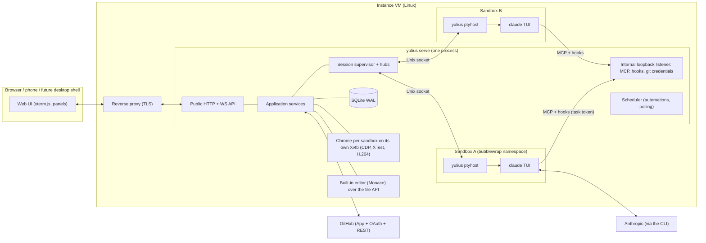

# SPEC-002: Yulius architecture and runtime contracts

Status: accepted (design; implementation authorized with SPEC-001)
Date: 2026-10-07
Owner: implementing agent; founders for product decisions
Scope authorization: user goal of 2026-10-07 (design robust architecture for concurrency,
isolation, cancellation, reconnect, process failure and recovery; implement in Rust).

This document holds engineering decisions. Unless a row cites SPEC-001, choices here are
implementation assumptions (class **A**) that serve SPEC-001 requirements; they are not user
requirements and may be revised with a recorded reason. Engineering invariants from
[runtime contracts](../../docs/engineering/runtime-contracts.md) (RUN, EVT, DATA, GIT, SEC) apply.

## 1. System overview



Principles:

1. **Agents are real CLIs in PTYs.** Yulius never re-implements an agent; it launches, observes
   and resumes native Claude Code sessions (SPEC-001 HRN-001, P(5); Codex deferred, F 2026-10-08).
2. **Sessions outlive the web server.** Each run is owned by a detached `ptyhost` process; the
   server reattaches after restart (NFR-001).
3. **GitHub is the authority** for repositories and permissions (ACC-007), with one exception:
   the superadmin owns the instance and has admin access to every sandbox without GitHub
   (ACC-012, F 2026-10-09).
4. **Harness-independent coordination** through one Yulius MCP server and the hook protocol both
   CLIs implement (COM-002, STP-001, DSC-003).
5. **Everything bounded and owned**: each queue, stream, retry and wait has a limit and an owner
   (§9).

## 2. Decision records

| ADR | Decision | Alternatives considered | Consequences |
| --- | --- | --- | --- |
| ADR-01 | One Rust binary `yulius` (axum/tokio) with subcommands `serve`, `ptyhost`, `hook`, `git-credential`, `import`, `login`, `backup`, `doctor`. Static web UI (vanilla ES modules + vendored xterm.js) embedded in the binary. | Leptos/Yew WASM UI; Node SPA build | One artifact to deploy; no Node toolchain for Yulius; UI is plain JS so a desktop shell can load it (OPS-002). JS UI lacks Rust type checking — mitigated by contracts-generated docs and UI checks. |
| ADR-02 | Detached `ptyhost` per run, Unix-socket protocol, vt100 screen state, exit record files. | tmux/dtach; in-server PTYs | Survives server restart (NFR-001); explicit ownership and identity; more code to test (fake agent suite). Requires the systemd unit to use `KillMode=process`. |
| ADR-03 | Linux containment per sandbox with bubblewrap (`--unshare-pid --die-with-parent`, private /tmp, only the sandbox directory writable, per-sandbox HOME). Host mode for development/tests, visibly flagged "not contained". | Docker per sandbox; gVisor; separate VMs | Cheap, fast, kills whole tree on SIGKILL of bwrap; no daemon. Network is shared (agents need it). Not a defense against kernel exploits — documented trust model §8. |
| ADR-04 | SQLite (rusqlite, bundled) in WAL mode, one write connection behind an async actor, versioned SQL migrations via `user_version`. | Postgres; sled; files | Single-VM product, simple backup (`VACUUM INTO`); write throughput ample for 2–5 users. |
| ADR-05 | Accounts are org secrets in Yulius; provider homes are per sandbox. Claude uses long-lived OAuth tokens from `claude setup-token` passed by environment. | One global home per account; copying credentials per task | Prevents cross-sandbox transcript leakage via shared homes; an account switch needs no file copy. (Codex homes with `auth.json` write-back were removed with Codex, F 2026-10-08.) |
| ADR-06 | Withdrawn (F 2026-10-08): no cross-provider switches. The provider-neutral transcript IR, the native transcript writers and the handoff fallback were removed; a task resumes its own session on another account. | Keep translation for a later second harness | Yulius runs Claude Code only; a returning harness gets its own decision. |
| ADR-07 | Yulius MCP (Streamable HTTP, JSON-RPC) on a loopback listener with per-run bearer tokens; hooks call the same listener through `yulius hook`. | Per-harness plugins; injecting text into the TUI only | One protocol for every harness; least privilege (task tokens reach only task-scoped tools). |
| ADR-08 | GitHub App (created by manifest flow) for installation tokens and user-to-server OAuth; permissions read per user per repository with a 5-minute cache. | OAuth App with `repo` scope; PATs | Narrow, revocable access; repository creation via installation (orgs) or the owner's user token (personal accounts). Requires a public callback URL. |
| ADR-09 | Superseded by ADR-15 (F 2026-10-10) for the user's view: the DOM mirror, its recorder, replayer and resource endpoint are removed; the per-sandbox Chromium, CDP for agents, the welcome page and the screencast (now the labelled JPEG fallback) remain. Earlier: narrowed by ADR-14 (F 2026-10-09): the mirror is now only the remote view of the sandbox Chrome's tabs (agents' tabs and hand-offs); the user's own browsing of the sandbox's apps is live (ADR-14). Per-sandbox headless Chromium; the user's view is a live DOM mirror: the rrweb recorder is injected through CDP into the page's main world (it must see the page's CSSOM patches) and reports to a CDP binding; the UI replays the events in rrweb's script-free iframe (sandbox `allow-same-origin` only — never `UNSAFE_replayCanvas`, which would let any page run script as Yulius through the binding) and paints sampled canvas frames itself; page resources the user's browser cannot reach are fetched by the server browser through a same-origin-only endpoint served with a `sandbox` CSP. The CDP screencast is the labelled fallback; input is dispatched with CDP `Input.*`; viewers learn viewport changes at once. Agents use Yulius browser tools and may attach CDP-capable MCPs to the same endpoint. New tabs open a welcome page served by the internal listener (BRW-006). | Pixel screencast only (original choice, rejected by F 2026-10-07); noVNC desktop; own DOM serializer; recorder in an isolated world (misses CSS-in-JS rules) | Crisp, selectable, phone-friendly view of the real browser (BRW-005); rrweb handles CSSOM/CSS-in-JS, inputs and iframes; plugins, internal pages and pages that send no DOM need the fallback. |
| ADR-10 | Built-in editor: Monaco (VS Code's editor component, vendored AMD build without its translations) in the web UI over a small file API (`/api/sandboxes/{sid}/files…`) on the sandbox repository or a task worktree; per-user view state stays in the browser. | openvscode-server per sandbox (original: needed a token cookie fix, ran outside containment, too heavy); per-user contained openvscode-server (built, then dropped by the founder: "much simpler, without 90% of the features"); CodeMirror (needs a bundler) | No editor process or prerequisite on the VM; 14 MB of static assets (the TypeScript worker is 7 MB, loaded only for JS/TS); no extensions, debugging or integrated terminal (shells cover that). |
| ADR-12 | Sandbox identity for user processes (shells): bubblewrap user namespace with `--uid 0 --gid 0`, generated `/etc/passwd`/`/etc/group` naming uid 0 after the user's login, the user's home `users/<user>/home` bound at `/home/<login>`, a `sudo` shim on `PATH`, hostname = sandbox slug. Agent runs keep the sandbox identity. | Real Unix accounts per user (needs a privileged helper); fake root via LD_PRELOAD | Separate users with root inside the sandbox without host privileges (UI-016); host system directories stay read-only (U-12). |
| ADR-13 | Superadmin recovery code: 6 random digits, Argon2id hash in `instance`, persistent failure counter; 3 failures clear the hash and set a permanent lock; regenerate requires a superadmin session plus the password. | No recovery (original ACC-002); email reset | Recovery possible without email (ACC-011); 3 tries bound guessing to 3·10⁻⁶; an attacker can deliberately lock recovery, which the founders accepted. |
| ADR-14 | Narrowed by ADR-15 (F 2026-10-10): the panel's live iframe tabs are removed; the preview origins and their proxy remain for one action, "Open live in a new window" on a sandbox dev server, and the no-recursion rules stay. Originally: the user browses the sandbox's apps **live in their own browser**: each (sandbox, port) has a preview origin `<port>-<key>.<yulius host>` that Yulius reverse-proxies to `127.0.0.1:<port>`, removing the iframe obstacles; the agents keep the sandbox's headless Chrome (ADR-09), whose tabs share the panel's strip and are watched remotely with the agent's cursor; Yulius never opens inside itself. Analysis and contract: §2.1. | Keep the mirror (A); pixel or video streaming (B); hybrids (D) | Native page behaviour on desktop and phone; needs wildcard DNS and TLS for the preview hosts (on-demand TLS); the app runs in the user's browser, so its absolute `localhost` URLs in page code do not reach the VM. |
| ADR-15 | The panel **streams the real sandbox Chrome**: a headful Chrome per sandbox on its own `Xvfb` (no TCP or abstract socket, a cookie outside the sandbox directories), shown as H.264 video (ffmpeg x11grab + libx264 `ultrafast`/`zerolatency`, FLV framing, GOP cache, keyframe-aware backpressure) over the viewer WebSocket and decoded with WebCodecs; the user's input is real (XTest through x11rb); CDP stays for agents. Analysis and contract: §2.2. | Fix the mirror (A); CDP screencast only (B); VNC/noVNC (C); WebRTC (D); in-process capture and encoder (E) | Scrolling and typing at video latency, captchas and cross-origin frames work because input is real and the browser is not headless; needs `xvfb` and `ffmpeg` with libx264 on the VM (else headless with JPEG frames); about one core per watched browser at 60 fps; the page is pixels (no text selection in the user's browser; copy goes through the clipboard). |
| ADR-11 | Delivery profiles in `yulius.toml` with presets `standard`, `product`, `studio`; merges/promotions are explicit user actions unless a profile enables auto-promotion. | Hard-coded dev/main | Fits Product and Studio without forcing their branches (K). |

### 2.1 ADR-14: the browser panel renders the sandbox's apps live (F 2026-10-09)

Status: accepted and implemented (issue #92). Narrows ADR-09.

**Problem.** "Even if we have this mirror thingy, it works terribly when we need to do
something real. It should be rendered fully on the user's side, and we can use the VM to get
around iframe problems. Deny recursion. We still need the cursor." The ADR-09 view is a
**replay**. The page runs in a Chrome on the server, and its DOM is recorded with rrweb and
rebuilt in a script-free iframe. Every key, click and wheel turn makes a round trip, and nothing
of the page runs in the user's browser: no native focus, scrolling inertia, IME, devtools or
canvas/WebGL. Apps with WebSockets, hot reload or heavy JavaScript degrade to pixels.

**Options compared.**

| | A: keep the mirror | B: pixel or video streaming (screencast, WebRTC, noVNC) | C: live page in the user's browser through a Yulius proxy on the VM | D: hybrids |
| --- | --- | --- | --- | --- |
| Fidelity and feel | DOM without scripts; input round-trips; canvases sampled; breaks on CSS-in-JS edge cases and shadow DOM | Exact pixels, but every interaction round-trips; text is an image (no selection or copy, no find); blurry on phones | The real page: native scrolling, selection, inputs, IME, devtools, WebGL, media | C for the user plus A/B for the agent's Chrome |
| Latency | One round trip per input | One round trip per input plus encoding | Local, like any site | Local for the user's tabs |
| Phone | Scaled replay, awkward input | Bandwidth-heavy, no native keyboard | Native | Native for the user's tabs |
| Server cost | Recorder in Chrome plus replay | Encoding per viewer | One proxy hop; no Chrome needed for the user | Chrome only for agents |
| Shared state with agents | Same Chrome (shared logins) | Same Chrome | Separate browser (the user's own cookies) | Hand-offs (AWS sign-in for an agent) stay in the agent's Chrome |
| Security surface | Hostile DOM replayed in Yulius's origin (mitigated: script-free iframe) | Small | A new origin per app; proxy must keep the Yulius session out of reach | C's plus A's |

Decision: **D, built on C**. The user's tabs are live iframes on preview origins (C). The agent
keeps the headless Chrome (ADR-09), and the user watches its tabs through the existing mirror
or pixels with the agent's cursor (A, now only for the agent's tabs). Agent hand-offs happen
there: an AWS sign-in the agent needs must live in the agent's Chrome.

**Real-world issues and how C handles them.**

- *X-Frame-Options and CSP `frame-ancestors`* (dev servers and frameworks send them):
  - the proxy removes `X-Frame-Options` and every `frame-ancestors` directive;
  - it then adds its own `Content-Security-Policy: frame-ancestors 'self' <Yulius origin>`;
  - only Yulius (and the app itself, for its own nested frames) can frame a preview.
- *Root-relative URLs* (`/assets/app.js`, `/api`): a path-prefix proxy (`/preview/20001/…`)
  would break them, as well as service workers, cookies with `Path=/` and client routers. So
  each app gets an **origin of its own**, `<port>-<key>.<host>`, and its paths are untouched.
- *Redirects and URLs that name `localhost:<port>`*:
  - the app is told it runs at `http://localhost:<port>` (`Host`, and `Origin`/`Referer` of its
    own previews rewritten), which satisfies Vite's and webpack's host checks and same-origin
    CSRF checks (SvelteKit, Next.js server actions, Django);
  - the response headers that carry URLs map `http(s)/ws(s)://<loopback>:<sandbox port>` back
    to the preview origins: `Location`, `Content-Location`, `Refresh`, `Link`,
    `Access-Control-Allow-Origin` and CSP sources.
  - Absolute `localhost` URLs inside page bodies or scripts are not rewritten (not done: body
    rewriting is fragile). Apps should use relative URLs or their dev server's proxy, as on any
    remote dev box.
- *Cookies in iframes*:
  - Preview origins are subdomains of the Yulius host, so they are **same-site** with Yulius.
    The iframe is therefore not a third-party context, and its cookies work under third-party
    cookie blocking (Safari ITP, Firefox TCP, Chrome).
  - `sslip.io` is **not** on the Public Suffix List (checked 2026-10-09), so the site is
    `sslip.io`. For the same reason a bare `localhost` does not work for local development
    (`*.localhost` hosts are sites of their own); use `yulius.localhost`.
  - The app's `Set-Cookie` loses `Domain` (it becomes host-only on the preview) and gains
    `Secure` over HTTPS.
- *WebSockets, HMR and streaming*:
  - upgrades are spliced through (bounded, re-checked every 60 s);
  - bodies stream both ways without buffering, so large uploads, server-sent events and
    streamed HTML work;
  - only HTML documents get one `<script>` tag appended (the bridge, below); they are requested
    without compression.
- *Service workers*: they are scoped to their preview origin, so they cannot touch Yulius.
  Paths under `/__yulius/` are reserved on every preview origin.
- *Auth*:
  1. A preview is opened through a **handshake**. A signed-in user with write access navigates
     to Yulius (`/api/previews/authorize`), which hands a single-use 60 s token to the preview
     origin (`/__yulius/handshake`).
  2. The token becomes a 12 h random **grant**, set as the `__Host-yulius_preview` cookie
     (host-only, `HttpOnly`, `Secure`, `SameSite=Lax`) on that preview origin only.
  3. Grants live in memory, at most 4096. Each request re-checks its grant against the user's
     Yulius session and write access at least every 30 s, so sign-out, disabling and lost
     access end it. After a restart, navigations pass through the handshake again.
  4. A navigation without a grant goes through the handshake by itself, so a new window and
     bookmarks work. If the browser drops the cookie, the landing step says so instead of
     looping.
  5. The grant cookie never reaches the app.
- *Phones*: native.

**Browser chrome (address bar, back, forward).** A cross-origin iframe hides its location and
history from the parent. The proxy therefore appends a small bridge script to proxied
documents. It posts the address, the title and `navigation.canGoBack/canGoForward` to the
Yulius origin only, and takes back, forward (Navigation API, so traversal stays inside the
frame) and reload, but only from the Yulius window that frames it. The panel shows addresses as
`localhost:<port>/…`. "Open in a new window" opens the preview origin top-level.

**Isolation between the preview origins and Yulius (security).** Every `*.sslip.io` host on the
internet, and every preview, is same-site with Yulius, so `SameSite` never protects anything
here:

- **Yulius's session cannot be used from a preview origin.**
  - The session cookie is `__Host-yulius_session` over HTTPS: host-only, so it never reaches a
    preview, and no sibling host can plant or shadow it ("cookie tossing").
  - A cookie-authenticated request that announces a foreign `Origin`, or that the browser marks
    `Sec-Fetch-Site: same-site/cross-site`, is refused unless it is a plain GET navigation.
  - WebSockets already required the Yulius origin.
  - Yulius's pages refuse every frame (`X-Frame-Options: DENY`, `frame-ancestors 'none'`).
- **A preview cannot be used from other sites.**
  - Credentialed requests and WebSockets must come from the preview itself or the same
    sandbox's other previews (`Origin`, fetch metadata).
  - Navigations from anywhere are allowed, and the grant decides.
  - The grant is per origin, so sandbox A's grant does not open sandbox B or another port.
- **Only the sandbox's own port range is reachable**, never Yulius's listeners or a sandbox
  browser's DevTools port. The upstream is always `127.0.0.1:<port>`.
- Tests: `crates/yulius/tests/preview.rs`; the live hostile page in `live_ui_browser.rs`.

**No recursion (BRW-008).**

- The proxy refuses Yulius's own ports. It also refuses any upstream that answers with this
  server's `X-Yulius` tag (a port forward to Yulius).
- The sandbox Chrome refuses Yulius's public host, its subdomains and every loopback form of
  its listeners:
  - before navigating (tools, viewers), with a typed refusal;
  - for page-initiated loads (links, redirects, frames, scripts), through a browser-wide CDP
    `Fetch` interception that fails them as blocked. The welcome page is the one allowed prefix.
  - A browser whose guard cannot be enabled is not used.
- The welcome page and the previews API never list Yulius's ports.
- The UI refuses to render in any frame: `boot.js` notes `window.top !== window.self`, and the
  app shows only a notice.

**Agents and the cursor.**

- Agents keep the headless Chrome and the MCP tools.
- Its tabs appear in the same strip, marked as the sandbox Chrome's. Each viewer watches the
  tab it chose (`watch`, nothing while on a live tab), with the labelled cursor (BRW-007).
- When an agent acts on the app shown in the user's live tab (same port), a notice over that
  tab says so and offers "Watch".
- "Open live" opens an agent tab's address live.
- **Cookies are not shared** between the user's live view and the agent's Chrome, so each has
  its own session, like two browsers. Sharing would mix users' and agents' identities across
  every member of the sandbox. A hand-off the agent needs happens in the agent's tab.

**Operations.**

- Wildcard DNS for `*.<host>`: `sslip.io` resolves any subdomain to the IP it encodes.
- TLS for the preview hosts:
  - Caddy: on-demand TLS whose `ask` endpoint is `GET /internal/preview-tls?domain=` on the
    loopback internal listener (200 only for preview hosts of existing sandbox ports);
  - nginx: a wildcard certificate (DNS challenge) instead.
- `YULIUS_PREVIEW_DOMAIN` (default: the public host; `off` disables previews).
- Without DNS or TLS, the panel's reachability check says so and offers the sandbox Chrome
  (docs/operations.md §4).

**Code.**

- `yulius-app::preview`: preview hosts, keys, the handshake, grants and the port policy.
- `yulius-server::preview`: the proxy itself, in the interface layer like the former editor
  proxy (HTTP to HTTP, no domain logic), plus `routes/previews.rs`.
- `yulius-browser::UrlDenyList`: the sandbox Chrome's guard.
- `web/assets/browser.js` (panel, live tabs) and `browserremote.js` (the sandbox Chrome view).

**Consequences and limits.**

- Absolute `localhost` URLs in page code do not reach the VM.
- Sites outside the sandbox's ports open in the sandbox Chrome (proxying arbitrary sites would
  be an open proxy, and their absolute URLs escape it).
- Third-party sign-in pages (Google, GitHub) refuse frames and must be opened in a new window.
- The sandbox Chrome tabs have no back or forward in the panel.
- `sslip.io` is shared by its whole user base: its Let's Encrypt limits are shared, and its
  hosts are all same-site. A production domain of one's own is better.
- Certificate Transparency logs publish each preview host name, which carries an opaque key,
  not the sandbox's name.

### 2.2 ADR-15: the browser panel streams the real sandbox Chrome (F 2026-10-10)

Status: accepted and implemented (issue #107). Supersedes ADR-09's user view and narrows ADR-14.

**Problem.** "The browser is slow as fuck on scrolling or typing, and clicking on a captcha does
not work. The current approach seems wrong… the bugs seem to be in the foundations." On
production (`main` dfe22eb) Michał used the sandbox's own Chrome: no preview certificate was ever
requested, so #105's live iframes never ran, and the panel showed the rrweb mirror.

- *Slow by construction.* Every wheel turn or key went viewer → WebSocket → CDP
  `Input.dispatch*` → page → recorder (batched every 40 ms, scroll sampled every 100 ms) → JSON →
  a DOM rebuilt in the user's browser. Large pages produced large batches.
- *Captchas cannot work.* The Chrome ran `--headless=new` with `navigator.webdriver === true`,
  which reCAPTCHA, Turnstile and hCaptcha read; their widgets are cross-origin iframes that the
  mirror neither records nor clicks.
- *The real need is the agent's browser.* The agent asks for help with a captcha or a sign-in
  (`browser_request_user_action`), then the user watches it work: the user must drive **the same
  Chrome the agent uses**, at full fidelity. ADR-14's live tabs are the user's own browser and
  cannot help there.

**Options compared.**

| | A: fix the mirror (headful + rrweb) | B: CDP screencast (JPEG) + CDP input | C: VNC / noVNC | D: WebRTC | E: H.264 over the viewer WebSocket + XTest (chosen) |
| --- | --- | --- | --- | --- | --- |
| Captchas, cross-origin frames | No: frames not recorded, synthetic clicks | Input is CDP-synthesized (headful helps); one frame per ack round trip | Yes (real input) | Yes | Yes: real X input, headful, no automation flag |
| Scrolling | Replay of mutations | ~10–25 fps, ack-paced | Tile updates, high bandwidth while scrolling | 60 fps | 60 fps, measured below |
| Network | WS (443) | WS (443) | WS (443) via websockify | UDP or TURN on 443 (the firewall allows only 22/80/443) | WS (443) |
| Server cost | Recorder per page | JPEG per frame in Chrome | Damage-based, cheap idle | Encoder per stream | One encoder per watched display (~1 core at 60 fps, 0 when nobody watches) |
| Client | Same-origin replay iframe | `createImageBitmap` | noVNC canvas | `<video>` | WebCodecs `VideoDecoder` (Chrome, Edge, Safari 16.4+, Firefox 130+); JPEG fallback |
| New code / prerequisites | — | Small | A VNC server + websockify | A WebRTC stack or a TURN server | `xvfb`, `ffmpeg` (libx264); x11rb (pure Rust) |

Remote-browser products (Browserbase and Hyperbeam live views, neko, Kasm) use C, D or E.
**Decision: E.** It keeps the existing WebSocket, its authorization and its Origin check, and
needs no UDP. B remains as the labelled fallback for viewers without WebCodecs and for hosts
without Xvfb or ffmpeg.

**Display (`yulius-browser::display`, `xserver`).**

- One `Xvfb :<n>` per running sandbox browser, started and reaped by Yulius as the service user:
  `-nolisten tcp -nolisten local` (only the filesystem socket `/tmp/.X11-unix/X<n>`; an abstract
  socket would be reachable from containment, which shares the network namespace), `-auth` with a
  random 16-byte MIT-MAGIC-COOKIE-1 written by Yulius (no `xauth` needed) to
  `<data>/displays/<sandbox>/Xauthority` (0600, directory 0700). That directory is outside every
  sandbox directory: containment binds `<data>/sandboxes/<id>` writable, so a cookie in the
  profile directory would be readable by agents. Numbers start at `YULIUS_BROWSER_DISPLAY_BASE`
  (100) and skip numbers whose socket or lock exists; Xvfb refusing a number moves to the next.
  The framebuffer is the maximum size; RandR sets the screen to the viewport, so pages and
  Chrome's menus see the viewport as the screen.
- Chrome runs headful on it: `--kiosk --window-position=0,0 --window-size=W,H` (no browser UI;
  the panel draws tabs and the address bar from CDP), `--disable-blink-features=AutomationControlled`
  (remote debugging alone makes `navigator.webdriver` true in Chrome 155), no
  `--enable-automation`, the normal user agent, `--force-device-scale-factor` when the scale is
  not 1. There is no window manager; one X thread per display plays its small part: every
  top-level window that maps (the browser, a popup, an OAuth window, a dialog) is moved to 0,0 at
  the viewport size and gets the keyboard focus, a press focuses the window under the pointer, a
  closed window hands the focus to the topmost remaining one; menus (override-redirect) are left
  alone. Resizing goes through X (`ConfigureWindow`), not `Browser.setWindowBounds`, because
  leaving kiosk's fullscreen state brings Chrome's UI back.
- One display shows one tab at a time: the active tab. Choosing a tab (`watch`) brings it to the
  front for every viewer, as in one shared browser window; a page that opens a page (a link to a
  new tab, `window.open`) comes to the front, and closing the shown tab brings the next one. An
  agent opening a tab brings it to the front too. Agents' tools need no front tab (headful
  screenshots of background tabs work).

**Video (`video`, `encoder`, `flv`).**

- While at least one viewer watches, `ffmpeg -f x11grab -draw_mouse 0 -framerate 60 -video_size
  WxH -i :n.0+0,0 -vf format=bgr24,format=yuv420p -c:v libx264 -preset ultrafast -tune
  zerolatency -bf 0 -g 120 -threads 2 -flush_packets 1 -f flv pipe:1` encodes the viewport
  region. The `bgr24` step takes swscale's fast RGB path: measured on the VM it halves the
  conversion cost (1280×800 at 60 fps, idle: 80 % of a core instead of 97–111 %).
- **FLV instead of Annex-B parsing (a change from the brief's recommendation).** An Annex-B
  access unit only ends when the next one starts, one frame interval (16.7 ms at 60 fps) later.
  FLV frames each access unit with its size, so the server forwards a frame the moment its last
  byte arrives; the payload is already AVC (length-prefixed NAL units) with the `avcC` record as
  WebCodecs' `description`. The parser is bounded (8 MiB per tag) and unit-tested for every split
  of a stream.
- `VideoHub` per display: GOP cache (the last keyframe and the frames after it, at most 240
  frames and 6 MiB) for instant start; a bounded queue per subscriber (256), and a subscriber that
  falls behind misses frames until the next keyframe; the encoder starts on the first subscriber,
  stops 5 s after the last one leaves, restarts at the new size when the viewport changes and gives
  up after three failed starts (viewers then get JPEG frames with the reason). The process is
  always terminated and reaped (SIGTERM, SIGKILL after 2 s, reap).
- Per viewer connection (`yulius-server::routes::browser`): a media queue bounded to 300 frames
  and 8 MiB; a live viewer more than 30 frames (0.5 s) behind skips to the next keyframe, and a
  keyframe flushes what it supersedes, so latency stays bounded and a slow viewer never slows the
  encoder or other viewers.
- Wire: `{"type":"stream","mode":"video"|"pixels","reason"?}`, `{"type":"video_config",
  "codec","description","width","height"}` (sent in the media queue, so it is ordered with the
  frames) and binary frames `u8 4, u8 flags (keyframe), u64 µs, access unit`. JPEG frames keep
  `u8 3 + tab id`.

**Client (`browserstream.js`).** WebCodecs `VideoDecoder` (`optimizeForLatency`), each frame
drawn on a canvas as it is decoded; a decoder queue beyond 6 frames skips to the next keyframe; a
`NotSupportedError` or a browser without WebCodecs asks for JPEG frames, labelled "JPEG mode".
The user's own cursor is the local CSS cursor (the video has none). The canvas shows the shared
viewport scaled to the panel; when another viewer's panel sized it, a notice offers "Fit my
panel". With scale 2 (`YULIUS_BROWSER_SCALE`) a HiDPI screen shows one video pixel per device
pixel (crisp text) at about three times the encoding cost; the default is 1.

**Input.**

- Moves, presses, releases and keys are XTest events on the display (x11rb, pure Rust, one
  connection per display; no process per event), bounded by a 512-command queue. Printable ASCII
  is mapped by character to its US-layout keycode, pressing or lifting Shift around it as the
  character needs (any user layout types the right character; with Ctrl, Alt or Meta down the
  user's Shift is kept, so Ctrl+Shift+Z stays itself); other keys by `KeyboardEvent.code`
  (evdev keycodes); characters no US key types (Polish letters, emoji, dead-key and IME results)
  and short typed text (up to 64 characters) are real key presses too: the X thread types a
  US-layout character with its own key and maps any other character's Unicode keysym onto one of
  the keymap's spare keycodes (reused least recently first, never while the browser may still
  look the old one up) and presses it. **A change from
  the brief**, which suggested CDP `Input.insertText` for these: measured on the VM, text inserted
  through CDP overtook key presses still queued in the X server ("Hello ą!" arrived as
  "Helląo !"); keysyms keep everything on one ordered path and give pages real key events. Only
  longer text (a paste) uses `Input.insertText`, after the display's queue has drained (an X
  round trip and 50 ms). Lock keys and AltGraph are not forwarded.
- The wheel and trackpad use CDP `mouseWheel` with pixel deltas on the shown tab (X wheel buttons
  are 3-line steps), coalesced per animation frame in the client.
- macOS: ⌘C/⌘V/⌘X/⌘A/⌘Z and other editing shortcuts are sent as Ctrl; ⌘ arrows as Home/End.
  Paste sends the user's clipboard as text; copy (⌘C/Ctrl+C/X) also asks the server for the
  selection (`copy` → `clipboard`), which goes to the user's clipboard (a pending
  `ClipboardItem` claimed in the key's own event where Safari needs it).
- Touch: a tap clicks, a drag scrolls; a Keyboard button opens the phone's keyboard.
- Back, forward and reload go through CDP (`history`, `reload`).
- Only write users reach the socket (unchanged); each connection may send 500 input events per
  second (burst 1000): moves and wheel beyond are dropped, other input is refused with an error.
  Every key and button a viewer held is released when it leaves.

**Security (each tested in `live_display.rs` on Linux).**

- Contained agents and users' contained shells reach no display: their `/tmp` is private (no X
  socket), there is no abstract socket and no TCP listener, and the cookie lives outside the
  directories containment binds. Inside bubblewrap `xdpyinfo -display :n` fails for every
  display.
- Each sandbox has its own display, cookie, profile and encoder; one sandbox's cookie does not
  open another's display.
- The video and input use the viewer WebSocket's authorization (write access, re-checked every
  60 s) and Origin check, unchanged.
- Unchanged and still open (R-07): the DevTools port is unauthenticated on loopback, which other
  sandboxes share.

**Recursion (BRW-008) unchanged:** the sandbox Chrome refuses Yulius's addresses (navigation
refusal and browser-wide `Fetch` interception), the welcome page skips Yulius's ports, the UI
refuses to be framed, and the preview proxy refuses Yulius's ports.

**Configuration.** `YULIUS_BROWSER_DISPLAY=auto|xvfb|headless` (auto: a display on Linux when
Xvfb and ffmpeg resolve), `YULIUS_XVFB`, `YULIUS_FFMPEG`, `YULIUS_BROWSER_FPS` (5–60, default 60),
`YULIUS_BROWSER_MAX_SIZE` (default 1920x1200 CSS pixels), `YULIUS_BROWSER_SCALE` (1–3, default 1),
`YULIUS_BROWSER_DISPLAY_BASE` (default 100). `yulius doctor` checks Xvfb, ffmpeg, libx264 and
x11grab.

**ADR-14 and the mirror.** The rrweb recorder, replayer and the resource endpoint
(`GET /api/sandboxes/{sid}/browser/resource`) are removed. The panel's live iframe tabs are
removed: the panel is the sandbox Chrome for every tab. The preview origins stay for one optional
action, "Open live in a new window", on a tab showing a sandbox dev server (when the server has
preview DNS and TLS): a developer can then use the app with their own browser's devtools. The
no-recursion and session-isolation rules of ADR-14 stay.

**Measured on the VM** (12 vCPU AMD EPYC 2.0 GHz under its production load, Chrome 155,
ffmpeg 6.1.1; `live_display.rs` `measures_fps_latency_cpu_and_bandwidth`, 60 fps, the test viewer
on the VM's loopback; ranges over the runs of the final design):

| | 1280×800 | 1920×1080 |
|---|---|---|
| Video fps while scrolling, p50 / p5 | 59–60 / 43–47 | 56 / 42–45 |
| Encoder CPU (x11grab + x264), scrolling / static page | 93–105% / 68–78% of a core | 145–149% / 129–146% |
| Bandwidth, scrolling / static page | 1.5–1.7 / 0.22 Mbit/s | 2.1–2.2 / 0.21–0.33 Mbit/s |

Server-side input to frame (a key over the viewer socket → XTest → Chrome repaints the whole page
→ x11grab → x264 → the socket): p50 77–80 ms, p95 119–122 ms; a typed character to the frame
showing it: p50 60–66 ms, p95 82–99 ms. An earlier build under heavier load showed p95 spikes of
204–241 ms and a p5 of 35 fps. At 30 fps the encoder takes 57–99% of a core. Not measured: the
DOM mirror (its cost was in the user's browser and per replayed mutation, not comparable on the
server), the network to a real user.

**Consequences and limits.**

- The page is pixels: text is selected in the remote page and copied through `copy`; find in page
  is Chrome's own (Ctrl+F).
- About one core per watched browser at 60 fps at 1280×800 (encoder), three quarters of one even
  on a static page (x11grab captures every frame), nothing when nobody watches; about 2 Mbit/s
  while scrolling. Open: capturing only on X damage.
- Without `xvfb`/`ffmpeg` (macOS development, CI) the browser runs headless with JPEG frames and
  CDP input, as before.
- No window manager: windows are fitted, not decorated; a page cannot move its popup.
- One shown tab per sandbox: viewers looking at different tabs bring each other's tab forward.
- The remote cursor's shape (pointer, text) is not mirrored; the user's own cursor is shown.

## 3. Code organization

Layers follow [dependency boundaries](../../docs/engineering/architecture.md).

| Crate | Layer | Responsibility |
| --- | --- | --- |
| `crates/yulius-domain` | domain | IDs, task/attempt/switch state machines, permission mapping, rotation policy, spec/format validator, cron evaluation, delivery profile model, briefing assembly. Only `thiserror`. |
| `crates/yulius-contracts` | contracts | Versioned DTOs: HTTP API, UI event stream, terminal WS frames, ptyhost wire protocol, MCP tool schemas, hook payloads, import manifest. |
| `crates/yulius-app` | application | Use cases and ports: `Store`, `GitHubPort`, `GitPort`, `SessionHostPort`, `HarnessPort`, `BrowserPort`, `EditorPort`, `Clock`, `Ids`, `SecretBox`, event bus. Authorization decisions. |
| `crates/yulius-store` | adapter | SQLite schema, migrations, repositories, backup. |
| `crates/yulius-ptyhost` | adapter | ptyhost process (PTY, containment, vt100, socket server) and client. |
| `crates/yulius-harness` | adapter | Claude Code launch specs, home layout, hook/MCP config rendering, transcript tailers and wire parsers, usage extraction, login flows. |
| `crates/yulius-github` | adapter | GitHub REST, App JWT, OAuth, installation tokens. |
| `crates/yulius-git` | adapter | Git CLI wrapper: clone/fetch, worktrees, branches, bundles, diff stats, hooks install. |
| `crates/yulius-browser` | adapter | Chromium lifecycle, CDP client, virtual displays (Xvfb, XTest, RandR), the H.264 encoder and video hub, screencast fallback, browser tools. |
| `crates/yulius-server` | interface | axum routes, auth middleware, WS endpoints, MCP and hook endpoints, embedded web UI (`web/`). |
| `crates/yulius-cli` | interface | `import`, `login`, admin client commands (HTTP client, argument parsing). |
| `crates/yulius` | composition | Configuration, wiring, subcommand dispatch, signal handling. |
| `tools/fake-agent` | tooling | Deterministic fake harness for failure tests (prints TUI-like output, writes fake transcripts, floods, ignores SIGTERM, forks descendants, simulates limits). |

## 4. Data directory and files

`$YULIUS_DATA` (default `/var/lib/yulius`), owner-only (0700):

```text
yulius.db, yulius.db-wal            SQLite (DATA-001)
master.key                          32 random bytes, 0600; encrypts secrets (XChaCha20-Poly1305)
setup.token                         one-time setup token until superadmin exists
sandboxes/<sandbox>/repo/           primary clone; tracks the integration branch; tasks never edit it
sandboxes/<sandbox>/worktrees/<task>/   one worktree + branch per task
sandboxes/<sandbox>/home/           sandbox HOME inside containment (caches, .claude config dir)
sandboxes/<sandbox>/browser/        Chromium profile
users/<user>/home/                  user's home in their shells (bound at /home/<login>; ADR-12)
users/<user>/identity/              generated passwd/group files of the user's sandbox identity
runtime/bin/                        generated helper commands bound read-only into user processes (sudo shim)
sandboxes/<sandbox>/imports/<job>/  uploaded bundles, snapshots, session files
runs/<attempt>/                     ptyhost: launch.json, pty.sock, status.json, exit.json, config files
shells/<shell>/                     ptyhost run directories of sandbox shells (UI-015); shell.json (owner,
                                    sandbox, folder, name, sealed host token) to adopt them after a restart
logins/<login>/                     temporary provider login (config dir + run dir); zero-filled and removed after the login
exports/sandbox-<slug>-<ms>.json    task export written when a sandbox is removed (PRJ-009), 0600
transcripts/<task>/                 archived/imported provider transcripts (immutable copies)
skills/open-mercato/                instance skill catalog extracted from the binary (vendored Open Mercato pack)
```

Unix socket paths are limited (104 bytes on macOS, 108 on Linux): `serve` refuses a data directory
whose longest socket path (`<data>/logins/<uuid>/pty.sock`) would exceed 103 bytes. A ptyhost shuts
its run down (normal escalation) when its run directory is removed or replaced or its socket
disappears on two consecutive 2 s checks, so a deleted run directory never leaves an unmanaged agent.

Atomic file writes: write to `*.tmp` in the same directory, `fsync`, rename, `fsync` the directory.

## 5. Persistence model

Schema version 1 (tables; columns abbreviated):

| Table | Key columns |
| --- | --- |
| `users` | id, github_login (unique), github_id, display_name, is_superadmin, is_instance_admin, disabled_at, password_hash (superadmin only, Argon2id) |
| `web_sessions` | id_hash, user_id, csrf_token, created_at, expires_at, revoked_at |
| `api_tokens` | id, user_id, token_hash, label, created_at, last_used_at, revoked_at |
| `device_grants` | user_code, device_code_hash, status, user_id, expires_at |
| `instance` | singleton: owner_login, owner_kind (org/user), public_url, github_app (encrypted blob), setup_completed_at |
| `github_tokens` | user_id, access (enc), refresh (enc), expires_at |
| `permission_cache` | user_id, sandbox_id, level (none/read/write/admin), checked_at |
| `sandboxes` | id, slug, repo_owner, repo_name, github_repo_id, default_branch, profile (json), port_base, created_by, onboarding_state, removed_at |
| `tasks` | id, sandbox_id, number (per sandbox), title, harness, workflow_id, status, activity, branch, worktree_path, spec_path, created_by, created_at, closed_at, archived_at, origin (ui/automation/import/onboarding), automation_run_id |
| `attempts` | id, task_id, seq, harness, account_id, provider_session_id, launch_kind (new/resume), state, ptyhost_pid, child_pid, started_at, ended_at, exit_code, exit_reason; partial unique index: one attempt per task in (spawning, live) |
| `provider_sessions` | id, task_id, harness, session_id, transcript_ref, first_seen, last_seen, origin |
| `accounts` | id, provider, label, credential (enc), priority, enabled, status, last_usage (json), last_error |
| `usage_samples` | account_id, at, window, used_percent, resets_at, source |
| `switch_decisions` | id, task_id, at, reason, inputs (json), outcome |
| `steps` | id, task_id, ordinal, title, status, note, updated_by, updated_at |
| `step_events` | step_id, at, actor, from_status, to_status, note |
| `messages` | id, sandbox_id, from_task, to_task (null = broadcast), kind, subject, body, created_at |
| `message_receipts` | message_id, task_id, delivered_at, read_at |
| `scope_claims` | id, task_id, pattern, note, created_at, released_at |
| `workflows` | id, sandbox_id (null = instance), name, description, steps (json), instructions, gates (json) |
| `automations` | id, sandbox_id, name, cron, timezone, prompt, workflow_id, harness, enabled, created_by, created_via (ui/agent) |
| `automation_runs` | automation_id, scheduled_for (unique pair), state, task_id, error |
| `skills` | id, scope (instance/sandbox/repo), name, source, enabled, digest |
| `mcp_servers` | id, scope, sandbox_id, name, transport, command/url, args (json), env (enc json), headers (enc json), enabled |
| `metrics` | attempt_id, input_tokens, output_tokens, cache_read, cache_write, model, turns, tool_calls, active_ms (nullable = unknown) |
| `feedback` | task_id, user_id, verdict, comment, at |
| `import_jobs` | id, sandbox_id, user_id, state, manifest (json), received (json), created_at |
| `audit_log` | id, at, actor, action, target, detail |

Versioning: each migration is one transaction; startup refuses a database from a newer schema.
Backup: `VACUUM INTO` plus copy of files excluding `runs/`.

## 6. State machines

For every nonterminal state: owner, exit trigger, timeout and behavior if the trigger never comes.

### 6.1 Task

| State | Owner | Exit trigger | Timeout / missing trigger |
| --- | --- | --- | --- |
| `queued` | scheduler | capacity available → `starting`; cancel → `stopped` | Queue bound 32; position shown; no timeout. |
| `starting` | supervisor | ptyhost Welcome + child running → `running`; spawn error → `failed` | 30 s → kill ptyhost tree, `failed(start_timeout)`. |
| `running` | supervisor | child exit 0/normal → `closed`; abnormal exit → `stopped(crashed)`; cancel → `stopping`; switch decision → `switching`; limit with no capacity → `waiting_capacity` | Liveness ping every 10 s; 3 missed pings + no process → `stopped(lost)`. |
| `switching` | rotation controller | new attempt `live` → `running`; failure → `stopped(switch_failed)` with retry offered | 120 s total; on expiry the old process is confirmed dead and the task becomes `stopped(switch_timeout)`. |
| `waiting_capacity` | rotation controller | an account becomes available (reset time passes or admin adds/enables) → `switching`; cancel → `stopped` | Re-evaluated at earliest reset and every 5 min. |
| `stopping` | supervisor | child and descendants reaped → `stopped(cancelled)` | Interrupt → 5 s → SIGTERM → 5 s → SIGKILL (bwrap: namespace dies) → 10 s; if still not reaped: `stopped(lost)` + audit alert; capacity released only after reaping or `lost`. |
| `closed`, `stopped`, `failed` | — (terminal for the run) | Continue → `starting` (new attempt, resume) | — |

`activity` (when `running`): `working` (UserPromptSubmit / output after input), `waiting` (Stop hook /
turn complete), `needs_attention` (permission request hook, browser action request, discipline gate
exhausted, waiting for capacity). `archived_at` is allowed only in non-live states.

### 6.2 Attempt (one process run)

`spawning → live → exited(code|signal) | killed | lost`. Exactly one terminal outcome is
persisted (compare-and-set on `state`). A process exit racing a cancel records the first durable
observation; the other is ignored (RUN-002).

### 6.3 Switch (account)

1. Decide (domain policy, inputs persisted in `switch_decisions`).
2. Quiesce: proactive → wait for turn end (Stop hook) up to 10 min; reactive → turn already ended.
3. Stop old attempt (as `stopping`, but final state `exited(switched)`).
4. Prepare target: nothing to copy (the sandbox home is shared); a task never changes harness.
5. Launch new attempt with native resume and a continuation prompt when the last turn failed.
6. Bridge viewers to the new attempt; write a one-line notice into the terminal stream.

Idempotency: a task has at most one in-flight switch (row lock via task status CAS).

### 6.4 Automation run

`scheduled (unique automation_id+scheduled_for) → task_created | skipped(previous_active|disabled)
| failed(error)`. Owner: scheduler. The run row is inserted before the task is created; restart
finds rows without a task and either links the task created with `automation_run_id` or creates it
once (DATA-002). Catch-up after downtime: at most one missed run per automation, if missed by less
than one interval.

### 6.5 Import job

`created → receiving → received → applying → completed | failed`. Chunks are idempotent by
(job, file, offset, sha256). `applying` creates sandbox (if needed), local import branches,
snapshot worktree and archived tasks inside one store transaction per session; reapplying skips
sessions already recorded (`provider_sessions` unique on harness+session_id+sandbox).

### 6.6 Sandbox onboarding

`not_needed | pending → preparing (task id) → ready | skipped(by admin)`. New tasks in an imported
sandbox are rejected with an explanatory error while `pending/preparing`, unless skipped (U-08).

### 6.7 Delivery (per task)

`none → pr_open (#n) → merged_integration → env_<name>_done … → promoted → env_production_done`.
Each transition is a user action (or profile auto-promotion) verified against GitHub state; stale
heads are refused (GIT-002).

## 7. Runtime contracts

### 7.1 ptyhost protocol (`yulius-contracts::ptyhost`, version 1)

Frame: `u32 big-endian length` + `u8 type` + payload. Max frame 1 MiB; output frames ≤ 64 KiB.

| Direction | Type | Payload |
| --- | --- | --- |
| C→H | `Hello` | protocol version, token (32 bytes), want_snapshot |
| C→H | `Input` | bytes (≤ 64 KiB) |
| C→H | `Resize` | cols, rows (1..=1000) |
| C→H | `Signal` | interrupt / terminate / kill |
| C→H | `Shutdown` | grace milliseconds |
| C→H | `Ping` | nonce |
| H→C | `Welcome` | attempt id, child pid, current seq, cols, rows |
| H→C | `Snapshot` | seq, formatted screen bytes |
| H→C | `Output` | seq (monotonic per attempt), bytes |
| H→C | `Exit` | exit code or signal, ended_at |
| H→C | `Pong` | nonce |
| H→C | `Error` | code, message |

Rules: the host authenticates the first frame within 5 s or drops the connection; one controlling
client (the server) at a time — a new authenticated connection replaces the old one; the PTY reader
never blocks on clients (bounded 8 MiB client queue; overflow drops the client, which reconnects
and receives a fresh snapshot). `status.json` = {version, attempt, ptyhost_pid, child_pid,
started_at, boot_id, token_sha256}; `exit.json` written atomically before the `Exit` frame.

Launch: the server writes `launch.json` (argv, cwd, non-secret env, containment, size) and spawns
`yulius ptyhost --run-dir <dir>` in its own process group with secret variables only in the
spawned environment (never on disk or argv). The host creates the PTY, spawns the child (session
leader) — inside `bwrap` when contained — and serves the socket.

Cancellation: `Signal(interrupt)` writes the harness' interrupt sequence; `terminate`/`kill` signal
the child's process group; contained runs kill `bwrap`, which tears down the PID namespace. The host
reaps the child before writing `exit.json`.

Restart reconciliation (server start): for each attempt in `spawning|live`: connect + Hello
(2 s). Success with matching token → reattach. Else if `exit.json` exists → record exit. Else if
`status.json` pid is alive with matching start time and boot id but socket unusable → kill it,
record `lost`. Else record `lost`. Never respawn automatically (DATA-002); the task becomes
`stopped(server_lost)` and is continuable.

### 7.2 Harness adapters

Common launch environment: `YULIUS_URL` (internal listener), `YULIUS_TASK_TOKEN`, `HOME` (sandbox
home), `TERM=xterm-256color`, `COLORTERM=truecolor`, git author identity of the acting user,
`GIT_CONFIG_*` credential helper `yulius git-credential`, `YULIUS_PORT_BASE`/`YULIUS_PORT_COUNT`
(per-sandbox range of 20 ports from 20000 upward, persisted on the sandbox row; SPEC-001 PRJ-010)
and `PORT` (first port of the range). Provider secrets are environment-only.

Sandbox shell sessions (SPEC-001 UI-015, UI-016) reuse the same ptyhost machinery with the user's
login shell in the contained sandbox; they are not tasks, have no harness hooks or MCP token, are
limited to 8 live shells per user and sandbox, require current write access to list or attach, and
are private to their owner and sandbox. Like agent sessions they outlive the server: shutdown only
detaches them, and the next start adopts each run directory whose `shell.json` names an existing
sandbox and whose host accepts the token (sealed with the master key); every other run directory is
ended and removed before serving. They end when their process exits, when the owner closes them
(Ctrl-C, SIGTERM, SIGKILL; the host is terminated if it outlives the wait), or after 24 h without
viewers (F 2026-10-09).

Launch preparation verified against the real CLIs (2026-10-07): with an isolated
`CLAUDE_CONFIG_DIR`, Claude Code 2.1.292 opens a theme picker and, for every new working directory,
a folder-trust prompt whose default answer is "No, exit". Before each launch Yulius merges
`hasCompletedOnboarding`, `theme`, `projects[<worktree realpath>].hasTrustDialogAccepted` (and
`bypassPermissionsModeAccepted` for contained runs) into `<CLAUDE_CONFIG_DIR>/.claude.json`, keeping
Claude's own keys. Enabled skills are copied into `<CLAUDE_CONFIG_DIR>/skills` at each launch.

| Concern | Claude Code (verified 2.1.292 flags) |
| --- | --- |
| New session | `claude --session-id <uuid> --settings <run>/claude-settings.json --mcp-config <run>/mcp.json [--model m] [--effort e] [--dangerously-skip-permissions when contained] "<prompt>"` |
| Resume | `claude --resume <uuid> … ["<continuation>"]` |
| Credentials | `CLAUDE_CODE_OAUTH_TOKEN` (from `claude setup-token`); `CLAUDE_CONFIG_DIR=<sandbox>/home/.claude` |
| Updates | `DISABLE_AUTOUPDATER=1` in every session and sign-in terminal: the operator updates the CLI on the host (docs/operations.md); a contained session could only fail to update itself (#45) |
| Transcript | `<config>/projects/<cwd-slug>/<session>.jsonl` |
| Usage | `message.usage` per assistant message (dedupe by message id + request id); limit errors from synthetic API error messages |
| Hooks | `--settings` JSON `hooks` for SessionStart, UserPromptSubmit, Stop, Notification |
| Skills | `<config>/skills/<name>/SKILL.md` + repository `.claude/skills` |
| Login (account add) | `claude setup-token` in a server-owned PTY; token captured from output and masked before display |
| Session-id drift | new `.jsonl` for the same worktree slug → adopt into lineage (HRN-004) |

Transcript tailing: poll size every 1 s; parse only complete lines; max line 4 MiB (longer lines
skipped with a diagnostic); unknown record types ignored; malformed lines counted, never fatal.

### 7.3 Translation (withdrawn)

Removed with Codex (F 2026-10-08, ADR-06): a task never changes harness, so no transcript is
translated. A switch resumes the task's own Claude session on another account.

### 7.4 Yulius MCP (internal listener `/mcp`, Streamable HTTP, JSON-RPC 2.0)

Authentication: `Authorization: Bearer <task token>`; token → (task, attempt). Protocol versions
accepted: 2025-06-18, 2025-03-26. Body ≤ 1 MiB; tool results ≤ 256 KiB.

| Tool | Purpose (requirements) |
| --- | --- |
| `project_context` | Project summary, architecture/decision index, recent changes, delivery rules (COM-004, DSC-009) |
| `tasks_list`, `task_get` | Previous and parallel tasks: status, harness, branch, spec, steps, summary (COM-001) |
| `message_send`, `messages_inbox` | Harness-independent messages, direct or broadcast (COM-002) |
| `scope_claim`, `scope_release`, `scopes_list` | Advisory path-glob claims with conflict report (COM-003) |
| `steps_set`, `step_update`, `steps_get` | Step manager (STP-001/002) |
| `spec_check` | Run the format validator on the task spec and docs (DSC-003) |
| `automation_create`, `automations_list`, `automation_update` | Prompt-created automations (AUT-002) |
| `workflows_list` | Workflows available (AUT-004) |
| `browser_tabs`, `browser_open`, `browser_navigate`, `browser_click`, `browser_type`, `browser_snapshot`, `browser_screenshot`, `browser_request_user_action` | Shared sandbox browser control and user hand-off (BRW-003/004) |
| `delivery_status` | Read-only PR/checks/profile status (GIT-001); no merge tool (GIT-002) |

Every tool the briefing announces (`YULIUS_TOOLS`) is served; a unit test fails otherwise (#50).
`scope_claim` takes one glob or up to 20, a task holds at most 50; claims of tasks that are no
longer live are ignored, a repeated claim is kept once and messages nobody again, and each other
task whose claim overlaps a new claim gets one `scope` message (which wakes it when idle).
`scope_release` takes `pattern`, `patterns` or nothing (all) and refuses anything else. `spec_check` returns the Stop gate's verdict and fix-it message for
the task spec plus the project-docs problems; `project_context` returns the briefing rebuilt now.

### 7.5 Hooks (`yulius hook <harness> <event>`)

The hook binary reads the CLI's JSON from stdin (≤ 1 MiB), forwards it to `/hooks/<event>` with the
task token (timeout 5 s) and prints the response. Failure to reach Yulius is fail-open (exit 0, no
output) and is recorded. Responses:

- `SessionStart` → `hookSpecificOutput.additionalContext` = briefing (≤ 12 KiB; §7.6).
- `UserPromptSubmit` → additionalContext with unread message digests (marks delivered); activity
  `working`.
- `Stop` → activity `waiting`; discipline gate: if the worktree has changes and the task spec is
  missing/invalid, or there are unread urgent messages, return `{"decision":"block","reason":…}`;
  at most 3 consecutive blocks per turn, then `needs_attention`. Also the turn boundary for
  proactive rotation.
- `Notification` / `PermissionRequest` → `needs_attention`.

Waking idle tasks (COM-005): when a direct message arrives for a `running` task with activity
`waiting` for ≥ 30 s and no viewer typed in the last 30 s, the supervisor types a short notice and
Enter into the PTY (configurable per task; never during `needs_attention`).

### 7.6 Briefing

Assembled in domain from store data and repository files, in this order, truncating each part to
its budget: role and discipline rules (format, branch/profile rules, Yulius tools), task (goal,
spec path, steps), project summary (`docs/product.md` head), architecture pointer, decision index
(titles), recent changes (last 10 delivered tasks + `docs/changes.md` head), parallel tasks and
scope claims, unread messages count.

### 7.7 Terminal WebSocket (`/api/tasks/{id}/terminal`)

Binary frames mirror §7.1 (Output/Snapshot/Exit) plus JSON text control frames: client `hello
{last_seq}`, `input`, `resize`, `take_control`; server `state {attempt, harness, controller}`,
`notice`. Joining viewers get a snapshot from the server's own vt100 copy, then live output. A
viewer may give its size with the connection (`?cols=&rows=`): a writer whom nobody else controls
gets it applied before its first state and snapshot, and when that changed the size the snapshot
waits (≤ 400 ms, until 40 ms without output) for the agent's redraw, so the terminal is drawn once at
the viewer's size (F 2026-10-09); the same size again (hello, reconnect) resizes nothing. Per
viewer queue 512 frames / 8 MiB; overflow closes with code 4008; client reconnects with backoff
(0.5 s → 10 s). Input requires write permission and is applied in arrival order; each input frame
carries a client sequence for duplicate suppression after reconnect. At most 16 viewers per task.
Accepted TCP connections set `TCP_NODELAY`, so a keystroke's echo — one small frame — is sent at once
instead of waiting behind Nagle's algorithm for the proxy's delayed ACK (F 2026-10-09, #29).

### 7.8 UI event stream (`/api/events`, WS)

Server-pushed JSON events (task status/activity, steps, messages, usage, automation runs,
browser action requests) filtered by permission. Bounded per-connection queue (256); lag →
`resync` event → client refetches lists.

### 7.9 Public HTTP API (selected)

`/api/setup`, `/api/auth/*` (GitHub OAuth, device approval, logout), `/api/me`, `/api/sandboxes`
(+ create/import/remove), `/api/sandboxes/{id}/tasks` (create, list), `/api/tasks/{id}` (get, stop,
continue, switch, archive, restore, feedback, steps), `/api/sandboxes/{id}/git/*`,
`/api/sandboxes/{id}/delivery/*`, `/api/sandboxes/{id}/{skills,workflows,automations,mcp}`,
`/api/admin/{users,accounts,github,mcp,skills}`, `/api/analytics/*`, `/api/status`,
`/api/import/*` (CLI), `/api/sandboxes/{id}/browser` (WS), `/api/sandboxes/{id}/previews`,
`/api/previews/authorize`; every `<port>-<key>.<host>` is a live preview (ADR-14).
All JSON bodies ≤ 1 MiB (uploads use chunk endpoints ≤ 8 MiB per chunk).

## 8. Security and trust model

- Users with **write** permission can make agents run arbitrary code in that sandbox; that is the
  product's purpose. Containment (ADR-03) protects the host and other sandboxes from such code on
  Linux. Host mode provides no containment and is labelled in the UI and logs (SEC-001).
- Public listener: HTTPS terminated by the reverse proxy; cookies HttpOnly, Secure, SameSite=Lax,
  the session cookie `__Host-` prefixed over HTTPS (ADR-14); CSRF header on state-changing
  requests; a cookie session refuses requests that announce another `Origin` or come from
  another site per fetch metadata (navigations excepted); WebSocket Origin must equal the public
  URL (or an allowlisted desktop origin); login rate limits; Argon2id for the superadmin
  password. Every response carries `X-Frame-Options: DENY`, `Content-Security-Policy:
  frame-ancestors 'none'` (nothing frames Yulius, not even Yulius), `X-Content-Type-Options:
  nosniff`, `Referrer-Policy: same-origin` and the process tag `X-Yulius` unless the route sets a
  stricter policy (#56, ADR-14); HSTS is set by the TLS proxy.
- Live previews (ADR-14): preview hosts are dispatched before the UI and API and only ever reach
  `127.0.0.1:<port>` of the sandbox's range (never Yulius's listeners or DevTools ports); write
  access through a single-use handshake and a per-origin grant re-checked every 30 s; credentialed
  cross-site use refused; the grant and Yulius cookies never reach the app.
- Sandbox access (ACC-007/008/012): one decision, `App::access_level`, serves every path — the
  sandbox list and REST routes, the event stream, terminal, shell and browser sockets and their
  re-checks, files, Git, tasks, Status and analytics. A disabled user has none; the superadmin
  has `admin` on every sandbox without a GitHub identity, without asking GitHub and without a
  `permission_cache` row (F 2026-10-09); everyone else gets the mirrored GitHub level (cached
  5 min, stale ≤ 30 min on outages), and no GitHub identity means none. GitHub calls made for the
  superadmin use the App installation where Yulius already acts as the App (opening a task's pull
  request, listing and importing installation repositories, a repository-scoped token for Git in
  the superadmin's shells); merging and releasing act as a person and are refused for the
  superadmin with `403` and a message, never `401`, which the UI treats as a signed-out session.
- Internal listener binds 127.0.0.1 only; accepts task tokens only; tokens are per attempt, random
  256-bit, stored hashed, revoked when the attempt ends.
- Secrets (provider credentials, GitHub App key, MCP env/headers) are encrypted at rest with the
  master key, never returned by the API, never logged (`Secret<T>` with redacted Debug), passed to
  children only via environment (SEC-002). Account login output is masked before reaching viewers.
- GitHub tokens: installation tokens (1 h) fetched on demand; user tokens refreshed; git transport
  uses the credential helper over the internal listener; task worktrees get a `pre-push` hook that
  rejects pushes to the profile's integration/production branches; scaffolded repositories get
  GitHub rulesets (DSC-007).
- Repository documents the server reads for agents (briefing, `project_context`, the Stop gate,
  step sync) are read only when their resolved path stays inside the worktree; a directory
  linked out of it reads as missing, and on Linux the opened file's real path is checked again
  (#70).
- Repository content, skills and MCP output are untrusted input; they cannot grant permissions,
  merges or deployments (SEC-003). Deployment commands run only on explicit user action with an
  audit entry.

- User processes (UI-016): shells run contained as the user's identity (ADR-12). A user's home
  is bound only into that user's processes; agent runs never see it. Shells are listed,
  attachable, renamed and closed only by their creator and only within their sandbox. Git in user processes asks the internal listener with a workspace token and
  receives the user's own GitHub token.
- Editor file API (ADR-10): write users only; relative paths of normal components, every
  existing path resolved and kept inside the folder (symbolic links cannot escape), `.git`
  refused, also when a link inside the folder resolves into it (#59), 2 MiB text limit, atomic
  writes with an optimistic SHA-256 check.
- Recovery code (ADR-13): stored as Argon2id hash only; verification is constant-time via
  Argon2; the failure counter and permanent lock are persisted before the response is sent.
- Browser displays (ADR-15): one Xvfb per sandbox browser with `-nolisten tcp -nolisten local` and
  a per-display cookie in `<data>/displays/<sandbox>/Xauthority` (0600, outside every directory
  containment binds); contained processes have a private `/tmp`, so no X socket, cookie,
  abstract socket or TCP listener reaches them; the video and input ride the viewer WebSocket's
  write-access and Origin checks. The sandbox Chrome refuses Yulius's origins and listeners
  (ADR-14, BRW-008).

## 8a. Imported repository specifics (Product, Studio)

- Sandboxes clone from GitHub; local machine state arrives only through `yulius import` uploads.
  Local agent worktrees on a developer machine (e.g., Product's `.claude/worktrees/*`) are not
  imported except as unpublished commits in the bundle.
- git-crypt (Studio `secrets/`): sandboxes stay **locked**; encrypted files remain ciphertext for
  agents. Unlocking would require an admin-provided key copied into each worktree's Git directory
  before checkout (Studio's own procedure) and is not offered in this version.
- Repository hooks (Studio `.githooks/pre-commit` mass-delete guard): worktrees honor the
  repository's `core.hooksPath` when the preparation task configures it per the repo's AGENTS.md;
  Yulius adds its own `pre-push` guard without replacing repository hooks. Hooks run in the
  agents' own Git inside containment only; the server's Git never runs them (R-13, #54).
- Instructions: repositories' `AGENTS.md`/`CLAUDE.md`/`.agents/skills`/`.claude/skills`
  remain authoritative inside the sandbox; the Yulius briefing points to them instead of
  overriding them.
- Product: integration branch `quartio`, `main` fast-forwarded, CI `node scripts/test-all.mjs`,
  deployments via its Deployer only with explicit authorization → `product` profile.
- Studio: integration branch `quartio` (actor branch), `main` fast-forwarded promptly, no general CI,
  knowledge compile lane → `studio` profile; Yulius routes all task changes through task branches
  and PRs, which satisfies both of Studio's lanes.

## 9. Limits and bounds

| Resource | Default | At the bound |
| --- | --- | --- |
| Live sessions per instance | 8 | queue (FIFO) |
| Queue length | 32 | reject with error |
| Viewers per task | 16 | reject join |
| Output frame | 64 KiB | split |
| ptyhost client queue | 8 MiB | drop client; reconnect + snapshot |
| Viewer queue | 512 frames / 8 MiB | close 4008; client resyncs |
| Event stream queue | 256 events | `resync` |
| Spawn timeout | 30 s | fail start |
| Stop escalation | 5 s + 5 s + 10 s | `lost` + alert |
| Switch total | 120 s | `stopped(switch_timeout)` |
| Hook call | 5 s | fail-open |
| Discipline blocks per turn | 3 | `needs_attention` |
| MCP request / result | 1 MiB / 256 KiB | error |
| Transcript line | 4 MiB | skip + diagnostic |
| Import total / chunk | 2 GiB / 8 MiB | reject |
| GitHub retries | 3 attempts, ≤ 30 s total, honoring `Retry-After` | surface error |
| Permission cache | 5 min | refetch |
| Preview handshakes / grants | 1024 pending (60 s) / 4096 (12 h, re-checked every 30 s) | refuse with 429 / drop the oldest |
| Preview requests awaiting a head / WebSockets | 512 / 256 (connect 5 s, head 120 s) | 503 |
| Browser video GOP cache (per display) | 240 frames / 6 MiB | not cached; new viewers start at the next keyframe |
| Browser video queue per subscriber / per viewer socket | 256 packets / 300 frames, 8 MiB, 30 frames behind | skip to the next keyframe (a keyframe flushes what it supersedes) |
| Display input queue | 512 commands; 500 events/s per viewer (burst 1000) | moves dropped; other input refused with an error |
| Encoder start failures | 3 in a row (backoff 0.5–3 s) | video unavailable; viewers get JPEG frames |
| Encoder tag (access unit) | 8 MiB | encoder restarted |

## 10. Failure and recovery matrix

| Failure | Detection | Behavior |
| --- | --- | --- |
| Browser disconnect | WS close | Session continues; reconnect → snapshot (AC-NFR-1). |
| Display encoder fails (ffmpeg missing, crash) | start error / output ends | Restart with backoff; after 3 failed starts viewers get JPEG frames with the reason (ADR-15). |
| Xvfb missing or fails | resolve / exit before ready | `auto`: headless with JPEG frames; `xvfb`: the browser does not start, with the reason; a crashed display ends the browser, which restarts on next use. |
| Slow browser viewer | media queue bound | Skips to the next keyframe; others and the encoder unaffected. |
| Slow viewer | queue bound | Viewer dropped, others unaffected (AC-NFR-4). |
| Server crash/restart/upgrade | startup reconciliation | Reattach live ptyhosts; record exits; no respawn (AC-NFR-2). |
| ptyhost crash | socket EOF + no exit.json + pid gone | Child is in ptyhost's session → receives SIGHUP; contained runs die with bwrap; attempt `lost`, task `stopped`. |
| Agent crash | exit frame non-zero | Task `stopped(crashed)`; Continue offered. |
| VM reboot | boot id mismatch | All live attempts `lost`; tasks continuable; automations resume schedule. |
| Usage limit | transcript/rate-limit events | Rotation (§6.3). |
| Provider outage/auth failure | spawn exits early / auth error text | Account marked `error`; rotation excludes it; admin notified. |
| GitHub outage | HTTP errors | Bounded retries; permission cache serves stale-but-recent (≤ 30 min) for read-only views; writes needing GitHub fail visibly. |
| Disk full | write errors | Refuse new tasks/imports; live sessions continue; status panel warns. |
| DB busy/corrupt | busy timeout / integrity check at start | Retry busy; refuse start on integrity failure with restore guidance. |
| Partial import upload | missing chunks | Resume by checksum (AC-IMP-1). |
| Concurrent Continue/Switch/Cancel | CAS on task status, unique live attempt | One wins; others get conflict errors. |
| Automation during downtime | scheduler startup | ≤ 1 catch-up run; unique run key prevents duplicates. |
| Worktree conflicts / dirty cleanup | git status before removal | Never delete dirty or foreign worktrees; surface for review (GIT-002). |

## 11. Testing and evidence plan

| Level | What | Notes |
| --- | --- | --- |
| Unit | state machines, rotation policy, validator, cron, permission mapping, briefing budgets, frame codecs, transcript parsers | pure, fast |
| Contract fixtures | Claude 2.1.292 transcript shapes (synthetic content, real structure) | fixtures labeled with version and date |
| Integration (fake agent) | ptyhost spawn/flood/ignore-SIGTERM/descendant/early-exit/cancel races, reconnect, server restart reattach, rotation with fake usage, hooks & MCP end-to-end | `tools/fake-agent` |
| Integration (fake GitHub) | OAuth, permissions, repo creation, PR/checks/merge/ff | axum fake server |
| Linux-only | bubblewrap containment escape attempts | CI ubuntu job |
| UI | end-to-end tests in `e2e/` (e2e by TesterArmy, Playwright) against the UI's mock mode: flows, keyboard, WCAG 2.x A/AA (axe-core), page errors, phone viewport; agent steps opt-in with a model key | Node test-only (ADR-01 unchanged); advisory CI job `Web UI e2e`. The real server, terminal rendering and panels against live agents: manual with recorded evidence |
| Live (opt-in, never CI) | real Claude Code: launch, hooks, MCP, resume | uses local credentials; minimal prompts |
| Live display (opt-in, Linux) | the streamed browser with Xvfb, ffmpeg and real Chrome: input, video content, popups, containment, recursion; performance figures; captcha clicks | `crates/yulius/tests/live_display.rs` (`YULIUS_LIVE_DISPLAY=1`); `live_ui_browser.rs` drives the real UI against it |
| Deploy | VM install | **out of scope**; packaging reviewed only |

## 12. Risks

| ID | Risk | Mitigation |
| --- | --- | --- |
| R-01 | Undocumented transcript formats change. | Version-pinned parsers, unknown-record tolerance, live smoke per CLI upgrade. |
| R-02 | Closed (F 2026-10-08): Codex refresh-token rotation (Codex removed). | — |
| R-03 | Closed (F 2026-10-08): Codex hook configuration semantics (Codex removed). | — |
| R-04 | Claude usage percentage not available for setup tokens. | Reactive switching on limit errors; proactive switching (99 %) when an administrator's usage refresh (`/api/oauth/usage`) reports the windows. |
| R-05 | Browser video on phones and slow links. | Skip-to-keyframe backpressure per viewer, client decode queue bound; fps and size configurable (ADR-15). Open: adaptive bitrate. |
| R-06 | Git operations of agents inside containment need credentials. | Credential helper via internal listener scoped per sandbox. |
| R-07 | Chromium's DevTools endpoint is unauthenticated on loopback; sandboxes share the loopback network, so any local process (including other sandboxes' agents) can drive a sandbox browser and its logged-in sessions; in contained mode CDP can make the uncontained browser write host files. The profile also lies inside the sandbox's writable root. | Port stays on 127.0.0.1. Open: an authenticated CDP proxy over a pipe, or Chromium inside the sandbox's containment/network namespace. |
| R-08 | An unrestricted GitHub installation token works for every repository of the installation. | Mitigated: agents receive tokens restricted to their sandbox repository (`repositories` parameter), only for live task tokens and only for `github.com/<owner>/<repo>`; unrestricted tokens stay server-side (delivery pushes, repository creation). |
| R-09 | Delivery environment commands run with the server's privileges outside containment, in a clone whose `.git` and the sandbox home are agent-writable (repository-local Git config such as filter drivers, tools reading `HOME`). | Hooks, fsmonitor and global/system Git config disabled for the checkout (the editor is now a file API, no process). Open: run environment commands inside the sandbox containment. |
| R-10 | The MCP server connection test makes the server connect to a user-supplied URL (SSRF). | Mitigated: the host is resolved and the client pinned to the checked addresses; link-local (cloud metadata), unspecified, multicast and broadcast targets are refused for everyone; loopback and private networks only for instance administrators; no redirects; 5 s bound; only tool names or a short error are returned. |
| R-11 | Concurrent Claude processes in one sandbox share `.claude.json`; a running Claude may rewrite the file between Yulius' trust merge and a new launch. | Merge immediately before spawn; the window is short. Live verification of concurrent launches pending. |
| R-12 | Closed (F 2026-10-08): Codex releases without `--no-daemon` (Codex removed). | — |
| R-13 | The server's own Git (worktree creation, commits, status and readiness checks, fetch, delivery pushes) runs outside containment in the sandbox repository and worktrees, whose Git directories agents can write (#54). | Every server-side Git command runs with repository hooks off (`core.hooksPath=/dev/null`), fsmonitor off and `ext::` refused; agents' own Git still runs hooks, so the pre-push guard applies to them. Open (#54 part B): repository-local configuration that runs programs or redirects remotes (filter, diff and merge drivers, credential helpers, URL rewriting) — read-only Git config in containment or a Yulius-owned mirror. |

## 13. Delivery checkpoints

Tracked as GitHub issues (one per checkpoint) with evidence comments.

| CP | Scope | Main requirements |
| --- | --- | --- |
| CP0 | Specification and architecture | all (this document, SPEC-001, SPEC-003) |
| CP1 | Workspace, store, server bootstrap, setup, auth skeleton, UI shell | ACC-001..005, ACC-010, UI-001..003 |
| CP2 | ptyhost, fake agent, terminal streaming, reconnect, restart reconciliation, cancellation | HRN-001/002, TSK-004, NFR-001..005 |
| CP3 | Harness adapters: launch, hooks, transcript tailing, usage, accounts and login | TSK-001..003, HRN-003/004, ROT-001/002/009 |
| CP4 | GitHub App/OAuth, permission mirroring, sandboxes, worktrees, task lifecycle, workspace UI | ACC-006..009, PRJ-*, TSK-005..008, UI-* |
| CP5 | Rotation | ROT-003..012 |
| CP6 | Yulius MCP, messages, scopes, steps, briefing, discipline gates, format validator | COM-*, STP-*, DSC-001..006, DSC-009 |
| CP7 | Skills catalog, MCP management, workflows, automations | SKL-*, MCP-*, AUT-* |
| CP8 | Git page and delivery profiles (standard/product/studio) | GIT-*, DLV-*, DSC-007/008 |
| CP9 | Browser and editor | BRW-*, EDT-* |
| CP10 | Import CLI, session migration, onboarding meta-task | IMP-*, DSC-010 |
| CP11 | Analytics, feedback, status panel, archive, phone UI | ANL-*, UI-005..007, UI-012, ARC |
| CP12 | Hardening: failure tests, security review, live compatibility smoke, packaging docs | NFR-*, OPS-* |

## 14. Implementation evidence

Integration branch `feat/core-services` (2026-10-07). Hosted CI is blocked by the organization's
Actions billing; the local gate `scripts/dev ci` (check, fmt, clippy `-D warnings`, nextest, doctests,
cargo-deny, machete, rustdoc) is the evidence until it runs.

| Area | Evidence |
| --- | --- |
| Process supervision (NFR-001..005, AC-TSK-3, AC-NFR-3) | `crates/yulius/tests/supervision.rs`: real detached ptyhost + fake agent + real git worktrees; a server runtime is dropped and a new one reconciles and reattaches the same child pid, snapshot restores the screen, crash exit code recorded, stop escalation, queueing at the session limit, normal exit closes the task; `crates/yulius-ptyhost/tests/*` (13 + orphan watchdog). |
| Rotation (AC-ROT-2 reactive, AC-ROT-6) | `supervision.rs`: a provider usage limit at turn end moves the same session to the next account with a native resume and a recorded decision; usage refreshed at 99 % moves it at the next turn boundary; with no capacity the task waits. |
| Superadmin access (AC-ACC-8) | `http_auth.rs`: every sandbox with admin access and its routes with GitHub down, no cached permission; only the superadmin (a password instance admin sees nothing, GitHub users mirrored); terminal and event stream survive re-checks. `shells.rs`: shell with the App's repository token. `projects.rs`: listing and import through the App. `delivery.rs`: pull request through the App, merge/release 403. `analytics.rs`: summary and Status cover every sandbox. `e2e/tests/access.e2e.ts` (mock UI). |
| Terminal and permissions (AC-TSK-2, AC-TSK-6, AC-ACC-5) | `terminal_ws.rs`: task created via the public API, two WebSocket viewers, read-only input refused, writer input reaches the agent, a GitHub downgrade turns an open socket read-only and revocation closes it (4003); the writer's `?cols=&rows=` is in its first state (AC-UI-38). |
| User terminals (UI-016, AC-UI-8, AC-UI-37) | `shells.rs`: many named shells per user and sandbox up to the bound, privacy between users and sandboxes (list, attach, rename, close), close ends the process, idle reaping; a shell keeps running when the server stops and the next server adopts it with its screen and process (unadoptable leftovers removed). `live_ui_terminal.rs` (opt-in Chrome): the Shell panel opens a working terminal without a click and "+" adds one. |
| Task terminal appearance (UI-043, AC-UI-38) | `live_ui_terminal.rs` (opt-in Chrome, fake agent with `--tui`, 80 ms latency): zero visible font, grid or layout changes after the first frame, cold and on reload; before this change 2 (cold) and 1 (reload), plus a font-size change before the agent's text. |
| Messages and steps (AC-COM-2, AC-STP-3) | `supervision.rs` wake test (notice typed into the idle recipient only); `agent_hooks.rs` plan-checklist → steps sync. |
| Operator CLI (AC-OPS-3) | `cli.rs`: `yulius backup` consistent copy, refuses an existing destination; `yulius doctor` fails on a too-long data dir. |
| Hooks, briefing, discipline (COM-004, DSC-003) | `crates/yulius/tests/agent_hooks.rs` over the internal HTTP listener. |
| Live Claude Code 2.1.292 | `tests/live_claude.rs` (opt-in): hooks fire, Yulius MCP `steps_set` with the task bearer token, session id and transcript path as predicted. `supervision.rs::real_claude_tui_reaches_the_prompt_inside_ptyhost` (opt-in): the real TUI in the real ptyhost reaches its prompt without first-run screens. |
| Codex | Removed (F 2026-10-08); creating a Codex task or account is refused (`task_delete.rs`, `accounts.rs`, `automations.rs`). |
| Real adapters | `tests/git_adapter.rs` (real git); GitHub adapter unit-tested against recorded HTTP (no real App configured). |
| Areas | `accounts.rs`, `analytics.rs`, `automations.rs`, `skills_mcp.rs`, `delivery.rs`, `projects.rs`, `import_server.rs`, `browser.rs`, `editor.rs`, `shells.rs`, `http_auth.rs`, `mcp_coordination.rs`. |
| UI in a real browser (2026-10-07) | Headless Google Chrome (isolated profile, CDP driver) against a temporary local `yulius serve`: setup wizard with both non-recoverable confirmations, workspace shell (thin sandbox tab row, sidebar without Settings, no top usage bar, "not contained" badge), GitHub connection page and manifest endpoint (real adapter: org form URL with state, callback URLs, permissions), users/accounts pages, status panel with live machine metrics. Task views through the UI's mock backend served by the real server: step strip, xterm terminal, browser panel with per-sandbox tabs and a user-action tab, phone layout (390×844) with quick-input bar whose input reaches the terminal. No console errors. Sandbox-backed pages with real data need a GitHub App (not exercised). The UI/API contract is enforced by `ui_contract.rs`. |
| Live previews and no recursion (ADR-14, 2026-10-09) | `tests/preview.rs` (handshake, rewriting, localhost view of the app, WebSocket passthrough, refusals of users, sandboxes, ports, cross-site callers and Yulius itself, the Yulius session unusable from a preview origin, TLS `ask`); `tests/browser.rs` (per-viewer `watch`); `yulius-browser` `tests/instance.rs` and `tests/manager.rs` (the sandbox Chrome's guard: refusal, `Fetch` interception, fail-closed start); opt-in `live_ui_browser.rs` with real Chrome (live iframe with root-relative assets, a redirect, a WebSocket, native typing, selection and scrolling, address bar and Back, agent notice and cursor, hostile preview page refused, framed UI refused, the sandbox Chrome refusing Yulius). Deployed DNS/TLS not exercised. |
| Streamed browser (ADR-15, 2026-10-10) | Unit: FLV parsing for every split of a stream, codec strings, GOP cache, subscriber and viewer backpressure, encoder lifecycle (on demand, idle stop, resize restart, give-up), key mapping, cookie format and permissions, device sizes. `tests/browser.rs` with a fake display: video config then a keyframe, a late viewer's instant start, viewport → display resize and encoder restart, XTest-shaped input, wheel and text through CDP, copy, release on leave, pages opened by pages come to the front, history and reload, a broken encoder falls back to JPEG, the display stops with the browser. Opt-in `live_display.rs` on the VM (Xvfb, ffmpeg, Chrome 155, as the service user): streaming from a keyframe, real clicks (also in an OAuth-style popup), typing incl. Polish letters and emoji in order, scrolling, canvas and image pixels, `navigator.webdriver === false`, agent cursor, screenshots, recursion refused, no display, cookie, abstract or TCP socket reachable from containment (both identities); figures in ADR-15; reCAPTCHA v2 demo (checkbox → image challenge, a tile selected) and Cloudflare's challenge on nopecha.com (checkbox → passed) with XTest clicks. `live_ui_browser.rs` with a display: the panel decodes H.264 in Chrome and its input reaches the page. `e2e/tests/browser.e2e.ts` (mock UI, VP8 via WebCodecs). |
| Not exercised | Real GitHub App/OAuth, deployment (out of scope). Linux results: see the container runs below. |

## 15. Changelog

- 2026-10-10 (F 2026-10-10): ADR-15 — the panel streams the real, headful sandbox Chrome from a
  per-sandbox Xvfb as H.264 over the viewer WebSocket with XTest input; the DOM mirror and its
  resource endpoint removed (ADR-09 superseded for the user's view), the live iframe tabs removed
  (ADR-14 narrowed to "Open live in a new window"); §3, §8, §9, §10, R-05, §14.

- 2026-10-09 (F 2026-10-09): ADR-14 — the browser panel renders the sandbox's apps live through
  per-port preview origins; ADR-09 narrowed to the agents' Chrome; no recursion; `__Host-`
  session cookie, foreign-site refusal and `frame-ancestors 'none'` (§8); preview bounds (§9).
- 2026-10-09 (F 2026-10-09, evening): user terminals — many shells per user and sandbox with names,
  list/rename/close, shells adopted after a restart from `shell.json` (§4, §7.2, §8); the terminal
  WebSocket takes the viewer's size with the connection and the snapshot waits for the redraw
  (§7.7); embedded UI assets carry ETags and answer revalidation with 304.
- 2026-10-09 (`F 2026-10-09`): the superadmin has admin access to every sandbox without GitHub;
  principle 3 and §8 record the exception and which GitHub actions use the App (ACC-012).
- 2026-10-09 (hardening): server-side Git never runs repository hooks; risk R-13 (#54).
- 2026-10-08 (F 2026-10-08): Claude Code only — Codex adapter, homes, login, usage probe, import,
  provider switching, harness proposals and the translation stack removed (ADR-05 narrowed, ADR-06
  and §7.3 withdrawn, R-02/R-03/R-12 closed); proactive rotation driven by usage refreshes;
  migration 0003 drops `tasks.harness_proposal` and `instance.auto_harness_switch`.

- 2026-10-07 (F 2026-10-07): ADR-09 DOM mirror, ADR-10 built-in Monaco editor (replacing
  openvscode-server), ADR-12 sandbox identity, ADR-13 recovery code; data directory additions;
  security notes.

- 2026-10-07: initial architecture and runtime contracts.
- 2026-10-07: implementation findings — socket path bound, ptyhost orphan watchdog, Claude config
  seeding, Codex flag probe, shell limits as implemented, risks R-07..R-12, evidence table.
