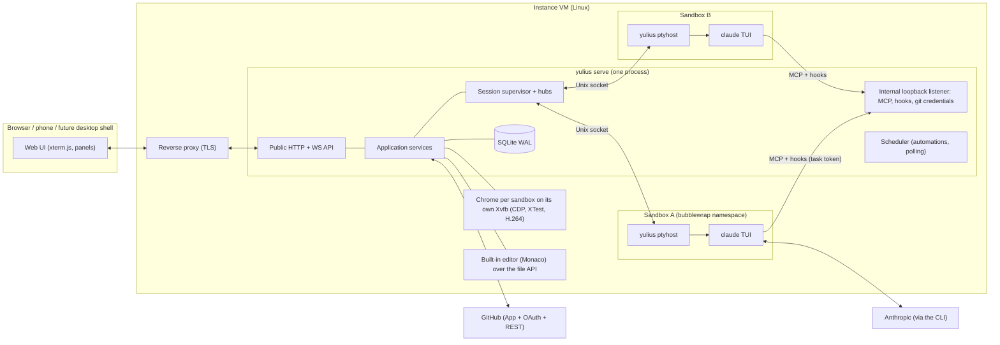

# SPEC-002: Yulius architecture and runtime contracts

Status: accepted (design; implementation authorized with SPEC-001)
Date: 2026-10-07
Owner: implementing agent; founders for product decisions
Scope authorization: user goal of 2026-10-07 (design robust architecture for concurrency,
isolation, cancellation, reconnect, process failure and recovery; implement in Rust).

This document holds engineering decisions. Unless a row cites SPEC-001, choices here are
implementation assumptions (class **A**) that serve SPEC-001 requirements; they are not user
requirements and may be revised with a recorded reason. Engineering invariants from
[runtime contracts](../../docs/engineering/runtime-contracts.md) (RUN, EVT, DATA, GIT, SEC) apply.

## 1. System overview



Principles:

1. **Agents are real CLIs in PTYs.** Yulius never re-implements an agent; it launches, observes
   and resumes native Claude Code sessions (SPEC-001 HRN-001, P(5); Codex deferred, F 2026-10-08).
2. **Sessions outlive the web server.** Each run is owned by a detached `ptyhost` process; the
   server reattaches after restart (NFR-001).
3. **GitHub is the authority** for repositories and permissions (ACC-007), with one exception:
   the superadmin owns the instance and has admin access to every sandbox without GitHub
   (ACC-012, F 2026-10-09).
4. **Harness-independent coordination** through one Yulius MCP server and the hook protocol both
   CLIs implement (STP-001, DSC-003; no messages: COM-002 and COM-005 withdrawn, SPEC-028).
5. **Everything bounded and owned**: each queue, stream, retry and wait has a limit and an owner
   (§9).

## 2. Decision records

| ADR | Decision | Alternatives considered | Consequences |
| --- | --- | --- | --- |
| ADR-01 | One Rust binary `yulius` (axum/tokio) with subcommands `serve`, `ptyhost`, `hook`, `git-credential`, `import`, `login`, `backup`, `doctor`. Static web UI (vanilla ES modules + vendored xterm.js) embedded in the binary. | Leptos/Yew WASM UI; Node SPA build | One artifact to deploy; no Node toolchain for Yulius; UI is plain JS so a desktop shell can load it (OPS-002). JS UI lacks Rust type checking — mitigated by contracts-generated docs and UI checks. |
| ADR-02 | Detached `ptyhost` per run, Unix-socket protocol, vt100 screen state, exit record files. | tmux/dtach; in-server PTYs | Survives server restart (NFR-001); explicit ownership and identity; more code to test (fake agent suite). Requires the systemd unit to use `KillMode=process`. |
| ADR-03 | Extended by ADR-22 (F 2026-10-10): runs join a per-sandbox namespace holder (private network, writable system layer, limits, seccomp); this row remains the legacy mode. Linux containment per sandbox with bubblewrap (`--unshare-pid --die-with-parent`, private /tmp, only the sandbox directory writable, per-sandbox HOME). Host mode for development/tests, visibly flagged "not contained". | Docker per sandbox; gVisor; separate VMs | Cheap, fast, kills whole tree on SIGKILL of bwrap; no daemon. Network is shared (agents need it). Not a defense against kernel exploits — documented trust model §8. |
| ADR-04 | SQLite (rusqlite, bundled) in WAL mode, one write connection behind an async actor, versioned SQL migrations via `user_version`. | Postgres; sled; files | Single-VM product, simple backup (`VACUUM INTO`); write throughput ample for 2–5 users. |
| ADR-05 | Accounts are org secrets in Yulius; provider homes are per sandbox. Claude uses long-lived OAuth tokens from `claude setup-token` passed by environment. | One global home per account; copying credentials per task | Prevents cross-sandbox transcript leakage via shared homes; an account switch needs no file copy. (Codex homes with `auth.json` write-back were removed with Codex, F 2026-10-08.) |
| ADR-06 | Withdrawn (F 2026-10-08): no cross-provider switches. The provider-neutral transcript IR, the native transcript writers and the handoff fallback were removed; a task resumes its own session on another account. | Keep translation for a later second harness | Yulius runs Claude Code only; a returning harness gets its own decision. |
| ADR-07 | Yulius MCP (Streamable HTTP, JSON-RPC) on a loopback listener with per-run bearer tokens; hooks call the same listener through `yulius hook`. | Per-harness plugins; injecting text into the TUI only | One protocol for every harness; least privilege (task tokens reach only task-scoped tools). |
| ADR-08 | GitHub App (created by manifest flow) for installation tokens and user-to-server OAuth; permissions read per user per repository with a 5-minute cache. A task acts on GitHub with its creator's user-to-server token (F 2026-10-11, GIT-003); the installation token serves instance housekeeping and is the fallback (§8). | OAuth App with `repo` scope; PATs; the installation token for agents (the bot appears as the author of people's work) | Narrow, revocable access; repository creation via installation (orgs) or the owner's user token (personal accounts). Requires a public callback URL. The App's permissions and what each is for: `docs/operations.md`; a read the App lacks the permission for degrades instead of failing (checks: §10, #111). A user-to-server token is capped twice — by the App's permissions and installation repositories and by the creator's own repository access — but it is not limited to one repository: an agent holds its creator's reach within the installation (§8). |
| ADR-09 | Superseded by ADR-15 (F 2026-10-10) for the user's view: the DOM mirror, its recorder, replayer and resource endpoint are removed; the per-sandbox Chromium, CDP for agents, the welcome page and the screencast (now the labelled JPEG fallback) remain. Earlier: narrowed by ADR-14 (F 2026-10-09): the mirror is now only the remote view of the sandbox Chrome's tabs (agents' tabs and hand-offs); the user's own browsing of the sandbox's apps is live (ADR-14). Per-sandbox headless Chromium; the user's view is a live DOM mirror: the rrweb recorder is injected through CDP into the page's main world (it must see the page's CSSOM patches) and reports to a CDP binding; the UI replays the events in rrweb's script-free iframe (sandbox `allow-same-origin` only — never `UNSAFE_replayCanvas`, which would let any page run script as Yulius through the binding) and paints sampled canvas frames itself; page resources the user's browser cannot reach are fetched by the server browser through a same-origin-only endpoint served with a `sandbox` CSP. The CDP screencast is the labelled fallback; input is dispatched with CDP `Input.*`; viewers learn viewport changes at once. Agents use Yulius browser tools and may attach CDP-capable MCPs to the same endpoint. New tabs open a welcome page served by the internal listener (BRW-006). | Pixel screencast only (original choice, rejected by F 2026-10-07); noVNC desktop; own DOM serializer; recorder in an isolated world (misses CSS-in-JS rules) | Crisp, selectable, phone-friendly view of the real browser (BRW-005); rrweb handles CSSOM/CSS-in-JS, inputs and iframes; plugins, internal pages and pages that send no DOM need the fallback. |
| ADR-10 | Built-in editor: Monaco (VS Code's editor component, vendored AMD build without its translations) in the web UI over a small file API (`/api/sandboxes/{sid}/files…`) on the sandbox repository or a task worktree; per-user view state stays in the browser. | openvscode-server per sandbox (original: needed a token cookie fix, ran outside containment, too heavy); per-user contained openvscode-server (built, then dropped by the founder: "much simpler, without 90% of the features"); CodeMirror (needs a bundler) | No editor process or prerequisite on the VM; 14 MB of static assets (the TypeScript worker is 7 MB, loaded only for JS/TS); no extensions, debugging or integrated terminal (shells cover that). |
| ADR-11 | Delivery profiles in `yulius.toml` with presets `standard`, `product`, `studio`; merges/promotions are explicit user actions unless a profile enables auto-promotion. | Hard-coded dev/main | Fits Product and Studio without forcing their branches (K). |
| ADR-12 | Kept by ADR-22 (F 2026-10-10): under the holder the identity files are the user's line followed by the sandbox system's own users and groups, and `sudo` is also a dpkg-diverted shim in the system layer. Sandbox identity for user processes (shells): bubblewrap user namespace with `--uid 0 --gid 0`, generated `/etc/passwd`/`/etc/group` naming uid 0 after the user's login, the user's home `users/<user>/home` bound at `/home/<login>`, a `sudo` shim on `PATH`, hostname = sandbox slug. Agent runs keep the sandbox identity. | Real Unix accounts per user (needs a privileged helper); fake root via LD_PRELOAD | Separate users with root inside the sandbox without host privileges (UI-016); host system directories stay read-only (U-12). |
| ADR-13 | Superadmin recovery code: 6 random digits, Argon2id hash in `instance`, persistent failure counter; 3 failures clear the hash and set a permanent lock; regenerate requires a superadmin session plus the password. | No recovery (original ACC-002); email reset | Recovery possible without email (ACC-011); 3 tries bound guessing to 3·10⁻⁶; an attacker can deliberately lock recovery, which the founders accepted. |
| ADR-14 | Narrowed by ADR-15 (F 2026-10-10): the panel's live iframe tabs are removed; the preview origins and their proxy remain for one action, "Open live in a new window" on a sandbox dev server, and the no-recursion rules stay. Originally: the user browses the sandbox's apps **live in their own browser**: each (sandbox, port) has a preview origin `<port>-<key>.<yulius host>` that Yulius reverse-proxies to `127.0.0.1:<port>`, removing the iframe obstacles; the agents keep the sandbox's headless Chrome (ADR-09), whose tabs share the panel's strip and are watched remotely with the agent's cursor; Yulius never opens inside itself. Analysis and contract: §2.1. | Keep the mirror (A); pixel or video streaming (B); hybrids (D) | Native page behaviour on desktop and phone; needs wildcard DNS and TLS for the preview hosts (on-demand TLS); the app runs in the user's browser, so its absolute `localhost` URLs in page code do not reach the VM. |
| ADR-15 | The panel **streams the real sandbox Chrome**: a headful Chrome per sandbox on its own `Xvfb` (no TCP or abstract socket, a cookie outside the sandbox directories), shown as H.264 video (ffmpeg x11grab + libx264 `ultrafast`/`zerolatency`, FLV framing, GOP cache, keyframe-aware backpressure) over the viewer WebSocket and decoded with WebCodecs; the user's input is real (XTest through x11rb); CDP stays for agents. Over the user's link (F 2026-10-10, later): the viewer acknowledges frames and the server keeps about a round trip on the way, the bitrate and frame rate follow the slowest viewer (VBV tiers), keyframes come on demand from a replacement encoder, wheel and pointer moves are coalesced. Analysis and contract: §2.2. | Fix the mirror (A); CDP screencast only (B); VNC/noVNC (C); WebRTC (D); in-process capture and encoder (E) | Scrolling and typing at video latency, captchas and cross-origin frames work because input is real and the browser is not headless; needs `xvfb` and `ffmpeg` with libx264 on the VM (else headless with JPEG frames); about one core per watched browser at 60 fps; the page is pixels (no text selection in the user's browser; copy goes through the clipboard). |
| ADR-16 | **Task intake and chains** (F 2026-10-10): TypeSafe's Jev (`jev-1.13.0`, one fixed Choice question per request, fixed thresholds) decides whether a new task mixes separate workstreams and whether a prompt typed into a running task is context, new scope, dropped scope or a redirect; a headless Claude Code run proposes the smallest split; the `UserPromptSubmit` hook holds non-context prompts for a decision in the task view; a task can wait as `chained` until another is Done; a new task's mode and workflow on Auto are two more fixed questions with Goal and "Feature" as the defaults (TSK-015). Analysis, rules and edge cases: §2.3. | An LLM in the hook; classifying every prompt; one task per listed item; an approval queue | Deterministic and optional (no key = no checks); prompts and task text go to TypeSafe when configured; one click to override a wrong hold. |
| ADR-17 | Claude subscriptions are **one self-managing pool** (F 2026-10-10): use-it-or-lose-it placement (weekly headroom ÷ hours to its reset ÷ tasks on the account + 1), a proactive switch at 98 % of any binding window at the turn boundary by native resume, and a **gentle, invisible pause** held by the harness — the Stop / `UserPromptSubmit` hook answers `202 Retry-After` and `yulius hook` keeps polling — persisted in `capacity_pauses`, resumed oldest first and staggered; a burn-rate forecast says when to buy more. Analysis and contract: §2.4. | Manual priorities (before); suspending the agent (SIGSTOP); letting the CLI hit the limit and typing a resume prompt; killing and resuming | No knobs; capacity that expires is spent first; switches only when forced; the agent is never told; a hold survives restarts; the CLI shows "running hook" while paused and a held agent keeps its session slot; relies on Claude Code honouring a long hook `timeout` (fallback: the reported-limit pause). |
| ADR-18 | **Updates from `main` through a root helper** (F 2026-10-10): the binary embeds its commit; the server reads `main` of Quartio-Studio/yulius hourly (App token, else a read token) and offers newer commits to superadmins; "Update now" runs one persisted run — **build** (tasks keep working) → **drain** (every Stop / `UserPromptSubmit` held as in ADR-17, starts queue, until every live task is at a pause point) → **install** by a oneshot root helper started by a root-owned systemd path unit (stop, back up binary and database, install, start, health check, roll back) → **resume** (staggered). Analysis and contract: §2.5. | Pausing before building (the coordinator's draft order); polkit or sudo for `systemctl start`; a shell-script helper; a separate helper binary; auto-update | Tasks pause for about a minute, not for the build; a failed build touches nothing; the helper runs code of `main` as root while building (as the manual deploy did); a held agent keeps its session; a turn longer than 30 minutes cancels the update unless the superadmin continues without waiting. The Jev key moves into sealed settings (ADM-002, §2.5). |
| ADR-19 | **One autonomous delivery discipline** (F 2026-10-10, #139): steps of similar effort with effort-weighted progress and pure-function rules (bounds, at most 2 in progress, no reopening by agents, reasons for blocked/skipped) plus never-blocking nudges; a spec only where it matters (by workflow, else by changed paths); one pipeline for features and fixes with an independent review in a fresh session and merge on green; infra bootstrap on Yulius CI without GitHub Actions; a docs-first briefing; bundled skills adapted to be universal. Analysis and contract: §2.5. | A hard step gate at every turn; LLM-judged step sizes; specs for everything; vendoring skills byte for byte; Bartek's full N2/N3 rule set (module locks, owner flags, scripted merge lock, DORA dashboards) | Progress means something without ceremony; agents keep momentum; the harness checks what a machine can check and nudges the rest; the remaining judgment (step sizes) stays with the agent, so a dishonest plan is caught only by its pace. |
| ADR-20 | **Secrets vault** (F 2026-10-10): team secrets and agent secrets under envelope encryption (per-write data keys, XChaCha20-Poly1305, KEK from the master key by HKDF); team reveals behind a 10-minute re-authentication, audited; agents use secrets without seeing them through a credential-injecting egress proxy on the internal listener (TLS interception only for hosts bound to a secret) and `browser_fill_secret`; exact values and encodings redacted from every channel an agent reads (Bash wrapper, `PostToolUse` rewrite, MCP results, proxy responses) and from the terminal. Analysis: §2.6. | `age`; `aes-gcm`; SQLCipher; an external vault; values in the environment; a request-making tool | One store for people and agents; agents' HTTP goes through Yulius; redaction is an oracle for weak values (8-character minimum); remaining threats in §2.6. |
| ADR-21 | **Yulius is the projects' only CI** (F 2026-10-10: "100% local … zero paid github features … deleting GitHub Actions completely"). Each sandbox's `[[ci.jobs]]`, or `[commands] gate`, is read from the integration branch; the profile's `gate` overrides it. Yulius runs the jobs for every open pull request head and every new integration and production head, once per commit, in parallel. Each job goes through the process host inside the sandbox's containment, without secrets, in a persistent per-job checkout with persistent caches. Results go to the commit status `yulius/ci`. Once a sandbox has CI, the merge gate takes the run at the exact head alone. Hygiene deletes merged branches and cleans stale branches and worktrees. Analysis and contract: §2.7. | GitHub Actions on hosted or Blacksmith runners (paid per minute, Actions workflows); a self-hosted Actions runner (still Actions, still a workflow per repository); a separate CI server (Buildkite agent, Woodpecker: another service to run and secure); running the gate in the agent's worktree (stale caches mixed with the agent's work, no isolation from the task) | One CI, on infrastructure we control, with no GitHub plan dependency. Merges are enforced by Yulius, not by rulesets. The VM pays the CPU, disk and caches. Statuses need the App's "Commit statuses: write"; pushes that delete workflows need "Workflows: write". Agents can still read a token through the Git credential helper, so the gate binds agents that merge through Yulius, not a hostile agent (§8). |
| ADR-22 | **Sandbox isolation** (F 2026-10-10): one namespace holder per sandbox — a user namespace with a subordinate id range, a private network namespace (`slirp4netns` egress, host loopback off, explicit relays for the internal listener and the sandbox's dev-server ports) and a mount namespace holding the sandbox's **system layer** (overlay of a Yulius-owned copy of the host system with a per-sandbox upper, so `sudo apt install` persists per sandbox); every run joins it, then gets its own PID/IPC/UTS/cgroup namespaces, a reduced capability set and a seccomp filter; per-sandbox cgroup v2 limits and a soft disk quota. Analysis and contract: §2.8. | rootless Podman; gVisor; microVMs (no KVM on the host); fuse-overlayfs over the live host system | `apt` works and persists per sandbox; host loopback services, other sandboxes and abstract sockets unreachable; limits per sandbox; needs an `/etc/subuid` range and `Delegate=` on the unit; without them the previous containment stays (`legacy`); the base copy costs ~6 GB and a few minutes per host system change. |

### 2.1 ADR-14: the browser panel renders the sandbox's apps live (F 2026-10-09)

Status: accepted and implemented (issue #92). Narrows ADR-09.

**Problem.** "Even if we have this mirror thingy, it works terribly when we need to do
something real. It should be rendered fully on the user's side, and we can use the VM to get
around iframe problems. Deny recursion. We still need the cursor." The ADR-09 view is a
**replay**. The page runs in a Chrome on the server, and its DOM is recorded with rrweb and
rebuilt in a script-free iframe. Every key, click and wheel turn makes a round trip, and nothing
of the page runs in the user's browser: no native focus, scrolling inertia, IME, devtools or
canvas/WebGL. Apps with WebSockets, hot reload or heavy JavaScript degrade to pixels.

**Options compared.**

| | A: keep the mirror | B: pixel or video streaming (screencast, WebRTC, noVNC) | C: live page in the user's browser through a Yulius proxy on the VM | D: hybrids |
| --- | --- | --- | --- | --- |
| Fidelity and feel | DOM without scripts; input round-trips; canvases sampled; breaks on CSS-in-JS edge cases and shadow DOM | Exact pixels, but every interaction round-trips; text is an image (no selection or copy, no find); blurry on phones | The real page: native scrolling, selection, inputs, IME, devtools, WebGL, media | C for the user plus A/B for the agent's Chrome |
| Latency | One round trip per input | One round trip per input plus encoding | Local, like any site | Local for the user's tabs |
| Phone | Scaled replay, awkward input | Bandwidth-heavy, no native keyboard | Native | Native for the user's tabs |
| Server cost | Recorder in Chrome plus replay | Encoding per viewer | One proxy hop; no Chrome needed for the user | Chrome only for agents |
| Shared state with agents | Same Chrome (shared logins) | Same Chrome | Separate browser (the user's own cookies) | Hand-offs (AWS sign-in for an agent) stay in the agent's Chrome |
| Security surface | Hostile DOM replayed in Yulius's origin (mitigated: script-free iframe) | Small | A new origin per app; proxy must keep the Yulius session out of reach | C's plus A's |

Decision: **D, built on C**. The user's tabs are live iframes on preview origins (C). The agent
keeps the headless Chrome (ADR-09), and the user watches its tabs through the existing mirror
or pixels with the agent's cursor (A, now only for the agent's tabs). Agent hand-offs happen
there: an AWS sign-in the agent needs must live in the agent's Chrome.

**Real-world issues and how C handles them.**

- *X-Frame-Options and CSP `frame-ancestors`* (dev servers and frameworks send them):
  - the proxy removes `X-Frame-Options` and every `frame-ancestors` directive;
  - it then adds its own `Content-Security-Policy: frame-ancestors 'self' <Yulius origin>`;
  - only Yulius (and the app itself, for its own nested frames) can frame a preview.
- *Root-relative URLs* (`/assets/app.js`, `/api`): a path-prefix proxy (`/preview/20001/…`)
  would break them, as well as service workers, cookies with `Path=/` and client routers. So
  each app gets an **origin of its own**, `<port>-<key>.<host>`, and its paths are untouched.
- *Redirects and URLs that name `localhost:<port>`*:
  - the app is told it runs at `http://localhost:<port>` (`Host`, and `Origin`/`Referer` of its
    own previews rewritten), which satisfies Vite's and webpack's host checks and same-origin
    CSRF checks (SvelteKit, Next.js server actions, Django);
  - the response headers that carry URLs map `http(s)/ws(s)://<loopback>:<sandbox port>` back
    to the preview origins: `Location`, `Content-Location`, `Refresh`, `Link`,
    `Access-Control-Allow-Origin` and CSP sources.
  - Absolute `localhost` URLs inside page bodies or scripts are not rewritten (not done: body
    rewriting is fragile). Apps should use relative URLs or their dev server's proxy, as on any
    remote dev box.
- *Cookies in iframes*:
  - Preview origins are subdomains of the Yulius host, so they are **same-site** with Yulius.
    The iframe is therefore not a third-party context, and its cookies work under third-party
    cookie blocking (Safari ITP, Firefox TCP, Chrome).
  - `sslip.io` is **not** on the Public Suffix List (checked 2026-10-09), so the site is
    `sslip.io`. For the same reason a bare `localhost` does not work for local development
    (`*.localhost` hosts are sites of their own); use `yulius.localhost`.
  - The app's `Set-Cookie` loses `Domain` (it becomes host-only on the preview) and gains
    `Secure` over HTTPS.
- *WebSockets, HMR and streaming*:
  - upgrades are spliced through (bounded, re-checked every 60 s);
  - bodies stream both ways without buffering, so large uploads, server-sent events and
    streamed HTML work;
  - only HTML documents get one `<script>` tag appended (the bridge, below); they are requested
    without compression.
- *Service workers*: they are scoped to their preview origin, so they cannot touch Yulius.
  Paths under `/__yulius/` are reserved on every preview origin.
- *Auth*:
  1. A preview is opened through a **handshake**. A signed-in user with write access navigates
     to Yulius (`/api/previews/authorize`), which hands a single-use 60 s token to the preview
     origin (`/__yulius/handshake`).
  2. The token becomes a 12 h random **grant**, set as the `__Host-yulius_preview` cookie
     (host-only, `HttpOnly`, `Secure`, `SameSite=Lax`) on that preview origin only.
  3. Grants live in memory, at most 4096. Each request re-checks its grant against the user's
     Yulius session and write access at least every 30 s, so sign-out, disabling and lost
     access end it. After a restart, navigations pass through the handshake again.
  4. A navigation without a grant goes through the handshake by itself, so a new window and
     bookmarks work. If the browser drops the cookie, the landing step says so instead of
     looping.
  5. The grant cookie never reaches the app.
- *Phones*: native.

**Browser chrome (address bar, back, forward).** A cross-origin iframe hides its location and
history from the parent. The proxy therefore appends a small bridge script to proxied
documents. It posts the address, the title and `navigation.canGoBack/canGoForward` to the
Yulius origin only, and takes back, forward (Navigation API, so traversal stays inside the
frame) and reload, but only from the Yulius window that frames it. The panel shows addresses as
`localhost:<port>/…`. "Open in a new window" opens the preview origin top-level.

**Isolation between the preview origins and Yulius (security).** Every `*.sslip.io` host on the
internet, and every preview, is same-site with Yulius, so `SameSite` never protects anything
here:

- **Yulius's session cannot be used from a preview origin.**
  - The session cookie is `__Host-yulius_session` over HTTPS: host-only, so it never reaches a
    preview, and no sibling host can plant or shadow it ("cookie tossing").
  - A cookie-authenticated request that announces a foreign `Origin`, or that the browser marks
    `Sec-Fetch-Site: same-site/cross-site`, is refused unless it is a plain GET navigation.
  - WebSockets already required the Yulius origin.
  - Yulius's pages refuse every frame (`X-Frame-Options: DENY`, `frame-ancestors 'none'`).
- **A preview cannot be used from other sites.**
  - Credentialed requests and WebSockets must come from the preview itself or the same
    sandbox's other previews (`Origin`, fetch metadata).
  - Navigations from anywhere are allowed, and the grant decides.
  - The grant is per origin, so sandbox A's grant does not open sandbox B or another port.
- **Only the sandbox's own port range is reachable**, never Yulius's listeners or a sandbox
  browser's DevTools port. The upstream is always `127.0.0.1:<port>`.
- Tests: `crates/yulius/tests/preview.rs`; the live hostile page in `live_ui_browser.rs`.

**No recursion (BRW-008).**

- The proxy refuses Yulius's own ports. It also refuses any upstream that answers with this
  server's `X-Yulius` tag (a port forward to Yulius).
- The sandbox Chrome refuses Yulius's public host, its subdomains and every loopback form of
  its listeners:
  - before navigating (tools, viewers), with a typed refusal;
  - for page-initiated loads (links, redirects, frames, scripts), through a browser-wide CDP
    `Fetch` interception that fails them as blocked. The welcome page is the one allowed prefix.
  - A browser whose guard cannot be enabled is not used.
- The welcome page and the previews API never list Yulius's ports.
- The UI refuses to render in any frame: `boot.js` notes `window.top !== window.self`, and the
  app shows only a notice.

**Agents and the cursor.**

- Agents keep the headless Chrome and the MCP tools.
- Its tabs appear in the same strip, marked as the sandbox Chrome's. Each viewer watches the
  tab it chose (`watch`, nothing while on a live tab), with the labelled cursor (BRW-007).
- When an agent acts on the app shown in the user's live tab (same port), a notice over that
  tab says so and offers "Watch".
- "Open live" opens an agent tab's address live.
- **Cookies are not shared** between the user's live view and the agent's Chrome, so each has
  its own session, like two browsers. Sharing would mix users' and agents' identities across
  every member of the sandbox. A hand-off the agent needs happens in the agent's tab.

**Operations.**

- Wildcard DNS for `*.<host>`: `sslip.io` resolves any subdomain to the IP it encodes.
- TLS for the preview hosts:
  - Caddy: on-demand TLS whose `ask` endpoint is `GET /internal/preview-tls?domain=` on the
    loopback internal listener (200 only for preview hosts of existing sandbox ports);
  - nginx: a wildcard certificate (DNS challenge) instead.
- `YULIUS_PREVIEW_DOMAIN` (default: the public host; `off` disables previews).
- Without DNS or TLS, the panel's reachability check says so and offers the sandbox Chrome
  (docs/operations.md §4).

**Code.**

- `yulius-app::preview`: preview hosts, keys, the handshake, grants and the port policy.
- `yulius-server::preview`: the proxy itself, in the interface layer like the former editor
  proxy (HTTP to HTTP, no domain logic), plus `routes/previews.rs`.
- `yulius-browser::UrlDenyList`: the sandbox Chrome's guard.
- `web/assets/browser.js` (panel, live tabs) and `browserremote.js` (the sandbox Chrome view).

**Consequences and limits.**

- Absolute `localhost` URLs in page code do not reach the VM.
- Sites outside the sandbox's ports open in the sandbox Chrome (proxying arbitrary sites would
  be an open proxy, and their absolute URLs escape it).
- Third-party sign-in pages (Google, GitHub) refuse frames and must be opened in a new window.
- The sandbox Chrome tabs have no back or forward in the panel.
- `sslip.io` is shared by its whole user base: its Let's Encrypt limits are shared, and its
  hosts are all same-site. A production domain of one's own is better.
- Certificate Transparency logs publish each preview host name, which carries an opaque key,
  not the sandbox's name.

### 2.2 ADR-15: the browser panel streams the real sandbox Chrome (F 2026-10-10)

Status: accepted and implemented (issue #107). Supersedes ADR-09's user view and narrows ADR-14.

**Problem.** "The browser is slow as fuck on scrolling or typing, and clicking on a captcha does
not work. The current approach seems wrong… the bugs seem to be in the foundations." On
production (`main` dfe22eb) Michał used the sandbox's own Chrome: no preview certificate was ever
requested, so #105's live iframes never ran, and the panel showed the rrweb mirror.

- *Slow by construction.* Every wheel turn or key went viewer → WebSocket → CDP
  `Input.dispatch*` → page → recorder (batched every 40 ms, scroll sampled every 100 ms) → JSON →
  a DOM rebuilt in the user's browser. Large pages produced large batches.
- *Captchas cannot work.* The Chrome ran `--headless=new` with `navigator.webdriver === true`,
  which reCAPTCHA, Turnstile and hCaptcha read; their widgets are cross-origin iframes that the
  mirror neither records nor clicks.
- *The real need is the agent's browser.* The agent asks for help with a captcha or a sign-in
  (`browser_request_user_action`), then the user watches it work: the user must drive **the same
  Chrome the agent uses**, at full fidelity. ADR-14's live tabs are the user's own browser and
  cannot help there.

**Options compared.**

| | A: fix the mirror (headful + rrweb) | B: CDP screencast (JPEG) + CDP input | C: VNC / noVNC | D: WebRTC | E: H.264 over the viewer WebSocket + XTest (chosen) |
| --- | --- | --- | --- | --- | --- |
| Captchas, cross-origin frames | No: frames not recorded, synthetic clicks | Input is CDP-synthesized (headful helps); one frame per ack round trip | Yes (real input) | Yes | Yes: real X input, headful, no automation flag |
| Scrolling | Replay of mutations | ~10–25 fps, ack-paced | Tile updates, high bandwidth while scrolling | 60 fps | 60 fps, measured below |
| Network | WS (443) | WS (443) | WS (443) via websockify | UDP or TURN on 443 (the firewall allows only 22/80/443) | WS (443) |
| Server cost | Recorder per page | JPEG per frame in Chrome | Damage-based, cheap idle | Encoder per stream | One encoder per watched display (~1 core at 60 fps, 0 when nobody watches) |
| Client | Same-origin replay iframe | `createImageBitmap` | noVNC canvas | `<video>` | WebCodecs `VideoDecoder` (Chrome, Edge, Safari 16.4+, Firefox 130+); JPEG fallback |
| New code / prerequisites | — | Small | A VNC server + websockify | A WebRTC stack or a TURN server | `xvfb`, `ffmpeg` (libx264); x11rb (pure Rust) |

Remote-browser products (Browserbase and Hyperbeam live views, neko, Kasm) use C, D or E.
**Decision: E.** It keeps the existing WebSocket, its authorization and its Origin check, and
needs no UDP. B remains as the labelled fallback for viewers without WebCodecs and for hosts
without Xvfb or ffmpeg.

**Display (`yulius-browser::display`, `xserver`).**

- One `Xvfb :<n>` per running sandbox browser, started and reaped by Yulius as the service user:
  `-nolisten tcp -nolisten local` (only the filesystem socket `/tmp/.X11-unix/X<n>`; an abstract
  socket would be reachable from containment, which shares the network namespace), `-auth` with a
  random 16-byte MIT-MAGIC-COOKIE-1 written by Yulius (no `xauth` needed) to
  `<data>/displays/<sandbox>/Xauthority` (0600, directory 0700). That directory is outside every
  sandbox directory: containment binds `<data>/sandboxes/<id>` writable, so a cookie in the
  profile directory would be readable by agents. Numbers start at `YULIUS_BROWSER_DISPLAY_BASE`
  (100) and skip numbers whose socket or lock exists; Xvfb refusing a number moves to the next.
  The framebuffer is the maximum size; RandR sets the screen to the viewport, so pages and
  Chrome's menus see the viewport as the screen.
- Chrome runs headful on it: `--kiosk --window-position=0,0 --window-size=W,H` (no browser UI;
  the panel draws tabs and the address bar from CDP), `--disable-blink-features=AutomationControlled`
  (remote debugging alone makes `navigator.webdriver` true in Chrome 155), no
  `--enable-automation`, the normal user agent, `--force-device-scale-factor` when the scale is
  not 1. There is no window manager; one X thread per display plays its small part: every
  top-level window that maps (the browser, a popup, an OAuth window, a dialog) is moved to 0,0 at
  the viewport size and gets the keyboard focus, a press focuses the window under the pointer, a
  closed window hands the focus to the topmost remaining one; menus (override-redirect) are left
  alone. Resizing goes through X (`ConfigureWindow`), not `Browser.setWindowBounds`, because
  leaving kiosk's fullscreen state brings Chrome's UI back.
- One display shows one tab at a time: the active tab. Choosing a tab (`watch`) brings it to the
  front for every viewer, as in one shared browser window; a page that opens a page (a link to a
  new tab, `window.open`) comes to the front, and closing the shown tab brings the next one. An
  agent opening a tab brings it to the front too. Agents' tools need no front tab (headful
  screenshots of background tabs work).

**Video (`video`, `encoder`, `flv`).**

- While at least one viewer watches, `ffmpeg -f x11grab -draw_mouse 0 -framerate <tier fps>
  -video_size WxH -i :n.0+0,0 -vf format=bgr24,format=yuv420p -c:v libx264 -preset ultrafast
  -tune zerolatency -bf 0 -crf 23 -maxrate <tier> -bufsize <tier / 10> -x264-params
  keyint=infinite -threads 2–4 -flush_packets 1 -f flv pipe:1` encodes the viewport region (the
  rate cap, keyframes on demand and the slice threads by frame size: see "Over the user's link"
  below). The `bgr24` step takes swscale's fast RGB path: measured on the VM it halves the
  conversion cost (1280×800 at 60 fps, idle: 80 % of a core instead of 97–111 %).
- **FLV instead of Annex-B parsing (a change from the brief's recommendation).** An Annex-B
  access unit only ends when the next one starts, one frame interval (16.7 ms at 60 fps) later.
  FLV frames each access unit with its size, so the server forwards a frame the moment its last
  byte arrives; the payload is already AVC (length-prefixed NAL units) with the `avcC` record as
  WebCodecs' `description`. The parser is bounded (8 MiB per tag) and unit-tested for every split
  of a stream.
- `VideoHub` per display: GOP cache (the last keyframe and the frames after it, at most 600
  frames and 6 MiB; replayed to a new viewer only up to 512 KiB, else it asks for a keyframe) for
  instant start; a bounded queue per subscriber (256), and a subscriber that
  falls behind misses frames until the next keyframe; the encoder starts on the first subscriber,
  stops 5 s after the last one leaves, restarts at the new size when the viewport changes and gives
  up after three failed starts (viewers then get JPEG frames with the reason). The process is
  always terminated and reaped (SIGTERM, SIGKILL after 2 s, reap).
- Per viewer connection (`yulius-server::routes::browser`): a media queue bounded to 300 frames
  and 8 MiB, paced by the viewer's acknowledgements; video that waited on the server more than
  250 ms is dropped for a fresh keyframe, and a keyframe flushes what it supersedes, so latency
  stays bounded and a slow viewer never slows the encoder or other viewers.
- Wire: `{"type":"stream","mode":"video"|"pixels","reason"?}`, `{"type":"video_config",
  "codec","description","width","height"}` (sent in the media queue, so it is ordered with the
  frames) and binary frames `u8 4, u8 flags (keyframe), u64 µs, access unit`. JPEG frames keep
  `u8 3 + tab id`.

**Client (`browserstream.js`).** WebCodecs `VideoDecoder` (`optimizeForLatency`); every frame is
acknowledged on arrival (`ack`) and decoded, and the newest decoded picture is drawn (at once when
the decoder is idle, else on the next animation frame); a decoder that fails or falls 90 frames
behind restarts and asks for a keyframe (`keyframe`); a `NotSupportedError` or a browser without
WebCodecs asks for JPEG frames, labelled "JPEG mode".
The user's own cursor is the local CSS cursor (the video has none). The canvas shows the shared
viewport scaled to the panel; when another viewer's panel sized it, a notice offers "Fit my
panel". With scale 2 (`YULIUS_BROWSER_SCALE`) a HiDPI screen shows one video pixel per device
pixel (crisp text) at about three times the encoding cost; the default is 1.

**Input.**

- Moves, presses, releases and keys are XTest events on the display (x11rb, pure Rust, one
  connection per display; no process per event, no reply waited for: one flush per batch; a press
  asks the server for the window under the pointer only while a popup is open). Discrete input is
  bounded by a 512-command queue; pointer moves are not queued but overwrite one "newest
  position" slot, and a press, release or key first queues the position before it, so it lands
  where the pointer was and a later move cannot overtake it. Printable ASCII
  is mapped by character to its US-layout keycode, pressing or lifting Shift around it as the
  character needs (any user layout types the right character; with Ctrl, Alt or Meta down the
  user's Shift is kept, so Ctrl+Shift+Z stays itself); other keys by `KeyboardEvent.code`
  (evdev keycodes); characters no US key types (Polish letters, emoji, dead-key and IME results)
  and short typed text (up to 64 characters) are real key presses too: the X thread types a
  US-layout character with its own key and maps any other character's Unicode keysym onto one of
  the keymap's spare keycodes (reused least recently first, never while the browser may still
  look the old one up) and presses it. **A change from
  the brief**, which suggested CDP `Input.insertText` for these: measured on the VM, text inserted
  through CDP overtook key presses still queued in the X server ("Hello ą!" arrived as
  "Helląo !"); keysyms keep everything on one ordered path and give pages real key events. Only
  longer text (a paste) uses `Input.insertText`, after the display's queue has drained (an X
  round trip and 50 ms). Lock keys and AltGraph are not forwarded.
- The wheel and trackpad use CDP `mouseWheel` with pixel deltas on the shown tab (X wheel buttons
  are 3-line steps), coalesced per animation frame in the client and, on the server, dispatched
  with at most two calls outstanding, the deltas arriving meanwhile summed (never waited for by
  the viewer socket).
- macOS: ⌘C/⌘V/⌘X/⌘A/⌘Z and other editing shortcuts are sent as Ctrl; ⌘ arrows as Home/End.
  Paste sends the user's clipboard as text; copy (⌘C/Ctrl+C/X) also asks the server for the
  selection (`copy` → `clipboard`), which goes to the user's clipboard (a pending
  `ClipboardItem` claimed in the key's own event where Safari needs it).
- Touch: a tap clicks, a drag scrolls; a Keyboard button opens the phone's keyboard.
- Back, forward and reload go through CDP (`history`, `reload`).
- Only write users reach the socket (unchanged); each connection may send 500 input events per
  second (burst 1000): moves and wheel beyond are dropped silently, and they leave 100 events of
  the burst to discrete input, which beyond is refused with an error. A move or wheel turn that
  fails is never reported to the viewer.
  Every key and button a viewer held is released when it leaves.

**Security (each tested in `live_display.rs` on Linux).**

- Contained agents and users' contained shells reach no display: their `/tmp` is private (no X
  socket), there is no abstract socket and no TCP listener, and the cookie lives outside the
  directories containment binds. Inside bubblewrap `xdpyinfo -display :n` fails for every
  display.
- Each sandbox has its own display, cookie, profile and encoder; one sandbox's cookie does not
  open another's display.
- The video and input use the viewer WebSocket's authorization (write access, re-checked every
  60 s) and Origin check, unchanged.
- Unchanged and still open (R-07): the DevTools port is unauthenticated on loopback, which other
  sandboxes share.

**Recursion (BRW-008) unchanged:** the sandbox Chrome refuses Yulius's addresses (navigation
refusal and browser-wide `Fetch` interception), the welcome page skips Yulius's ports, the UI
refuses to be framed, and the preview proxy refuses Yulius's ports.

**Configuration.** `YULIUS_BROWSER_DISPLAY=auto|xvfb|headless` (auto: a display on Linux when
Xvfb and ffmpeg resolve), `YULIUS_XVFB`, `YULIUS_FFMPEG`, `YULIUS_BROWSER_FPS` (5–60, default 60),
`YULIUS_BROWSER_MAX_SIZE` (default 1920x1200 CSS pixels), `YULIUS_BROWSER_SCALE` (1–3, default 1),
`YULIUS_BROWSER_DISPLAY_BASE` (default 100). `yulius doctor` checks Xvfb, ffmpeg, libx264 and
x11grab.

**ADR-14 and the mirror.** The rrweb recorder, replayer and the resource endpoint
(`GET /api/sandboxes/{sid}/browser/resource`) are removed. The panel's live iframe tabs are
removed: the panel is the sandbox Chrome for every tab. The preview origins stay for one optional
action, "Open live in a new window", on a tab showing a sandbox dev server (when the server has
preview DNS and TLS): a developer can then use the app with their own browser's devtools. The
no-recursion and session-isolation rules of ADR-14 stay.

**Measured on the VM** (12 vCPU AMD EPYC 2.0 GHz under its production load, Chrome 155,
ffmpeg 6.1.1; `live_display.rs` `measures_fps_latency_cpu_and_bandwidth`, 60 fps, the test viewer
on the VM's loopback; ranges over the runs of the final design):

| | 1280×800 | 1920×1080 |
|---|---|---|
| Video fps while scrolling, p50 / p5 | 59–60 / 43–47 | 56 / 42–45 |
| Encoder CPU (x11grab + x264), scrolling / static page | 93–105% / 68–78% of a core | 145–149% / 129–146% |
| Bandwidth, scrolling / static page | 1.5–1.7 / 0.22 Mbit/s | 2.1–2.2 / 0.21–0.33 Mbit/s |

Server-side input to frame (a key over the viewer socket → XTest → Chrome repaints the whole page
→ x11grab → x264 → the socket): p50 77–80 ms, p95 119–122 ms; a typed character to the frame
showing it: p50 60–66 ms, p95 82–99 ms. An earlier build under heavier load showed p95 spikes of
204–241 ms and a p5 of 35 fps. At 30 fps the encoder takes 57–99% of a core. Not measured: the
DOM mirror (its cost was in the user's browser and per replayed mutation, not comparable on the
server), the network to a real user.

**Over the user's link (F 2026-10-10, later; #122).** "Browser is slow as fuck. Especially when
scrolling and moving. Improve this dramatically." The figures above were taken with the viewer on
the VM. Measured again **at the client** (real Chrome on a Mac in Poland running the real UI
through an SSH tunnel to a throwaway instance on the VM, 1138×766 panel; a probe page paints its
scroll position, pointer position and an input counter as pixel rows that the client reads back
from every frame it draws, so input → displayed frame is on the client's clock), #108's build
showed four faults:

1. *Wheel: one CDP round trip at a time.* Chrome answers a `mouseWheel` once the renderer handled
   it, 33 ms on the VM: at most ~30 per second went through while a trackpad sends 60–120, so the
   scroll queued up without bound (2.6–5.2 s behind the hand), and the viewer socket's video
   waited behind every dispatch (bursty frames).
2. *The client dropped everything after a burst.* The frames behind a keyframe (140–370 KB with
   `ultrafast`) arrive together; the decoder queue passed 6 and the view skipped to the next
   keyframe, 2 s later: a still page or typing showed at 2.7–8 fps.
3. *No flow control.* Frames were written as fast as the socket took them; when the stream
   outran the link they piled up in the next hop (the tunnel's or Caddy's socket: 0.25–4 MB,
   seconds of video, 3.5–25 s of queueing measured), where "30 frames behind" never saw them.
4. *Moves queued as discrete input.* Every pointer move took a slot of the X thread's queue; when
   the display fell behind they filled it and the viewer got "input arrives faster than the
   display takes it" (seen on production).

The design over the same WebSocket (443 only):

- **Flow control** (`routes/browser/flow.rs`). The viewer acknowledges every video frame on
  arrival (`{"type":"ack","frames":n}`, the count so far). The writer lets the next frame go only
  while the oldest unacknowledged one was sent less than the base round trip (the smallest
  acknowledgement delay of the last 10 s) plus 120 ms ago; the rest waits on the server. Video
  that waited 250 ms is dropped and the connection asks the encoder for a keyframe once the path
  has room again (at most once a second). A viewer that never acknowledges (an older page) is not
  paced. Every second it reports what was acknowledged and whether the path queued up (the
  median delay 50 ms over the base after a 2 s warm-up, a stall, or drops) and whether the path,
  not the stream, limited what was delivered.
- **Rate control** (`video::RateControl`, `TIERS`). x264 runs CRF 23 capped by a VBV at a tier:
  12, 8, 5 (start), 3.5 Mbit/s at 60 fps, 2.5 at 45, 1.5 and 0.8 at 30 (the configured fps caps
  them), the buffer a tenth of a second of the cap (so a keyframe or a fast scroll is at most
  ~100 ms of the cap: uncapped, a scroll made 80–180 KB frames at 36 fps on the VM; 6 Mbit/s kept
  55 fps with readable text, 3 Mbit/s 50 fps blurred while moving). A congested viewer steps the
  stream down at once (to 85 % of what its path delivered when the path set it, else one step;
  1.5 s apart); after a quiet spell (6 s, doubled after a failed probe up to 60 s) with the stream
  using at least half its cap, it probes one tier up. The slowest viewer sets the tier.
- **Keyframes on demand, make before break.** No periodic keyframe (each was a burst and, capped,
  a moment of blur). A viewer that joins without a small cached group, falls behind, or whose
  decoder fails asks for one; a new tier needs one too. The hub then starts a replacement encoder
  while the current one keeps streaming and switches every viewer at its first keyframe (about
  0.2 s later, no gap); the old one is stopped and reaped in the background; at most one restart
  per second. A resize still restarts (the screen changed under the old capture).
- **Input**: the wheel dispatcher and the move slot above; the client sends a move only when the
  position changed, at most once per animation frame.
- **Client**: every frame decoded, the newest drawn, a keyframe asked for on decoder trouble.
- Caddy needs no change: after the upgrade it copies the WebSocket byte stream as it reads it
  (`encode` and `flush_interval` do not apply); measured through a Caddy with the production site
  block in front of the test instance, the figures matched the direct path.
- Rejected: WebRTC (UDP, a firewall port and a TURN fallback for what flow and rate control over
  TCP now give within a round trip plus ~60 ms); per-frame JPEG; skipping frames without
  keyframes (x264 has no non-reference frames to drop).

Measured at the client (p50 / p95; "not shown": not within the scenario plus 1.5 s).

*Real path*, back to back (Mac in Poland → the VM through an SSH tunnel; RTT 60–100 ms, the link
then 1–2 Mbit/s with stalls; the shared link varied from 0.8 to 50 Mbit/s over the day):

| | #108 | This design |
|---|---|---|
| Displayed fps: still page / scrolling / moving | 8 / 24 / 29 | 30 / 21–29 / 30 (the 0.8 Mbit/s tier) |
| Scroll: input → frame | 5.2 s / 7.1 s; 358 of 480 not shown; 2.7 s → 7.1 s over the scroll | 0.28–0.36 s / 0.66–1.3 s; flat |
| Pointer move, drag: input → frame | not shown (3.5–9.8 s of video queued) | 0.15 s / 0.20–0.21 s |
| Key: input → frame | not shown (16 s queued) | 0.15 s / 0.18 s |
| Bytes queued towards the client | tunnel 250–325 KB, server socket up to 4.1 MB | tunnel ≤ 54 KB, server ≤ 7 KB |
| Keyframes | 130–250 KB every 2 s | 9–16 KB, on demand |

Through a Caddy with the production site block (`encode zstd gzip`, no `flush_interval`) on the
same path: keys 0.16 s / 0.20 s, scroll 0.25–0.31 s / 0.47–0.58 s, flat.

*Emulated link* on the VM (`live_ui_stream.rs` with `YULIUS_LIVE_LINK`: 35 ms each way, the
downlink behind a 1 MiB buffer; headless Chrome as the viewer; the same test binary built from
#108 and from this design):

| Downlink | Scroll fps, input → frame | Move fps, input → frame | Key input → frame |
|---|---|---|---|
| 20 Mbit/s, #108 | 41; 1.8 s / 3.7 s, 156 of 362 not shown, 0.6 → 3.0 s | 43; 2.0 s / 4.1 s | 0.22 s / 1.3 s |
| 20 Mbit/s, now | 64; 0.24 s / 0.32 s, flat | 56; 0.16 s / 0.34 s | 0.14 s / 0.17 s |
| 4 Mbit/s, #108 | 24; 2.7 s / 5.2 s, 191 of 349 not shown | 37; none shown | 1.5 s / 2.4 s |
| 4 Mbit/s, now | 36; 0.25 s / 0.36 s, flat | 36; 0.16 s / 0.31 s | 0.13 s / 0.16 s |
| 1.5 Mbit/s, #108 | 17; 3.8 s / 6.3 s, 305 of 371 not shown | 22; none shown | none shown |
| 1.5 Mbit/s, now | 30; 0.27 s / 1.0 s, settling (0.72 → 0.25 s) | 37; 0.22 s / 0.40 s | 0.14 s / 0.18 s |

Input → frame is the round trip plus about 60–90 ms for keys and moves (the server-side part,
typing to frame, is 56 ms p50 on the VM) and plus 150–250 ms for scrolling (full-frame changes;
the probe reads the scroll from the page's main thread, which trails the compositor). On the VM
with the viewer on loopback: scrolling 55–61 fps p50 168–170 ms, moves 62–66 fps p50 63–107 ms,
keys p50 48–66 ms, flat; `live_display.rs`: 59 fps p50 while scrolling at 1280×800 and 60 at
1920×1080, 0.02 Mbit/s on a still page (0.22 with periodic keyframes), 2.2–2.7 Mbit/s scrolling,
key to frame p50 71 ms. When the real link stalled for tens of seconds (one HTTP request took
59 s during a run) the panel froze with it and caught up within about a second afterwards,
without a backlog.

**Consequences and limits.**

- The page is pixels: text is selected in the remote page and copied through `copy`; find in page
  is Chrome's own (Ctrl+F).
- About one core per watched browser at 60 fps at 1280×800 (encoder), three quarters of one even
  on a static page (x11grab captures every frame), nothing when nobody watches; at most the
  tier's cap while scrolling (2–3 Mbit/s measured at 5 Mbit/s), 0.02 Mbit/s on a still page. A
  keyframe request or a tier change runs a second encoder for ~0.2 s. Open: capturing only on X
  damage; a frame rate the encoder adapts without a restart.
- On a slow link the picture blurs while it moves (the VBV cap) and sharpens when it stops; the
  slowest viewer sets the tier for everyone watching the sandbox.
- Without `xvfb`/`ffmpeg` (macOS development, CI) the browser runs headless with JPEG frames and
  CDP input, as before.
- No window manager: windows are fitted, not decorated; a page cannot move its popup.
- One shown tab per sandbox: viewers looking at different tabs bring each other's tab forward.
- The remote cursor's shape (pointer, text) is not mirrored; the user's own cursor is shown.

### 2.3 ADR-16: task intake and chained tasks (F 2026-10-10)

Status: accepted and implemented (issues #114, #115). Source: item 10 (c) and (d) of the founder's
"final state" list, and the same day's refinements: "if the thread is consistent, it should be one
task … 'ux work' and 'backend work', not 10 different tasks", and "do not overcomplicate this jev
thingy, it should be just consistent."

**Problem.** A new task is always one task, even when the request mixes separate workstreams. While
a task runs, everything a person types reaches the agent, so its scope drifts: new features get
added mid-task, parts of the plan are dropped silently, and a different task replaces the current
one in the same session and branch. There was no way to say "start this when #12 is done".

**Decision.** The design is deterministic and the default always wins when unsure: one task,
context.

1. *Jev.* TypeSafe's `jev-1.13.0` Choice evaluator is the only classifier. One fixed question with a
   fixed option set is asked per request: `split` (`one` | `several`) for a new task, `scope`
   (`context` | `new_scope` | `drops_scope` | `redirect`) for a typed prompt. An answer counts only
   when its typed choice is also the most probable option, at or above a fixed threshold
   (`YULIUS_JEV_SPLIT_THRESHOLD`, default 0.9; `YULIUS_JEV_SCOPE_THRESHOLD`, default 0.8). A choice
   that disagrees with its own distribution counts as uncertain. The adapter
   (`crates/yulius/src/wiring/jev.rs`) works as follows:
   - one endpoint, no redirects, one deadline over connect, request and the whole body (split
     2.5 s, scope 3 s), no retries;
   - requests ≤ 28 KiB, refused before sending when they contain the key; answers ≤ 256 KiB;
   - strict contract: exact model, exactly the asked question, an option as the choice, a
     confidence and probabilities in 0–1 over exactly the asked options summing to 1 (hundredth
     rounding accepted, never renormalized), non-negative token usage;
   - every failure is typed and means "no answer". The key comes from an owner-only file and never
     reaches a log, an error or a request body.
2. *Split (TSK-011).* Prompts under 40 words are one task without a Jev call. After Enter, the
   composer waits for the check for at most 4 s; any failure creates the task. On a confident
   `several`, the composer shows the card at once, with **Keep as one task** already usable, and
   asks for a proposal:
   - one headless `claude -p` run on an account picked by the same placement policy as task runs
     (`--model haiku`, JSON output with a schema, no tools, no MCP servers, no slash commands, no
     saved session, the request on stdin, an empty private config directory, 60 s, the run killed
     and reaped on timeout);
   - the prompt asks for the **smallest** split, normally 2 and at most 4 tasks, grouped by area,
     titled "Area: what", each carrying its items word for word, never one task per item;
   - the domain rejects more than 4 tasks, as many tasks as listed items (3 or more), a missing
     listed item or an empty task. A single task means "keep one". With no usable proposal the task
     is created as written.
3. *Chains (TSK-012).* A new task may name a predecessor of its sandbox that has not ended. It waits
   in the task status `chained` (§6.1) with a row in `task_chains`.
   - *Starting.* The chain is re-evaluated when the predecessor's run ends, after its clean Stop
     hook (after the automatic pull request), when it is cancelled or deleted, and every minute.
     **Done** is the sidebar's rule (#35): a finished turn (`running`/`waiting`, or `closed`) and a
     pull request recorded as merged, or open with checks green or none required (read from
     GitHub). Released tasks go `chained → queued` (compare-and-set) and then start normally.
   - *Needing a person.* A predecessor that ends otherwise sets a reason, and the task stays
     `chained` and shows as Needs you until Start now, Cancel or a continued predecessor.
   - *Branch.* A chained task starts from its predecessor's branch until that branch is merged.
     Then it starts from the integration branch.
4. *Scope discipline (TSK-013).* Claude Code's `UserPromptSubmit` hook (already registered for
   every run) is the gate. A held prompt gets `{"decision":"block","reason":…}`. Claude Code 2.1.295
   shows the reason to the person, keeps the text in its input box and never gives it to the agent
   (verified with the CLI and a blocking hook, without credentials). The task's summary carries the
   pending hold, and the task view shows the card.
5. *Auto mode and workflow (TSK-015, F 2026-10-10).* `mode: "auto"` and `workflow_id: "auto"` on
   `POST /api/sandboxes/{sid}/tasks` (the composer's defaults; the API's default stays Goal without
   a workflow). Before the task exists, Jev answers at most two questions at once, within one
   2.5 s deadline (`crates/yulius-domain/src/auto_choice.rs`, `crates/yulius-app/src/auto_choice.rs`):
   - `mode` (`goal` | `prompt`), threshold 0.75 — default Goal;
   - `workflow`: a fixed question text whose options are the sandbox's workflows as
     `App::workflows_for` lists them — the catalog's defaults (§7.10), then instance and sandbox
     workflows — as `w1`…`w12`, each "Name (spec first | no spec): description Use when: … Steps:
     …." (the gate first, so the 400-byte cut never drops it; never hard-coded), and `none`,
     threshold 0.6 — default the workflow named "Feature" (the sandbox's own before the default),
     none without one, and none for a prompt-mode task.
   - A prompt-mode task never gets a spec-first (`require_spec`) workflow from Auto: Jev's pick
     becomes none, recorded as the default ("features need specs; research and questions don't").
   - Picked values are never sent to Jev; a bad mode or workflow is refused before any call. The
     decision is a row in `task_auto_choices` (who chose the mode and the workflow: `jev` or
     `default`; the workflow's name), audited as `task.auto_choice` with Jev's percentages, and
     returned as the summary's `auto`. The same privacy as the split check: the prompt goes to
     TypeSafe when a key is configured.

**Rules for a typed prompt, in order** (the first match decides):

| # | Prompt | Outcome | Why it is predictable |
| --- | --- | --- | --- |
| 1 | No Jev key, Jev unavailable or slow, or task not running | passes | Intake never blocks work on a dependency. |
| 2 | Empty, a slash command (`/goal`, `/clear`, `/compact`, `/model`…), ≤ 3 words ("yes", "continue", "use option 2") or Claude Code's own tagged turn (`<task-notification>`…) | passes, no Jev call | Fixed text rules; answers and commands are never interrupted. |
| 3 | The identical text after "Send anyway" (once, within 10 min) | passes, override recorded | The person already decided. |
| 4 | The task's own prompt, or nobody typed into the task's terminal in the last 60 s (goal continuations, background agents, Yulius's first prompt and continuations) | passes | Only a person's own submission is checked. |
| 5 | `context`, or any answer below the threshold | passes | Uncertain means context. |
| 6 | `new_scope` | held: Start in parallel · Run after this task · Send anyway | New work becomes its own task. |
| 7 | `drops_scope` | held: pick the steps it rules out → they become `skipped`, the agent gets a message, the new direction is chained · Send anyway | The plan stays true; nothing is dropped silently. |
| 8 | `redirect` | held: Cancel, revert and start a new task (explicit confirmation) · Send anyway | A different task gets a clean worktree and branch. |

**Edge cases.**

- *A prompt while the agent is mid-turn.* Claude Code runs the hook whenever it submits the prompt,
  queued or not, and the same rules apply then. A late submission (more than 60 s after the last
  keystroke) passes, by rule 3.
- *Several people at once.* Each prompt is judged alone. The hold records who typed last into that
  terminal. A newer held prompt supersedes an unanswered one (one card per task). The first decision
  wins (compare-and-set); a second gets a conflict.
- *Goal mode.* `/goal` is a slash command. Goal continuations are not typed, so they pass. When
  steps are skipped, the agent's message says so, and the goal evaluator sees that message in the
  transcript; the goal is not rewritten.
- *Send anyway.* Yulius presses Enter in the session, and Claude Code resubmits the text it kept.
  When the person has edited that text meanwhile, the edited text is checked like any prompt.
- *Revert.* It needs `confirm: true`. The task is stopped and reaped (at most 30 s; otherwise
  nothing changes). Its work, committed or not, is committed to a new branch
  `yulius/reverted/<number>-<ms>`, which never replaces an existing branch. Then the worktree is
  reset to its fork point with the integration branch, the task is archived, and a new task starts.
  Nothing is deleted, and the note names the branch. For a chained task, its predecessor's commits
  are kept on that branch too.
- *Server restart.* Holds and chains are rows in the database. The typing window is in memory, so
  after a restart prompts pass until the next keystroke.
- *Privacy.* With a Jev key, a task's title, prompt and step titles plus the typed prompt go to
  TypeSafe; split requests go to TypeSafe and to Anthropic through the account's Claude Code. No
  Jev key: nothing leaves the instance.

**Alternatives.** An LLM in the hook instead of Jev was rejected: it is slower, gives free-text
answers and needs prompt-injection handling inside a 5 s budget. Rewriting the prompt was rejected:
the hook cannot replace prompt text. Classifying every prompt, including slash commands and short
answers, was rejected: it is unpredictable and costly. A separate approval queue for chains was
rejected; the existing queue and status machine are enough. Splitting one task per numbered item
was rejected by the founder.

**Consequences.** Without a Jev key everything behaves as before. A wrong `context` lets drift
through, which is the chosen side of the trade-off; a wrong hold costs one click (Send anyway).
Chained tasks need GitHub to see "tested" (a merged pull request needs no call). Stacked branches
can repeat the predecessor's commits in the successor's pull request until it is merged.

### 2.4 ADR-17: Claude subscriptions as one self-managing pool (F 2026-10-10)

Status: accepted and implemented (issue #112). Replaces the priority-ordered rotation of §6.3.

**Request.** "We want to reduce management of subscriptions — priority etc. … run multiple tasks
at the same moment but we don't want to manage subscriptions … implement the most efficient
mechanism of switching … maximally use all our resources … monitor when we'll need to buy more …
pausing tasks should be gentle: paused when 98 % is used and nothing is left, resumed gently when
the first subscription arrives … done by our harness only … invisible for the agents."

**How the windows behave.** `GET /api/oauth/usage` (the endpoint Claude Code reads) reports per
subscription: `five_hour` — a session window that starts with the first request and resets five
hours later (`resets_at` absent while none runs); `seven_day` — a weekly window with a fixed reset
per subscription (the same weekday and hour every week); and per-model weekly caps
(`seven_day_opus`, `seven_day_sonnet`; `null` when the plan has none). Each gives `utilization` in
percent of that window's allowance; how requests are weighted is not documented, so Yulius uses
only the reported percentages. The CLI's own limit record names the window it hit
(`rateLimitType`). A few full 5-hour windows exhaust a week, so over a week the weekly window is
the binding budget and the 5-hour window caps how fast one subscription can be spent.

**Where the readings come from (F 2026-10-10, #143).** The usage endpoint needs the OAuth scope
`user:profile`. Yulius signs subscriptions in with `claude setup-token`, whose token Claude Code
2.1.292 creates with `user:inference` only (Claude Code itself skips the endpoint without
`user:profile`), so the endpoint answers HTTP 403 for every subscription, whatever is refreshed or
signed in again; on production all three had no reading at all. Claude Code does know the usage:
it reads the `anthropic-ratelimit-unified-*` headers of its own API responses and passes them to
its `statusLine` command as `rate_limits.five_hour` / `seven_day` (`used_percentage`, `resets_at`
in Unix seconds). Every run's settings name `yulius hook claude StatusLine` as that command
(§7.5); its readings are the subscription's 5-hour and weekly windows — per-model caps and a
reported limit kept — stored when they change (at once for a move of a point or more, a reset or
crossing 98 %; else at most every 15 s) and sampled for the burn rate at most every 5 minutes
(`usage_samples.source` = `session`). An idle subscription has no fresh reading: its last one
counts until its windows reset (then fresh, §2.4 policy), unknown ranks last. The probe stays for
sign-ins that may read the endpoint; its 403 is "not shared": no error, an old note cleared, asked
again a day later. **Idle subscriptions (F 2026-10-11, #4):** on that 403 (or 429, which production answers) the probe sends one
one-token message on the cheapest model and reads the same `anthropic-ratelimit-unified-5h/7d`
headers (utilization as a fraction, reset in Unix seconds), so a subscription shows usage all the
time, not only while a task runs; the background round skips a subscription only while its reading
is fresh (under 90 s: a session that works reports it live). A task that is running but idle
reports nothing, so a subscription in use is not skipped for that alone (production, #4). The
request starts the 5-hour window of an idle subscription. A subscription also used outside Yulius is seen as Claude saw it at the last
response of a Yulius session.

**What "maximally use all resources" means: use it or lose it.** Capacity is perishable: a
window's unused headroom is gone at its reset. Hence:

1. Spend first the weekly headroom that resets soonest. `headroom ÷ hours to reset` is the burn
   rate needed to use it before it is lost; the higher, the more urgent.
2. Keep every subscription's 5-hour window working rather than piling tasks onto one: the score is
   divided by the live tasks already on the subscription plus one, so concurrent tasks spread in
   proportion to urgency (a subscription that must burn 4 points/h takes more tasks than one that
   needs 1).
3. Do not exhaust the weekly budget of a subscription far from its reset: its urgency is low, so it
   is used when the expiring capacity is gone, instead of being drained early and dead for days.

**Keeping switches cheap.** A switch ends the CLI and resumes the session on another subscription.
Prompt caches belong to one subscription, so the resumed session re-reads its whole context
uncached — for a long session about as much as several ordinary turns. So Yulius never rebalances
running tasks: a task moves only when its subscription reaches 98 % (the 2 % margin covers the turn
in flight), only at a turn boundary (nothing in flight is lost), placement prefers at least 5 points
of room in every window (a task placed with less would move again within minutes), a paused task
resumes in place when its own subscription recovers (no switch), and the idle CLI is ended with
SIGTERM instead of an interrupt that could start or cancel anything.

**Policy** (`yulius-domain::rotation`, pure; SPEC-001 §7.4). A candidate is a signed-in subscription
(status `ok` or `limited`) below 98 % in every window binding the task — 5-hour, weekly, and the
weekly cap of an Opus or Sonnet task — with no reported limit in effect. Ranking: tier (≥ 5 points
of room in every known window, then no known window — unknown is never zero, and is never
exhaustion either: a subscription nobody uses is never read, so it ranks before one with less
than 5 points left (F 2026-10-11) — then less than 5 points), then
`score = (98 − weekly used) ÷ hours to the weekly reset ÷ (in_use + 1)` (hours clamped to
0.25–168; unknown reset = 168), then the capacity that expires soonest (weekly reset, then 5-hour
reset), fewer tasks, id. Triggers: *Start* (no process: placement), *Proactive* (a boundary or a
paused task with a process: stay while the current subscription is a candidate, else the best
other), *LimitReached* (always off the current one), *Manual* (ROT-007). No candidate → *Wait*
until the earliest time a subscription becomes a candidate again.

**The pause: options.**

| Option | Hook timeouts | Claude Code's timers | ptyhost / terminal | Yulius restart | Verdict |
| --- | --- | --- | --- | --- | --- |
| A. Hold the boundary hook: Stop / `UserPromptSubmit` answer `202 Retry-After`, `yulius hook` asks again with the same payload | Yulius writes the CLI's `timeout` for these two events (8 days + 1 h; Node timers overflow at 24.8 days); the client gives up at 8 days (more than a week) and fails open; each request keeps its 5 s bound, no long-lived connection | The CLI is in a normal, supported state (running a hook); no request is in flight, nothing times out; MCP servers stay connected | Unaffected: the process runs, the terminal shows the hook spinner, Stop still works (an interrupt cancels the hook) | Survives: the pause is a database row and the polling client is the CLI's child, not the server's; while held, a refused connection or a 5xx is retried every 2 s and the restarted server answers from the row | **Chosen** |
| B. Suspend the process (SIGSTOP / SIGCONT) between turns | No safe moment: a goal or gate continuation starts the next request right after Stop; stopped during a hook, the hook's timer fires on SIGCONT and the decision is lost | Every timer fires at once on SIGCONT (streams, MCP calls, hooks) | The PTY looks hung; input piles up in a small kernel buffer; Stop's interrupt waits for SIGCONT; PID namespaces need care | Survives in the kernel, but a lost database leaves processes frozen | Rejected |
| C. Let the CLI hit the limit, then type a resume prompt (before) | — | — | — | — | Rejected: the agent sees the limit and the prompt |
| D. Kill now, resume later | — | Cold cache on every resume | — | Survives | Only when capacity returns on another subscription |

**What is held, and how it ends.** At Stop, a task that would work on (its gate blocks, or goal
mode) is held; a turn that ends idle is not — its next prompt (the user's or an
automation's) is held at `UserPromptSubmit`, and the prompt (≤ 100 KiB) is kept for a resume
elsewhere. A task with no process (new task, Continue, a switch that found nothing) waits to
start. An agent without hooks pauses idle at the turn end its transcript shows. A `202` carries no
output, so the model is never involved; the final answer is the ordinary hook output computed when
the hold ends. The pause is a `capacity_pauses` row (`turn`, `prompt`, `limit`, `start`) plus the
task status `waiting_capacity`. A usage limit the CLI reports mid-turn turns the pause into
`limit`: the CLI ended that turn itself. It resumes by a native resume past the limit, also on its
own subscription: the transcript steps back over the limit errors and notices, and Claude Code
continues the cut turn itself (`CLAUDE_CODE_RESUME_INTERRUPTED_TURN`, SPEC-034, ADR-0027). The
harness never sends text on its own after a pause.

**Resume.** One loop (`App::start_capacity_loop`) wakes on usage readings, an added or removed
subscription, a new pause, the earliest known reset (+1 s) and every 5 minutes, and walks the open
pauses oldest first with 20 s between two resumes ("gently": usage readings catch up, and a fresh
window is not hit by every waiting task at once). Per task the policy decides: in place when the
process's own subscription is a candidate (the held hook answers on its next poll, ≤ 10 s); else a
native resume on the chosen subscription (prompt: the held prompt or the gate's reasons; after a
reported limit none, the turn continued past the limit; a goal-mode session gets its goal again as
at every launch);
a task without a process starts there.

**Forecast** (`yulius-domain::capacity`, ROT-013). Points are percentage points of one
subscription's weekly window; T = 98; N = healthy subscriptions.

- Weekly headroom H = Σ (T − uᵢ)⁺ over members with a known weekly use uᵢ (unknown adds nothing).
- Burn rate B_w for w = 24 h and 7 d: per subscription, the sum over consecutive readings inside w
  of Δ = u_k − u_{k−1} when positive, u_k when the window reset in between, 0 when it fell without
  a reset, divided by the hours those readings span (≥ 1 h, else skipped); summed over
  subscriptions (removed ones count: their use was served demand); unknown without readings.
- Runs out: walking forward from now at B_24h, H falls linearly and gains min(uᵢ, T) at member i's
  weekly reset (capped at T × members with known use); the first time H reaches 0, shown when
  within 7 days.
- Paused P = task-hours of pauses in the last 7 days; active A = task-hours of runs minus pauses
  that held a process.
- Needed = ⌈max(B_24h × 168 ÷ T, N × (A + P) ÷ A)⌉, the second term only when P > 0 (N + 1 when
  A = 0); add = max(needed − N, 0), at least 1 when the pool is empty and work waits.
- Recommendation: "Capacity is sufficient" when add = 0, else "Add about {add} subscription(s) to
  stop pausing" ("Add a subscription to start working" for an empty pool).

The rate term is long-run demand at the current pace; pauses mean demand went unobserved (tasks
waited), so the pause factor scales the pool by the share of time tasks were held. Readings come
every 10 minutes (ROT-009), so B is an average, not a measurement of single turns.

**Consequences.** No priorities, order or on/off switch (API, UI and schema: migration 0004 drops
`accounts.priority` and `accounts.enabled`; a disabled account joins the pool — remove unwanted
ones before upgrading). A held agent keeps its session slot (§9). The terminal shows the CLI's
hook spinner while paused. A per-model limit the CLI reports blocks the whole subscription until
its reset (conservative). Not verified against a live CLI (no paid run in this change): that Claude
Code honours an 8-day hook `timeout`; if it ended the hook earlier, the hook fails open, the agent
continues on a subscription at 98 % or more, and a reported limit pauses it as `limit` — work is
never lost.

### 2.5 ADR-18: Updates from main and the root update helper (F 2026-10-10)

Status: accepted and implemented (issue #140).

**Request.** "Add update method. The repo is here https://github.com/Quartio-Studio/yulius and
always will be. When new thing is on prod, users who has installed it should be asked to update
(superadmins). Do not do autoupdate at the moment. All tasks and everything should be paused for
the update and resumed right after without agents knowing … users should be able to do that because
developing yulius using yulius, our vm will be prod where we'll do final tests." And (item 2): "On
installing Yulius user should be prompted for Jev key and it should be managed by superadmin later."

**Know the build.** `crates/yulius/build.rs` embeds `YULIUS_BUILD_COMMIT`: the environment variable
when it is a full commit id (the helper sets it to the commit it checked out), else
`git rev-parse HEAD` (rebuilding when `HEAD` or its ref moves), else empty ("unknown build", e.g. a
tarball). `yulius version` prints it; the internal listener serves `GET /internal/version`.

**Detect.** `yulius-domain::update` fixes the repository (`Quartio-Studio/yulius`, `main`). The
`ReleaseSource` port (adapter `wiring::release`, GitHub REST, 15 s per request, ≤ 4 MiB, no
redirects) returns the head of `main` and, from `GET compare/{build}...{head}`, the relation —
behind (an update), up to date, ahead (a development build), diverged — and the commits between
(≤ 250); an unknown build gets the latest 20 commits. Credentials, in order: the App's
installation token for that repository (`repository_token`), the read token of
`YULIUS_UPDATE_TOKEN_FILE`, else anonymous; a refusal tries the next. Checks run 60 s after start
and then every hour (`YULIUS_UPDATE_CHECK_MINUTES`), and on "Check now" (a check younger than 30 s
is reused); the result lives in memory. A changed offer publishes `update.updated`; the UI turns it
into the superadmin's notification and banner. The summary is the titles of the new commits
(merges and promotions left out, conventional prefixes and `(#n)` removed): "A · B · C and N more".

**Order: build first, pause second.** The draft order was pause → build → restart → resume. A
release build takes 5–15 minutes on the VM; pausing first would stop every task for all of it, and
a failed build would have paused them for nothing. Building first keeps tasks working, pauses them
only for the install (about a minute), and takes the database backup at the quiet point right
before the swap, so a rollback loses nothing. The build competes for CPU with agents; the unit runs
it at `Nice=10`, idle I/O.

**The run** (`update_runs`, at most one open; `App::update_round` every 2 s while open):

| State | Owner | Exit | Bound / missing trigger |
| --- | --- | --- | --- |
| `building` | root helper (build request) | status `built` → `draining`; `failed` → `failed`; Cancel → `cancelled` | no acknowledgement: the request is written again every 20 s and the run fails after 90 s (a helper busy with an earlier request is waited for); 3 h → `failed` |
| `draining` | server (hold) | every live task at a pause point on two consecutive passes, or "Continue without waiting" → `installing` (install request); Cancel → `cancelled` | 30 min → `cancelled` ("N tasks were still in a turn"), holds released |
| `installing` | root helper (install request) | helper `succeeded` and this server runs the target → `resuming` (outcome succeeded); `rolled_back` / `failed` → `resuming` with that outcome | no acknowledgement within 90 s → `resuming` (failed, nothing installed); 15 min → `resuming` (failed) |
| `resuming` | server | every live task released (staggered 2 s) → the outcome | a restart repeats the release |

A **pause point** (`update::at_pause_point`): the task's hook was held for the update in the last
15 s, it is paused for capacity, or its agent finished its turn (`waiting`, `done`,
`needs_attention`). A turn in progress is not one: restarting under it could fail a Yulius tool call
or Git credential request the agent would see.

**The hold.** While a run drains, installs or resumes, `hook_event` answers every `Stop` and
`UserPromptSubmit` with `202 Retry-After: 3` before any other logic (ADR-17's hold mechanism, a
shorter retry so released tasks go on within seconds); other hooks answer as usual. `start_run`
queues instead of launching (as at the session limit), `drain_queue` and the capacity resume loop
wait. Task states are untouched: tasks and agents never learn of the pause; a banner tells the
people. The hold flag is restored from the open run before the server serves (`restore_update_hold`),
so the new server holds every boundary from its first hook call; the hook client retries refused
connections while held, so the restart releases nothing. Resuming adds tasks one by one (2 s apart)
to the released set; then the hold ends, queued tasks start and the capacity loop is woken.

**The root helper** (`yulius update-helper`, `crates/yulius/src/update_helper.rs`). The service user
cannot replace `/usr/local/bin/yulius` or restart itself. Options considered:

| Option | Verdict |
| --- | --- |
| A root-owned systemd **path unit** (`PathChanged=<data>/update/request.json`) starting a oneshot root service with a fixed command | **Chosen**: no extra package, no sudo, works with `NoNewPrivileges`; the request is data, never a command |
| polkit rule allowing `systemctl start yulius-update@<commit>.service` | Needs polkitd and a JavaScript rule; the token for the private repository still has to cross as a file |
| sudoers entry for a wrapper | sudo wildcards are easy to get wrong; fails under `NoNewPrivileges` |
| Shell script helper | JSON parsing, file checks and rollback logic are hard to test; the Rust helper is tested with real Git and fake systemctl in CI |
| Separate helper binary | Two binaries to install and keep in step; the subcommand runs only its own small code path |

The request (`yulius_contracts::update::HelperRequest`, version 1) says only `build` or `install`,
a request id, a full commit id, an optional short-lived read token and the time. The helper reads
it only if it is a regular file (not a link, checked before and after `open` with `O_NOFOLLOW |
O_NONBLOCK`) owned by the data directory's (unprivileged) owner, ≤ 16 KiB, the exact schema, ≤ 15
minutes old, and an id not handled before (`last-request`); after a run it reads the request again
(up to three), so one written while it was busy is not lost. Everything else comes from the
root-owned unit: repository URL, binary, service, health URL, data directory. Build: fetch
`refs/heads/main` into its own checkout (`/var/lib/yulius-update/src`; the token only as an
`http.extraHeader` in the environment of that one `git fetch`, never in argv or on disk); the
commit must exist, be an ancestor of `origin/main`, and not be the installed commit or an ancestor
of it (no downgrade); exact detached checkout and `git clean`; `cargo build --release --locked -p
yulius` with `YULIUS_BUILD_COMMIT`, progress parsed from cargo's progress line, a 2 h bound; the
binary is staged with its commit. Install (the staged build of that commit only): read the running
commit, `systemctl stop` (KillMode=process: sessions and terminals survive), back up the binary and
`yulius.db` (+ WAL) to `backups/<id>/` (only regular files of the service user, streamed; last 3
kept), install by rename, `systemctl start`, wait ≤ 120 s for `/internal/version` to report the
commit and the service to stay active; otherwise stop, restore the binary and the database (old
`-wal`/`-shm` removed, new files `O_EXCL`, owner and 0600 set on the descriptor) and start, then
report `rolled_back` (or `failed` with "restore by hand from …" when the rollback fails too). Status
(`HelperStatus`, `<state>/status.json`, 0644, written atomically) carries the step, progress, error,
the previous commit and the last 40 output lines.

**The Jev key** (ADM-001, ADM-002). `instance.jev_key` holds the key sealed with the master key
(`jev_key_set_at`, `jev_key_set_by`). Task intake's evaluator is swappable
(`IntakeServices` with a `JevConnector` port, adapter `wiring::jev::JevKeys`): the saved key wins,
else the `YULIUS_JEV_API_KEY_FILE` key ("from config"), else none; set, replace, remove and "save it
here" take effect at once. The test sends one split question about a one-line request and reads the
HTTP status: 401/403 → refused, other errors → unreachable, a contract violation → invalid. No log,
audit entry or response contains the key; audit actions are `jev.key_set` / `jev.key_removed`.

**Consequences.** Superadmins decide when; nothing updates by itself. Pausing costs about a minute
of agent time; held agents keep their session slots. Building runs code of `main` as root, as the
manual deploy already did; `main` is protected (pull requests, required checks), the unit limits the
writable paths (`ProtectSystem=strict`). A database change made by the new version in its failed
start is discarded by a rollback. A task in a turn longer than 30 minutes cancels the update unless
someone continues without waiting (its agent may then see a failed Yulius tool call). The first
installation of the helper and the read credential are an operator step (`docs/operations.md` §8).

### 2.6 ADR-19: one autonomous delivery discipline (F 2026-10-10)

**Problem.** Michał (F 2026-10-10, item 3(b)): "9/10 should mean 90%", steps must "keep arriving
uniformly to avoid 0%->100% jumps", every feature takes the same path from spec to production
with no human acceptance, "features must have specs but research not … robust but flexible, first
principles", projects get senior-grade foundations on our own CI, agents know the whole product,
and the Open Mercato skills become universal. Before: the Feature workflow seeded phases
("Implement" was most of the work), the step tools accepted any shape, the domain step rules were
unused, the Stop gate demanded a spec for any change, the briefing said people merge, and the
skills assumed Open Mercato's harness.

**Steps** (`yulius_domain::steps`, pure; `yulius_app::discipline` feeds them):

| Rule | Where | Kind |
| --- | --- | --- |
| 1-30 unique, non-empty steps ≤ 200 chars; effort 1-3 (default 1); `blocked` only with a note | `steps_set` (`validate_plan`), `spec_check` (Plan ≤ 30 top-level items, no repeats) | refusal |
| At most 2 in progress; an agent never reopens done/skipped; blocked always and skipped by an agent need a note | `step_update` (`check_update`) | refusal |
| Effort-weighted `percent` (skipped counts as finished) | API, tools, briefing, strip | — |
| Coarse plan (< 3 when a spec is needed), fine plan (> 12), phase-only titles, > ⅓ of steps at effort 3, none started, two open, stale (> max(45 min, 3 × typical duration per effort unit)), burst (≥ 3 steps and ≥ 30 % of the effort finished in the last 10 min) | step tool results, `spec_check`, briefing | nudge |
| Branch changed and no step ever started; for a goal, a stale step | Stop hook, once per task and kind, only when the turn stays on its subscription, never counted as a gate block | one-shot nudge |

Start and finish times are the latest `in_progress` and `done`/`skipped` events of `step_events`
(indexed per task by migration 11), so every path that changes steps (tools, spec sync, people)
feeds them without new bookkeeping. Effort lives in `steps.effort`; the spec sync keeps it by title.

**Spec policy** (`SpecPolicy`): the task's workflow decides (`require_spec`); without one, a spec
is required as soon as the branch's changed paths (`review_changes` against the integration
branch, both sides of renames) include anything that is not documentation; a cut or unreadable
list counts as code. The Stop gate, `spec_check` (`required`) and the automatic pull request (no
plan needed when no spec is) apply it. A required spec that does not exist yet blocks the turn at
the Stop gate, not only the pull request later, with a reason that has the agent write it without
asking anyone; a spec moved after it was registered is found again by its `yulius-task`
frontmatter and registered under its new path (F 2026-10-11: features finished without a spec and
nothing opened; a renamed spec blocked every Stop).

**Delivery loop** (F 2026-10-11; SPEC-028). Yulius opens a ready task's pull request after its
turn and says so in the task's terminal. No notice reaches the agent (ADR-0023): it waits with
`yulius wait`, which ends when the checks at its head end, its delivery moves or an armed merge is
decided (merged, refused with the reason, or dropped because the branch moved or the checks
failed), and reads `ci_status` and `delivery_status`. The background reconciliation queues an
errored Yulius CI run again once. A pull request green but behind its base where the repository
requires an up-to-date branch (GitHub's `mergeable_state: behind`) is refused by `delivery_merge`
with that reason instead of GitHub's "required status checks are expected", which an agent read as
a missing permission. The briefing says agents never ask a person and open an issue for what
only a person can do.

**Pipeline.** Briefing, `delivery-pipeline` skill and workflows describe one path: ready issue →
spec → test-first slices → gates → independent review (fresh context, read-only, verdict for the
exact head, ≤ 3 rounds) → fixes → pull request → merge on green → deploy/verify → promote → verify
→ cleanup. Machine-checked: base, linked ready issue, size, tests changed, gate green on the exact
head (Yulius CI, #138), review on the exact head, up to date. Agent merge/deploy/promote and
`issue_create` are a separate change (DLV-008).

**Foundations.** The briefing reads `yulius.toml` (test, lint) and counts `.github/workflows/*.y(a)ml`
(a real directory inside the repository) and asks a code-changing task to bootstrap first
(workflow Infra bootstrap, skill `infra-bootstrap`); the onboarding prompt does the same.

**Taken from Bartek's N2/N3 playbook:** small PRs, a test that fails without the change,
independent review in a fresh session, machine-checked gates, flaky-test rules (no retries,
quarantine with an issue), Definition-of-Ready labels. **Left out:** owner flags and exceptions
(no human acceptance), module locks (scope claims and messages instead), the scripted merge lock
and promotion records (Yulius delivery serializes merges), second-model-family review (Claude
only, F 2026-10-08), GitHub rulesets and Actions (paid), DORA dashboards.

### 2.7 ADR-20: the secrets vault — team secrets people reveal, agent secrets agents use but never see (F 2026-10-10)

Status: accepted and implemented (issue #141). Requirements VLT-001..009 (SPEC-001 §5.19).

**Request.** "We want to have 2 sections for storing secrets. One section is for team secrets:
passwords to shared mails, infra etc. The second one is something similar but for agents: API
keys, also passwords etc. Agent can access them but never see them. … You should probably use some
ready library for storing this because it should be very safe. It solves 2 problems: in early
startups the permission layer is flat … but secrets are sent on WhatsApp, mail etc. … And we don't
have a good way to pass credentials to agents without leaking them." Later the same evening:
"maybe just check all input for the exact strings we have and redact them?" — exact-value
redaction is a primary mechanism, not only defence in depth.

**Two problems, two threat models.** Team secrets are read by people who are all trusted alike
(flat permissions); the risk is the channel (chats, mail) and a session left open, so the answer
is a shared encrypted store, a fresh proof of identity before a value shows, and an audit trail.
Agent secrets must be *used* by a process that may be wrong or manipulated (prompt injection in a
web page, an issue, a dependency) and whose every input is recorded in its transcript; anything in
its environment, files or tool results can be echoed, committed or sent anywhere. So a value must
never enter the sandbox in clear, and if one gets in anyway (a `.env` in the repository, an API
echoing it), it must not reach the agent's context.

**Storage (both sections).** One table, `vault_secrets` (migration 0009). Every field that is
secret — and, for team secrets, the URL and user name too — is one JSON payload under **envelope
encryption**: a fresh random 256-bit data key per write, XChaCha20-Poly1305 with the row's id and
section as associated data (a ciphertext copied into another row does not open), the data key
wrapped by the vault key-encryption key with its own associated data, the KEK derived from the
instance master key with HKDF-SHA256 (`yulius/vault/kek/v1`; domain-separated from the master
key's other uses) and recorded as `kek_id`. Libraries: RustCrypto `chacha20poly1305` (already the
master-key cipher; audited by NCC Group), `ring` for HKDF and the TOTP HMACs (already a
dependency), `zeroize` for data keys and decrypted payloads, `subtle` for constant-time equality;
all MIT/Apache/ISC/BSD and accepted by `cargo deny`. SQLite runs with `secure_delete` so replaced
ciphertext is overwritten in the file. Plaintext types have redacted `Debug`; no value is logged,
put in an error, a metric or an audit entry (they name secrets, never values).

| Alternative | Why not |
| --- | --- |
| `age` (file format, X25519/scrypt recipients) | Made for files sent to recipients; one server key gains nothing from recipients; no binding to a database row; larger dependency tree. A natural format for a future export. |
| `aes-gcm` | 96-bit random nonces have a birthday bound per key; fine with per-write keys, but XChaCha20's 192-bit nonces remove the question with a dependency we already ship. |
| SQLCipher (whole-file encryption) | The key would live next to the file anyway; needs a different SQLite build; no per-secret binding, re-authentication or audit. |
| External vault (HashiCorp Vault, Infisical, a cloud KMS) | Another service to run and secure for a team of 2–5 on one VM; the use-without-seeing layer is still Yulius' own. Revisit when Yulius holds customers' production keys. |

Backups (`yulius backup`, `VACUUM INTO`) hold ciphertext only; `master.key` is backed up
separately (docs/operations.md). **Rotation**: every write uses a new data key; values are rotated
at their source and replaced in Yulius (each shows its age; after 180 days the UI suggests
rotating it); `kek_id` lets a future master-key rotation re-wrap 72-byte keys without touching any
ciphertext; that instance-wide command (it must also re-seal accounts, GitHub tokens and MCP
secrets) is a follow-up. After a suspected leak of `master.key` together with a database copy,
re-encryption does not help: the values themselves must be rotated at their providers.

**Team section.** Every signed-in member lists, adds, edits and deletes team secrets (flat, as the
team works): title, URL, user name, password, notes and a TOTP seed (base32 or an
`otpauth://totp/…` URI; RFC 6238 SHA-1/256/512, 6–8 digits). The list shows titles, URLs and user
names. Revealing a password, notes or the seed, copying, and reading the current code need a
**fresh re-authentication**: the browser session signed in, or re-authenticated, within the last
10 minutes — the superadmin's password (rate limited, audited), or signing in with GitHub again
(a new session). API tokens (CLI) never reveal. Copy writes the clipboard and clears it after
30 seconds (when it still holds the value and the page has focus: browsers allow no more). Every
reveal, copy, code, failed confirmation and change is in the audit trail shown on the page
(`vault.*` entries; an agent secret's entries only to members who can view its sandbox).

**Agent section: use, never see.** An agent secret has a NAME (environment style), a description
agents read, **bound hosts** (`api.stripe.com`, `*.supabase.co`, optional port), an optional
injection (`Authorization: Bearer`, Basic with a user name, or a named header), an optional user
name and TOTP seed, and a value of at least 8 characters (shorter values cannot be recognised in
output, VLT-006). Sandbox secrets are managed by members with write access, instance-wide ones by
instance administrators; members who can view a sandbox see names, descriptions and bindings.
Values are write-only for everyone (replace, never read back).

Mechanisms considered for *using* a secret:

| Mechanism | Decision |
| --- | --- |
| (i) HTTP APIs: credential-injecting egress proxy | **Chosen.** Below. |
| (ii) Website sign-in: `browser_fill_secret` types into the sandbox browser | **Chosen.** Only into a tab whose page is on a bound host (no typing a password into an attacker's page); returns no value; audited. |
| (iii) CLIs | Token CLIs (`gh`, `vercel`, `stripe`, `supabase`, SDKs) work unchanged through the proxy and placeholders (`GH_TOKEN=yulius-secret-GH_TOKEN`). Git keeps its credential helper (a token the agent can read, as before: since F 2026-10-11 its task creator's, §8). Helpers that print a credential to their caller (`credential_process`, Docker helpers) would hand it to the agent: not offered. Request-signing CLIs (AWS SigV4, service-account JWTs) need the key itself: not supported; give them short-lived scoped credentials. |
| Environment variables or files with real values; an MCP tool returning a value | Rejected: the agent reads them. |
| A tool that performs HTTP requests on the agent's behalf | Works, but every SDK and CLI would have to be rewritten around a tool; the proxy covers real programs. |

**Egress proxy contract.** Served on the **internal listener** (the address of `YULIUS_URL`): a
`CONNECT` or an absolute-form request is a proxy request, everything else the internal API.
Agent runs get `HTTP(S)_PROXY`/`http(s)_proxy = http://yulius:<task token>@<internal host:port>`
(secret environment), `NO_PROXY` for loopback and Claude Code's own API hosts (a Yulius restart
never interrupts a turn), `NODE_USE_ENV_PROXY=1`, and — when the host's CA roots are found —
`SSL_CERT_FILE`, `REQUESTS_CA_BUNDLE`, `CURL_CA_BUNDLE`, `GIT_SSL_CAINFO` and
`NODE_EXTRA_CA_CERTS` pointing at `<run>/egress-ca.pem` (the host's roots plus the instance's
egress CA, bound read-only into containment). Without credentials of a live run the proxy answers
407.
- `CONNECT host:port` to a host **bound** to an agent secret of the run's sandbox (or an
  instance-wide one): TLS ends at Yulius with a leaf certificate for the host signed by the egress
  CA (ECDSA P-256; the CA key sealed in `vault_meta`, trusted only by agent runs), the inner
  HTTP/1.1 requests are rewritten and sent over HTTPS with the host's real certificate verified
  against the system roots. Any other host: an opaque tunnel (Yulius sees nothing).
- Absolute `http://` requests: to a bound host they are sent over HTTPS (a secret never travels
  in clear); otherwise forwarded as plain HTTP.
- Rewriting a request to a bound host: `yulius-secret-NAME` placeholders in header values
  (inside Basic credentials too) and in the path and query are replaced by NAME's value only when
  NAME is bound to this host; then a secret with an injection adds its header when the request
  lacks it; two secrets adding the same header need `X-Yulius-Secret: NAME` (else 409 naming
  them); `X-Yulius-Secret` and proxy headers are removed; `Accept-Encoding: identity` so the
  response can be checked. Request bodies are never rewritten.
- Responses (intercepted and plain HTTP): every in-scope value and encoding is redacted from
  headers and the streamed body; a compressed response that would hide one is refused (502).
- Destinations are resolved first and loopback, unspecified, link-local (cloud metadata),
  multicast and broadcast addresses refused, also after DNS (no rebinding). Bounds: 256
  connections, 10 s connect and handshake, 60 s request head, 24 h per connection.
- The first use of a secret by a run on a host is audited (`vault.agent.use`) and `last_used_at`
  set.

**Exact-value redaction (primary, F 2026-10-10 later).** Every channel through which an agent can
read is scanned for the exact value of every agent secret that applies, and for its encodings:
hexadecimal (both cases), base64 and base64url at each of the three byte alignments inside longer
encoded text, percent-encoding and JSON escaping (needles of ≥ 8 bytes). Matches become
`[secret:NAME]` before the agent sees them.

| Channel | How |
| --- | --- |
| Bash tool output (stdout, stderr, background shells) | `CLAUDE_CODE_SHELL_PREFIX = <yulius> --scrub-exec`: Claude Code 2.1.292 runs every Bash command as `'<yulius>' --scrub-exec '<command>'` (also hooks and stdio MCP servers). The wrapper runs the command with the shell and streams both outputs through a redactor that holds an unfinished line's last `max − 1` bytes across chunks (released after 1 s of quiet), then exits with the command's status. Inspected read-only in the installed bundle. |
| Every tool result (Read, Grep, WebFetch, Bash, MCP tools, subagents' tools) | A `PostToolUse` hook (matcher `*`) answers `hookSpecificOutput.updatedToolOutput` with the redacted result ("Replaces the tool output before it is sent to the model", Claude Code 2.1.292). |
| Yulius MCP results (browser page text and accessibility snapshots, task prompts, messages) | Redacted on the server before they are returned. |
| HTTP through the proxy | Response headers and bodies, as above. |
| The terminal people watch | PTY output and snapshots redacted before the hub's screen and its viewers (a tail that may begin a value waits ≤ 40 ms). |
| Transcripts Yulius serves | `App::redact_for_sandbox` (the sessions view, #137, applies it). |

The in-sandbox parts run as the agent's own user, so they never hold a value: they work from
**fingerprints** — the rolling hash and a salted SHA-256 of each needle — fetched with the task
token (`POST /internal/scrub/fingerprints`) or, while Yulius restarts, read from the run's
`scrub.json`. With neither, a Yulius run fails closed: the command does not run and a tool result
is withheld. Redactions are reported for the audit trail (`vault.agent.redacted`).

**Threats that remain (stated honestly).**
1. *Echo through a bound host in a form redaction does not know*: a manipulated agent can make a
   bound host reflect the injected credential transformed (reversed, split across fields, stored
   then read in pieces, encrypted). Binding limits this to hosts the team chose: never bind a host
   the agent controls (its own app, a deployment it can change, request-echo services); prefer
   narrowly scoped keys.
2. *Use without seeing is still use*: the agent can do anything the credential allows on its
   hosts.
3. *Deliberate extraction of a value present in the sandbox*: exact-value redaction stops
   accidental exposure (a `.env`, a log, an echoing API), not an agent determined to print a file
   in slices shorter than a needle. The design's first line is that no value is ever put in the
   sandbox; a value someone else placed there (a committed `.env`) is the leak to fix.
4. *Redaction is an oracle*: an agent can learn whether a guess equals a secret by watching what
   is redacted (and the fingerprints allow offline checks of guesses). High-entropy keys are safe;
   a weak password is not — hence the 8-character minimum and the advice to store generated
   values.
5. *Browser*: the page of a bound origin can read a filled field (it is the site); Yulius' tools
   redact snapshots and page text, and password fields are masked in screenshots, but pixels are
   not redacted, and an agent attaching raw CDP to the unauthenticated DevTools port (R-07) can
   read a field's value. Closing R-07 (isolation work) removes that path.
6. *Clients that ignore proxy variables or custom CA bundles* (pinned certificates, a Java
   keystore) cannot use injected secrets; they fail closed (TLS error), never leak.
7. *Channels outside Claude Code's hooks*: tool errors (`PostToolUseFailure` cannot rewrite) of
   tools other than Bash; WebFetch's page summary is made by a model that sees the raw page unless
   the host is bound (then the proxy redacts first).
8. Sandboxes share loopback today: another sandbox's process can reach the proxy but needs a live
   task token of a run (256-bit, never in argv). The server holds decrypted agent values in memory
   while runs use them (root on the VM can read them, as it can read `master.key`).

**Integration with sandbox isolation** (`feat/sandbox-isolation`): the proxy lives on the internal
listener, so whatever keeps `YULIUS_URL` reachable from a sandbox keeps the proxy reachable, and
the proxy URL is derived from the same `internal_url`. With egress denied by default inside a
network namespace the proxy becomes the sandbox's single way out (unbound hosts are tunneled; an
allowlist can be added as a policy decision without changing agents), and it already refuses
local destinations, so it is not a bypass. Shells are not proxied (people's own processes).

**Consequences.** Agent runs route HTTP(S) through Yulius (Claude Code's own API traffic stays
direct); every Bash command and tool result passes a redaction step (milliseconds; nothing when no
agent secret applies); a vault that cannot be read fails a run's start rather than starting it
without redaction. People get one place for shared credentials with TOTP codes, gated reveals and
an audit trail. Not verified against a live CLI (no paid run in this change): the end-to-end
behaviour of `CLAUDE_CODE_SHELL_PREFIX` and `updatedToolOutput` inside a real Claude Code session;
both were read from the installed 2.1.292 bundle, and the wrapper and the hook are tested
directly.

### 2.8 ADR-21: Yulius runs the projects' CI (F 2026-10-10)

Status: accepted and implemented (issue #138).

**Request.** "All tests and CI/CD should be 100% local, using local blacksmith instance. Zero paid
github features. Keep github hygiene clean." Michał's clarification the same evening: "onboarding
should contain deleting GitHub Actions completely and using only blacksmith". Blacksmith the
service runs GitHub Actions workflows, so the intent is Yulius's own CI on our VM, with no GitHub
Actions. Also: agents "create prs, merge them autonomously, then delete branches and worktrees …
no stale branches".

**Configuration.** `[[ci.jobs]]` entries (`name`, a one-line `command`, an optional `matrix` of
space-separated values) or `[commands] gate` (one job named `gate`) in `yulius.toml`.

- The configuration is read **from the integration branch head**, so a pull request cannot change
  the CI it is tested with. Changing CI goes through a merged pull request.
- An administrator's `gate` in the delivery profile (`PATCH /api/sandboxes/{sid}`) overrides it.
- **Bootstrap:** while the integration branch has no CI and no configuration error, a pull request
  that adds CI is tested with its own jobs (`source: pull_request`). The onboarding pull request
  that replaces GitHub Actions is then tested by what it adds.
- Matrix values reach the command as the environment variable `YULIUS_CI_MATRIX`, never by text
  substitution.
- Bounds: 16 definitions, 32 jobs after expansion, 16 values per matrix, 2,000 bytes per command.

**Scheduling** (`yulius_app::ci`, pure plan in `yulius_domain::ci::plan`).

- *Sync loop*, every 60 s (`YULIUS_CI_POLL_SECS`). For each sandbox:
  - fetch the clone with the installation token;
  - read the CI in force;
  - list open pull requests into the integration branch (at most 30; heads not in the clone,
    from forks, are not tested);
  - resolve the integration and production heads.
- *Plan:*
  - a target is queued unless a run of the same commit is active or has a verdict (a commit is
    tested once, whatever reference carries it);
  - an active run whose reference moved to another commit, or disappeared, is cancelled with
    "superseded by <sha>".
- *Dispatcher* (woken on queue and on runner release, else every 15 s): starts the oldest queued
  runs of each sandbox, one per free lane (`YULIUS_CI_LANES`, default 2; SPEC-021). Each lane has
  its own job checkouts (`<job>@<lane>` past the first), so two runs never share one. Disk
  upkeep's claim of a sandbox's checkouts waits for every lane and holds them all.
- *Jobs* of a run run in parallel. Each holds one of `YULIUS_CI_MAX_JOBS` (default 4) instance-wide
  slots, waiting for one cancellably.

**Execution** (`ci/exec.rs`).

- **Checkout:** a persistent detached worktree per job at `<sandbox>/ci/jobs/<job>`, with matrix
  siblings at `<job>.<n>`. Each run does a forced checkout of the commit and `git clean -fd`, which
  keeps ignored files: build outputs and dependency folders are the job's cache.
- **Command:** `/bin/sh -c '<fixed wrapper>' yulius-ci <log> <command>`. The wrapper redirects
  output to the job's log and runs the command as its own `sh -c` argument, so the configured text
  is never spliced into Yulius's script.
- **Process:** spawned through `SessionHost`, the same process and containment port as agents.
  Contained instances use bubblewrap over the sandbox directory, with HOME = `<sandbox>/ci/home`.
- **Environment:** `PATH`, `LANG`, `TERM=dumb`, `CI=true`, `NO_COLOR=1`, `HOME`,
  `YULIUS_CI_CACHE=<sandbox>/ci/cache` and `YULIUS_CI_{RUN,JOB,SHA,REF,MATRIX}`. No task token,
  provider credential or GitHub token.
- **Output:** the log is read every 500 ms from the first byte, escape sequences are removed, the
  last 512 KiB is kept and stored every 2 s while running.
- **Ending:** a timeout (`YULIUS_CI_JOB_TIMEOUT_MIN`, default 30), a cancellation or a log over
  256 MiB sends SIGKILL to the job's process group through the host. When no exit is seen within
  10 s, the host is terminated, and it kills and reaps the group. The run directory and log are
  removed afterwards.
- **Run state:** running while any job is active, then failed > error > cancelled > passed.

**Results.** On every state change Yulius publishes the commit status `yulius/ci`:

- pending "Queued…" or "Running…";
- success "Passed: N jobs in …";
- failure "Failed: <job> (exit code n) in …";
- error "Error: …" or "Cancelled: …".

The status links to `<public>/s/<slug>/ci?run=<id>`. A refused publication is recorded on the run.
A missing permission ("the GitHub App needs the Commit statuses: Read and write permission") is
shown once to administrators. Publication is retried by the loop, at most 5 attempts within a day.

**Merge gate.** `dlv_observe` asks for the CI's verdict at the pull request head.

- If the sandbox has CI, or a run of that commit exists, that run alone decides:
  - no run, queued or running → `pending`;
  - passed → `success`;
  - failed, error or cancelled → `failure`.
- GitHub's checks are not read then, so leftover Actions or statuses from elsewhere do not count.
- Without CI, or with `YULIUS_CI=off`, GitHub's checks decide as before (#111).
- The verdict feeds the domain merge gate, the Done rule and agents' merges alike. They all go
  through `dlv_observe` and `dlv::apply`.

**Branch protection without paid rulesets.** Merges happen through Yulius (people on the Git page,
agents through Yulius's tools), and the merge gate enforces the profile there. Creating a project
still asks GitHub for rulesets, as a second line of defence, but a refusal (a free plan with a
private repository) no longer fails the creation.

**Hygiene** (`ci/hygiene.rs`, domain classification `yulius_domain::ci::classify_*`).

- After a merge through Yulius, the head branch is deleted unless it is protected (integration,
  production or default) or another open pull request uses it.
- A scan runs every 6 h (first after 10 min) and on request. It is bounded to 300 remote branches,
  oldest first, and 50 pull-request lookups.
- It reports:
  - remote branches whose newest pull request was merged or closed;
  - branches contained in the integration or production branch;
  - unmerged branches without a pull request and without commits for 14 days (`idle`, removed only
    with `force`);
  - local branches no worktree uses whose tip is on a remote-tracking branch;
  - task worktrees of deleted, archived or merged tasks, and registered worktrees whose directory is
    gone.
- It never reports live tasks' worktrees, the CI checkouts, protected branches, or branches with an
  open pull request.
- Cleanup scans again first, removes worktrees only when clean (never forced), audits every removal
  and returns what it kept and why.
- GitHub keeps every pull request's commits, so deleting its branch loses nothing.

**Onboarding off GitHub Actions.** The agent tool `ci_setup` summarizes the task worktree's
`.github/workflows/*.yml` with a bounded line reader (`yulius_domain::ci::actions`): jobs,
`runs-on`, the raw `strategy`, and `run:` and `uses:` steps. It returns them with the CI the
worktree's `yulius.toml` configures and the steps:

1. translate every check into `[[ci.jobs]]`;
2. `git rm -r .github/workflows`;
3. commit;
4. the pull request is tested by bootstrap.

The CI page names workflows still on the integration branch.

**This repository (Quartio-Studio/yulius).** The takeover is done (2026-10-12, #184): the App has
the permissions, `[[ci.jobs]]` holds quality and e2e, the rulesets require only `yulius/ci`
(integration 5225204) and `.github/workflows/` is deleted. The branch policy moves into Yulius's
merge gate (#223) and is checked by hand until then. The steps it took, in order:

1. Give the App "Commit statuses: Read and write" and "Workflows: Read and write", and accept them on
   the installation.
2. Add `[[ci.jobs]]` for the quality gate (`python3 scripts/bootstrap.py && scripts/dev ci`) and
   e2e (`cd e2e && npm ci --ignore-scripts && npx e2e run`).
   - The VM needs the Rust toolchain via rustup in the CI home, and Node ≥ 24.8 for e2e.
   - The branch policy (`scripts/check_git_policy.py`) reads the pull request's title and base from
     GitHub's event with a token. Jobs have neither, so the policy moves into Yulius's merge gate (a
     follow-up) or stays a GitHub check until then.
   - macOS becomes a manual check.
3. Let Yulius run beside Actions until its results match for a few days.
4. Switch the rulesets' required checks to `yulius/ci`, or drop the rulesets on a free plan.
5. Delete `.github/workflows/`.

**Consequences.**

- The VM's CPU and disk carry the CI: per-job checkouts plus caches per sandbox (a Rust workspace's
  `target/` per job). Size `YULIUS_CI_MAX_JOBS` to the machine.
- Cache poisoning stays within a sandbox's trust domain. A pull request's job can write the caches a
  later integration run reads, as with shared Actions caches. Agents of the sandbox can already
  write there.
- macOS and Windows targets are not covered (Linux VM only).
- Forks' pull requests are not tested.
- The gate binds merges made through Yulius. An agent that extracts a token from the credential
  helper could still merge through GitHub's API (§8).

### 2.9 ADR-22: sandbox isolation — one namespace holder per sandbox (F 2026-10-10)

Status: accepted and implemented (issue #142). Extends ADR-03 (bubblewrap) and ADR-12 (user
identity); resolves SPEC-001 U-12; narrows R-07.

**Request.** "Make sure isolation is good enough — think how sandboxes should be isolated etc, we
want to have best practices here. Also we'd like to run sudo apt update etc by users in case we
need some weird library."

**The host.** Contabo VPS, Ubuntu 24.04, kernel 6.8, 12 vCPU, 47 GB RAM, ext4 root.
- **No nested virtualization:** no `/dev/kvm`, no `svm` flag.
- **Sandboxing tools:** bubblewrap 0.9.0 (no `--overlay`); `slirp4netns` 1.2.1, `uidmap` and `fuse-overlayfs` installed.
- **AppArmor:** `kernel.apparmor_restrict_unprivileged_userns=1`; only `/usr/bin/bwrap` has a `userns` profile.
- **cgroups:** v2 with `nsdelegate`.
- **Before this ADR:** no `/etc/subuid` range for `yulius`, and `yulius.service` had no `Delegate=`.

**Measured before this change.** Every run was its own `bwrap`: PID/IPC/UTS namespaces, a private `/tmp`, the host's `/usr`, `/etc` and `/opt` read-only, and the sandbox directory writable. Shells also had a single-uid user namespace. Every sandbox shared the **host network namespace**, so from inside one you could reach:
- Yulius's listeners;
- Caddy's admin API (`127.0.0.1:2019`, which rewrites the reverse proxy);
- every sandbox Chrome's DevTools port (R-07);
- other sandboxes' dev servers;
- abstract Unix sockets.

There were no resource limits and no syscall filter. `apt` could not work: the system directories were read-only, and one mapped uid cannot `chown` to `_apt` or package owners.

**Options.**

| | (a) bubblewrap + per-sandbox system layer | (b) rootless Podman per sandbox | (c) gVisor (`runsc`) | (d) microVMs (Firecracker, Cloud Hypervisor, Kata) |
| --- | --- | --- | --- | --- |
| Available here | yes: `bwrap`, `newuidmap`, `slirp4netns` present; kernel overlayfs in a user namespace allowed for `bwrap`'s AppArmor profile (measured) | packages `podman`, `passt`, `crun`/`conmon`, a systemd user instance with linger for cgroup delegation | `runsc` package; systrap platform without KVM; rootless mode limited (no sandbox network) | **no** (no KVM) |
| Filesystem, `apt` persisting per sandbox | overlay: lower = a Yulius-owned copy of the host system (ids shifted into the namespace), upper = per sandbox; native dpkg/apt | container layer per sandbox over an image | gofer/overlay per sandbox, persisted upper possible | own disk per VM |
| Process, PID, IPC | namespaces per run, shared user/net/mount namespaces per sandbox | namespaces per container | separate kernel (Sentry) | separate kernel |
| uid mapping (`_apt`, dpkg chowns) | `newuidmap`: root inside = service user, 1–65535 = a subordinate range | same (`/etc/subuid`) | same plus Sentry users | full |
| Limits | cgroup v2 via `Delegate=` on `yulius.service` | via the user systemd instance | via cgroups | VM size |
| Network | private namespace, `slirp4netns` egress with host loopback off, explicit relays | pasta/slirp, `-p` publishes | netstack; rootless only host or none | tap/bridge (root) |
| Kernel attack surface | host kernel, reduced by capabilities and seccomp | host kernel + Podman's seccomp | small (Sentry intercepts syscalls) | smallest |
| Fit with ptyhost (ADR-02: PTY, `--die-with-parent`, process-tree probe, survive restarts) | unchanged: `ptyhost → bwrap → agent` | `podman exec` client between ptyhost and agent; killing it does not kill the agent; pids are conmon's | `runsc exec`, same issue | agent behind a VM console/vsock |
| Performance | native CPU/memory; kernel overlay for system files, direct binds for the repository | native | file- and syscall-heavy work (git, npm, cargo, Claude Code's own tooling) several times slower on systrap | near native, needs KVM |
| Operations | one `/etc/subuid` line, two unit lines; no daemon | Podman stack, user manager + linger, image builds, storage migrations | `runsc` install, AppArmor profile, root or limited rootless | not possible here |
| Upgrade path | toward (b)/(c) if needed: the holder already owns a container-shaped root | — | as a later runtime under (a)'s holder | when the VM gets KVM or moves to bare metal |

**Within (a), the writable root.** Three ways to give a sandbox a writable root were measured on the VM:
- **Kernel overlayfs straight over the host's `/usr`.** The mount succeeds (inside `bwrap`'s profile), but any change under a host-root-owned directory fails with `EOVERFLOW`/`EACCES`: the copy-up must `chown` to host uid 0, which is not mapped in the namespace. Measured.
- **fuse-overlayfs over the live host directories.** It needs ownership squashing or xattr-stored owners (`squash_to_root`, `xattr_permissions`), which breaks dpkg's ownership semantics. It puts a userspace hop on every read of `/usr` (compilers, `node_modules` in `/usr/lib`). Its lower layer changes under it at every host upgrade, which overlayfs does not define.
- **A full rootfs copy per sandbox.** About 5.7 GB per sandbox.

Hence the shared, ownership-shifted **base** under a kernel overlay with a per-sandbox upper: native speed, real ownership (`apt-get install` ran as `_apt`/root in the experiment, with files owned by the shifted ids on the host), and one copy per host system state.

**Decision: (a).** It is the only option that keeps the process model every other guarantee rests on (ADR-02; NFR-001..005), costs no performance, and runs on this host without a daemon. Namespaces share the host kernel. The mitigations are a reduced capability set, a seccomp filter against the usual escalation paths, no nested user namespaces, and no host services reachable over the network. gVisor stays the documented next step if the threat model grows; it can run under the same holder later.

**Design.**

1. **Namespace holder (one per sandbox).** `yulius sandbox-host start` (a short-lived helper) runs:
   ```
   bwrap --unshare-user --unshare-net --userns-block-fd … --dev-bind / / -- yulius sandbox-host inner
   ```
   - It maps root to the service user and 1–65535 to the service user's `/etc/subuid`/`/etc/subgid` range, writing the map with `newuidmap`/`newgidmap` while `bwrap` blocks.
   - Then it attaches `slirp4netns --configure --disable-host-loopback` to the new network namespace and records `runtime/sandboxes/<sid>/host.json`: pids, namespace inodes, boot id, base.
   - The inner process mounts the **system layer** (kernel overlayfs, `userxattr`) at `runtime/sandboxes/<sid>/root` inside its mount namespace, writes `/etc/hosts` and `/etc/hostname`, serves the relays and waits.
   - The holder is detached like a ptyhost (it survives server restarts). The server adopts it again by verifying the pids and namespace inodes. It is stopped after 5 minutes without runs, or when its base is superseded and it is idle; the next run starts a fresh one.
2. **Runs join the sandbox.** A run is an agent session, a shell or a CI job (ADR-21: CI tests the sandbox's own system, packages included, and pull requests' code gets the same isolation).
   - The ptyhost first joins the sandbox's cgroup, then `setns` into the holder's user, network and mount namespaces, after checking that `/proc/<pid>/ns/*` still has the recorded inodes, so a reused pid cannot be joined.
   - It then starts `yulius sandbox-exec` (seccomp shim) → `bwrap` with its own PID/IPC/UTS/cgroup namespaces, `--cap-drop ALL` plus Docker's default set (`CHOWN DAC_OVERRIDE FOWNER FSETID KILL SETGID SETUID SETPCAP SETFCAP NET_BIND_SERVICE NET_RAW SYS_CHROOT AUDIT_WRITE`), `--die-with-parent`, fresh `/proc` and `/dev`, private `/tmp` and `/run`.
   - Binds:
     - the system layer's `/usr` `/etc` `/var` `/opt` `/root` `/home` `/srv` (writable), with `/bin`, `/lib`, `/lib64` and `/sbin` as links;
     - the sandbox directory at its host path (unchanged: repository, worktrees, home, attachments);
     - read-only: the `yulius` executable, the agent CLI's package directory, `--contained-readonly` paths and the run's own files.
   - Everything inside runs as uid 0 of the sandbox. Agents get `IS_SANDBOX=1`, which Claude Code requires for `--dangerously-skip-permissions` as root.
3. **System layer.**
   - **The base.** `system/base-<n>/` is built by `yulius sandbox-base build`, by the server in the background, or by the operator before a deploy. It holds `/usr`, `/etc`, `/opt` and dpkg/apt/debconf state from `/var`, copied as the service user with ownership shifted into the namespace in a second pass inside it. Unreadable files are skipped: shadow, sudoers, private keys. `/var/lib/yulius` and everything else under `/var` are never copied (allow-list).
   - **Generated in the base:**
     - `resolv.conf` (slirp's DNS) and `policy-rc.d` (no service starts);
     - `shadow`/`gshadow`;
     - the `sudo` shim as `/usr/bin/sudo` (it runs `env "$@"`, so `sudo NAME=value command` works), with a local dpkg diversion so upgrading `sudo` does not replace it.
   - **Upper.** `sysroots/<sid>/{upper,work}` is per sandbox, outside the sandbox directory, so sandbox processes cannot touch the overlay's internals.
   - **Rebuilds.** The base is rebuilt when the host's dpkg status, `/usr/local` or `/opt` changes (a fingerprint checked every 30 minutes, debounced 10 minutes). A holder moves to the new base the next time it starts. The upper is kept: packages a sandbox installed stay installed, and files it never changed follow the new base. Unreferenced bases are deleted.
4. **Network.** Each sandbox has a private network namespace.
   - **Egress:** `slirp4netns` (`YULIUS_SANDBOX_EGRESS=direct`, default) or none (`none`: only the explicit relays).
   - **Host loopback, other sandboxes and abstract sockets** are unreachable.
   - **Relays.** The only crossings are explicit relays through Unix sockets in `runtime/sandboxes/<sid>/`, never bound into runs:
     - **Into the sandbox:** the internal listener's port (MCP, hooks, Git credentials, the secrets proxy of ADR-20; `YULIUS_URL` unchanged), plus operator-configured `YULIUS_SANDBOX_FORWARD` ports.
     - **Out to the host's loopback:** the sandbox's dev-server ports (PRJ-010), bound on the host only while something listens on them inside (the holder polls `/proc/net/tcp*` every second). Connections reach servers bound to `127.0.0.1` or `::1` inside, so previews, the welcome page's port list and the sandbox browser keep working.
5. **Limits.**
   - **cgroups.** With `Delegate=yes` and `DelegateSubgroup=server` on the unit, the server keeps its own processes in `server/`, moves processes left from before delegation to `legacy/`, and gives each sandbox `sandboxes/<sid>/` with `memory.max`, `cpu.max` and `pids.max`. The holder, `slirp4netns` and every run of the sandbox are in it. Defaults: half the RAM, all CPUs but two, 8192 tasks.
   - **Disk.** ext4 project quotas need the filesystem unmounted, so disk is a **soft quota**: the sandbox directory plus its upper layer, measured in the background (bounded walk). Over `YULIUS_SANDBOX_DISK_GB` (default 100), new runs are refused with the figures (after a fresh measurement when the reading is older than a minute, and after Yulius pruned the build caches of tasks that do not work, SPEC-008); live runs continue.
6. **Seccomp** (x86-64; other architectures: none, logged).
   - **Refused with `EPERM`:** kernel modules, kexec, `bpf`, `perf_event_open`, `userfaultfd`, keyrings, `io_uring_*`, `open_by_handle_at`, mount APIs, `pivot_root`, swap, reboot, `syslog`, `acct`, `quotactl`, `iopl`/`ioperm`, x32 calls.
   - **Nested user namespaces:** `unshare`/`clone` with `CLONE_NEWUSER` are refused; `clone3` answers `ENOSYS`, so libc falls back to `clone`.
   - **Other architectures' calls** are refused.
7. **Identity (ADR-12 kept).**
   - **Users.** A user's shell binds generated `passwd`/`group` files over `/etc/passwd` and `/etc/group`, as before: the user's line (uid 0 named after the login) followed by the sandbox system's own users and groups, read when the shell starts. So `whoami` is the login and system users (`_apt`, users of installed packages) resolve.
   - **The cost:** a package whose scripts add a system user or group (`useradd`, `groupadd`; a database server, for example) fails in a user's shell. The rename onto the bound file is refused, and the files are a snapshot. Such packages install from an agent's session, where `/etc/passwd` is the system layer's own.
   - **Measured:** `libnss-extrausers`, which would have avoided the bind, does not resolve uid 0 (`getent -s extrausers passwd 0` returned the `nobody` line on the VM), so it is not used.
   - **Agents** run as `root`.
8. **Modes and migration.** `YULIUS_ISOLATION=auto` (default) uses this design when its prerequisites hold:
   - Linux and containment on;
   - `bwrap`, `newuidmap`/`newgidmap` and a subordinate range of at least 65,536 ids;
   - `slirp4netns` (unless egress is `none`);
   - a built base.

   Otherwise runs use the previous containment (`legacy`), and `yulius doctor` names what is missing. `namespaces` refuses runs without the prerequisites; `legacy` keeps the old behaviour.
   - **Runs from before the deploy.** Their `launch.json` has no join, so they are re-adopted and keep running as they are. New runs in the same sandbox use the holder. Ports a legacy run still holds on the host are skipped by the relay until they are free.
   - **Files.** The service user owns files written by uid 0 in either mode, so the repository, worktrees and homes need no migration. The system layer of an existing sandbox starts empty.
   - **cgroups.** Processes from before delegation are moved to `legacy/`.

**Security properties (tested, §14).**
- **Host secrets.** `master.key`, the database, `jev.key`, other sandboxes, other users' homes, run directories and the relay sockets are not in a run's mount namespace.
- **Displays.** The X displays' sockets (private `/tmp`), abstract sockets (private network) and cookies are unreachable.
- **Host loopback.** Yulius's public listener, Caddy's admin API, DevTools ports and other loopback services are refused. The internal listener works through its relay. So an isolated run cannot send forged client-address headers to the public listener (#88, §8 "Client address"); runs without isolation still can, which the proxy secret covers.
- **Package installs.** A package installed in one sandbox is invisible in another and on the host.
- **Limits and syscalls.** Limits hold; nested user namespaces and filtered calls fail.

**Not covered.**
- **The kernel.** Kernel bugs reachable through allowed syscalls; gVisor is the upgrade.
- **Root inside a sandbox is the service user on host files.** Anything that user owns and that is bound into the sandbox (the sandbox directory, the `yulius` binary read-only) is that sandbox's to change, as before. The Chrome profile under the sandbox directory stays readable to that sandbox's agents (R-07).
- **The subordinate range is shared by every sandbox.** Mount, PID and network namespaces separate them; per-sandbox ranges are a later refinement.
- **Disk is a soft quota.** It needs project quotas on a dedicated data volume to become hard.
- **The secrets proxy is a way out, not the only one,** unless `YULIUS_SANDBOX_EGRESS=none`.

## 3. Code organization

Layers follow [dependency boundaries](../../docs/engineering/architecture.md).

| Crate | Layer | Responsibility |
| --- | --- | --- |
| `crates/yulius-domain` | domain | IDs, task/attempt/switch state machines, permission mapping, rotation policy, spec/format validator, cron evaluation, delivery profile model, briefing assembly, task-intake rules (ADR-16). Only `thiserror`. |
| `crates/yulius-contracts` | contracts | Versioned DTOs: HTTP API, UI event stream, terminal WS frames, ptyhost wire protocol, MCP tool schemas, hook payloads, import manifest. |
| `crates/yulius-app` | application | Use cases and ports: `Store`, `GitHubPort`, `GitPort`, `SessionHostPort`, `HarnessPort`, `BrowserPort`, `EditorPort`, `Clock`, `Ids`, `SecretBox`, event bus. Authorization decisions. |
| `crates/yulius-store` | adapter | SQLite schema, migrations, repositories, backup. |
| `crates/yulius-ptyhost` | adapter | ptyhost process (PTY, containment, vt100, socket server) and client. |
| `crates/yulius-sandbox` | adapter | Sandbox isolation (ADR-22): the per-sandbox namespace holder, the system layer's base, relays across the network boundary, cgroup limits, disk usage, seccomp filter, entering a sandbox. |
| `crates/yulius-harness` | adapter | Claude Code launch specs, home layout, hook/MCP config rendering, transcript tailers and wire parsers, usage extraction, login flows. |
| `crates/yulius-github` | adapter | GitHub REST, App JWT, OAuth, installation tokens. |
| `crates/yulius-git` | adapter | Git CLI wrapper: clone/fetch, worktrees, branches, bundles, diff stats, hooks install. |
| `crates/yulius-browser` | adapter | Chromium lifecycle, CDP client, virtual displays (Xvfb, XTest, RandR), the H.264 encoder and video hub, screencast fallback, browser tools. |
| `crates/yulius-egress` | adapter | The agents' egress proxy: CONNECT tunnels, TLS interception of hosts bound to agent secrets (egress CA, rcgen + rustls), verified HTTPS upstream, response redaction (ADR-20). |
| `crates/yulius-server` | interface | axum routes, auth middleware, WS endpoints, MCP and hook endpoints, embedded web UI (`web/`). |
| `crates/yulius-cli` | interface | `import`, `login`, admin client commands (HTTP client, argument parsing). |
| `crates/yulius` | composition | Configuration, wiring, subcommand dispatch, signal handling; the Jev client and key connector and the headless Claude split proposer (ADR-16); the GitHub release source, the update helper's files and the root helper `yulius update-helper` (ADR-18); `build.rs` embeds the build commit. |
| `tools/fake-agent` | tooling | Deterministic fake harness for failure tests (prints TUI-like output, writes fake transcripts, floods, ignores SIGTERM, forks descendants, simulates limits). |

## 4. Data directory and files

`$YULIUS_DATA` (default `/var/lib/yulius`), owner-only (0700):

```text
yulius.db, yulius.db-wal            SQLite (DATA-001)
master.key                          32 random bytes, 0600; encrypts secrets (XChaCha20-Poly1305)
setup.token                         one-time setup token until superadmin exists
sandboxes/<sandbox>/repo/           primary clone; tracks the integration branch; tasks never edit it
sandboxes/<sandbox>/worktrees/<task>/   one worktree + branch per task
sandboxes/<sandbox>/home/           sandbox HOME inside containment (caches, .claude config dir)
sandboxes/<sandbox>/browser/        Chromium profile
sandboxes/<sandbox>/attachments/{tasks,shells}/<id>/  files dropped or pasted onto a terminal (UI-048):
                                    outside every worktree; removed with the task or when the shell ends
users/<user>/home/                  user's home in their shells (bound at /home/<login>; ADR-12)
users/<user>/identity/              generated passwd/group files of the user's sandbox identity
runtime/bin/                        generated helper commands bound read-only into user processes (sudo shim)
runtime/sandboxes/<sandbox>/        namespace holder (ADR-22): holder.json, host.json, holder.log, in.sock,
                                    out.sock, root/ (the merged system layer inside the holder only)
system/base-<n>/, system/current.json   bases of the system layers: a copy of the host system with ids
                                    shifted into the sandboxes' user namespace (ADR-22)
sysroots/<sandbox>/{upper,work}/    a sandbox's system layer (packages it installed); outside the sandbox
                                    directory, never bound into runs
sandboxes/<sandbox>/imports/<job>/  uploaded bundles, snapshots, session files
sandboxes/<sandbox>/sessions/<doc>/ imported sessions (SES-001): `<session>.jsonl` and `<session>/subagents/`,
                                    read-only copies (0444), replaced as a whole when re-uploaded
runs/<attempt>/                     ptyhost: launch.json, pty.sock, status.json, exit.json, config files;
                                    scrub.json (redaction fingerprints) and egress-ca.pem (host roots
                                    plus the egress CA), both bound read-only into containment (ADR-20)
shells/<shell>/                     ptyhost run directories of sandbox shells (UI-015); shell.json (owner,
                                    sandbox, folder, name, sealed host token) to adopt them after a restart
logins/<login>/                     temporary provider login (config dir + run dir); zero-filled and removed after the login
exports/sandbox-<slug>-<ms>.json    task export written when a sandbox is removed (PRJ-009), 0600
transcripts/<task>/                 imported provider transcripts of tasks (immutable copies; a continued
                                    imported session is copied here when its task is created)
skills/<pack>/                      bundled skill packs extracted from the binary: yulius, open-mercato,
                                    superpowers (SKL-007; rewritten when they differ, extras removed)
skills/open-mercato/                instance skill catalog extracted from the binary (vendored Open Mercato pack)
update/request.json                 the update request for the root helper (0600, written atomically; ADR-18)
```

The update helper keeps its own root-owned state outside the data directory (ADR-18):
`/var/lib/yulius-update/` (0755) with `status.json` (0644, read by the server), `last-request`,
`installed-commit`, `src/` (its checkout), `target/`, `staged/` and `backups/<run>/` (0700).

Unix socket paths are limited (104 bytes on macOS, 108 on Linux): `serve` refuses a data directory
whose longest socket path (`<data>/logins/<uuid>/pty.sock`) would exceed 103 bytes. A ptyhost shuts
its run down (normal escalation) when its run directory is removed or replaced or its socket
disappears on two consecutive 2 s checks, so a deleted run directory never leaves an unmanaged agent.

Atomic file writes: write to `*.tmp` in the same directory, `fsync`, rename, `fsync` the directory.

## 5. Persistence model

Schema version 1 (tables; columns abbreviated):

| Table | Key columns |
| --- | --- |
| `users` | id, github_login (unique), github_id, display_name, is_superadmin, is_instance_admin, disabled_at, password_hash (superadmin only, Argon2id) |
| `web_sessions` | id_hash, user_id, csrf_token, created_at, expires_at, revoked_at |
| `api_tokens` | id, user_id, token_hash, label, created_at, last_used_at, revoked_at |
| `device_grants` | user_code, device_code_hash, status, user_id, expires_at |
| `instance` | singleton: owner_login, owner_kind (org/user), public_url, github_app (encrypted blob), setup_completed_at; jev_key (sealed), jev_key_set_at, jev_key_set_by (ADM-002) |
| `github_tokens` | user_id, access (enc), refresh (enc), expires_at |
| `permission_cache` | user_id, sandbox_id, level (none/read/write/admin), checked_at |
| `sandboxes` | id, slug, repo_owner, repo_name, github_repo_id, default_branch, profile (json), port_base, created_by, onboarding_state, removed_at |
| `tasks` | id, sandbox_id, number (per sandbox), title, harness, workflow_id, status, activity, branch, worktree_path, spec_path, created_by, created_at, closed_at, archived_at, origin (ui/automation/import/onboarding), automation_run_id |
| `attempts` | id, task_id, seq, harness, account_id, provider_session_id, launch_kind (new/resume), state, ptyhost_pid, child_pid, started_at, ended_at, exit_code, exit_reason; partial unique index: one attempt per task in (spawning, live) |
| `provider_sessions` | id, task_id, harness, session_id, transcript_ref, first_seen, last_seen, origin |
| `accounts` | id, provider, label, credential (enc), status, usage (json), last_error (version 4 drops priority and enabled, ADR-17) |
| `usage_samples` | account_id, at, window_name (`five_hour`, `seven_day`, `seven_day_opus`, `seven_day_sonnet`), used_percent, resets_at, source; kept 8 days (ADR-17 forecast) |
| `capacity_pauses` | id, task_id, kind (turn/prompt/limit/start), account_id, continuation (held prompt), started_at, ended_at, outcome; at most one open per task (partial unique index) |
| `switch_decisions` | id, task_id, at, reason, inputs (json), outcome |
| `steps` | id, task_id, ordinal, title, status, note, updated_by, updated_at, effort (1-3, version 11, STP-006) |
| `step_events` | step_id, at, actor, from_status, to_status, note; index (task_id, step_id) (version 11): start and finish times (STP-007) |
| `messages` | id, sandbox_id, from_task (null = Yulius), to_task (null = to people), kind, subject, body, created_at. History only: nothing writes or shows messages since SPEC-028 |
| `message_receipts` | message_id, task_id, delivered_at, read_at |
| `scope_claims` | id, task_id, pattern, note, created_at, released_at |
| `workflows` | id, sandbox_id (null = instance), name, description, steps (json), instructions, gates (json) |
| `automations` | id, sandbox_id, name, cron, timezone, prompt, workflow_id, harness, enabled, created_by, created_via (ui/agent) |
| `automation_runs` | automation_id, scheduled_for (unique pair), state, task_id, error |
| `skills` | id, scope (instance/sandbox/repo), name, source, enabled, digest |
| `mcp_servers` | id, scope, sandbox_id, name, transport, command/url, args (json), env (enc json), headers (enc json), enabled |
| `metrics` | attempt_id, input_tokens, output_tokens, cache_read, cache_write, model, turns, tool_calls, active_ms (nullable = unknown) |
| `feedback` | task_id, user_id, verdict, comment, at |
| `import_jobs` | id, sandbox_id, user_id, state, manifest (json), received (json), created_at |
| `audit_log` | id, at, actor, action, target, detail |
| `task_chains` | task_id (PK), after_task_id (NULL once the predecessor is deleted), after_number, blocked_reason, created_at — ADR-16 |
| `update_runs` | id, target_commit, from_commit, summary, state (building/draining/installing/resuming/succeeded/failed/rolled_back/cancelled), outcome (while resuming), error, requested_by, created_at, state_since, finished_at; at most one open (unique partial index) — ADR-18 |
| `vault_secrets` | id, section (team/agent), sandbox_id (agent: one sandbox, NULL = every sandbox), name, description, hosts (json), injection, header_name, fields (json, names only), kek_id, wrapped_key, ciphertext, created/updated by and at, value_updated_at, last_used_at; agent names unique where they apply — ADR-20 (version 9) |
| `vault_reauth` | session_hash (PK), at: a browser session's last re-authentication — ADR-20 |
| `vault_meta` | name (PK), kek_id, wrapped_key, ciphertext, created_at: sealed vault key material (the egress CA) — ADR-20 |
| `prompt_holds` | id, task_id, class, prompt, prompt_sha256, percent, typed_by, state (pending/sent/consumed/parallel/after/skipped_after/reverted/dismissed/superseded), created_at, resolved_by, resolved_at, new_task_id — ADR-16 |
| `task_auto_choices` | task_id (PK), mode_by, workflow_by (`jev` / `default`; NULL when a person picked it), workflow_name, created_at — ADR-16 item 5 (TSK-015) |
| `ci_runs` | id, sandbox_id, reference (`pr/<n>` / `branch/<name>`), sha, source (profile/yulius_toml/pull_request), state (queued/running/passed/failed/error/cancelled), reason, requested_by, status_for, status_note, status_attempts, queued_at, started_at, ended_at; partial unique index: one running run per sandbox — ADR-21 (migration `0011_local_ci.sql`) |
| `ci_jobs` | id, run_id (cascade), ordinal, name, job_key, command, matrix, state, reason, exit_code, output (tail), started_at, ended_at — ADR-21 |
| `session_docs` | id, sandbox_id, kind (task/imported), task_id (task sessions; cascade on task deletion), harness, session_id, title, author_id, git_branch, cwd_relative, base (imported: the revision a continuation starts from), transcript_path, sha256, bytes, redactions, started_at, ended_at, continued_task_id (set null on task deletion), indexed_bytes, indexed_lines, index_full, created_at, updated_at; unique (sandbox, harness, session) for imported, (task, harness, session) for task sessions — SES-001 |
| `session_chunks` + `session_fts` | one redacted passage per transcript line (doc_id cascade, line, role, text ≤ 8 KiB) and its FTS5 index (external content, `unicode61 remove_diacritics 2`, kept in sync by triggers) — SES-005 |

Versioning: each migration is one transaction; startup refuses a database from a newer schema.
Backup: `VACUUM INTO` plus copy of files excluding `runs/`.

## 6. State machines

For every nonterminal state: owner, exit trigger, timeout and behavior if the trigger never comes.

### 6.1 Task

| State | Owner | Exit trigger | Timeout / missing trigger |
| --- | --- | --- | --- |
| `chained` | chain controller (ADR-16) | predecessor Done, or a person's Start now → `queued`; cancel → `stopped(cancelled)` | Re-evaluated when the predecessor's run ends, after its clean Stop, on cancel/delete and every minute; a predecessor that ends otherwise sets a reason and the task waits for a person (no timeout); at most 32 per sandbox. |
| `queued` | scheduler | capacity available → `starting`; cancel → `stopped` | Queue bound 32; position shown; no timeout. |
| `starting` | supervisor | ptyhost Welcome + child running → `running`; spawn error → `failed` | 30 s → kill ptyhost tree, `failed(start_timeout)`. |
| `running` | supervisor | child exit 0, or any exit after Claude Code's `SessionEnd` said the person left (`prompt_input_exit`, `logout`) → `closed`; ended by SIGTERM/SIGKILL/SIGHUP/SIGINT or exit 129/130/137/143 → `stopped(killed)`; any other exit → `stopped(crashed)`; cancel → `stopping`; switch decision → `switching`; limit with no capacity → `waiting_capacity` | Liveness ping every 10 s; 3 missed pings + no process → `stopped(lost)`. |
| `switching` | rotation controller | new attempt `live` → `running`; failure → `stopped(switch_failed)` with retry offered | 120 s total; on expiry the old process is confirmed dead and the task becomes `stopped(switch_timeout)`. |
| `waiting_capacity` | capacity controller (ADR-17) | a subscription becomes a candidate (a reset passes, new usage, a subscription added) → `running` in place, `switching` to another one, or `starting` without a process; the hold ends without the pool — a held hook nobody asked about for 45 s, a transcript line (prompt or interrupt) written after the hold, or a typed prompt replacing a held turn — → `running` (held again at submit when still no capacity); the process exits → `closed`/`stopped`; cancel → `stopped` | Re-evaluated at the earliest reset, on usage readings and subscription changes, and every 5 min (every 15 s while a hook is held); the pause row survives restarts; a held hook gives up after 8 days (fails open). |
| `stopping` | supervisor | child and descendants reaped → `stopped(cancelled)` | Interrupt → 5 s → SIGTERM → 5 s → SIGKILL (bwrap: namespace dies) → 10 s; if still not reaped: `stopped(lost)` + audit alert; capacity released only after reaping or `lost`. |
| `closed`, `stopped`, `failed` | — (terminal for the run) | Continue → `starting` (new attempt, resume) | — |

`activity` (when `running`): `working` (UserPromptSubmit / output after input), `waiting` (Stop hook /
turn complete / the person interrupted the turn — Claude Code's "[Request interrupted by user]" line,
for which no Stop hook runs), `needs_attention` (permission request hook, browser action request,
discipline gate exhausted, waiting for capacity), `done` (the goal is achieved and the turn ended,
below).
`archived_at` is allowed only in non-live states.

**Finish rule (SPEC-001 TSK-014, F 2026-10-10).** Owner: supervisor (`yulius-app::finish`).
Claude Code 2.1.292 records the goal (`/goal`, TSK-010) in the transcript as `goal_status`
attachments (§7.2); `met: true` means achieved. Its evaluator is a Stop hook, so the record usually
follows Yulius' own Stop hook. The supervisor keeps "goal achieved" per run: set by `met: true`,
cleared by a typed prompt (UserPromptSubmit whose prompt does not start with `<` — Claude Code's own
wake-ups do — or a user prompt record in the transcript), a new goal, a "not met" or a failed goal.

- A clean Stop (no gate block) sets `done` when the goal is achieved, `waiting` otherwise; the
  automatic pull request (GIT-001) is tried at that Stop as before. A `met: true` record seen while
  the task is `waiting` makes it `done`; seen while `working` (Yulius' hook blocked or was slow), the
  next clean Stop makes it `done`. Exit from `done`: any prompt → `working` (UserPromptSubmit or the
  transcript); permission prompt or browser request → `needs_attention`; process exit → `closed` /
  `stopped`. A prompt of a turn that already ended cleanly, read late from the transcript, does not
  reopen it (its record time ≤ the last clean Stop).
- **Background shells** are a live overlay, not a state: while the task is idle (`waiting`/`done`)
  the supervisor probes the agent's process tree at the clean Stop, when the goal is achieved and
  every 5 s, counting Bash-tool shells (command line with Claude Code's wrapper `… && pwd -P >| <cwd
  file>`) with no such shell above them (`yulius-ptyhost::shells`). The count is published with the
  task (`background_shells`); a `done` task with shells shows Working with "N background shell(s)
  still running" and Done when the count drops to 0 — Claude Code also wakes the agent when a shell
  ends, and that turn's clean Stop settles the task again. A probe that fails or exceeds 3 s reports
  nothing (the task is not held back; logged). Shells ended by Claude Code's background timeout or
  `/exit` disappear from the count by themselves.
- Done also follows from a tested pull request on a `waiting` task (GIT-001); the UI combines both
  with one rule (failing checks → Needs you, shells → Working, goal achieved or PR tested → Done,
  checks still running → In review).
- **Restart:** the transcript of a reattached run is read from its start again; until a poll reaches
  its end the lines are folded into their final state (turn open or ended, goal achieved or not) and
  applied once: a finished turn makes a `working` task `waiting`/`done` (its Stop hook went
  unanswered while Yulius was down), an achieved goal makes a `waiting` task `done`, a replay never
  sets `working`. A resumed attempt reads only new lines, so a goal achieved before the restart is
  kept in the persisted `done` but not re-learned (a later prompt clears it anyway).

### 6.2 Attempt (one process run)

`spawning → live → exited(code|signal) | killed | lost`. Exactly one terminal outcome is
persisted (compare-and-set on `state`). A process exit racing a cancel records the first durable
observation; the other is ignored (RUN-002).

### 6.3 Switch (account)

1. Decide (pool policy, ADR-17; inputs persisted in `switch_decisions`): proactive at 98 % of a
   binding window, reactive on a reported limit, or the resume of a paused task.
2. Quiesce: proactive → the turn boundary (the Stop hook holds the agent while it moves; a run
   without hooks: the transcript's turn end); reactive → the turn already ended.
3. Stop old attempt (as `stopping`, but final state `exited(switched)`); an automatic switch sends
   SIGTERM first (the agent is idle), a person's switch an interrupt.
4. Prepare target: nothing to copy (the sandbox home is shared); a task never changes harness.
5. Launch new attempt with native resume; a prompt only when the turn must go on: the held prompt,
   the gate's reasons; after a reported limit no prompt: the transcript steps back over the limit
   and Claude Code continues the cut turn (SPEC-034; never words about accounts or limits).
   No candidate → the task pauses (`start`; `limit` for a resume past a limit).
6. Bridge viewers to the new attempt; write a one-line notice into the terminal stream.

Idempotency: a task has at most one in-flight switch (row lock via task status CAS).

### 6.4 Automation run

`scheduled (unique automation_id+scheduled_for) → task_created | skipped(previous_active|disabled)
| failed(error)`. Owner: scheduler. The run row is inserted before the task is created; restart
finds rows without a task and either links the task created with `automation_run_id` or creates it
once (DATA-002). Catch-up after downtime: at most one missed run per automation, if missed by less
than one interval.

### 6.5 Import job

`created → receiving → received → applying → completed | failed`. Chunks are idempotent by
(job, file, offset, sha256). Job creation adds the sandbox when needed; `applying` creates local
import branches and the snapshot worktree, then stores each session as a session document
(§6.10): new, replaced (same uploader, other digest), unchanged (same digest) or kept as another
person's; finally it starts the preparation task of a `pending` sandbox (§6.6). Reapplying is
idempotent (same digests). Before the job, `POST /api/onboard/plan` tells the CLI the sandbox,
its onboarding status and which fingerprints (`sha256` of the redacted transcript) the server
already holds, so unchanged sessions are never offered. Sessions arrive redacted (IMP-008,
`yulius_domain::redact` applied by `yulius_import::stage_redacted`).

### 6.6 Sandbox onboarding

`not_needed | pending → preparing (task id) → ready | skipped(by admin)`. Every import starts `pending` with an onboarding task: the full preparation prompt when the docs fail the format check, the environment-only prompt (`ENVIRONMENT_TITLE`) when they pass; `not_needed` is left for repositories created from a template (F 2026-10-11). Owner: the server. Exit
triggers: `pending → preparing` when the preparation task starts — by itself, at once for a
repository added in the UI and when the import is applied for `yulius onboard` (also
`POST …/onboarding/approve`, kept for a pending sandbox whose start failed; a missing preparation
task is created then); `preparing → ready` when the task has finished — it rests after running, or its turn ended
with every step of its plan resolved — and the project validates in its worktree or the clone
(re-evaluated on reads, turn ends, task closes and the gate);
`→ skipped` by an admin. Failure: a start failure leaves `pending` (shown with what is pending);
no subscription with capacity leaves the task paused and the sandbox `preparing` (ADR-17). While
`pending/preparing`, a new task (create, held-prompt choice, chain, automation run) is created
`chained` after the preparation task (`App::onboarding_wait`) and released by `advance_chains`
when the sandbox is `ready` or `skipped` (re-checked at the preparation task's turn ends, by the
chain tick and at once on a skip); Start now releases one at once. Continuing a resting task or
an imported session is refused with a 409 (`App::ensure_tasks_may_start`; U-08, IMP-010). `App::onboarding_status` gives the state, a summary and the pending
items (the CLI and the plan show them).

### 6.7 Delivery (per task)

`none → pr_open (#n) → merged_integration → env_<name>_done … → promoted → env_production_done`.
Each transition is a user action (or profile auto-promotion) verified against GitHub state; stale
heads are refused (GIT-002).

### 6.8 Update run (ADR-18)

`building → draining → installing → resuming → succeeded | failed | rolled_back`, with
`building → failed | cancelled` and `draining → cancelled`. Owners, exits and bounds: the table in
§2.5. Every move is a compare-and-set on the stored state; the run survives server restarts (a
restart during `installing` is the normal case: the new server finishes it).

### 6.9 CI run and job (ADR-21)

`queued → running → passed | failed | error | cancelled`; `queued → cancelled`.

- *queued*: owned by the dispatcher. It leaves when the sandbox has no executing run (→ running),
  when it is cancelled or superseded, or when a person cancels it.
- *running*: owned by the run's executor. It leaves when every job has ended. The run's state comes
  from its jobs.
- A restart puts running runs back to queued after terminating their hosts.

A job goes `queued → running` once it holds a slot, or straight to cancelled when the run is
cancelled first. It leaves running on exit, timeout, cancellation, the output limit or a lost host.
Every end is recorded once (compare-and-set).

### 6.10 Session documents (SES-001..005)

Task sessions get a document lazily (on list, search or read) for each `provider_sessions` entry;
their transcript is the harness file under the sandbox home for the task worktree (an imported
lineage entry's stored copy until the task resumed it natively). Imported sessions get theirs when
an import is applied. Indexing is incremental and lazy: each list or search reads complete lines
from `indexed_bytes` of documents whose transcript grew (compare-and-set on the position, so
concurrent refreshes never duplicate passages), at most 32 MiB per refresh and 64 MiB per session
(`index_full` after that); a shrunk transcript is re-indexed. Passages, pages and agent reads are
normalized from Claude Code JSONL by `yulius_app::transcripts` and redacted with
`yulius_domain::redact` (dotenv content when a tool call's path or command names a dotenv file).
Search: every word becomes a quoted prefix term (FTS5 syntax never reaches the index), all terms
must match, else any; results are grouped per document (≤ 3 passages each). Continuing an imported
session creates a task (origin `import`), copies the transcript to `transcripts/<task>/`, records
an `imported` lineage entry and the document's `continued_task_id`, and resumes it natively from
the document's `base` (IMP-004).

## 7. Runtime contracts

### 7.1 ptyhost protocol (`yulius-contracts::ptyhost`, version 1)

Frame: `u32 big-endian length` + `u8 type` + payload. Max frame 1 MiB; output frames ≤ 64 KiB.

| Direction | Type | Payload |
| --- | --- | --- |
| C→H | `Hello` | protocol version, token (32 bytes), want_snapshot |
| C→H | `Input` | bytes (≤ 64 KiB) |
| C→H | `Resize` | cols, rows (1..=1000) |
| C→H | `Signal` | interrupt / terminate / kill |
| C→H | `Shutdown` | grace milliseconds |
| C→H | `Ping` | nonce |
| H→C | `Welcome` | attempt id, child pid, current seq, cols, rows |
| H→C | `Snapshot` | seq, formatted screen bytes |
| H→C | `Output` | seq (monotonic per attempt), bytes |
| H→C | `Exit` | exit code or signal, ended_at |
| H→C | `Pong` | nonce |
| H→C | `Error` | code, message |

Rules: the host authenticates the first frame within 5 s or drops the connection; one controlling
client (the server) at a time — a new authenticated connection replaces the old one; the PTY reader
never blocks on clients (bounded 8 MiB client queue; overflow drops the client, which reconnects
and receives a fresh snapshot). `status.json` = {version, attempt, ptyhost_pid, child_pid,
started_at, boot_id, token_sha256}; `exit.json` written atomically before the `Exit` frame.

Launch: the server writes `launch.json` (argv, cwd, non-secret env, containment, size) and spawns
`yulius ptyhost --run-dir <dir>` in its own process group with secret variables only in the
spawned environment (never on disk or argv). The host creates the PTY, spawns the child (session
leader) — inside `bwrap` when contained — and serves the socket.

Cancellation: `Signal(interrupt)` writes the harness' interrupt sequence; `terminate`/`kill` signal
the child's process group; contained runs kill `bwrap`, which tears down the PID namespace. The host
reaps the child before writing `exit.json`.

Restart reconciliation (server start): for each attempt in `spawning|live`: connect + Hello
(2 s). Success with matching token → reattach. Else if `exit.json` exists → record exit. Else if
`status.json` pid is alive with matching start time and boot id but socket unusable → kill it,
record `lost`. Else record `lost`. Never respawn automatically (DATA-002); the task becomes
`stopped(server_lost)` and is continuable.

### 7.2 Harness adapters

Common launch environment: `YULIUS_URL` (internal listener), `YULIUS_TASK_TOKEN`, `HOME` (sandbox
home), `TERM=xterm-256color`, `COLORTERM=truecolor`, git author identity of the acting user,
`GIT_CONFIG_*` credential helper `yulius git-credential`, `YULIUS_PORT_BASE`/`YULIUS_PORT_COUNT`
(per-sandbox range of 20 ports from 20000 upward, persisted on the sandbox row; SPEC-001 PRJ-010)
and `PORT` (first port of the range). Provider secrets are environment-only. Agent secrets
(ADR-20): `NAME=yulius-secret-NAME` placeholders, `CLAUDE_CODE_SHELL_PREFIX=<yulius> --scrub-exec`
and `YULIUS_SCRUB_FILE`, and, with the egress proxy, `HTTP(S)_PROXY` (secret: it carries the task
token), `NO_PROXY`, `NODE_USE_ENV_PROXY` and the CA bundle variables.

Sandbox shell sessions (SPEC-001 UI-015, UI-016) reuse the same ptyhost machinery with the user's
login shell in the contained sandbox; they are not tasks, have no harness hooks or MCP token, are
limited to 8 live shells per user and sandbox, require current write access to list or attach, and
are private to their owner and sandbox. Like agent sessions they outlive the server: shutdown only
detaches them, and the next start adopts each run directory whose `shell.json` names an existing
sandbox and whose host accepts the token (sealed with the master key); every other run directory is
ended and removed before serving. They end when their process exits, when the owner closes them
(Ctrl-C, SIGTERM, SIGKILL; the host is terminated if it outlives the wait), or after 24 h without
viewers (F 2026-10-09).

Launch preparation verified against the real CLIs (2026-10-07): with an isolated
`CLAUDE_CONFIG_DIR`, Claude Code 2.1.292 opens a theme picker and, for every new working directory,
a folder-trust prompt whose default answer is "No, exit". Before each launch Yulius merges
`hasCompletedOnboarding`, `theme`, `projects[<worktree realpath>].hasTrustDialogAccepted` (and
`bypassPermissionsModeAccepted` for contained runs) into `<CLAUDE_CONFIG_DIR>/.claude.json`, keeping
Claude's own keys. It also sets `diffSidebarOpen: false` there and `"open": false` in existing
stores of the built-in diff plugin (`<CLAUDE_CONFIG_DIR>/plugins/store`), so Claude Code's diff side
panel does not open by itself beside the transcript in a wide task terminal (SPEC-024).
Enabled skills are copied into `<CLAUDE_CONFIG_DIR>/skills` at each launch.

MCP servers (MCP-001/004) are part of every launch, not of an account: the supervisor passes the
sandbox's effective servers (`App::mcp_attachments`: enabled instance servers, overridden by the
sandbox's of the same name) in `HarnessLaunch.mcp` for each attempt — new, resumed, switched to
another subscription by native resume or by hand — and the harness adapter renders them into the
run's own `<run>/mcp.json` (`--mcp-config … --strict-mcp-config`, so nothing from a Claude home
adds to or replaces them), with the Yulius tool server first. Secret values appear in the file
only as `${VAR}` references (`env` of a stdio server; `Authorization: Bearer ${YULIUS_MCP_<NAME>_TOKEN}`
for an HTTP server); the values travel in the run's secret environment. `CLAUDE_CONFIG_DIR` is
per sandbox and the credential an environment variable, so no subscription has servers of its
own. A harness added later receives the same harness-neutral list. A stored value
`${secret:NAME}` is a reference to an agent secret: it is resolved for each run by
`App::resolve_secret_ref`, the hook point of the agent-secrets vault, and left out (with a
warning) while nothing answers to it.

| Concern | Claude Code (verified 2.1.292 flags) |
| --- | --- |
| New session | `claude --session-id <uuid> --settings <run>/claude-settings.json --mcp-config <run>/mcp.json --model <m, default claude-opus-5-5> [--effort <e, default high; none for Haiku>] [--dangerously-skip-permissions when contained] "<prompt>"` |
| Resume | `claude --resume <uuid> … ["<continuation>"]` |
| Credentials | `CLAUDE_CODE_OAUTH_TOKEN` (from `claude setup-token`); `CLAUDE_CONFIG_DIR=<sandbox>/home/.claude` |
| Updates | `DISABLE_AUTOUPDATER=1` in every session and sign-in terminal: the operator updates the CLI on the host (docs/operations.md); a contained session could only fail to update itself (#45) |
| Transcript | `<config>/projects/<cwd-slug>/<session>.jsonl` |
| Usage | `message.usage` per assistant message (dedupe by message id + request id); limit errors from synthetic API error messages |
| Hooks | `--settings` JSON `hooks` for SessionStart, UserPromptSubmit, Stop, Notification, SessionEnd |
| Status line | `--settings` JSON `statusLine` → `yulius hook claude StatusLine` (§7.5): the repository and branch, and the session's plan usage for the pool (ADR-17) |
| Skills | `<config>/skills/<name>/SKILL.md` + repository `.claude/skills` |
| Login (account add) | `claude setup-token` in a server-owned PTY; token captured from output and masked before display |
| Session-id drift | new `.jsonl` for the same worktree slug → adopt into lineage (HRN-004) |

Transcript tailing: poll size every 1 s; parse only complete lines; max line 4 MiB (longer lines
skipped with a diagnostic); unknown record types ignored; malformed lines counted, never fatal.
Observed besides usage: user prompts (with their time), the person interrupting a turn (a user
line that is exactly "[Request interrupted by user]" or "… for tool use": the turn's end, not a
prompt), `end_turn`, usage limits, the goal's
`goal_status` attachments (`sentinel` = a goal set — or cleared when `met: true` —, `met: false` = not
met yet, `met: true` = achieved, `failed: true` = impossible; sidechain records ignored) and the
`system` records `stop_hook_summary` / `turn_duration` that close a turn. After a restart, the
transcript of a reattached run is caught up first: observations before the first poll that reaches
the end are reduced to their final state (§6.1 Finish rule); usage limits keep their immediate
effect. A run started by the current server is watched live from its first line.

### 7.3 Translation (withdrawn)

Removed with Codex (F 2026-10-08, ADR-06): a task never changes harness, so no transcript is
translated. A switch resumes the task's own Claude session on another account.

### 7.4 Yulius MCP (internal listener `/mcp`, Streamable HTTP, JSON-RPC 2.0)

Authentication: `Authorization: Bearer <task token>`; token → (task, attempt). A Cockpit's
`ck_…` bearer (SPEC-037, ADR-0029) resolves to its owner and sandbox and is served only the
management tools (tasks, automations, workflows, sessions). Protocol versions
accepted: 2025-06-18, 2025-03-26. Body ≤ 1 MiB; tool results ≤ 256 KiB.

| Tool | Purpose (requirements) |
| --- | --- |
| `project_context` | Project summary, architecture/decision index, recent changes, delivery rules (COM-004, DSC-009) |
| `tasks_list`, `task_get` | Previous and parallel tasks: status, harness, branch, spec, steps, summary (COM-001) |
| `task_create` | Create and start a task as New task does, origin `agent`, for the task's creator or the Cockpit's owner; at most 20 per project and rolling hour (SPEC-037 MGT-001..003) |
| ~~`message_send`, `messages_inbox`~~ | Withdrawn (SPEC-028, ADR-0023): no message tools. |
| `scope_claim`, `scope_release`, `scopes_list` | Advisory path-glob claims with conflict report (COM-003) |
| `steps_set`, `step_update`, `steps_get` | Step manager (STP-001/002, STP-006..008): plan bounds, effort, WIP limit, no reopening by agents, weighted `percent` and `nudges` in every result (ADR-19) |
| `spec_check` | Run the format validator on the task spec and docs (DSC-003); `required` per the spec policy (DSC-013) and `plan_nudges` |
| `automation_create`, `automations_list`, `automation_update` | Prompt-created automations (AUT-002) |
| `workflows_list` | Workflows available, the defaults first with `builtin` and `when_to_use` (AUT-004, AUT-006) |
| `browser_tabs`, `browser_open`, `browser_navigate`, `browser_click`, `browser_type`, `browser_snapshot`, `browser_screenshot`, `browser_request_user_action` | Shared sandbox browser control and user hand-off (BRW-003/004) |
| `delivery_status` | Read-only PR/checks/profile status (GIT-001); no merge tool (GIT-002) |
| `sessions_search`, `session_read` | Sessions as docs (SES-005): full-text search over the task and imported sessions of the agent's sandbox (its own sessions excluded; ≤ 20 sessions, ≤ 3 passages each) and a bounded read of one session by id or task number (≤ 200 entries, ≤ 100 000 characters, `next_from`); never another sandbox's |
| `secrets_list`, `browser_fill_secret` | Agent secrets: names, descriptions and bindings; typing a value, user name or TOTP code into a page of a bound host (VLT-004/005, ADR-20) |
| `ci_status`, `ci_rerun` | The CI in force and recent runs (this task's pull request first), one run's job outputs (tails of 16 KiB), run a commit again (DLV-006) |
| `ci_setup` | Onboarding off GitHub Actions: the worktree's workflows summarized, its `[[ci.jobs]]`, the steps (DLV-006) |
| `repo_hygiene`, `repo_cleanup` | Stale branches and worktrees; removal of safe items, `force` for unmerged branches without a pull request (DLV-007) |
| `delivery_status` | PR/checks/profile status and next actions (GIT-001) |
| `issue_create` | A GitHub issue meeting the Definition of Ready (one `type:`, one `priority:`, at least one `area:` label; an `## Acceptance criteria` checklist), as the task creator or the App; labels created when missing (DLV-008) |
| `delivery_merge`, `delivery_deploy`, `delivery_promote` | Agents deliver their own work (DLV-008, ADR-19): the person paths (`merge_task_pr`, `start_environment_run`, `promote_sandbox`) run with the task creator's authority, plus an independent review of the exact head and passed checks for a merge (`reviewed_head`), command-verified environments only for a deploy; each action is also audited as `task:<n>` |

Every tool the briefing announces (`YULIUS_TOOLS`) is served; a unit test fails otherwise (#50).
Every tool result (and error) is redacted of the sandbox's agent secrets before it is returned
(VLT-007).
`scope_claim` takes one glob or up to 20, a task holds at most 50; claims of tasks that are no
longer live are ignored, a repeated claim is kept once, and an overlap with another task's claim is returned to the claiming agent only (no message, SPEC-012).
`scope_release` takes `pattern`, `patterns` or nothing (all) and refuses anything else. `spec_check` returns the Stop gate's verdict and fix-it message for
the task spec plus the project-docs problems; `project_context` returns the briefing rebuilt now.

### 7.5 Hooks (`yulius hook <harness> <event>`)

The hook binary reads the CLI's JSON from stdin (≤ 1 MiB), forwards it to `/hooks/<event>` with the
task token (timeout 5 s) and prints the response. Failure to reach Yulius is fail-open (exit 0, no
output) and is recorded. Responses:

- `SessionStart` → `hookSpecificOutput.additionalContext` = briefing (≤ 12 KiB; §7.6).
- `UserPromptSubmit` → first the scope check (ADR-16 rules): a held prompt returns
  `{"decision":"block","reason":…}` (shown to the person, never to the agent) and nothing else
  happens; otherwise activity `working` (no message digest, SPEC-028); a typed prompt that passes clears an achieved goal (§6.1 Finish rule). The Jev
  deadline (3 s) fits inside the hook client's 5 s; any failure passes.
- `Stop` → activity `waiting`, or `done` when the goal is achieved (§6.1 Finish rule); discipline
  gate: if the worktree has changes, the task needs a spec (DSC-013) and the spec is
  missing/invalid, return `{"decision":"block","reason":…}`;
  at most 3 consecutive blocks per turn, then `needs_attention`. A clean turn end that stays on its
  subscription may return one step nudge as a block (STP-008, ADR-19): given once per task and
  kind (kept in memory), not counted as a gate block, so it never escalates. Also the turn boundary of the
  subscription pool (ADR-17): a switch at 98 %, or a hold when no subscription has capacity and the
  agent would work on.
- Hold (ADR-17): `Stop` and `UserPromptSubmit` may answer `202 Accepted` with `Retry-After`
  (10 s) and no body. The hook client sleeps that long (1–60 s) and sends the same request again
  until a `200` (printed as usual), a 4xx (fails open) or 8 days pass (fails open); while held, a
  refused connection or a 5xx is retried every 2 s (a server restart). The CLI's `timeout` for
  these two events is 8 days + 1 h; the other events keep 15 s.
- `Notification` / `PermissionRequest` → `needs_attention` when it asks a person to act (a permission prompt or a question); Claude Code's idle reminder (`notification_type: idle_prompt`, "waiting for your input") and `auth_success` leave the activity as it is, so a finished task stays `waiting`/`done` (F 2026-10-11).
- `SessionEnd` → no output; its `reason` is kept for the run until it exits: `prompt_input_exit`
  (`/exit`, Ctrl+C twice, Ctrl+D) and `logout` make the exit a normal close whatever its code;
  `clear` (the process goes on with a new session) drops an achieved goal (§6.1).
- `StatusLine` (Claude Code's `statusLine` command, not a hook; same client and listener): the
  input is the status line JSON, of which `rate_limits` becomes the run's subscription's usage
  (ADR-17); the `200` answer is `text/plain`, the line "→ <repository> git:(<branch>)" (HRN-005).
- A hold nobody asks about any more ends: the client asks every 10 s (2 s during a restart), so a
  hold without a request for 45 s was given up by the CLI (an interrupt, its own hook timeout — 15 s
  in sessions started before ADR-17 — or a killed client); the pause closes as `abandoned` and the
  task runs again (§6.1).
- Update hold (ADR-18): while an update drains, installs or resumes, `Stop` and `UserPromptSubmit`
  answer `202` with `Retry-After: 3` before anything else, until the task is released; other events
  answer as usual.
- `PostToolUse` (matcher `*`, timeout 60 s) never reaches the server with the tool result: the hook
  client redacts it in the sandbox from the run's fingerprints and prints
  `hookSpecificOutput.updatedToolOutput` when it held an agent secret (ADR-20); without
  fingerprints in a Yulius run the result is withheld.

Waking idle tasks (COM-005) is withdrawn (SPEC-028, ADR-0023): Yulius never types into an agent's
session; an agent that waits runs `yulius wait` in a background shell, which Claude Code wakes it
from.

### 7.6 Briefing

Assembled in domain from store data and repository files, in this order, truncating each part to
its budget: role and discipline rules (know the product first, the spec policy of the task's
workflow, steps of similar effort, tests, decisions, evidence; ADR-19), the delivery pipeline with
Git hygiene and the profile's path, "Read before you build" (the docs index and sessions as docs:
`sessions_search`, `session_read`), Yulius tools, dev-server ports, task (goal, workflow, spec path
and policy, steps with weighted progress and nudges), project foundations it lacks (DSC-014), project
summary (`docs/product.md` head), architecture pointer, decision index (titles), recent changes
(last 10 delivered tasks + `docs/changes.md` head), parallel tasks and scope claims.

### 7.7 Terminal WebSocket (`/api/tasks/{id}/terminal`)

Binary frames mirror §7.1 (Output/Snapshot/Exit) plus JSON text control frames: client `hello
{last_seq}`, `input`, `resize`, `take_control`, `active`, `idle`; server `state {attempt, harness,
controller}`, `notice`. Who sets the PTY size (TSK-006, UI-019, F 2026-10-10) is a pure policy in
`yulius-app` (`hub::control`): every writer reports the size its own window fits (`hello`,
`resize`) and its presence (`active`: visible, focused, used within a minute; `idle` otherwise);
typing (not a forwarded wheel turn) or `take_control` (a click into the terminal) claims the size
at once, an active viewer takes it from an idle controller, an idle or leaving controller hands it
to the most recently active viewer, and a viewer alone keeps it while idle; each hand-over applies
the new controller's last reported size to the PTY at once (live tasks only), and a run that
attaches at another size takes the controller's (a viewer who opened the task while it started).
Read-only viewers never control. Joining viewers get a snapshot from the server's own vt100 copy, then live output. A
viewer may give its size with the connection (`?cols=&rows=`): a writer whom nobody controls, or
whose controller is idle, gets it applied before its first state and snapshot, and when that changed the size the snapshot
waits (≤ 400 ms, until 40 ms without output) for the agent's redraw, so the terminal is drawn once at
the viewer's size (F 2026-10-09); the same size again (hello, reconnect) resizes nothing. Per
viewer queue 512 frames / 8 MiB; overflow closes with code 4008; client reconnects with backoff
(0.5 s → 10 s). Input requires write permission and is applied in arrival order; each input frame
carries a client sequence for duplicate suppression after reconnect. At most 16 viewers per task.
Accepted TCP connections set `TCP_NODELAY`, so a keystroke's echo — one small frame — is sent at once
instead of waiting behind Nagle's algorithm for the proxy's delayed ACK (F 2026-10-09, #29).

### 7.8 UI event stream (`/api/events`, WS)

Server-pushed JSON events (task status/activity, steps, usage, automation runs,
browser action requests) filtered by permission. Bounded per-connection queue (256); lag →
`resync` event → client refetches lists.

### 7.9 Public HTTP API (selected)

`/api/setup`, `/api/auth/*` (GitHub OAuth, device approval, logout), `/api/me`, `/api/sandboxes`
(+ create/import/remove), `/api/sandboxes/{id}/tasks` (create, list; `after_task_id` chains; `mode`/`workflow_id` `auto`), `/api/sandboxes/{id}/intake/{check,proposal}` (ADR-16), `/api/tasks/{id}` (get, stop,
continue, switch, archive, restore, feedback, steps, `start-now`, `held-prompts/{hid}`), `/api/sandboxes/{id}/git/*`,
`/api/sandboxes/{id}/delivery/*`, `/api/sandboxes/{id}/{skills,workflows,automations,mcp}`,
`/api/admin/{users,accounts,github,mcp,skills}`, `/api/analytics/*`, `/api/status`,
`/api/import/*` and `/api/onboard/plan` (CLI), `/api/sandboxes/{id}/sessions`, `/api/sessions/{id}`
(get, delete, `transcript`, `continue`; SES-002/003), `/api/sandboxes/{id}/browser` (WS), `/api/sandboxes/{id}/previews`,
`/api/previews/authorize`; every `<port>-<key>.<host>` is a live preview (ADR-14).
Dropped files (EDT-006, UI-048): `PUT /api/sandboxes/{id}/files/upload`, `POST
/api/tasks/{id}/attachments`, `POST /api/sandboxes/{id}/shells/{id}/attachments`, one raw file
per request, streamed to disk (`yulius_app::uploads`).
All JSON bodies ≤ 1 MiB (imports use chunk endpoints ≤ 8 MiB per chunk; a dropped file is one
raw body up to the upload limit, 25 MiB by default).

### 7.10 Workflow catalog format (AUT-006)

Default workflows ship with Yulius as one Markdown file per workflow, `catalog/workflows/<id>.md`.
`crates/yulius-app/build.rs` embeds every `*.md` file of that directory except `README.md`, so
adding a workflow needs no code change; `yulius_domain::workflow_format::parse_workflow` reads
one, and a unit test (`workflows::catalog`) parses every shipped file and checks the embedded set
against the directory, so a malformed file fails CI (at runtime one that does not parse is skipped
with a warning). `<id>` is 1–40 lowercase ASCII letters, digits and `-`, not starting with `-`;
the workflow's id is `wf-<id>`. Never rename a shipped file: tasks and automations refer to its id.

```markdown
---
name: Feature
description: New or changed behaviour, from a spec through review and tests to production.
when_to_use: The task adds or changes behaviour that users or other code rely on.
spec: required
tests: required
order: 10
---

## Steps

1. Write the spec
2. Implement

## Instructions

Markdown for the agent's briefing (### subsections allowed).
```

| Part | Rule |
| --- | --- |
| Frontmatter | Between `---` lines; one `key: value` per line, plain text, optionally in matching quotes, never multi-line; `#` lines are comments; an unknown or repeated key is an error |
| `name` | Required, ≤ 80 characters |
| `description` | Required, one line, ≤ 300 characters: what it is |
| `when_to_use` | Required, one line, ≤ 300 characters: when to pick it (what intake reads when the workflow is chosen automatically) |
| `spec`, `tests` | `required` or `optional` (default `optional`): the gates `require_spec`, `require_tests` |
| `order` | 0–999 (default 100): list order, then name |
| Body | Exactly `## Steps` then `## Instructions`; nothing before `## Steps`; no `#` title |
| Steps | One list item (`1.`, `-`, `*`, `+`) per step, ≤ 200 characters, at most 100; no code blocks; may be empty |
| Instructions | Everything below the heading, trimmed, ≤ 16 KiB; the briefing includes the first 3,000 characters |

Defaults are never stored: `App::workflows_for` lists them first, then the stored instance and
sandbox workflows, and lookups by id (`visible_workflow`, `task_workflow`) answer them from the
catalog, so a release replaces their content. The API marks them `builtin: true` with
`when_to_use`; `PUT`/`DELETE` on one answer 409 ("duplicate it to customise"), and a duplicate is
an ordinary custom workflow. A stored row whose id a default answers to is never listed. At
startup `App::retire_legacy_workflows` handles the two instance rows seeded before the catalog
(`wf-feature` "Feature", `wf-quick-task` "Quick task"): one still equal to its seed is deleted
(references to `wf-feature` stay and reach the default; those to `wf-quick-task` are cleared as by
a delete); an edited `wf-feature` is kept as a new custom instance workflow "Feature (custom)"; an
edited `wf-quick-task` stays as a custom workflow. Each retirement is audited (`workflow.retired`).

## 8. Security and trust model

- Users with **write** permission can make agents run arbitrary code in that sandbox; that is the
  product's purpose. Containment (ADR-03) protects the host and other sandboxes from such code on
  Linux. Host mode provides no containment and is labelled in the UI and logs (SEC-001).
- Public listener: HTTPS terminated by the reverse proxy; cookies HttpOnly, Secure, SameSite=Lax,
  the session cookie `__Host-` prefixed over HTTPS (ADR-14); CSRF header on state-changing
  requests; a cookie session refuses requests that announce another `Origin` or come from
  another site per fetch metadata (navigations excepted); WebSocket Origin must equal the public
  URL (or an allowlisted desktop origin); login rate limits per client (below); Argon2id for the
  superadmin password. Every response carries `X-Frame-Options: DENY`, `Content-Security-Policy:
  frame-ancestors 'none'` (nothing frames Yulius, not even Yulius), `X-Content-Type-Options:
  nosniff`, `Referrer-Policy: same-origin` and the process tag `X-Yulius` unless the route sets a
  stricter policy (#56, ADR-14); HSTS is set by the TLS proxy.
- Client address (ACC-013, #88; `yulius_server::client`): password sign-in allows 5 attempts per
  minute per client key. The key is the TCP peer, except that a request carrying exactly one
  `X-Yulius-Proxy-Secret` equal (constant time, `subtle`) to the secret of
  `YULIUS_PROXY_SECRET_FILE` (owner-only, 32–4096 printable characters, read once at start) is keyed
  on its single well-formed `X-Yulius-Client-Ip`; an IPv6 key is the /64, an IPv4-mapped address
  its IPv4. The proxy overwrites both headers on the Yulius site; the preview proxy strips both
  before a request reaches a sandbox's app. `X-Forwarded-For` is not trusted because anything that
  reaches the listener directly could name a new address per request. **Who reaches that
  listener (checked 2026-10-11):** isolated runs cannot (the holder starts `slirp4netns
  --disable-host-loopback` and relays only the internal listener and `YULIUS_SANDBOX_FORWARD`
  ports; `10.0.2.2` and unrelayed host loopback ports refused in the opt-in `tests/isolation.rs`,
  AC-NFR-8, run on the production VM in #154); through the VM's public address they reach the
  proxy as one client. Runs in legacy
  containment or host mode, and a `YULIUS_SANDBOX_FORWARD` of the public port, still share the
  host's loopback, so the secret stays as defence in depth: without it their forged headers count
  against `127.0.0.1`. The secret is outside every contained run's mount namespace, its Caddy copy
  is a root-only environment file (`{env.*}` placeholder, so not in Caddy's config API), and it is
  never logged, returned, shown by `yulius doctor` or put into an error (`Secret` debug redaction).
- Live previews (ADR-14): preview hosts are dispatched before the UI and API and only ever reach
  `127.0.0.1:<port>` of the sandbox's range (never Yulius's listeners or DevTools ports); write
  access through a single-use handshake and a per-origin grant re-checked every 30 s; credentialed
  cross-site use refused; the grant and Yulius cookies never reach the app.
- Sandbox access (ACC-007/008/012): one decision, `App::access_level`, serves every path — the
  sandbox list and REST routes, the event stream, terminal, shell and browser sockets and their
  re-checks, files, Git, tasks, Status and analytics. A disabled user has none; the superadmin
  has `admin` on every sandbox without a GitHub identity, without asking GitHub and without a
  `permission_cache` row (F 2026-10-09); everyone else gets the mirrored GitHub level (cached
  5 min, stale ≤ 30 min on outages), and no GitHub identity means none. GitHub calls made for the
  superadmin use the App installation where Yulius already acts as the App (opening a task's pull
  request, listing and importing installation repositories, a repository-scoped token for Git in
  the superadmin's shells); merging and releasing act as a person and are refused for the
  superadmin with `403` and a message, never `401`, which the UI treats as a signed-out session.
  A task the superadmin created has no creator token, so it acts as the App (GIT-003).
- Internal listener binds 127.0.0.1 only; accepts task tokens only; tokens are per attempt, random
  256-bit, stored hashed, revoked when the attempt ends.
- Secrets (provider credentials, GitHub App key, MCP env/headers) are encrypted at rest with the
  master key, never returned by the API, never logged (`Secret<T>` with redacted Debug), passed to
  children only via environment (SEC-002). Account login output is masked before reaching viewers.
  An MCP value `${secret:NAME}` stores a reference, not a secret; it resolves only through the
  vault's hook (`App::resolve_secret_ref`), never from the server's or the run's environment, so
  it cannot pull Yulius's own credentials into an MCP server (§7.2).
- GitHub tokens: installation tokens (1 h) fetched on demand; user tokens refreshed; git transport
  uses the credential helper over the internal listener; task worktrees get a `pre-push` hook that
  rejects pushes to the profile's integration/production branches; scaffolded repositories get
  GitHub rulesets (DSC-007).
- Who acts on GitHub (GIT-003, F 2026-10-11): a person's own request uses their token (ACC-012
  for the superadmin). **What a task does uses its creator's user-to-server token**
  (`App::creator_github_token`, refreshed as needed): the agent's Git credential (`POST
  /internal/git-credential` with the run's task token; still only `github.com` and, when Git sends
  a path, only the sandbox's repository), the agent's `gh` (the SPEC-004 shim, bound read-only at
  `/yulius/bin` first on the run's `PATH`, asking the same route through `yulius gh-token`; a
  `GH_TOKEN` already set wins, a failure leaves `gh` logged out, nothing is written to disk),
  Yulius's push and pull request for a ready task and later pushes to it, and the agent tools
  `delivery_merge`, `delivery_promote` (and the automatic promotion after `delivery_deploy`) and
  `issue_create` with the labels it creates. Commits in a task worktree carry the creator's name
  and `{id}+{login}@users.noreply.github.com`. **Fallback:** a creator with no linked account,
  a disabled or deleted account, or a token that cannot be refreshed gives the App's token —
  restricted to the sandbox's repository for the agent's Git, `gh` and issues, the installation
  token for Yulius's pushes, pull requests, merges and promotions — and the task's terminal says
  once why the App appears. **Stays with the App**, because it belongs to no one task: Yulius CI's
  commit statuses and its fetches (ADR-21), repository hygiene — deleting merged branches after a
  merge, `repo_hygiene` and `repo_cleanup` (DLV-007) — background reads (delivery reconciliation,
  the Done rule, the Git page without a viewer, the sandbox clone's fetch), the update check
  (ADR-18), and repository creation and import (a person's action, with the installation where
  the owner is an organization). **Remaining risk:** the agent can read the token it is given, as
  it could read the repository token before; the creator's token (8 h) reaches every repository
  of the installation the creator may write, not only the sandbox's, until it expires, and
  printed into the agent's output it lands in the transcript readers of the sandbox see. The
  refresh token never leaves the server.
- Repository documents the server reads for agents (briefing, `project_context`, the Stop gate,
  step sync) are read only when their resolved path stays inside the worktree; a directory
  linked out of it reads as missing, and on Linux the opened file's real path is checked again
  (#70).
- Repository content, skills and MCP output are untrusted input; they cannot grant permissions,
  merges or deployments (SEC-003). Deployment commands run only on explicit user action with an
  audit entry.

- User processes (UI-016): shells run contained as the user's identity (ADR-12). A user's home
  is bound only into that user's processes; agent runs never see it. Shells are listed,
  attachable, renamed and closed only by their creator and only within their sandbox. Git in user processes asks the internal listener with a workspace token and
  receives the user's own GitHub token.
- Editor file API (ADR-10): write users only; relative paths of normal components, every
  existing path resolved and kept inside the folder (symbolic links cannot escape), `.git`
  refused, also when a link inside the folder resolves into it (#59), 2 MiB text limit, atomic
  writes with an optimistic SHA-256 check. The repository folder itself must resolve inside its
  sandbox directory (a contained shell is root there and could swap it for a link).
- Dropped files (EDT-006, UI-048): uploads follow the editor's rules, stream to a temporary file
  in the destination folder and are linked into place (never replacing a name unless the user
  confirmed, never a folder or link), bounded in size, number at once and idle time, and audited.
  Terminal attachments live in the sandbox directory, outside every worktree, under folders that
  must be real directories (no link a sandbox process planted is followed); containment binds the
  sandbox at the same path, so the agent reads them by the absolute path it is given. They are
  not mounted read-only on purpose: a bind of a folder the sandbox can rename would let a
  sandbox process swap in a link and have bubblewrap mount its target. Like the files API, the
  checks are by path (a swap racing the milliseconds between check and use is not excluded;
  `openat`-based resolution would close it). Attachment names keep only characters that need no
  shell quoting.
- Update helper (ADR-18): the only privileged path is the root-owned path unit and its oneshot
  service with a fixed command. The request carries no command, path or URL: only build/install,
  an id, a commit of `main` and a read token; the helper refuses links, FIFOs, another user's or
  oversized files, unknown fields, stale or repeated ids, commits not on `main` and downgrades. It
  never writes into the service user's directories except the database restore (new files only,
  owner set on the descriptor, links removed rather than followed) and never copies a database
  file that is a link or not the service user's. Tokens stay out of argv, files and status. The
  build runs repository code as root (as a manual deploy does); the unit sets `ProtectSystem=strict`
  with only the needed paths writable, `NoNewPrivileges`, a private `/tmp`.
- Jev key (ADM-002): sealed with the master key, superadmin-only API, never returned or logged.
- Recovery code (ADR-13): stored as Argon2id hash only; verification is constant-time via
  Argon2; the failure counter and permanent lock are persisted before the response is sent.
- Sandbox isolation (ADR-22, §2.8): runs of an isolated sandbox share its holder's user, network
  and mount namespaces; each run has its own PID/IPC/UTS/cgroup namespaces, Docker's default
  capability set and the seccomp filter (no nested user namespaces). The network namespace reaches
  the host only through `slirp4netns` with the host loopback disabled and the explicit relays (the
  internal listener's port into the sandbox, the sandbox's dev-server ports out to the host's
  loopback); abstract sockets, other sandboxes, Yulius's public listener, Caddy's admin API and
  DevTools ports are unreachable (R-07's cross-sandbox path closed). A run's mount namespace holds
  the system layer, its sandbox directory and read-only the `yulius` binary, the agent CLI's
  package and the run's files; `master.key`, the database, `runtime/`, `system/`, `sysroots/`,
  other sandboxes and other users' homes are absent. Root inside is the service user on host
  files: what a sandbox may write (its directory) is unchanged. A pid is joined only while
  `/proc/<pid>/ns/*` has the recorded inodes.
- Browser displays (ADR-15): one Xvfb per sandbox browser with `-nolisten tcp -nolisten local` and
  a per-display cookie in `<data>/displays/<sandbox>/Xauthority` (0600, outside every directory
  containment binds); contained processes have a private `/tmp`, so no X socket, cookie,
  abstract socket or TCP listener reaches them; the video and input ride the viewer WebSocket's
  write-access and Origin checks. The sandbox Chrome refuses Yulius's origins and listeners
  (ADR-14, BRW-008).

- Secrets vault (ADR-20): values only under envelope encryption (per-write data keys, KEK derived
  from the master key, row identity as associated data); team reveals need a browser session
  authenticated within 10 minutes and are audited; agent secrets are write-only, added to
  requests by the egress proxy only for their bound hosts (TLS interception only there; local
  destinations refused after resolution), typed by `browser_fill_secret` only into pages of those
  hosts, and redacted with their encodings from every channel an agent reads, from the terminal
  and from served transcripts. In-sandbox redaction holds fingerprints, never values, and fails
  closed. Remaining threats: ADR-20.
- CI jobs (ADR-21): repository-defined shell text, run like the sandbox's agents: through the
  process host inside the sandbox's containment, with no secret in their environment (no task
  token, provider credential or GitHub token). The CI configuration comes from the integration
  branch, so a pull request cannot weaken the CI it is judged by; it can still change the scripts
  the CI calls, as in any CI. Server-side Git for checkouts runs outside containment with hooks and
  fsmonitor disabled (#54). Commit statuses and branch deletion use the installation token, never
  exposed to jobs. The merge gate binds merges through Yulius: an agent that obtains a token from
  the credential helper could merge through GitHub's API, which on a free plan nothing on GitHub
  prevents.

## 8a. Imported repository specifics (Product, Studio)

- Sandboxes clone from GitHub; local machine state arrives only through `yulius import` uploads.
  Local agent worktrees on a developer machine (e.g., Product's `.claude/worktrees/*`) are not
  imported except as unpublished commits in the bundle.
- git-crypt (Studio `secrets/`): sandboxes stay **locked**; encrypted files remain ciphertext for
  agents. Unlocking would require an admin-provided key copied into each worktree's Git directory
  before checkout (Studio's own procedure) and is not offered in this version.
- Repository hooks (Studio `.githooks/pre-commit` mass-delete guard): worktrees honor the
  repository's `core.hooksPath` when the preparation task configures it per the repo's AGENTS.md;
  Yulius adds its own `pre-push` guard without replacing repository hooks. Hooks run in the
  agents' own Git inside containment only; the server's Git never runs them (R-13, #54).
- Instructions: repositories' `AGENTS.md`/`CLAUDE.md`/`.agents/skills`/`.claude/skills`
  remain authoritative inside the sandbox; the Yulius briefing points to them instead of
  overriding them.
- Product: integration branch `quartio`, `main` fast-forwarded, CI `node scripts/test-all.mjs`,
  deployments via its Deployer only with explicit authorization → `product` profile.
- Studio: integration branch `quartio` (actor branch), `main` fast-forwarded promptly, no general CI,
  knowledge compile lane → `studio` profile; Yulius routes all task changes through task branches
  and PRs, which satisfies both of Studio's lanes.

## 9. Limits and bounds

| Resource | Default | At the bound |
| --- | --- | --- |
| Live sessions per instance | 8 | queue (FIFO) |
| Queue length | 32 | reject with error |
| Viewers per task | 16 | reject join |
| Output frame | 64 KiB | split |
| ptyhost client queue | 8 MiB | drop client; reconnect + snapshot |
| Viewer queue | 512 frames / 8 MiB | close 4008; client resyncs |
| Event stream queue | 256 events | `resync` |
| Spawn timeout | 30 s | fail start |
| Update check of `main` (ADR-18) | every 60 min; "Check now" reuses a result < 30 s; 15 s and 4 MiB per GitHub request; ≤ 250 commits | error shown, nothing offered |
| Update request / helper status files | 16 KiB / 256 KiB; request valid 15 min | refused / ignored |
| Password sign-in (ACC-013) | 5 attempts per client key per minute; ≤ 4096 client keys tracked (keys idle for a minute forgotten first) | 429; a new key while 4096 are active also waits |
| Helper acknowledgement | request rewritten every 20 s, given up after 90 s (not while the helper reports progress on an earlier request) | run fails or resumes, nothing installed |
| Update build | helper 2 h; server 3 h | `failed` |
| Pausing tasks for an update | 30 min | `cancelled`, tasks released |
| Install and health check | health 120 s; install 15 min | rollback; `failed` |
| Update resume stagger / hold retry | 2 s / `Retry-After: 3` | — |
| Update backups kept | 3 | oldest removed |
| Stop escalation | 5 s + 5 s + 10 s | `lost` + alert |
| Switch total | 120 s | `stopped(switch_timeout)` |
| Hook call | 5 s | fail-open |
| Hook hold (Stop, `UserPromptSubmit`) | `Retry-After` 10 s (client: 1–60 s), 2 s after a failure, 8 days in total (CLI `timeout` 8 days + 1 h) | fail-open; a reported limit then pauses as `limit` |
| Resume of paused tasks | oldest first, 20 s apart; loop at least every 5 min | — |
| Held prompt carried to another subscription | 100 KiB | longer prompts are not held (they run; a reported limit pauses them) |
| Usage readings kept | 8 days | pruned on insert |
| Discipline blocks per turn | 3 | `needs_attention` |
| Background-shell probe (idle task) | every 5 s; ≤ 4096 processes, depth 64, 256 KiB per command line; `ps` (no `/proc`) 2 s, total 3 s | count not known: the task is not held back |
| MCP request / result | 1 MiB / 256 KiB | error |
| Transcript line | 4 MiB | skip + diagnostic |
| Import total / chunk | 2 GiB / 8 MiB | reject |
| Imported session transcript / sessions per import | 128 MiB (after redaction, images left out) / 2 000 | left out with a warning / the newest 2 000 go, run again |
| Imported sessions per sandbox | 10 000 sessions, 8 GiB | `capacity` with the advice to delete old ones |
| Session index | 64 MiB of transcript per session, 32 MiB read per refresh, 8 KiB per passage | the rest is readable, not searchable / indexed on the next refresh |
| Session page / agent read | 500 entries, ~2 MiB; text 32 KiB, results 16 KiB, diffs 16 KiB × 20 / 200 entries, 100 000 characters | `next` / `next_from` |
| Session search | 200 characters, 12 terms; 20 sessions × 3 passages | cut |
| GitHub retries | 3 attempts, ≤ 30 s total, honoring `Retry-After` | surface error |
| Permission cache | 5 min | refetch |
| Preview handshakes / grants | 1024 pending (60 s) / 4096 (12 h, re-checked every 30 s) | refuse with 429 / drop the oldest |
| Egress proxy connections | 256; connect and TLS handshake 10 s; request head 60 s; 24 h per connection | 503 |
| Re-authentication window / attempts | 10 min / 5 per user and minute | `reauth_required` / 429 |
| Agent secrets per sandbox (with instance-wide) / hosts per secret / value | 200 / 16 / 8 characters – 16 KiB | 429 / 422 / 422 |
| Redaction hold | Bash wrapper: an unfinished line's last needle − 1 bytes, 1 s quiet; terminal: a possible beginning of ≥ 4 bytes, 40 ms; `PostToolUse` input 32 MiB | released; larger results withheld |
| Preview requests awaiting a head / WebSockets | 512 / 256 (connect 5 s, head 120 s) | 503 |
| Browser video GOP cache (per display) | 600 frames / 6 MiB; replayed to a joining viewer up to 512 KiB | not cached / not replayed; the viewer asks for a keyframe |
| Browser video queue per subscriber / per viewer socket | 616 packets / 300 frames, 8 MiB, 250 ms waiting | skip to a fresh keyframe, asked of the encoder (a keyframe flushes what it supersedes) |
| Browser video in flight per viewer (acknowledging) | base round trip + 120 ms (≤ 240 frames, 4 MiB; 30 frames before the first sample) | held on the server |
| Keyframe restarts (replacement encoders) | 1 per second per display, one replacement at a time, 3 s to its first keyframe | requests coalesced; a late replacement is stopped |
| Wheel dispatches per browser | 2 outstanding, 4 distinct pending | deltas summed |
| Display input queue | 512 discrete commands (moves: one coalesced slot); 500 events/s per viewer (burst 1000, 100 kept for discrete input) | moves and wheel dropped silently; other input refused with an error |
| Encoder start failures | 3 in a row (backoff 0.5–3 s) | video unavailable; viewers get JPEG frames |
| Encoder tag (access unit) | 8 MiB | encoder restarted |
| Upload (one file, EDT-006/UI-048) | 25 MiB (`YULIUS_UPLOAD_MAX_MB`, 1–1024) | 422 before or while reading |
| Uploads at once (instance) | 8 | 429; the UI retries 3 times with backoff |
| Upload body idle | 60 s without a chunk | 422; temporary file removed |
| Attachments per task or shell | 500 | 409 |
| Files per drop (UI) | 1000 into the editor, 20 onto a terminal | the rest are left out with a note |
| Jev request / answer / deadline (ADR-16) | 28 KiB / 256 KiB / 2.5 s split, 3 s scope, 2.5 s for both Auto questions (asked at once; at most 12 workflows offered); one request, no retries | refused before sending / typed failure → no check, or the Auto default |
| Split proposals | 2 at once, 60 s each, 256 KiB output | `capacity` / failure → one task |
| Chained tasks per sandbox | 32 | refused at creation |
| Held prompts per task | one pending (a newer one supersedes) | — |
| Revert stop wait | 30 s | nothing reverted, conflict |
| CI jobs at once (instance, ADR-21) | 4 (`YULIUS_CI_MAX_JOBS`) | jobs wait for a slot (cancellable) |
| CI runs at once per sandbox | 2 (`YULIUS_CI_LANES`) | the next waits in the queue |
| CI job time | 30 min (`YULIUS_CI_JOB_TIMEOUT_MIN`) | process group killed; job `error` "timed out" |
| CI job output | 512 KiB kept, log ≤ 256 MiB | oldest discarded with a note / job ended "more than 256 MiB of output" |
| CI configuration | 16 job definitions, 32 jobs, 16 matrix values, 2,000-byte commands | `yulius.toml` problem shown; no CI from it |
| Pull requests tested per sandbox | 30 open | the rest wait for a later sync |
| CI retention | 50 runs per sandbox, 14 days | oldest finished runs deleted hourly |
| Commit status publication | 5 attempts within 24 h | the note stays on the run |
| Hygiene scan | 300 remote branches, 50 pull-request lookups, every 6 h | note; the rest next scan |
| Sandbox memory / CPU / tasks (ADR-22, with delegation) | half the RAM / CPUs − 2 / 8192 | OOM kill inside the sandbox / throttled / `fork` fails (`EAGAIN`) |
| Sandbox disk (soft, ADR-22) | 100 GB (directory + system layer), measured ≤ every 10 min, ≤ 4 M entries | new runs refused (409) with the figures; live runs continue |
| Holder start / idle stop | 60 s / 5 min without runs or leases (1 min when its base is superseded) | start error (`auto`: the run uses the previous containment) / holder stopped |
| Relayed connections per sandbox and direction | 256 (header 5 s, connect 3 s); ports polled every 1 s | refused |
| Base build | one at a time, 60 min; host unchanged 10 min before a rebuild; fingerprint read every 30 min | build error logged; the current base stays |

## 10. Failure and recovery matrix

| Failure | Detection | Behavior |
| --- | --- | --- |
| Vault unreadable (decryption or store failure) at a run's start | error from the vault | The run does not start (never without redaction); MCP and served text are withheld, not shown unredacted (ADR-20). |
| Yulius unreachable from the Bash wrapper or the tool hook | request fails | Fingerprints from the run's `scrub.json`; without them the command is not run (exit 126) and a tool result is withheld. |
| Egress upstream unreachable, refused destination, compressed response from a bound host | connect error / policy / `Content-Encoding` | 502 / 403 / 502 with a plain-text reason to the agent's client; nothing forwarded. |
| Browser disconnect | WS close | Session continues; reconnect → snapshot (AC-NFR-1). |
| `main` unreadable (no App access, no token, rate limit) | update check error | Said on Settings → Instance; nothing offered; the next check retries (ADR-18). |
| Update helper not installed or not running | no state directory / no acknowledgement in 90 s | "Update now" disabled / the run fails or resumes; nothing installed. |
| Update build fails | helper status `failed` | Run `failed` with cargo's error and the last lines; tasks were never paused. |
| A task stays in a turn while pausing for an update | not at a pause point after 30 min | Update cancelled, holds released (or "Continue without waiting"). |
| Server restart during an update | open run on start | Hold restored before serving; held hook clients retry; the new server finishes the run. |
| New version unhealthy after install | `/internal/version` not reporting it within 120 s | Helper restores binary and database, starts the previous version: run `rolled_back`, tasks resumed. Rollback failing too: `failed` with the backup path (manual restore, operations guide §8). |
| Display encoder fails (ffmpeg missing, crash) | start error / output ends | Restart with backoff; after 3 failed starts viewers get JPEG frames with the reason (ADR-15). |
| Xvfb missing or fails | resolve / exit before ready | `auto`: headless with JPEG frames; `xvfb`: the browser does not start, with the reason; a crashed display ends the browser, which restarts on next use. |
| Slow browser viewer | acknowledgements late (flow control), video waiting 250 ms, media queue bound | Video held on the server, then dropped for a fresh keyframe asked of the encoder once the path has room; the stream steps down a tier; others unaffected except the shared tier (ADR-15). |
| Replacement encoder fails or sends no keyframe in 3 s | start error / output ends / deadline | The current encoder keeps streaming; a failed start restarts the encoder (backoff as above). |
| Discrete input backs up (X server not reading) | 512-command queue full | That input refused with `capacity`; moves keep coalescing; nothing reordered. |
| Slow viewer | queue bound | Viewer dropped, others unaffected (AC-NFR-4). |
| Server crash/restart/upgrade | startup reconciliation | Reattach live ptyhosts; record exits; no respawn (AC-NFR-2). Replayed transcripts are reduced to their final state: finished tasks stay `done`/`waiting`, a turn or goal finished while Yulius was down is applied (§6.1, AC-TSK-13). |
| Stop hook unanswered (Yulius down or slow) | the transcript's closing records on catch-up; the next clean Stop | The task settles at the restart's catch-up or the next Stop; while Yulius runs the Stop hook stays the turn boundary. |
| ptyhost crash | socket EOF + no exit.json + pid gone | Child is in ptyhost's session → receives SIGHUP; contained runs die with bwrap; attempt `lost`, task `stopped`. |
| Agent crash | exit frame non-zero | Task `stopped(crashed)`; Continue offered. |
| VM reboot | boot id mismatch | All live attempts `lost`; tasks continuable; automations resume schedule. |
| Usage limit | transcript/rate-limit events | Rotation (§6.3); with no candidate the task pauses as `limit` (ADR-17). |
| Every subscription exhausted | pool policy at a boundary or start | Gentle pause held by the harness (ADR-17); resume when capacity returns. |
| Server restart during a pause | open `capacity_pauses` rows | Paused runs are reattached and stay held (the hook client keeps polling); the resume loop resumes them. |
| Provider outage/auth failure | spawn exits early / auth error text | Account marked `error`; rotation excludes it; admin notified. |
| GitHub outage | HTTP errors | Bounded retries; permission cache serves stale-but-recent (≤ 30 min) for read-only views; writes needing GitHub fail visibly. |
| GitHub App lacks a check permission (#111) | 403 "Resource not accessible by integration" from check runs, the combined status or Actions runs | The other sources decide (Actions runs stand in for unreadable check runs); the source is named once per repository in `checks_access`, with the App's permission page for instance administrators; nothing reported while a source is unreadable, or nothing readable, is `unknown`, which blocks merges and releases that require checks. Other GitHub errors: `unknown` with a note. |
| Disk full | write errors | Refuse new tasks/imports; live sessions continue; status panel warns. |
| DB busy/corrupt | busy timeout / integrity check at start | Retry busy; refuse start on integrity failure with restore guidance. |
| Partial import upload | missing chunks | Resume by checksum (AC-IMP-1). |
| Import applied, preparation start fails | start error | The sandbox stays `pending` with what is pending; approve (write) or skip (admin) on the sandbox page; a re-run of `yulius onboard` tries again. |
| Session transcript missing or unreadable | open/read error | Listed with its metadata; the page shows nothing to read; not indexed; agents get a clear error. |
| Concurrent Continue/Switch/Cancel | CAS on task status, unique live attempt | One wins; others get conflict errors. |
| Automation during downtime | scheduler startup | ≤ 1 catch-up run; unique run key prevents duplicates. |
| Worktree conflicts / dirty cleanup | git status before removal | Never delete dirty or foreign worktrees; surface for review (GIT-002). |
| Jev down, slow or answering off-contract | typed adapter failure | Nothing checked: new tasks are created as written, typed prompts pass (ADR-16). |
| Split proposal fails (no account, Claude error, timeout, unusable) | proposer failure / domain check | The composer creates the one task as written. |
| Predecessor of a chained task ends without being Done | chain re-evaluation | The chained task needs a person (reason shown); never started silently. |
| CI job hangs or floods output | job deadline / log size | SIGKILL to its group through the host; host terminated when no exit within 10 s; job `error` with the reason; run directory and log removed. |
| Restart with CI runs executing | active runs at start | Hosts of their jobs terminated; runs and jobs back to `queued` (outputs cleared with a note); run again. |
| Commit status refused (permission, outage) | GitHub error | Recorded on the run (`status`), retried by the loop up to 5 times in a day; the run and the merge gate are unaffected. |
| `yulius.toml` CI invalid on the integration branch | parse error | No CI from it (no runs), the problem shown on the CI page and to agents; a profile `gate` still applies. |
| Head commit not in the clone (fork, force-push race) | `rev-parse` | Not queued; a queued run whose commit cannot be fetched errors with the reason. |
| Sandbox holder dies (ADR-22) | upkeep tick: recorded pid without its namespaces | Record removed, `slirp4netns` stopped; live runs keep their namespaces (they lose egress); the next run starts a new holder (a second overlay is never mounted on the same layer: until the old runs end, new runs are refused, or use the previous containment in `auto`). |
| `slirp4netns` dies | upkeep tick | Restarted against the live holder; egress back within 30 s. |
| Server restart with live holders | `host.json` + namespace inodes | Holders adopted, relays re-served; runs never notice except relayed connections in flight. |
| Host packages change (apt upgrade, new Claude Code) | fingerprint | New base built in the background; holders move to it when idle; packages a sandbox installed stay in its layer. |
| Over the disk quota | background measurement, re-measured when older than a minute | Caches of tasks that do not work are pruned first (SPEC-008); then new sessions are refused with the figures; live ones continue; a switch checks this before it ends the running session. |

## 11. Testing and evidence plan

| Level | What | Notes |
| --- | --- | --- |
| Unit | state machines, rotation policy, validator, cron, permission mapping, briefing budgets, frame codecs, transcript parsers | pure, fast |
| Contract fixtures | Claude 2.1.292 transcript shapes (synthetic content, real structure) | fixtures labeled with version and date |
| Integration (fake agent) | ptyhost spawn/flood/ignore-SIGTERM/descendant/early-exit/cancel races, reconnect, server restart reattach, rotation with fake usage, hooks & MCP end-to-end | `tools/fake-agent` |
| Integration (fake GitHub) | OAuth, permissions, repo creation, PR/checks/merge/ff | axum fake server |
| Linux-only | bubblewrap containment escape attempts | CI ubuntu job |
| Isolation (opt-in, Linux, ADR-22) | the namespace holder end to end: apt, persistence, other sandboxes, network relays and refusals, host secrets, displays, seccomp, limits, disk quota, idle restart | `crates/yulius/tests/isolation.rs` (`YULIUS_ISOLATION_TEST=1`; limits in a delegated transient unit); run on the production VM's kernel as the service user |
| UI | end-to-end tests in `e2e/` (e2e by TesterArmy, Playwright) against the UI's mock mode: flows, keyboard, WCAG 2.x A/AA (axe-core), page errors, phone viewport; agent steps opt-in with a model key | Node test-only (ADR-01 unchanged); advisory CI job `Web UI e2e`. The real server, terminal rendering and panels against live agents: manual with recorded evidence |
| Live (opt-in, never CI) | real Claude Code: launch, hooks, MCP, resume | uses local credentials; minimal prompts |
| Live display (opt-in, Linux) | the streamed browser with Xvfb, ffmpeg and real Chrome: input, video content, popups, containment, recursion; performance figures; captcha clicks | `crates/yulius/tests/live_display.rs` (`YULIUS_LIVE_DISPLAY=1`); `live_ui_browser.rs` drives the real UI against it |
| Deploy | VM install | **out of scope**; packaging reviewed only |

## 12. Risks

| ID | Risk | Mitigation |
| --- | --- | --- |
| R-01 | Undocumented transcript formats change. | Version-pinned parsers, unknown-record tolerance, live smoke per CLI upgrade. |
| R-02 | Closed (F 2026-10-08): Codex refresh-token rotation (Codex removed). | — |
| R-03 | Closed (F 2026-10-08): Codex hook configuration semantics (Codex removed). | — |
| R-04 | Claude usage percentage not available for setup tokens (confirmed: the usage endpoint answers 403 without `user:profile`). | Readings from the running sessions' status line (ADR-17 "Where the readings come from"); reactive switching on limit errors; an idle subscription keeps its last reading until its windows reset; unknown usage ranks last. |
| R-14 | Claude Code's handling of a hook held for days is not verified live (ADR-17). | The CLI timeout is written explicitly; the hook client fails open first; a reported limit still pauses the task as `limit`. Open: a live smoke of a held Stop hook. |
| R-05 | Browser video on phones and slow links. | Flow control by the viewer's acknowledgements, bitrate and frame-rate tiers following the slowest viewer, keyframes on demand, skip to a fresh keyframe per viewer (ADR-15, F 2026-10-10). Open: per-viewer tiers (the slowest viewer sets the shared stream). |
| R-06 | Git operations of agents inside containment need credentials. | Credential helper via internal listener scoped per sandbox. |
| R-07 | Chromium's DevTools endpoint is unauthenticated on loopback; before ADR-22 sandboxes shared the loopback network, so any local process (including other sandboxes' agents) could drive a sandbox browser and its logged-in sessions; CDP can make the uncontained browser write host files. The profile also lies inside the sandbox's writable root. | Port stays on 127.0.0.1. Isolated sandboxes (ADR-22) cannot reach the host's loopback, so the cross-sandbox path is closed; legacy containment and host processes remain exposed. Open: an authenticated CDP proxy over a pipe, or Chromium inside the sandbox's holder. |
| R-08 | An unrestricted GitHub installation token works for every repository of the installation; a user-to-server token for every repository its user may use within the installation. | Mitigated: agents receive their task creator's own token (GIT-003: never more than that person may do) or, without one, an installation token restricted to their sandbox repository (`repositories` parameter); only for live task tokens and only for `github.com`, Git's requests only for `<owner>/<repo>`; unrestricted installation tokens stay server-side (delivery pushes and merges without a creator token, repository creation). Open: a user-to-server token cannot be narrowed to one repository, so a manipulated agent can act as its creator elsewhere in the installation until the token expires (8 h, §8). |
| R-09 | Delivery environment commands run with the server's privileges outside containment, in a clone whose `.git` and the sandbox home are agent-writable (repository-local Git config such as filter drivers, tools reading `HOME`). | Hooks, fsmonitor and global/system Git config disabled for the checkout (the editor is now a file API, no process). Open: run environment commands inside the sandbox containment. |
| R-10 | The MCP server connection test makes the server connect to a user-supplied URL (SSRF). | Mitigated: the host is resolved and the client pinned to the checked addresses; link-local (cloud metadata), unspecified, multicast and broadcast targets are refused for everyone; loopback and private networks only for instance administrators; no redirects; 5 s bound; only tool names or a short error are returned. |
| R-11 | Concurrent Claude processes in one sandbox share `.claude.json`; a running Claude may rewrite the file between Yulius' trust merge and a new launch. | Merge immediately before spawn; the window is short. Live verification of concurrent launches pending. |
| R-12 | Closed (F 2026-10-08): Codex releases without `--no-daemon` (Codex removed). | — |
| R-15 | Agent secrets: a manipulated agent can still misuse a credential on its bound hosts, make a bound host echo it transformed, confirm guesses of a weak value through redaction, or read a filled field over raw CDP (R-07); the end-to-end Claude Code behaviour of the shell prefix and `updatedToolOutput` is read from the 2.1.292 bundle, not exercised live. | Host binding, the 8-character minimum, write-only values, audit of every use; ADR-20 lists the threats. Open: a live smoke with Claude Code; R-07. |
| R-13 | The server's own Git (worktree creation, commits, status and readiness checks, fetch, delivery pushes) runs outside containment in the sandbox repository and worktrees, whose Git directories agents can write (#54). | Every server-side Git command runs with repository hooks off (`core.hooksPath=/dev/null`), fsmonitor off and `ext::` refused; agents' own Git still runs hooks, so the pre-push guard applies to them. Open (#54 part B): repository-local configuration that runs programs or redirects remotes (filter, diff and merge drivers, credential helpers, URL rewriting) — read-only Git config in containment or a Yulius-owned mirror. |

## 13. Delivery checkpoints

Tracked as GitHub issues (one per checkpoint) with evidence comments.

| CP | Scope | Main requirements |
| --- | --- | --- |
| CP0 | Specification and architecture | all (this document, SPEC-001, SPEC-003) |
| CP1 | Workspace, store, server bootstrap, setup, auth skeleton, UI shell | ACC-001..005, ACC-010, UI-001..003 |
| CP2 | ptyhost, fake agent, terminal streaming, reconnect, restart reconciliation, cancellation | HRN-001/002, TSK-004, NFR-001..005 |
| CP3 | Harness adapters: launch, hooks, transcript tailing, usage, accounts and login | TSK-001..003, HRN-003/004, ROT-001/002/009 |
| CP4 | GitHub App/OAuth, permission mirroring, sandboxes, worktrees, task lifecycle, workspace UI | ACC-006..009, PRJ-*, TSK-005..008, UI-* |
| CP5 | Rotation | ROT-003..012 |
| CP6 | Yulius MCP, messages, scopes, steps, briefing, discipline gates, format validator | COM-*, STP-*, DSC-001..006, DSC-009 |
| CP7 | Skills catalog, MCP management, workflows, automations | SKL-*, MCP-*, AUT-* |
| CP8 | Git page and delivery profiles (standard/product/studio) | GIT-*, DLV-*, DSC-007/008 |
| CP9 | Browser and editor | BRW-*, EDT-* |
| CP10 | Import CLI, session migration, onboarding meta-task | IMP-*, DSC-010 |
| CP11 | Analytics, feedback, status panel, archive, phone UI | ANL-*, UI-005..007, UI-012, ARC |
| CP12 | Hardening: failure tests, security review, live compatibility smoke, packaging docs | NFR-*, OPS-* |

## 14. Implementation evidence

Integration branch `feat/core-services` (2026-10-07). Hosted CI is blocked by the organization's
Actions billing; the local gate `scripts/dev ci` (check, fmt, clippy `-D warnings`, nextest, doctests,
cargo-deny, machete, rustdoc) is the evidence until it runs.

| Area | Evidence |
| --- | --- |
| Process supervision (NFR-001..005, AC-TSK-3, AC-NFR-3) | `crates/yulius/tests/supervision.rs`: real detached ptyhost + fake agent + real git worktrees; a server runtime is dropped and a new one reconciles and reattaches the same child pid, snapshot restores the screen, crash exit code recorded, stop escalation, queueing at the session limit, normal exit closes the task; `crates/yulius-ptyhost/tests/*` (13 + orphan watchdog). |
| Session ends and usage from the sessions (HRN-007, ROT-007, ROT-009, AC-TSK-15, AC-ROT-15/16; #143, #144) | `tests/session_sync.rs` (real ptyhost, fake agent shaped like Claude Code 2.1.292, real `yulius hook`, keys through the terminal API): Ctrl+C during a turn → `waiting`, Ctrl+C twice and `/exit` → `closed`, crash → `stopped_crashed`, SIGTERM/SIGKILL → `stopped_killed`, Stop → `stopping` then `stopped_cancelled`; a typed new-scope prompt held by the scope check, the agent prints nothing for it, the summary carries the card; the status line prints "→ sync git:(feat/…)" and its `rate_limits` become the account's windows. `tests/subscription_pool.rs` (fake clock): status line readings (windows, caps kept, `session` samples, no write when unchanged, the 98 % switch), a hold not polled for 45 s ends `abandoned`, a prompt typed into a held turn takes the task out of the pause. `tests/account_usage.rs`: HTTP 403 is no error, clears an old note, backs off a day. Unit: `exit_event`, `TaskEvent::Killed`, the interrupt line, contracts, launch settings, usage failure kinds. `e2e/tests/subscriptions.e2e.ts` (mock UI). |
| Rotation (AC-ROT-2 reactive, AC-ROT-6) | `supervision.rs`: a provider usage limit at turn end moves the same session to the next account with a native resume and a recorded decision; usage refreshed at 99 % moves it at the next turn boundary; with no capacity the task waits. |
| Per-client sign-in limits behind the proxy (ACC-013, AC-ACC-9; #88) | `tests/trusted_proxy.rs` (the public router on a real loopback listener with recorded peers, raw HTTP/1.1): two proxied clients have separate buckets and an IPv6 /64 shares one; missing, wrong, partial and repeated secrets and unusable addresses count against `127.0.0.1`; forged headers rotated per request stay in the peer's bucket with and without a configured secret; at TRACE level no response, log line or configuration debug string contains the secret; the limiter stays at 4096 keys. Three of these fail against the previous peer-only handler. Unit: header parsing and keys (`yulius-server` `client`), the secret file (`wiring::proxy`), the doctor check. `tests/preview.rs`: neither header reaches a sandbox's app. |
| Superadmin access (AC-ACC-8) | `http_auth.rs`: every sandbox with admin access and its routes with GitHub down, no cached permission; only the superadmin (a password instance admin sees nothing, GitHub users mirrored); terminal and event stream survive re-checks. `shells.rs`: shell with the App's repository token. `projects.rs`: listing and import through the App. `delivery.rs`: pull request through the App, merge/release 403. `analytics.rs`: summary and Status cover every sandbox. `e2e/tests/access.e2e.ts` (mock UI). |
| Terminal and permissions (AC-TSK-2, AC-TSK-6, AC-ACC-5) | `terminal_ws.rs`: task created via the public API, two WebSocket viewers, read-only input refused, writer input reaches the agent, a GitHub downgrade turns an open socket read-only and revocation closes it (4003); the writer's `?cols=&rows=` is in its first state (AC-UI-38); the size follows the active viewer (alone and idle it keeps it; a newcomer takes it from an idle one; typing and `take_control` apply the typist's size at once; an idle or leaving controller hands it to the active viewer; the agent's `stty size` agrees). `hub::control` unit tests cover the policy. |
| Terminal size, clipboard and file links (UI-018, UI-019, AC-UI-10, AC-UI-11; F 2026-10-10) | `e2e/tests/terminal.e2e.ts` (mock): the key table per platform and the path forms (unit, in the page); Ctrl+C copies a selection and interrupts without one; paste types; the right-click menu; a read-only paste refused; another viewer's 90×30 grid fills the box, centred, never cut off, with a chip and no banner, and a click takes the size; file links in the task terminal (five forms linked, four kinds left plain, a web link kept) open the editor at file, line and column; a shell's `ls` output links. `live_ui_terminal.rs` (opt-in Chrome, real server and fake agent): copy with a selection keeps the agent running, the platform's paste key types the clipboard, two windows of different sizes (the active one sets the PTY, the other fills its box; a click moves the size; an idle window hands it back), and Ctrl+C without a selection interrupts the agent. |
| User terminals (UI-016, AC-UI-8, AC-UI-37) | `shells.rs`: a shell's `folder` (where its paths resolve) and the OSC 7 working directory its `PROMPT_COMMAND` reports; many named shells per user and sandbox up to the bound, privacy between users and sandboxes (list, attach, rename, close), close ends the process, idle reaping; a shell keeps running when the server stops and the next server adopts it with its screen and process (unadoptable leftovers removed). `live_ui_terminal.rs` (opt-in Chrome): the Shell panel opens a working terminal without a click and "+" adds one. |
| Task terminal appearance (UI-043, AC-UI-38) | `live_ui_terminal.rs` (opt-in Chrome, fake agent with `--tui`, 80 ms latency): zero visible font, grid or layout changes after the first frame, cold and on reload; before this change 2 (cold) and 1 (reload), plus a font-size change before the agent's text. |
| Steps; messages withdrawn (AC-STP-3; SPEC-028) | `agent_hooks.rs` plan-checklist → steps sync and `stored_messages_reach_no_hook`; `mcp_coordination.rs` (no message tools, scope overlaps message nobody); `delivery.rs` (no message rows; `yulius wait` says how an armed merge ended: merged, dropped for a moved branch or red checks, refused with GitHub's reason; a merge being decided still reads as armed; a direct merge forgets an old outcome); `http_auth.rs` (no messages route); `e2e/tests/rail.e2e.ts` (the rail is Browser, Editor, Shell). |
| Unreadable GitHub checks (GIT-001, AC-GIT-1, #111) | `yulius-github`: `wire::tests::unreadable_sources_never_make_checks_green`; `tests/client.rs` against the fake GitHub: 403 on check runs and 200 on statuses (statuses and Actions runs decide, `head_sha` sent), Actions withheld too, nothing reported → unknown, nothing readable → unknown, 403 on statuses only (check runs decide, no Actions call), another 403 still fails. `tests/github_checks.rs`: the production adapter maps the report. `tests/delivery.rs`: one `checks_access` (settings link for the superadmin only), no note, unknown refuses the merge and the release with the reason, other GitHub errors become one note without a doubled prefix. Domain merge-gate tests with `ChecksState::Unknown`. Manifest test requests `statuses: read`. |
| Operator CLI (AC-OPS-3) | `cli.rs`: `yulius backup` consistent copy, refuses an existing destination; `yulius doctor` fails on a too-long data dir. |
| Hooks, briefing, discipline (COM-004, DSC-003) | `crates/yulius/tests/agent_hooks.rs` over the internal HTTP listener. |
| Live Claude Code 2.1.292 | `tests/live_claude.rs` (opt-in): hooks fire, Yulius MCP `steps_set` with the task bearer token, session id and transcript path as predicted. `supervision.rs::real_claude_tui_reaches_the_prompt_inside_ptyhost` (opt-in): the real TUI in the real ptyhost reaches its prompt without first-run screens. |
| Codex | Removed (F 2026-10-08); creating a Codex task or account is refused (`task_delete.rs`, `accounts.rs`, `automations.rs`). |
| Real adapters | `tests/git_adapter.rs` (real git); GitHub adapter unit-tested against recorded HTTP (no real App configured). |
| Areas | `accounts.rs`, `analytics.rs`, `automations.rs`, `skills_mcp.rs`, `delivery.rs`, `projects.rs`, `import_server.rs`, `browser.rs`, `editor.rs`, `shells.rs`, `http_auth.rs`, `mcp_coordination.rs`. |
| UI in a real browser (2026-10-07) | Headless Google Chrome (isolated profile, CDP driver) against a temporary local `yulius serve`: setup wizard with both non-recoverable confirmations, workspace shell (thin sandbox tab row, sidebar without Settings, no top usage bar, "not contained" badge), GitHub connection page and manifest endpoint (real adapter: org form URL with state, callback URLs, permissions), users/accounts pages, status panel with live machine metrics. Task views through the UI's mock backend served by the real server: step strip, xterm terminal, browser panel with per-sandbox tabs and a user-action tab, phone layout (390×844) with quick-input bar whose input reaches the terminal. No console errors. Sandbox-backed pages with real data need a GitHub App (not exercised). The UI/API contract is enforced by `ui_contract.rs`. |
| Live previews and no recursion (ADR-14, 2026-10-09) | `tests/preview.rs` (handshake, rewriting, localhost view of the app, WebSocket passthrough, refusals of users, sandboxes, ports, cross-site callers and Yulius itself, the Yulius session unusable from a preview origin, TLS `ask`); `tests/browser.rs` (per-viewer `watch`); `yulius-browser` `tests/instance.rs` and `tests/manager.rs` (the sandbox Chrome's guard: refusal, `Fetch` interception, fail-closed start); opt-in `live_ui_browser.rs` with real Chrome (live iframe with root-relative assets, a redirect, a WebSocket, native typing, selection and scrolling, address bar and Back, agent notice and cursor, hostile preview page refused, framed UI refused, the sandbox Chrome refusing Yulius). Deployed DNS/TLS not exercised. |
| Task finishing (TSK-014, 2026-10-10) | Unit: `goal_status` and turn-closing records (fixture `goal.jsonl`, structure of Claude Code 2.1.292 read from the installed bundle and a production transcript, read-only), the replay reduction, typed prompts vs wake-ups, `Activity::Done`, the tail's catch-up flag, the background-shell counter (synthetic tables, depth/size bounds, a real wrapper shell found until it exits). `tests/task_done.rs`: fake agent with Claude Code's hooks through `yulius hook` → Done with 0 shells; a goal turn leaving a Bash-tool shell → 1 shell until it ends, then Done; typing after Done → `working` → `waiting`; a restart keeps a done task done (no `working` event) and applies a goal achieved while the server was down. With the catch-up disabled the restart test fails. Mock UI e2e `task-done.e2e.ts`. |
| Streamed browser (ADR-15, 2026-10-10) | Unit: FLV parsing for every split of a stream, codec strings, GOP cache, subscriber and viewer backpressure, encoder lifecycle (on demand, idle stop, resize restart, give-up), key mapping, cookie format and permissions, device sizes. `tests/browser.rs` with a fake display: video config then a keyframe, a late viewer's instant start, viewport → display resize and encoder restart, XTest-shaped input, wheel and text through CDP, copy, release on leave, pages opened by pages come to the front, history and reload, a broken encoder falls back to JPEG, the display stops with the browser. Opt-in `live_display.rs` on the VM (Xvfb, ffmpeg, Chrome 155, as the service user): streaming from a keyframe, real clicks (also in an OAuth-style popup), typing incl. Polish letters and emoji in order, scrolling, canvas and image pixels, `navigator.webdriver === false`, agent cursor, screenshots, recursion refused, no display, cookie, abstract or TCP socket reachable from containment (both identities); figures in ADR-15; reCAPTCHA v2 demo (checkbox → image challenge, a tile selected) and Cloudflare's challenge on nopecha.com (checkbox → passed) with XTest clicks. `live_ui_browser.rs` with a display: the panel decodes H.264 in Chrome and its input reaches the page. `e2e/tests/browser.e2e.ts` (mock UI, VP8 via WebCodecs; frames acknowledged). Over a real link (F 2026-10-10, later): unit tests of the wheel coalescing, the move slot (1,000 moves then a click, in order), flow control, the media-queue policy, the tier policy, the make-before-break switch and the encoder arguments; `tests/browser.rs`: a wheel flood with Chrome not answering, a move flood without errors, an acknowledging viewer paced and stepped down a tier; opt-in `live_ui_stream.rs` (client-side fps and input → frame on Linux); the client-side measurements over the real path in ADR-15 and the PR. |
| Dropped files (EDT-006, UI-048, 2026-10-10) | `tests/uploads.rs`: editor uploads (write users only, CSRF, folders created, byte-for-byte with SHA-256, 409 then overwrite with permissions kept, folders and links never replaced, traversal / absolute / control characters / `.git` / links out refused with nothing written outside, a repository folder linked into another sandbox refused, task worktree root, audit), bounds (declared and streamed size, an interrupted body, 8 concurrent then 429, no temporary file left), task attachments (safe unique names, read users refused, a planted link refused, removed with the task), shell attachments (owner only, removed when the shell closes or at start-up), the fake agent reading an attachment by path with a clean `git status` (uncontained; on Linux also inside bubblewrap, skipped where bubblewrap cannot run). Unit tests in `yulius_app::uploads`. `e2e/tests/filedrop.e2e.ts` (mock UI). Opt-in `live_ui_filedrop.rs` with real Chrome: real drags from disk to the explorer and to the task terminal, read by the fake agent. |
| Task intake and chains (ADR-16, 2026-10-10) | Unit: domain rules (thresholds, bypasses, bounded states, the 10-item goal → 2 workstreams, one-per-item/too-many/missing-item rejections), `chained` transitions; the Jev adapter against a local HTTP fake (pinned request, every contract check, HTTP errors with one request each, deadline, size bounds, key file rules); the Claude proposer against a fake `claude` (stdin not argv, token and private config dir, timeout kill, output parsing); `keep_and_revert` with real Git. `tests/intake.rs` with fake Jev and Claude: split check and proposal, parallel/chain creation, start on Done, needs-you on crash and delete, continue/start-now/cancel, every hook rule, send anyway, skip steps, revert with real Git. Store: chains and holds across a reopen. `e2e/tests/intake.e2e.ts` (mock UI). Not exercised: real Jev and Claude calls (no key in tests). |
| Auto mode and workflow, composer (TSK-015, UI-021, 2026-10-10) | Unit: `auto_choice.rs` (thresholds, defaults, the sandbox's own Feature first, the spec-first rule for prompts, bounded options). `tests/auto_choice.rs` (fake Jev, public API): Jev's choices from the store's workflows, a question as Prompt with a no-spec workflow, the spec-first override, defaults with no key, Jev down or unsure, picked values not sent to Jev, 422 before any call, the audit entry; `yulius-store/tests/store.rs` round trip and deletion. `e2e/tests/new-task.e2e.ts`, `intake.e2e.ts` (mock): keys, lists, indent, bold/italic, fences, Preview, Auto chips and labels, the split card's loading and layout. |
| Subscription pool (ADR-17, 2026-10-10) | Unit: `rotation.rs` (placement spends expiring capacity first, spreading, ties, tiers, 98 % switch, waiting until the earliest reset, one subscription, model caps, manual rules), `capacity.rs` (burn rate, run-out walk through resets, task-hours, needed subscriptions, the forecast numbers), task transitions of `waiting_capacity`, hook client holds (`hook_client.rs`: re-ask after `202`, retry across a restart and a 5xx, fail open on 4xx and after the bound, no retry without a hold), migration 0003→0004. `subscription_pool.rs` (fake clock): a held Stop (`202`, no body) through a restart until the reset releases it in place; a held prompt; an idle turn end not held; `GET /api/capacity` numbers and role scoping. `pool_supervision.rs` (real ptyhost, fake agent, scripted usage): placement on expiring capacity, pause at the boundary with nothing typed and resume in place, staggered oldest-first start on a new subscription, native resume on the subscription with capacity without a prompt, a pause across a server restart, a reported limit resumed past the limit with no prompt (also on its own subscription, SPEC-034). `accounts.rs`/`analytics.rs`: no priority or enabled in views, PATCH refuses them. `e2e/tests/subscriptions.e2e.ts` (mock UI). Not exercised: a live Claude Code held hook (R-14). |
| MCP, Git as presentation, skills, default workflows (MCP-004, GIT-002, SKL-006, AUT-006; #136, 2026-10-10) | The reported bug ("Add server does nothing"): on `dev` the empty MCP page's Add server threw `ReferenceError: edit is not defined` (headless Chrome, mock mode); `live_ui_mcp.rs` (opt-in Chrome, real server) fails on that page and passes with the fix: empty state → add page → pasted `claude mcp add` → Add (sealed, tested) → the attachments a run gets → edit → Remove. `pool_supervision.rs::mcp_servers_reach_every_run_on_every_subscription`: real processes on two subscriptions; each run's `mcp.json` and secret names, the values in the child environment, the same servers after a native-resume switch plus one added meanwhile. `skills_mcp.rs`: `${secret:NAME}` stays write-only and is left out of runs while unresolved. Workflows: `workflow_format` unit tests (every rule, line numbers), `workflows::catalog` (the shipped files parse and are all embedded), `automations.rs` (defaults first and read-only — 409 even for an administrator —, duplicate, task steps and instructions from the catalog, retirement of unchanged and edited seeded rows, `workflows_list`). UI (mock e2e): `mcp.e2e.ts`, `workflows.e2e.ts`, `skills.e2e.ts`, `git.e2e.ts`. |
| Secrets vault (ADR-20, 2026-10-10) | Unit: names, host bindings, placeholders, injections, encodings (base64 at every alignment), plain and fingerprinted redaction with every split point, RFC 4226/6238 vectors, envelopes (row binding, tampering, foreign key), migration and store. `yulius-egress/tests/proxy.rs`: real TLS upstream echoing the credential, interception with injection and query placeholder, opaque tunnels, 407/403/409 refusals, plain HTTP upgraded to HTTPS. `tests/secrets.rs`: team CRUD, re-authentication by password and GitHub, bearer tokens refused, activity, encryption at rest (database, WAL, backup), access control, agent secrets via the App's policy (placeholders, Basic, injection, conflicts, other sandbox), MCP `secrets_list`, MCP result redaction, MCP `${secret:NAME}`, the proxy on the internal listener through the real router (tunnel with the task token, 407 without, 403 to a local address). `tests/browser.rs`: `browser_fill_secret` against the fake CDP endpoint (typed into the bound host's page, refused on another host, snapshot redacted). `tests/secrets_redaction.rs`: the real `yulius --scrub-exec` with fingerprints (echo, file read back, base64, chunks split by sleeps), the `PostToolUse` hook, a fake agent printing a value into the task terminal, launch environment. `e2e/tests/secrets.e2e.ts` (mock UI). Not exercised: a live Claude Code session. |
| Delivery discipline (ADR-19, #139, 2026-10-10) | Unit: `yulius-domain` `steps` (plan bounds, keeping status and effort by title, no reopening by agents, WIP limit with its message, blocked/skipped reasons, 9 of 10 = 90 % and effort weighting, phase titles, plan-shape nudges, stale and burst with a fake clock), `spec_format` (Plan bounds and repeats, `SpecPolicy`, documentation paths), `briefing` (docs index, sessions, pipeline, git hygiene, spec policy per workflow, weighted steps and nudges, foundations); `yulius-app` `discipline` (weighted progress, timings, turn-end nudges, the six default workflows' content), `skills` (every pack equals its catalog directory, unique names, licenses and upstream commits, no Open Mercato harness or manual mode in adapted skills, attribution notes, extraction of three packs), `hooks` (foundations without following links). Store: effort and timings from the history. `mcp_coordination.rs` (step rules and nudges over MCP, `spec_check` `required`), `agent_hooks.rs` (briefing sections, the spec asked only where it matters by workflow and by changed paths, the one-shot untracked-work nudge), `delivery.rs` (a docs-only task opens its pull request without a spec; a code change waits), `skills_mcp.rs` (three sources listed, run set, no `.ai/agentic.config.json`), `e2e/tests/steps.e2e.ts` (weighted progress bar, mock). Not exercised: a live agent following the briefing; agent merge/deploy/promote tools (separate change). |
| Updates and the Jev key (ADR-18, 2026-10-10) | Unit: `yulius-domain::update` (commit ids, titles and summaries, run transitions, pause points); `wiring::release` against a local server shaped like GitHub's answers (behind, up to date, unknown build, 401/404/429/5xx, malformed head; field names checked against the real API); `wiring::update_files`; `update_helper` with real Git repositories, fake cargo, fake systemctl and a fake health endpoint (strict request parsing, owner/link/FIFO/size checks, build once per id with progress, a failed build's error and log, commits off main or older than installed refused, the token only as a header of the fetch, install with backup, rollback restoring binary, database and modes, a linked database refused, install needing the staged commit); the Jev client's test request (ok, refused, unreachable, invalid). Integration: `tests/self_update.rs` (offer to superadmins only, cached check, App token then error, Update now refusals and the build request, holds with `Retry-After: 3` and no output, queued starts, two-pass install, hold across a restart, staggered release, rollback, 30-minute bound, cancel, unresponsive helper), `tests/update_supervision.rs` (real ptyhost, fake agent through the real hook client: a prompt typed during the update waits through the server's restart on the same port and reaches the same process exactly as typed), `tests/jev_key.rs`, store migration `version_five_databases_migrate_to_updates_and_the_jev_key`. UI: headless Chrome against the mock (banner, instance page, run to success and to rollback, setup step, Jev card); `e2e/tests/update.e2e.ts` in CI. VM (2026-10-11, throwaway units and paths under `/var/tmp/yqa-update`, service as `nobody` with a fake systemctl): a transient path unit with `ProtectSystem=strict` started the helper on the request; it built the PR head in 4.5 min with progress, installed it (stop, backup, swap, start, health in 5 s), rolled back a build reporting the wrong commit after 120 s (binary, database with owner and mode, previous version running, data intact), and refused a downgrade, a root-owned request, a link to `/etc/shadow` and a stale request. |
| Yulius-run CI and hygiene (ADR-21, DLV-006/007, 2026-10-11) | Unit: `yulius_domain::ci` (gate validation and precedence, job definitions and matrix expansion and their errors, run state from jobs, the plan: once per commit, supersede, no automatic retry of a cancelled reference; status descriptions within 140 characters; the merge gate; branch and worktree classification), `ci::actions` (workflow reader: jobs, block scalars, folded scripts, bounds, garbage), the `yulius.toml` `[[ci.jobs]]` parser and render round trip, `ci/exec.rs` (escape stripping across chunks, matrix checkouts), store (`ci_runs`/`ci_jobs`: transitions, one running run per sandbox, requeue after restart, status bookkeeping, retention with cascade). `yulius-github` `tests/client.rs`: commit statuses against the fake GitHub (pending then success in the combined status, description clipped, invalid state refused, 403 without the permission), branch deletion (true, then false). `tests/local_ci.rs` (real git, real detached ptyhost, fake GitHub): jobs in parallel with a matrix, outputs without escape sequences, no secret in the environment, persistent checkouts, statuses and links, the merge gate pending → passed → failed, Run again (and its refusal while active), a superseded run killed at once, a timeout, nothing left in `runs/`; statuses refused → runs still gate; hygiene scan and cleanup over a real origin. `tests/delivery.rs`: the merged branch is deleted. `e2e/tests/ci.e2e.ts` (mock UI). |
| Sandbox isolation (ADR-22, #142, 2026-10-11) | On the production VM (Ubuntu 24.04, kernel 6.8, bwrap 0.9.0) as `yulius` with its subordinate range, `crates/yulius/tests/isolation.rs` with the real server, ptyhost, `bwrap`, `newuidmap`, `slirp4netns` and a real base: **3/3 passed**. Base built in 217 s (74 s warm), 5.5 GB; first shell (holder start) 174–384 ms; `sudo apt-get install cowsay` from a user's shell in 9–12 s, `whoami` = the login; a second shell, an agent session (root, `IS_SANDBOX=1`, its own `apt-get install sl` and `useradd --system`) and a shell after an idle stop see the packages; the other sandbox and the host do not. Forwarded host port open; another host loopback port, the slirp gateway and a host abstract socket closed; `/tmp/.X11-unix` absent; `master.key`, `jev.key`, the other sandbox, another user's home, `runtime/`, `system/`, `sysroots/` absent; `unshare(CLONE_NEWUSER)`, `mount` and `unshare -U` refused; IPv4 and IPv6-only dev servers inside answer on the host's `127.0.0.1:<port>`, the other sandbox cannot reach them; an attachment read by path. Limits (transient unit with `Delegate=yes`, `DelegateSubgroup=server`): `pids.max` 64 → forks refused after 48 with `EAGAIN`; `memory.max` 256 MiB → the 512 MiB allocation OOM-killed (exit 137, `oom_kill 1`), the run sees `0::/`. Over the disk quota: 409 with the figures. The seccomp filter by itself (`yulius sandbox-exec -- bwrap …`): `unshare(CLONE_NEWUSER)` and `io_uring_setup` allowed without it, `EPERM` with it; `bpf`, `keyctl`, `perf_event_open` `EPERM`; `fork` works. `yulius serve` in a delegated unit: limits on (25 GB, 10 CPUs), base adopted. Unit tests: seccomp program per call, relays (in, out, refused, forbidden, following ports), `/proc/net/tcp`, cgroup files, subordinate ids, the base copy (data directory and `/var` outside the allow-list never copied, links, hard links), generated files, fingerprint, owners, identity merge, the joined `bwrap` argv, contract validation. |
| Onboarding and sessions (IMP-007..010, SES-001..005, 2026-10-10) | Unit: `yulius-domain::redact` (provider tokens, near misses, assignments, URLs, headers, JWTs, keys, dotenv files and pasted blocks, determinism and idempotence, Unicode); `yulius-import::redact` (JSONL stays valid, same bytes twice, dotenv tool results, named keys, images left out, budget); `yulius-app::transcripts` (entries, diffs, paging with dotenv tracking, index batches at byte offsets, agent rendering, long lines); store `session_docs` (uniqueness, CAS on the index position, FTS search per sandbox, cascade on task deletion). CLI against the fake server (`tests/import/end_to_end.rs`): four steps, all/recent/pick, redaction listed and applied, only new or changed sessions, resume, dry run, status, refusal. Server (`tests/import_server.rs`, `tests/sessions.rs`): sessions stored as attributed documents, replaced or kept, continued natively by another member; list, search, read, delete by access level; MCP search and read scoped and bounded; the gate on create, chain and continue; the plan. UI: `e2e/tests/sessions.e2e.ts` (mock; runs in CI), checked locally with headless Chrome (layout at 1440, 768 and 390 px). |
| A task acts as its creator on GitHub (GIT-003, AC-GIT-3; #188, 2026-10-11) | `agent_hooks.rs::the_agents_git_acts_as_the_task_creator` (the creator's token with and without a repository path; the App's repository token for an expired sign-in and for an unlinked creator, each said once in the task's terminal) and `git_credentials_are_scoped_to_the_project_repository`; `delivery.rs`: `a_ready_task_opens_its_pull_request_by_itself` (push and pull request with the creator's token, follow-up push too), `agents_merge_only_through_gated_tools` (`merge_pull`, the promotion's `fast_forward` and `create_issue` by the creator), `a_task_without_a_github_creator_delivers_as_the_app` (push, pull request and an agent merge as the App, one notice); the delivery fakes record the token of every push and GitHub write, and `yulius-github`'s fake records a `FakeActor` per request (`client.rs::the_fake_records_which_credential_made_each_request`); `supervision.rs` (real Git: the worktree's `user.email` is `4242+admin@users.noreply.github.com`, the agent's `gh` shim written); unit: `projects::commit_identity_is_the_address_github_links_to_the_account`, `identity::agent_runs_get_the_gh_shim_first_on_path`. The new agent and delivery tests fail on the previous code (installation token). Not run: a real GitHub App (the user-to-server token pushing and merging on github.com) and a real `gh` in an agent run. |
| Not exercised | Real GitHub App/OAuth, deployment (out of scope). Linux results: see the container runs below. `yulius onboard` against a deployed instance with real `~/.claude` stores. |

## 15. Changelog

- 2026-10-12 (task #26, "delete message mechanism for now until we make the infra very good";
  SPEC-028, ADR-0023): messages are removed end to end: no `message_send` or `messages_inbox`, no
  stored notices, digest, urgent-message stop reason or idle wake-up, no Messages panel, unread
  counts, message notification or `GET /api/tasks/{tid}/messages`. `yulius wait` says how an armed
  merge ended. Tables and history stay.
- 2026-10-12 (F 2026-10-12): task-to-task messaging is removed (COM-002 withdrawn, SPEC-012):
  `message_send` accepts only `to="people"`, `scope_claim` messages nobody, notices from Yulius
  (`tell_task`, `tell_freed`, intake) and the inbox, digest, wake-up and panel are unchanged.
- 2026-10-12 (F 2026-10-12): the wake-up notice (COM-005) is typed, then submitted with a separate
  Enter after a pause; a wake-up still unsent is only submitted, never typed again.
- 2026-10-11 (F 2026-10-11): a pull request behind its base is told to update and refused by
  `delivery_merge` with that reason (strict rulesets).
- 2026-10-11 (F 2026-10-11): the delivery loop also tells a task when its pull request conflicts
  with its base (no checks run on it, so an agent waiting for them waited forever).
- 2026-10-11 (F 2026-10-11): spec policy and the delivery loop — a missing required spec blocks
  the Stop gate, a moved spec is re-registered by its frontmatter, and a task is told when its pull
  request opens and when its checks pass or fail; the briefing makes agents autonomous.
- 2026-10-11 (F 2026-10-11): ADR-17 ranking — unknown usage before less than 5 points of room;
  usage rounds every 2 minutes with a shared back-off, and on opening the Subscriptions page.
- 2026-10-11 (F 2026-10-11, #188): ADR-08 and §8 — a task acts on GitHub with its creator's
  user-to-server token (the agent's Git and `gh`, Yulius's pushes and pull requests for it, the
  agent's merges, promotions and issues); the App's token is the fallback and stays for CI
  statuses, hygiene and background reads; R-08 and ADR-20 (iii) updated; §14.
- 2026-10-11 (F 2026-10-11): §7.5 the idle reminder no longer marks a task as needing attention.
- 2026-10-11 (F 2026-10-11): §6.6 tasks wait for preparation instead of a 409, and a finished
  preparation turn (plan done, docs valid) makes the sandbox ready.
- 2026-10-11: editorial — §2 decision records and their index table in ADR order (two §2.5
  sections are now §2.5 ADR-18 and §2.6 ADR-19); no decision changed.
- 2026-10-11 (F 2026-10-09, decision on #88): §8 the client address of per-client limits — the
  trusted proxy's header only with the shared secret, else the TCP peer — and the measured reach
  of the public listener from sandboxes (ADR-22's host-loopback property cross-referenced); §9
  sign-in limiter bounds; §14.
- 2026-10-10 (F 2026-10-10, item 3b; #137): sessions as documents — §4 `sessions/<doc>/`, §5
  `session_docs`/`session_chunks`/`session_fts` (migration 0011), §6.5 imports store sessions as
  documents and the onboarding plan, §6.6 the gate and the self-starting preparation task, §6.10
  new, §7.4 `sessions_search`/`session_read`, §7.9, §9 bounds, §10, §14.
- 2026-10-11 (F 2026-10-10, final stage; #138): ADR-21 Yulius-run CI and repository hygiene;
  §5 `ci_runs`, `ci_jobs`; §6.8; §7.4 CI and hygiene tools; §8 CI trust; §9 bounds; §10; §14.
- 2026-10-10 (F 2026-10-10, final stage items 1(e) and 2; #140): ADR-18 (§2.5) updates from `main`
  through a root helper — build commit, checks of `main`, the update run (§6.8), the hook hold
  (§7.5), the path-unit helper with backup and rollback (§8), bounds (§9), failures (§10); the Jev
  key sealed in `instance` and swappable at run time; §3, §4, §5 (`update_runs`, migration 0008).
- 2026-10-10 (F 2026-10-10, item 4; #142): ADR-22 — sandbox isolation with one namespace holder
  per sandbox (subordinate id range, private network with relays, writable system layer over a
  shared base, limits, seccomp); ADR-03/ADR-12 extended; new crate `yulius-sandbox`; §3, §4, §8,
  §9, §10, §11, R-07, §14.
- 2026-10-10 (F 2026-10-10, final stage items 1(a)/(c); #143, #144): ADR-17 "Where the readings
  come from" — `setup-token` sign-ins cannot read the usage endpoint (HTTP 403, no `user:profile`),
  so the sessions' status line reports the plan usage; R-04. §6.1: how each session end moves the
  task (`stopped(killed)` new, `SessionEnd`), interrupts end a turn, holds the session no longer
  keeps end. §7.2 hooks and status line, the interrupt line; §7.5 `SessionEnd`, `StatusLine`, holds
  given up; §14.
- 2026-10-10 (F 2026-10-10, #139): §7.4 agent delivery tools `delivery_merge` (passed checks and
  an independent review of the exact head), `delivery_deploy` (command-verified environments) and
  `delivery_promote`, on the person paths with the task creator's authority, audited as the task.
- 2026-10-10 (F 2026-10-10, final stage; #136): §7.2 MCP servers in every run's own configuration
  whatever the subscription, `${secret:NAME}` references and the vault's hook; §7.10 the workflow
  catalog format and read-only defaults with the retirement of the seeded rows; §7.4
  `workflows_list`; §8 references; §14.
- 2026-10-10 (F 2026-10-10, "final stage" list; #135): ADR-16 item 5 — Auto mode and workflow
  (two fixed Jev questions, defaults Goal and "Feature", never a spec-first workflow for a prompt),
  `task_auto_choices`, §9 bound, §14.
- 2026-10-10 (F 2026-10-10, item 3a): ADR-20 (§2.6) — the secrets vault: envelope encryption, team
  secrets with re-authenticated audited reveals and TOTP, agent secrets used through the egress
  proxy and browser filling, exact-value redaction of every channel an agent reads; §3, §4, §5,
  §7.2, §7.4, §7.5, §8, §9, §10, R-15, §14.
- 2026-10-10 (F 2026-10-10, item 3(b), #139): ADR-19 — delivery discipline (§2.5): step rules and
  nudges, effort-weighted progress, spec policy, the autonomous pipeline, foundations in the
  briefing, bundled packs `yulius` / `open-mercato` (adapted) / `superpowers`; §4 skill packs, §5
  `steps.effort` and the `step_events` index (migration 11), §7.4 step tools and `spec_check`,
  §7.5 Stop nudge, §7.6 briefing order, §14.
- 2026-10-10 (F 2026-10-10, later; #122): ADR-15 over the user's link — flow control by
  acknowledged frames, VBV bitrate tiers following the slowest viewer, keyframes on demand from a
  replacement encoder (make before break), coalesced wheel and pointer moves, every frame decoded
  and the newest drawn; client-side measurements; §9 bounds, §10, R-05, §14.
- 2026-10-10 (F 2026-10-10): §6.1 activity `done` and the finish rule (goal achieved, clean turn
  end, background shells as a live overlay, restart catch-up); §7.2 goal and turn-closing records;
  §7.5 Stop/UserPromptSubmit; §9 probe bounds; §10 restart and unanswered Stop; §14.
- 2026-10-10 (F 2026-10-10): dropped files — streamed uploads into the repository or a worktree and
  terminal attachments outside git that the contained agent reads by path (§4, §7.9, §8, §9, §14).
- 2026-10-10 (F 2026-10-10, item 10b): ADR-17 — Claude subscriptions as one self-managing pool:
  use-it-or-lose-it placement, a 98 % switch at the turn boundary, a pause held at the Stop /
  `UserPromptSubmit` hook (`202 Retry-After`, invisible to the agent, persisted, resumed oldest
  first and staggered) and a capacity forecast; §5 (`capacity_pauses`, `usage_samples`, accounts
  without priority and enabled — migration 0004), §6.1, §6.3, §7.5, §9, §10, R-04, R-14, §14.
- 2026-10-10 (F 2026-10-10, #110/#111): `POST /api/tasks/{tid}/messages` removed (people talk to
  the agent in its terminal); `GitOverview`/`Delivery` gain `checks_access`; checks read each source
  on its own with an Actions-runs fallback and a `ChecksState::Unknown` that never passes a gate;
  the App manifest requests `statuses: read` (ADR-08, §10, §14).
- 2026-10-10 (F 2026-10-10, item 10 c/d): ADR-16 — task intake with Jev (split check and Claude's
  smallest split, the `UserPromptSubmit` scope check with held prompts) and chained tasks; §5
  `task_chains`, `prompt_holds` (migration 0004), §6.1 `chained`, §7.5, §7.9, §9, §10, §14.

- 2026-10-10 (F 2026-10-10): ADR-15 — the panel streams the real, headful sandbox Chrome from a
  per-sandbox Xvfb as H.264 over the viewer WebSocket with XTest input; the DOM mirror and its
  resource endpoint removed (ADR-09 superseded for the user's view), the live iframe tabs removed
  (ADR-14 narrowed to "Open live in a new window"); §3, §8, §9, §10, R-05, §14.

- 2026-10-09 (F 2026-10-09): ADR-14 — the browser panel renders the sandbox's apps live through
  per-port preview origins; ADR-09 narrowed to the agents' Chrome; no recursion; `__Host-`
  session cookie, foreign-site refusal and `frame-ancestors 'none'` (§8); preview bounds (§9).
- 2026-10-09 (F 2026-10-09, evening): user terminals — many shells per user and sandbox with names,
  list/rename/close, shells adopted after a restart from `shell.json` (§4, §7.2, §8); the terminal
  WebSocket takes the viewer's size with the connection and the snapshot waits for the redraw
  (§7.7); embedded UI assets carry ETags and answer revalidation with 304.
- 2026-10-09 (`F 2026-10-09`): the superadmin has admin access to every sandbox without GitHub;
  principle 3 and §8 record the exception and which GitHub actions use the App (ACC-012).
- 2026-10-09 (hardening): server-side Git never runs repository hooks; risk R-13 (#54).
- 2026-10-08 (F 2026-10-08): Claude Code only — Codex adapter, homes, login, usage probe, import,
  provider switching, harness proposals and the translation stack removed (ADR-05 narrowed, ADR-06
  and §7.3 withdrawn, R-02/R-03/R-12 closed); proactive rotation driven by usage refreshes;
  migration 0003 drops `tasks.harness_proposal` and `instance.auto_harness_switch`.

- 2026-10-07 (F 2026-10-07): ADR-09 DOM mirror, ADR-10 built-in Monaco editor (replacing
  openvscode-server), ADR-12 sandbox identity, ADR-13 recovery code; data directory additions;
  security notes.

- 2026-10-07: initial architecture and runtime contracts.
- 2026-10-07: implementation findings — socket path bound, ptyhost orphan watchdog, Claude config
  seeding, Codex flag probe, shell limits as implemented, risks R-07..R-12, evidence table.
