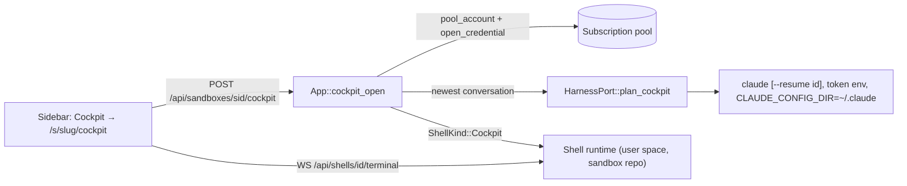

# SPEC-021: Cockpit, every user's permanent plain Claude session

Status: implemented
Date: 2026-10-12
Owner: Yulius task #19
Scope authorization: user request: "In this bar we need to add "Cockpit" at the top - this should
be one permament claude session, every user gets own session. User can run /clear there but can't
delete it. It's for quick btws and work that shouldn't become a task. Go." (screenshot: the
sandbox sidebar, New task above Tasks, Sessions, Git, …), then: "this should be a plain session
without any additional requirements hooks etc".

## Goal

Every user has one Claude Code session per sandbox, the Cockpit, first in the sidebar's
navigation. It is for quick questions and small work that should not become a task: a plain
Claude Code session with no Yulius hooks, MCP, briefing, steps, spec or delivery gates. It is
always there: the user can `/clear` it but never delete or close it, and it comes back with its
conversation after an exit, an idle stop or a server restart.

## Context

- Tasks (`crates/yulius-app/src/supervisor.rs`) always launch Claude Code with Yulius's hooks,
  status line, MCP server, briefing and discipline (`yulius-harness` `plan_claude`); a task also
  has a number, a branch and a worktree. None of that is wanted here.
- Sandbox shells (`crates/yulius-app/src/shells.rs`, UI-015/UI-016) are already per user and
  sandbox, private, run as the user's sandbox identity in the sandbox repository, get no task
  token or hooks, survive a server restart (adopted from `shells/<id>/shell.json`) and are
  reaped after a day without viewers. Their WebSocket speaks the task terminal protocol.
- A request outside any task already takes a subscription from the pool with
  `App::pool_account` (split proposals, `intake.rs`).
- Claude Code handles `/clear` itself (a new conversation in the same process). Its
  conversations are files under `<CLAUDE_CONFIG_DIR>/projects/<cwd slug>/`; the harness port
  finds the newest one (`newest_claude_session`).

## Requirements

| ID | Requirement | Evidence |
| --- | --- | --- |
| CKP-001 | Each user with write access has at most one Cockpit per sandbox. `POST /api/sandboxes/{sid}/cockpit` returns it, starting it when it is not running; concurrent calls start one. Read users are refused. | `cockpit.rs` tests |
| CKP-002 | (Amended by SPEC-037 MGT-004: the Cockpit gets the Yulius MCP server with the management tools.) The Cockpit is plain Claude Code: no `--settings`, `--mcp-config`, hooks, status line, task token, briefing or `--dangerously-skip-permissions`; the Claude OAuth token of a pool subscription in its environment (never in argv), `CLAUDE_CONFIG_DIR` in the user's own home (`/home/<login>/.claude` when contained), the first-run screens and folder trust settled. Its environment is otherwise the user's terminal environment (identity, Git as their GitHub account through the workspace credential, ports). | harness unit test, `cockpit.rs` |
| CKP-003 | A Cockpit that is started again resumes the user's newest conversation in that sandbox (`--resume <id>`), after `/clear` the cleared one's successor; a first start has none; a conversation it could not resume (exit with an error within 10 s) is skipped next time, so the Cockpit never stays stuck. | `cockpit.rs` |
| CKP-004 | The Cockpit cannot be deleted, closed or renamed: it is not in the shell list, the shell rename and close calls answer 404 for it, it does not count against the shells limit, and there is no delete route. | `cockpit.rs` |
| CKP-005 | The Cockpit is private: only its owner can get or attach to it; other users get their own. | `cockpit.rs` |
| CKP-006 | A running Cockpit survives a server restart (adopted as the Cockpit, not as a terminal); an idle one is ended after a day without viewers like shells and resumes on the next open. | `cockpit.rs` |
| CKP-007 | Without a subscription with capacity the call fails with a clear reason (`Conflict`/`Capacity`), nothing is left running. | `cockpit.rs` |
| CKP-008 | Sidebar: "Cockpit" is the first item of the sandbox navigation, opening `/s/<slug>/cockpit`: the Cockpit's terminal filling the centre with a short line saying what it is; an ended Cockpit offers "Start again"; read users see why they cannot use it. | `e2e/tests/cockpit.e2e.ts`, `navigation.e2e.ts` |

## Design

- The Cockpit is a shell runtime of kind `Cockpit` ([ADR-0020](../../docs/decisions/0020-cockpit-as-a-plain-shell-session.md)):
  same ownership, containment, adoption, terminal and idle reaping as shells, a different
  program. `ShellFile` records the kind (default `terminal`, so older records still adopt).
- `HarnessPort::plan_cockpit` builds the plain launch: argv `claude [--resume <id>] --model claude-opus-5-5 --effort high` (SPEC-023), env
  `CLAUDE_CONFIG_DIR`, `DISABLE_AUTOUPDATER=1`, secret env `CLAUDE_CODE_OAUTH_TOKEN`, and
  prepares `<home>/.claude/.claude.json` (onboarding done, theme, trust of the repository).
- A per-app async lock serialises Cockpit starts so a double click starts one.
- UI: `NAV` gets `['cockpit', 'Cockpit', 'gauge']` first; `pages/cockpit.js` posts, then
  mounts `createTerminalView` on `/api/shells/<id>/terminal`. Mock mode serves the call.

## Plan

- [x] Read the product context and related work, then write and validate the spec
- [x] A user's plain Cockpit session starts and resumes on a pool subscription (API, harness plan, tests)
- [x] The Cockpit is permanent and private: no close or rename, adopted after restart, reaped and resumed (tests)
- [x] Cockpit first in the sidebar opens its terminal (page, mock, e2e)
- [x] Independent review in a fresh session, findings fixed test-first
- [x] Every gate green, docs and the changes log updated

## Acceptance criteria

- A write user clicks Cockpit and gets a working Claude Code session in the sandbox repository;
  a second click, another tab or a reload shows the same session.
- `/clear` gives a fresh conversation in the same Cockpit; there is no way to delete it.
- Another user of the same sandbox gets a different Cockpit and cannot attach to this one.
- After `/exit` (or a server restart, or a day unwatched) opening the Cockpit continues the
  latest conversation.
- No Yulius hook, MCP server or briefing reaches the Cockpit session.

## Test plan

- Unit: `yulius-harness` `plan_cockpit` argv/env (no settings, MCP, hooks, bypass; token only
  in secret env; `--resume` when given).
- Integration (`crates/yulius/tests/cockpit.rs`, real ptyhost, a fake `claude` script that
  prints its argv and whether the token is set): start, reuse, concurrency, privacy, read
  user refused, not listed/closable/renamable, resume after exit with the newest conversation,
  adoption after restart, no subscription → error and nothing running.
- e2e (mock): Cockpit first in the navigation, opens its terminal, ended state offers Start
  again; navigation test updated.

## Decisions

- **Shell runtime, not a task** (ADR-0020): a task brings hooks, MCP, briefing, gates, a number,
  a branch and a worktree; the user asked for a plain session. Shells already give per-user
  privacy, containment, restart adoption and the terminal.
- **Per sandbox**: a Claude session needs a working directory and a sandbox's tools; the
  Cockpit runs in the sandbox repository like a shell.
- **Resume by id, not `--continue`**: `--continue` exits with an error when there is no
  conversation; the newest conversation file is known and picks up `/clear` successors.
- **No `--dangerously-skip-permissions`**: "plain" means Claude Code as a person starts it; the
  user switches modes with Shift+Tab. Reversible.
- **Default model**: Opus 5.5 at high effort (`--model claude-opus-5-5 --effort high`, SPEC-023
  DEF-004, superseding "no `--model`, the subscription's default"); `/model` changes it until
  the Cockpit starts again. The subscription is chosen by the weekly Opus cap too.
- **Subscription**: the pool's best placement at each start (`pool_account`); the Cockpit does
  not take a task session slot and is not moved between subscriptions while it runs (a limit
  shows in Claude Code; Start again picks another). The token is visible to the user's own
  session, as it already is to the agents of tasks they start.
- **Idle**: the process ends after a day without viewers like shells; the conversation stays
  and resumes, so the Cockpit itself is permanent.
- **Review round 1** (fresh session, REQUEST CHANGES on minors only): a running Cockpit is now
  returned before the start lock; a resume that fails at once is skipped next time; tests cover
  a failed start after the shell was prepared, an uncloned repository, no capacity, and the
  contained paths (config in `/home/<login>/.claude`, prepared and searched on the host); phones
  do not focus the terminal; CKP-002 says the environment is the user's terminal environment.
  Not changed: workspace git credentials of a Cockpit (and of every shell) adopted after a
  restart are not valid any more until it starts again, an existing shell limitation filed as #242;
  files dropped on a Cockpit go when its process ends, like a terminal's.
- **Review round 2** (fresh session, APPROVE at 498195d with minors): the page asks for its
  Cockpit again when the terminal is refused or loses its connection and follows it to a new id,
  so a Cockpit whose process is gone (a reboot) starts again by itself (e2e, mock
  `&cockpit=gone`); starts are serialised per user and sandbox instead of instance-wide (no new
  test: the double-open test still proves one start per user); a registration error after the
  spawn discards the process; only an error exit (not a signal) within 10 s of the spawn marks a
  conversation unresumable. Not changed: a request during the idle reaper's shutdown may still
  get the ending Cockpit, which then offers Start again.

## Evidence

- `scripts/dev ci` (repository contracts, script tests, check, fmt, clippy `-D warnings`, nextest,
  doctests, deny, machete, doc) at the review-round-1 head: exit 0, 1158 tests run, 1158 passed,
  16 skipped.
- `cargo test -p yulius --test cockpit`: 8 passed — one Cockpit for two concurrent opens, plain
  launch (no flags, token only in the environment, config and trust settled, no bypass), not
  listed/renamed/closed, not counted against terminals, no DELETE (405), private (404 for
  another writer, 403 for a reader), attachments for the owner only, resume of the newest
  conversation after `/exit` and after the idle reaper, a conversation that cannot be resumed
  skipped next time, adoption as the Cockpit after a restart, 409 without a subscription or a
  clone, 429 without capacity, a failed start after the shell was prepared leaving nothing, the
  contained config paths (`/home/alice/.claude`, prepared and searched on the host).
  The tests failed before the code (missing API; 404 on drop; the broken resume repeated).
- `cargo test -p yulius-harness --test launch`: 7 passed, including `plan_cockpit`.
- e2e (`npx e2e run`, mock): 32 files passed, 1 skipped (the live-model `agent.e2e.ts`); 134
  tests passed at round 1, including `cockpit.e2e.ts` (4, now 5 with the gone-process case) and `navigation.e2e.ts` (Cockpit first). Without
  the navigation entry the Cockpit test fails.
- Not verified here: a real `claude` binary in a contained production sandbox (the tests use a
  fake `claude` script and the real detached ptyhost; the contained case is checked on the
  planned paths, not with bwrap).
