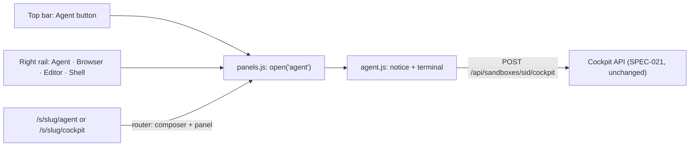

# SPEC-035: the Cockpit becomes the Agent, in the right panel

Status: implemented
Date: 2026-10-12
Owner: Yulius task #33
Scope authorization: user request: "Move cockpit to the right and change cockpit to "Agent". Add
distinct message that it's for quick work like setting up automations, asking quick questions etc
and everything more complex like writing code should happen directly in tasks, and not there".

## Goal

The user's own plain Claude Code session of a sandbox (SPEC-021, the "Cockpit") is called
**Agent** and lives on the right of the screen, in the tool panel next to Browser, Editor and
Shell, so it can be used beside any page instead of replacing it. Its panel says plainly what it is
for: quick work such as setting up automations or asking a quick question; anything bigger, such
as writing code, belongs in a task.

## Context

- SPEC-021 / ADR-0020: the Cockpit is a shell of kind `cockpit` started by
  `POST /api/sandboxes/{sid}/cockpit`; the UI is a full page (`pages/cockpit.js`) at
  `/s/<slug>/cockpit`, first in the left sidebar's navigation (`NAV`, `layout.js`).
- The right side of the screen is the tool rail and its resizable panel (`panels.js`, UI-042,
  UI-044): Browser, Editor and Shell, each a view kept alive per sandbox while hidden. The rail is
  hidden by default and shown with the top bar's Tools toggle; opening a panel shows it.
- `/s/<slug>/browser` already opens a right panel from a link: the router maps it to the composer
  and `app.js` opens the panel, then replaces the address with `/s/<slug>`.
- Task #27 (SPEC-029, running in parallel) trims the left navigation to Cockpit, Tasks, Git, CI,
  Secrets and Dashboard with the rest under "More"; whichever merges second drops the Cockpit
  entry from the trimmed list.
- Only the UI names the Cockpit for people; the API, the shell kind (`cockpit`) and the stored
  records are internal names.

## Requirements

| ID | Requirement | Evidence |
| --- | --- | --- |
| AGT-001 | The right rail's first tool is **Agent**: it opens the user's Agent session of the current sandbox (the SPEC-021 Cockpit, same API and behaviour: one per user and sandbox, resumed, Start again, recovered after a lost process, read users told why) in the right panel, beside the page in the centre. The session stays alive while the panel is hidden or shows another tool. | `e2e/tests/agent-panel.e2e.ts` |
| AGT-002 | The Agent panel shows a distinct notice above the session: it is for quick work (setting up automations, quick questions); anything more complex, such as writing code, should be done in a task. The notice offers "New task", which opens the new-task composer. | `agent-panel.e2e.ts` |
| AGT-003 | No "Cockpit" remains in the UI: the panel, its messages and errors say "Agent". | `agent-panel.e2e.ts` |
| AGT-004 | The left sidebar's navigation no longer lists the Cockpit. | `navigation.e2e.ts`, `agent-panel.e2e.ts` |
| AGT-005 | The top bar has an **Agent** button (sandbox pages only) that opens or closes the Agent panel, whether the rail is shown or not. | `agent-panel.e2e.ts` |
| AGT-006 | `/s/<slug>/agent` and the old `/s/<slug>/cockpit` open the sandbox with the Agent panel open, and the address becomes `/s/<slug>`. | `agent-panel.e2e.ts` |

## Design

- `pages/cockpit.js` becomes `agent.js`, `createAgentView(ctx, sandbox)`: the same open, recover
  and Start again logic, returning a panel view (`el`, `show`, `hide`, `destroy`) like the Shell
  view. It starts the session the first time the panel shows it (not when the panel is built),
  and focuses the terminal on each show (not on phones).
- `panels.js` `KINDS` gets `['agent', 'spark', 'Agent']` first; `createView('agent')` builds it.
- The notice is a `note` region at the top of the view: "For quick work: setting up automations,
  asking a quick question. Anything more complex, such as writing code, belongs in a task." with a
  "New task" link to `/s/<slug>`.
- `layout.js` drops the Cockpit from `NAV`; the tab row gets an Agent button (`ctx.toggleAgent`).
- `router.js` maps `agent` and `cockpit` like `browser` (composer + `panel: 'agent'`); `app.js`
  opens the panel and replaces the address.
- The server is unchanged: API paths, the shell kind and `COCKPIT_NAME` stay (internal names; a
  rollback still adopts the session). ADR-0030 records the move.

## Plan

- [x] Read the product context and related work, then write and validate the spec
- [x] The Agent opens in the right panel with its quick-work notice
- [x] The Agent leaves the left navigation; the top bar and old links open it
- [x] Independent review in a fresh session, findings fixed test-first
- [x] Every gate green, docs and the changes log updated

## Acceptance criteria

- On any sandbox page, clicking Agent (top bar or rail) opens the Agent session on the right while
  the page stays in the centre; closing and reopening shows the same conversation.
- The Agent panel shows the quick-work notice with a New task link above the terminal.
- The sidebar has no Cockpit; nothing in the UI says "Cockpit".
- An old `/s/<slug>/cockpit` link opens the sandbox with the Agent panel.

## Test plan

- e2e (mock), `e2e/tests/agent-panel.e2e.ts` replacing `cockpit.e2e.ts` (`agent.e2e.ts` is the unrelated live-model test): opens from the top bar beside a
  task, notice and New task link, quick question answered, same session after close/reopen and
  after another page, Start again after `/exit`, a gone process recovered, a failed start says why
  with Try again, read access explained, `/agent` and `/cockpit` links, not in the sidebar, axe
  clean.
- `navigation.e2e.ts`: the sandbox navigation without Cockpit; `rail.e2e.ts`: Agent first in the rail.
- The server's Cockpit tests (`crates/yulius/tests/cockpit.rs`) are unchanged and must still pass.

## Decisions

- **"Right" means the right tool panel** (ADR-0030): the right side of the screen is where the
  tools live; a panel keeps the session beside the page in use, which suits quick work (ask about
  the task in view, set up an automation while looking at its page). Alternatives: a full page
  reached from the right of the top bar (still replaces the page), a fixed right column of its own
  (a second panel system).
- **Top-bar button too**: the rail is hidden by default, so a rail button alone would hide the
  Agent from people who never open Tools.
- **Internal names stay `cockpit`**: renaming the API, shell kind and stored records would change
  public contracts and persistence for no user-visible gain.
- **Old links redirect** rather than 404, as `/browser` does.
- **Session starts on first show**, not when the panel host builds the view, so a sandbox visit does
  not take a subscription seat.
- **Review round 1** (fresh session, REQUEST CHANGES at 163a1b2): New task in the notice beside a
  task gave the keyboard back to the Agent (the panel re-shown for the new page focused it): a
  panel shown again for a new page or task now only refits; on phones New task closes the panel so
  the composer shows; the top-bar button and the `/agent` link show the rail only while the panel
  is open, without changing the remembered Tools choice; read users get no New task link; the
  spec's evidence names `agent-panel.e2e.ts`; tests added for each, for opening from the rail with
  the top-bar button following, for the session kept across another tool, and for a sandbox
  switch. Not changed: the button's name changes between Show and Hide Agent with
  `aria-pressed`, as the Tools button does.
- **Review round 2** (fresh session, REQUEST CHANGES at 47b5eb4): switching sandbox with the Agent
  open started the new sandbox's Agent and moved the keyboard into it; the session now takes focus
  only when the person opened the Agent (not on a new page or sandbox, nor when it recovers a lost
  process), with a studio → product test. A tool chosen from the rail itself now makes the rail the
  person's Tools choice, so it no longer disappears when that tool closes.
- **Review round 3** (fresh session, REQUEST CHANGES at 1c50892): the rail-button change had no test
  (added); closing the top-bar Agent with the rail's own Agent button kept the rail (only a click
  that opens a tool now adopts the rail); a session recovered right after the person opened the
  Agent lost the keyboard (the recovery now keeps the pending wish to focus). The nit that a slow
  start could take the keyboard after the person moved on is fixed too: a start focuses only if the
  keyboard is still where it was, nowhere, or in the Agent. Not changed: an `/agent` link to
  another sandbox while an Agent is open starts it without the keyboard (rare; the person clicks
  it). Round 3 is the last full round; a fourth, narrow review confirms these fixes because the
  merge needs an approved head.
- **Merge of task #27** (SPEC-029, its ADR took 0025): this decision became ADR-0026, then ADR-0030 after tasks #28, #32, #31 and #35 took 0026 to 0029; the Cockpit
  is left out of the trimmed navigation and SPEC-029 NAV-001 says where it went.
- **Review round 4** (fresh session, narrow, APPROVE at 4277747 with minors): the wish to focus
  from opening the Agent now ends when its first screen shows, so a recovery long after (a reboot)
  leaves the keyboard on the page (mock `rebootCockpits()`); the slow-start guard got its test
  (mock `holdCockpit`, a held answer, not a delay); SPEC-029 NAV-001 notes the move. Not changed: ADR-0025's title ("Six
  sandbox pages") is history, explained by its status note.
- **Confirmation of the round 4 fixes** (fresh session, APPROVE at f1ce280 with test minors): the
  two focus tests now wait until the terminal is shown (when a focus request lands) and the
  slow-start test holds the answer instead of relying on a delay; a comment says how a refused
  session keeps the keyboard.
- **CI on 2d06cd8**: the slow-start test failed once under load (`__yuliusMock` not defined yet: the
  mock backend is a dynamic import that can land after the page opens); it now waits for the mock
  with `mockReady`, as the drafts tests do. The same run's 30-minute timeouts were host overload
  (issue #280).

## Evidence

- `npx e2e run` (mock, full suite) at 4277747 (after merging dev): 32 files passed, 1 skipped (the
  live-model `agent.e2e.ts`); 170 tests passed. `agent-panel.e2e.ts` failed before the change (9 of
  9: no Agent button, notice, routes; Cockpit in the sidebar), and each review-round test failed
  before its fix (New task focus, phones, rail kept on, sandbox switch, rail closed from the rail,
  recovery right after opening, recovery long after opening).
- `scripts/dev ci` (repository contracts, script tests, check, fmt, clippy `-D warnings`, nextest,
  doctests, deny, machete, doc) at 4277747: exit 0, 1166 tests run, 1166 passed, 16 skipped
  (`crates/yulius/tests/cockpit.rs` unchanged and passing).
- Manual check in the Yulius browser (mock, 1280×800): the top-bar Agent button opens the Agent
  beside task #12 with the notice and New task link; Agent first in the rail; no Cockpit in the
  sidebar.
- Not verified here: a real `claude` session behind the Agent (the server path is unchanged from
  SPEC-021 and covered by its tests); the phone layout only through e2e at 390 px, not on a device.
