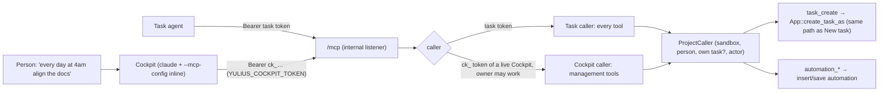

# SPEC-037: Tasks and the Cockpit create tasks and automations

Status: implemented
Date: 2026-10-12
Owner: Yulius task #35
Scope authorization: user request: "I got something like this. Tasks and cockpit should be able to
manage our whole system - especialy create tasks, automations. For example I want to tell cockpit:
"everyday on 4am align the current docs to the latest changes if they are not aligned" or "create a
task from that" etc". The attached screenshot shows the Cockpit answering "create a task to fix it"
with "I couldn't create the task from here … This Cockpit session has no Yulius tools, and the
agent tools have no way to create a task anyway", then a prompt to paste into New task.

## Goal

A person can ask the Cockpit, or a task's agent can decide, to create a task ("create a task from
that") or a scheduled automation ("every day at 4am align the docs to the latest changes"), and
Yulius does it with that person's authority, without anyone copying a prompt into New task.

## Context

- Task agents reach Yulius through the `yulius` MCP server (ADR-0006, `crates/yulius-app/src/mcp.rs`),
  authenticated by the run's task token. They already have `automation_create`,
  `automations_list`, `automation_update`, `workflows_list`, `tasks_list` and `task_get`, but no
  tool creates a task. `TaskOrigin::Agent` ("created by another agent through MCP") exists and is
  unused.
- Tasks are created by `App::create_task` (`lifecycle.rs`, `POST /api/sandboxes/{sid}/tasks`):
  access check, workflow pick (an id, or `auto` for Jev's choice), goal/prompt mode, a predecessor
  (`after_task_id`, SPEC-001 TSK-012) or a start rule (SPEC-017), the onboarding gate, then a start.
- The Cockpit (SPEC-021, ADR-0020) is a shell of kind `cockpit` running plain `claude`: no settings,
  hooks, MCP server, briefing or approval bypass (CKP-002). Its environment is the user's terminal
  environment, which holds `YULIUS_URL` (the internal listener, where `/mcp` is served) and a
  per-user workspace token that only issues Git credentials and lives in memory: it changes on
  every server restart, while a Cockpit outlives the restart (CKP-006).
- A shell's host token is random, sealed into `shells/<id>/shell.json` and kept across restarts.
- Measured on the installed Claude Code 2.1.292: `--mcp-config` takes an inline JSON string, and
  `${NAME}` in a server's headers is filled from the environment (a local stub server received
  `Authorization: Bearer secret123` from `"Bearer ${XYZ_TOK}"`, with `XYZ_TOK=secret123`).

## Requirements

| ID | Requirement | Evidence |
| --- | --- | --- |
| MGT-001 | The `task_create` MCP tool creates and starts a task in the caller's project from `prompt`, with optional `title`, `workflow` (id, name or `auto`), `mode` (`goal`, `prompt`, `auto`), `after_task` (a task number) or `start_rule`, `model` and `effort`. It follows the same rules as New task in the UI: the onboarding gate, chains, start rules, workflow steps, Jev's auto choice. The new task's origin is `agent` and its creator is the person on whose authority the caller acts. The result names the task (id, number, title, status, branch). | `crates/yulius/tests/manage_tools.rs` |
| MGT-002 | A task's agent acts with the authority of the task's creator: `task_create`, `automation_create` and `automation_update` are refused when that person is disabled or can no longer work in the project, and what it creates belongs to them. | `manage_tools.rs` |
| MGT-003 | Tools create at most 20 tasks per project per rolling hour (task agents and Cockpits together); one more is refused with the time until the next one is allowed. UI and automation tasks do not count. | `manage_tools.rs`, unit test |
| MGT-004 | The Cockpit gets the `yulius` MCP server: `--mcp-config` with an inline JSON naming `<YULIUS_URL>/mcp` and the header `Authorization: Bearer ${YULIUS_COCKPIT_TOKEN}`; the token only in the secret environment, never in argv or a file. Still no settings, hooks, status line, briefing, `--strict-mcp-config` (the user's own MCP servers keep working) or approval bypass. The read-only tools are allowed with `--allowedTools`; creating or changing something asks the person first. | harness unit test, `crates/yulius/tests/cockpit.rs` |
| MGT-005 | A Cockpit token is `ck_` and the SHA-256 of a fixed label and the Cockpit shell's host token, so it survives a server restart with its Cockpit. It is valid only while that Cockpit is live, and at every call the Cockpit's owner must be enabled and able to work in its project. Otherwise the call is refused as an invalid token. | `crates/yulius/tests/cockpit.rs` |
| MGT-006 | A Cockpit is served the management tools: `tasks_list`, `task_get`, `task_create`, `automation_create`, `automations_list`, `automation_update`, `workflows_list`, `sessions_search`, `session_read`. Its `tools/list` serves exactly these; any other tool (steps, spec, scopes, delivery, CI, issues, browser, secrets) is refused as unknown. Tasks keep every tool, now with `task_create`. | `cockpit.rs`, `mcp.rs` and `manage_tools.rs` unit/integration tests |
| MGT-007 | What a Cockpit creates is attributed to its owner: automations record `created_via = agent`, created by the owner, and audit actor `cockpit:<login>`; tasks have the owner as creator. `tasks_list` from a Cockpit lists the project's tasks without a `you` entry. | `cockpit.rs` |

## Design

- `coordination::ProjectCaller` carries what the management tools need: the sandbox, the person on
  whose authority it acts, the caller's own task (none for a Cockpit), the audit actor and detail.
  An `AgentContext` gives one (`task:<n>`, the task's creator); a Cockpit gives one
  (`cockpit:<login>`, its owner). `tasks_list`, `task_get`, `sessions_search`, `session_read`,
  `automation_*` and `workflows_list` take it instead of the task's context.
- `mcp.rs` resolves the bearer: `ck_…` to a Cockpit caller, otherwise the task token as before.
  `tools/list` and `tools/call` serve the caller's tool set.
- `lifecycle.rs`: `create_task` becomes `create_task_as(user, sandbox, request, origin)`, which the
  API (`ui`) and `task_create` (`agent`) both call.
- `cockpit.rs` derives the token from the runtime's host token and passes it, with the internal
  URL, to `plan_cockpit`.

## Acceptance criteria

- AC-MGT-1: a task's agent calls `task_create` with `{"prompt": "Align docs/ with the latest
  changes", "after_task": <its own number>}`. A chained task of the same creator, with origin
  `agent`, appears in the project.
- AC-MGT-2: a Cockpit calls `automation_create` with `{"name": "Align docs", "cron": "0 4 * * *",
  "prompt": "…"}`. The automation is on the Automations page, created by the Cockpit's owner.
- AC-MGT-3: a Cockpit launch plan carries the inline MCP config and the token only in the secret
  environment; a Cockpit's `tools/list` has `task_create` and not `steps_set`.
- AC-MGT-4: the 21st tool-created task within an hour is refused; a `ck_` token of an ended
  Cockpit, or of a user without write access, is refused.

## Plan

- [x] Read the product context and related work, then write and validate the spec
- [x] Task agents create tasks with task_create, bounded per project
- [x] The Cockpit is served the management tools under its own token
- [x] The Cockpit launches with the Yulius MCP server
- [x] Docs, ADR and architecture describe the managing Cockpit
- [x] Independent review in a fresh session, findings fixed test-first
- [x] Every gate green, docs and the changes log updated

## Test plan

- Unit (`yulius-harness` `launch.rs` tests): `plan_cockpit` with the Yulius server has the
  inline config, `--allowedTools` with the read-only tools, the token only in `secret_env`, no
  `--strict-mcp-config`, `--settings` or bypass. Without it, the plan is unchanged.
- Unit (`yulius-app`): the rolling-hour bound (20 allowed, the 21st refused, allowed again after
  the hour) on the injected clock.
- Integration (`crates/yulius/tests/manage_tools.rs`, the test server with fake agents):
  - `task_create` from a task: creates, chains after a number, applies a start rule, refuses an
    empty prompt and a creator who lost access, and hits the bound;
  - automation tools refused for a creator who lost access, `task_create` for a disabled one;
  - the read-only allowlist is a subset of the Cockpit's tools.
- Integration (`cockpit.rs`): a Cockpit's token: `tools/list` set, `task_create` and
  `automation_create` attributed to the owner (`created_via = agent`), `steps_set` refused, the
  token refused after the Cockpit ends, for a disabled owner and for one who lost access, and
  accepted again after a restart.
- Integration (`cockpit.rs`): the launched Cockpit's argv has the inline config, and its
  environment's `YULIUS_COCKPIT_TOKEN` is accepted by `/mcp`.
- Not covered by the gate: a live model choosing the tool (needs a paid credential). The inline
  config and header expansion were measured on Claude Code 2.1.292 (Context).

## Decisions

- **The Cockpit gets the MCP server, but stays without hooks and gates.** This supersedes
  ADR-0020/CKP-002 only for the MCP server. The person asked the Cockpit to "manage our whole
  system". MCP is the one coordination protocol (ADR-0006). The alternatives:
  - a shell command (`yulius task create`) authenticated by the workspace token: a second protocol,
    and that token is lost on every server restart;
  - a REST call with the person's login: the Cockpit has no session cookie, and handing it one
    would grant the whole UI API.
  Recorded as ADR-0029.
- **A Cockpit token derived from the persisted host token.** A random token per launch would be
  lost when the server restarts while the Cockpit keeps running. A stored token needs a
  migration. Deriving it from the sealed host token survives the restart, ends with the Cockpit,
  and reveals nothing about the host token (one-way hash). Validity is checked against live
  Cockpit shells. The few per sandbox and user make the scan cheap.
- **Inline `--mcp-config`, not a file.** The Cockpit runs contained as the user; the shell's run
  directory is outside what it can read. The inline JSON holds only `${YULIUS_COCKPIT_TOKEN}`,
  not the value (measured to expand). No `--strict-mcp-config`: the Cockpit is the person's own
  session, and their MCP servers keep working.
- **Read-only tools pre-allowed, changes asked.** Creating a task or automation is visible and
  costs subscription time. The person approves it once in the TUI, as they approve any tool there
  (no bypass, CKP-002).
- **One creation path.** `task_create` calls the same function as New task (`create_task_as`), so
  workflows, Jev's auto choice, chains, start rules and the onboarding gate behave the same. The
  intake split check (`intake_check`) is a UI step and stays out: the agent writes one request.
- **Authority of a person, never of Yulius.** A task acts for its creator (as `delivery_merge`
  does), a Cockpit for its owner; both are rechecked at every
  creating or changing call (a Cockpit's at every call), so lost access stops them.
- **A bound on tool-created tasks.** Every queue needs a bound (AGENTS.md). Agents creating tasks
  that create tasks could grow without one. Twenty an hour per project is far above a person's
  pace and stops a loop within minutes. It is in memory: a restart forgets it, which only resets
  the window.
- **Scope.** This task covers creating and listing tasks and automations, the user's examples.
  Stopping, archiving or deleting tasks and deleting automations from a Cockpit are separate
  capabilities, filed as follow-up issue #275.
- Cockpits already running when the server is updated keep running without the tools until they
  are started again ("Start again", `/exit`, or the idle stop).
- Review round 1 (fresh session, 799f762) approved with minor findings, all fixed in 1d8a897:
  task agents' `automation_create`/`automation_update` did not recheck the creator's access
  (now `manage_authority`, test-first: the new test failed before), wrong evidence files, missing
  tests (disabled owner or creator, bearer accepted after a restart, `created_via`), the
  read-only allowlist tied to the served tools by a test, small style and doc fixes. Round 2
  (1d8a897) approved; its nits (two stale SPEC-021 lines, refusal assertions that did not check
  why) are fixed. The second authority check on a Cockpit's creating calls stays: it is cheap
  (cached access) and keeps every creating tool safe whoever calls it.
- The full gate's first run here failed on `rustc` killed by SIGKILL. The reviewer's build in a
  tmpfs target directory and this one exhausted memory on a host without swap. Not a code
  failure: the rerun with nothing else building passed.

## Evidence

- Measured before the design (Claude Code 2.1.292, a local stub HTTP server): `claude
  --mcp-config '{"mcpServers":{"yt":{"type":"http","url":"http://127.0.0.1:20117/mcp",
  "headers":{"Authorization":"Bearer ${XYZ_TOK}"}}}}' -p hi` with `XYZ_TOK=secret123` and an
  invalid OAuth token: the stub received `Authorization: Bearer secret123`. No model was called
  (401 from the API).
- Test-first: the `task_create` integration tests failed with the tool's dispatch removed (2 of 4;
  the refusal tests were then tightened to fail for the wrong reason too). The
  automation-access test failed before `manage_authority` (the update was accepted).
- `cargo test -p yulius --test manage_tools`: 7 passed. `cargo test -p yulius --test cockpit`:
  12 passed. `cargo test -p yulius-harness --test launch`: 9 passed. `cargo test -p yulius-app
  --lib`: 143 passed (window unit test, Cockpit tool set). `cargo test -p yulius --test
  automations --test mcp_coordination --test sessions`: passed.
- `scripts/dev ci` on 1d8a897: exit 0. Repository checks, fmt, clippy `-D warnings`, nextest
  (1186 run, 1186 passed, 16 skipped), doctests, cargo-deny, machete, docs.
- Review: round 1 approved 799f762 (minor findings, fixed), round 2 approved 1d8a897 (nits,
  fixed), round 3 on the final head.
- Not tested here: a live model choosing `task_create` in a real Cockpit (needs a paid
  credential), and a Cockpit contained by the sandbox isolation reaching `/mcp` (it uses the
  same internal URL as contained task agents, which already reach it).
- After rebasing onto `dev`, which in the meantime took ADR-0027 and ADR-0028 (one integration
  test binary, SPEC-033): the ADR is renumbered 0029 and `manage_tools.rs` is a module of
  `tests/main.rs`. `cargo test -p yulius --test main -- manage_tools:: cockpit:: automations::
  mcp_coordination::`: 30 passed; repository check passed ("one product test binary").
- Follow-up: #275 (stop, archive or delete tasks and delete automations through MCP).
