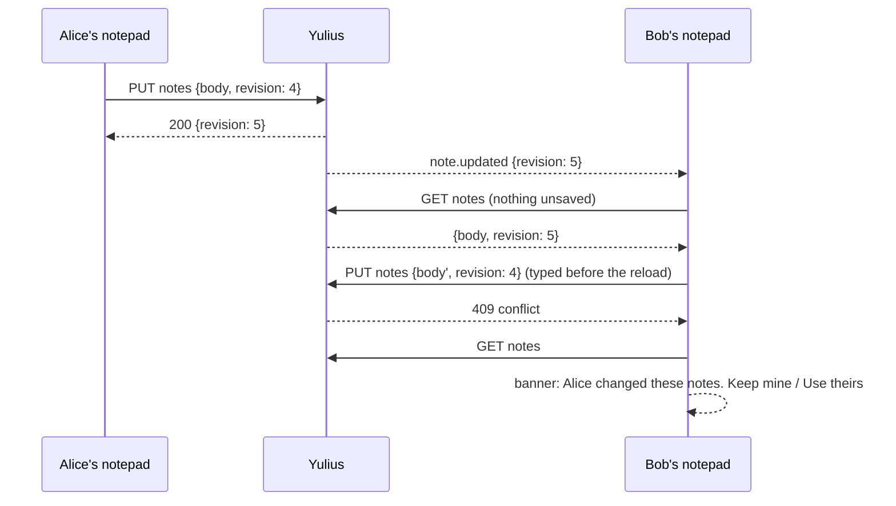

# SPEC-041: auto-saved notes for the sandbox and the team

Status: in progress
Date: 2026-10-12
Owner: Yulius task #40
Scope authorization: user request: "Here we want auto-saved notes, sandbox-wise and team-wise"
(screenshot: the tools rail with Browser, Editor and Shell, and empty space below them).

## Goal

The tools rail gets a fourth tool, **Notes**, below Shell. It holds two shared notepads: **This
sandbox**, one per sandbox, and **Team**, one for the whole Yulius instance. Notes are saved by
themselves while people type: no Save button, nothing lost after a reload, a sandbox switch or
another device. Everyone who opens a notepad sees the same text, and an edit by a teammate shows up
without a reload. When two people type at the same time, neither text is lost without a choice.

## Context

- The rail and its panel live in `crates/yulius-server/web/assets/panels.js` (`KINDS`, `createView`).
  One tool is open at a time, its width is kept per user, and its view stays alive while hidden.
  Parallel task #33 (SPEC-035) adds an "Agent" tool at the top of the same list; Notes goes last,
  so the two changes merge cleanly.
- Nothing in Yulius stores free text for people today. The composer's drafts (SPEC-026, ADR 0021)
  live in one browser and belong to one person, which is the wrong fit for shared notes. Team
  secrets (SPEC-040, task #39) are a vault with notes per secret, a different thing.
- Persistence is SQLite with ordered migrations (`crates/yulius-store/src/lib.rs`, ADR 0004).
  Store areas are traits in `crates/yulius-app/src/ports/store_ext.rs` that `SqliteStore` implements.
- Permissions come from GitHub (ADR 0007). `App::require(user, sandbox, Action)` maps them:
  `View` is read access, `Work` is write access (browser, editor, shell).
- `WS /api/events` (`crates/yulius-server/src/routes/events.rs`) pushes `UiEvent`s. An event with a
  sandbox goes only to people who can view that sandbox; one without a sandbox goes to everyone
  signed in.
- The web UI is plain ES modules with a mock backend (`assets/mock.js`) that the end-to-end
  tests use (`e2e/`).

## Requirements

| ID | Requirement | Evidence |
| --- | --- | --- |
| NOT-001 | The tools rail shows **Notes** after Shell. Its panel has two tabs, "This sandbox" and "Team", and remembers the last one per browser. | e2e `notes.e2e.ts`, `rail.e2e.ts` |
| NOT-002 | A notepad saves by itself 600 ms after the last keystroke, and also when the text box loses focus, the panel closes or hides, or the page is hidden. The head shows the state: "Saving…", "Saved", or "Not saved, retrying…" after a failure. A failed save is retried with growing pauses (1 s doubling up to 30 s) while the text differs from what was saved. | e2e `notes.e2e.ts` (reload shows text; failure then recovery) |
| NOT-003 | Sandbox notes: one per sandbox, shared by everyone who can view it. Reading needs read access (`View`), editing needs write access (`Work`). A reader sees the text read-only with a line saying why. A sandbox nobody may see answers 404. | Rust `notes::sandbox_notes_follow_github_access` |
| NOT-004 | Team notes: one for the instance, read and edited by every signed-in person. | Rust `notes::team_notes_are_shared_by_everyone_signed_in` |
| NOT-005 | `GET /api/notes` and `GET /api/sandboxes/{sid}/notes` return `{scope, body, revision, updated_at, updated_by}`. A notepad never written is `{body: "", revision: 0}`. `PUT` takes `{body, revision}`, where `revision` is the revision the edit started from. It stores the text as revision + 1 and returns the note. When the stored revision differs, it answers `409 conflict` and stores nothing. | Rust `notes::*` |
| NOT-006 | Bounded: a body holds at most 256 KiB of UTF-8 (larger: `422 invalid`). There is exactly one row per notepad, so storage grows only with sandboxes. | Rust `notes::a_note_is_bounded` |
| NOT-007 | Every stored edit publishes `note.updated {scope, sandbox_id, revision, updated_by}` on `WS /api/events`. A sandbox note's event reaches only people who can view that sandbox. An open notepad with no unsaved typing loads the newer text and keeps the caret where it was. | Rust `notes::an_edit_is_announced_to_viewers`; e2e (a teammate's edit appears) |
| NOT-008 | Edits at the same time: a save refused with 409 loads the current note. If it equals the local text, the notepad simply adopts it. Otherwise a banner names who changed it and offers "Keep mine" (saves the local text over the newer revision) and "Use theirs" (replaces the local text). Until the person picks one, nothing is saved and the local text stays on screen. | e2e `notes.e2e.ts` (conflict, both choices) |
| NOT-009 | Accessible: tabs are a `tablist`, the text box is labelled, the save state is a polite live region, and the open panel has no WCAG A/AA violations (axe). It works at 390 px. | e2e `notes.e2e.ts` (axe, phone) |

## Acceptance criteria

- AC-NOT-1: open Notes, type in "This sandbox", reload: the text is there and the head reads "Saved".
- AC-NOT-2: "Team" shows the same text in another sandbox; "This sandbox" differs per sandbox.
- AC-NOT-3: a teammate's edit (an event with a newer revision) appears in an idle notepad without a reload.
- AC-NOT-4: a save refused with 409 shows the conflict banner. "Keep mine" stores the local text and
  "Use theirs" shows the teammate's.
- AC-NOT-5: a member with read access sees sandbox notes read-only and can edit team notes.
- AC-NOT-6: a failed save says "Not saved, retrying…" and saves once the server answers again.

## Plan

- [x] Read the product context and related work, then write and validate the spec
- [ ] Sandbox and team notes are stored with revisions behind the notes API
- [ ] A saved note is announced on the event stream to the people who may read it
- [ ] The rail's Notes panel shows both notepads and saves them by itself
- [ ] Simultaneous edits end in a choice instead of a lost text, and teammates' edits appear live
- [ ] Independent review in a fresh session, findings fixed test-first
- [ ] Every gate green, docs and the changes log updated

## Design

**Storage.** Migration `0013_notes.sql` creates `notes(scope TEXT PRIMARY KEY, body TEXT NOT NULL,
revision INTEGER NOT NULL, updated_by TEXT, updated_at INTEGER NOT NULL)`. `scope` is `team` or
`sandbox:<sid>`. `NoteStore` (in `store_ext.rs`) has two methods. `note(scope)` returns the stored
note, if any. `put_note(scope, body, base_revision, by, at)` is a compare-and-set in one
transaction: it updates the row whose revision equals the base, or inserts revision 1 when the base
is 0 and no row exists. It returns the new note, or `None` on a revision mismatch.

**Application.** `crates/yulius-app/src/notes.rs` holds `App::note`, which checks access and returns
an empty note at revision 0 when none is stored, and `App::save_note`. That method checks access
(team: signed in; sandbox: `Work`) and the size, runs the compare-and-set, and publishes the event
(team: no sandbox; sandbox: that sandbox). `updated_by` is the person's display name: the GitHub
login, else the user's name.

**API.** `crates/yulius-contracts/src/api/notes.rs` (`Note`, `SaveNote`) and
`crates/yulius-server/src/routes/notes.rs` provide `GET/PUT /api/notes` and
`GET/PUT /api/sandboxes/{sid}/notes`. Their body limit is 2 MiB, which leaves room for JSON
escaping; the application enforces the 256 KiB limit.

**Web.** `assets/notes.js` exports `createNotesView(ctx, sandbox)` for `panels.js`. The view holds
one notepad controller per scope: a textarea with `mdinput`, `base` (the last revision known),
`saved` (the text known to be stored), a debounce timer, one save in flight, a retry timer and a
conflict state. The head shows the tab strip and the save state. The store forwards `note.updated`
events, and the view reloads a notepad when the event's revision is newer and nothing is unsaved.
`mock.js` keeps notes in memory with the same contract and lets a test edit a note "as someone else".

## Test plan

- Rust integration tests `crates/yulius/tests/notes.rs` (declared in `tests/main.rs`): empty notes
  at revision 0; save and read back; a stale revision gives 409 and stores nothing; the size limit;
  a reader can read but not edit sandbox notes and can edit team notes; a user without access gets
  404; events reach a sandbox's viewers only. A store unit test covers the compare-and-set.
- e2e `e2e/tests/notes.e2e.ts` in mock mode: AC-NOT-1 to AC-NOT-6, the remembered tab, axe and
  390 px. `rail.e2e.ts` is updated for the fourth tool.
- Not covered: two real browsers against a real server (the mock simulates the teammate), and
  `pagehide` while the network is gone.

## Decisions

- Server-stored, shared notes (ADR 0029). "Team-wise" means people share them, so browser storage
  cannot work. One row per notepad keeps it simple and bounded.
- Optimistic revisions instead of real-time co-editing (CRDT or OT). The team is 2 to 5 people, and
  a whole-text compare-and-set with an explicit choice on conflict never loses text silently.
  Merging characters live would need a CRDT library and a socket protocol for little gain.
- Editing sandbox notes needs write access, like the other tools of the rail. Reading needs read
  access, like everything else in the sandbox. Team notes are open to every admitted person, since
  the instance is the team.
- A plain textarea with Markdown-while-typing (`mdinput.js`), not the block editor
  (`mdeditor.js`). Notes are quick text, the textarea keeps the caret stable across live reloads,
  and the block editor's re-render would not.
- History is kept only as a revision counter. Versions and undo across sessions are out of scope.
