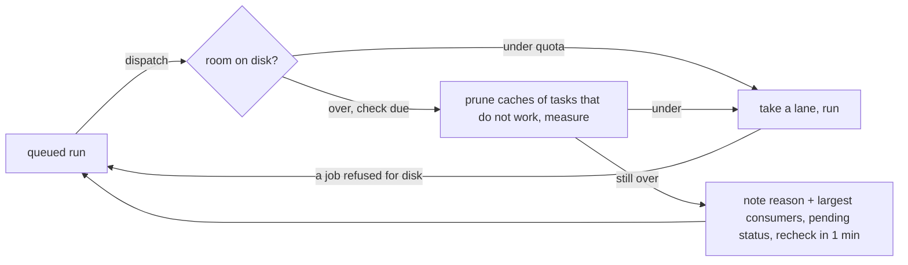

# SPEC-059: CI waits for disk instead of erroring; a working task's caches stay

Status: implemented
Date: 2026-10-13
Owner: Yulius task #50
Scope authorization: GitHub issues #240, #256, #258 and #245, through task #50 (part of task #47,
"fix all open actionable GitHub issues").

## Goal

A sandbox over its soft disk quota no longer turns Yulius CI runs into errors. A run blocked only
by the quota stays queued, says why and who uses the space, and starts by itself once usage is
under the quota, so an armed merge keeps waiting for it. Disk upkeep frees what it can at once,
and never removes the caches of a task whose background shell or subagent may still be building.

## Context

- **CI errors over the quota (#240, #256, #258).** On 2026-10-12, with six or seven tasks building
  Rust in the `yulius` sandbox, usage reached 100.9–151 GB of the 100 GB quota. Every CI run ended
  `error` within 1–5 seconds. The path:
  - Each CI job calls `isolation_join` (`crates/yulius-app/src/isolation.rs`), which calls
    `Manager::prepare` (`crates/yulius-sandbox/src/manager.rs`).
  - Over the quota, `prepare` refuses every start, CI included (`PrepareError::OverQuota`). The
    app prunes idle tasks' caches and asks once more. If that frees nothing, the job ends `error`.
  - An errored run is a verdict (`yulius_domain::ci::plan`): the commit is not queued again.
    `retry_errored_run` (SPEC-020) re-queues it once, and the second error stays.
  - The commit status `error` reads as failed checks, so an armed `delivery_merge` is dropped
    (`merge_armed_task`).
- **The refusal names nobody (#258).** "this sandbox uses N of its 100.0 GB disk quota; free
  space" does not say which worktrees hold the space. Usually it is other live tasks.
- **Caches pruned under a working task (#245).** On 2026-10-12 at about 14:40 UTC, task #25's
  `target/` disappeared while its background `scripts/dev ci` compiled. Afterwards it held 66 MB.
  At 15:11 UTC Yulius pruned 18.2 GB of the same task while its review subagent ran. The server
  logs of that day are not reachable from a task sandbox, so the cause comes from the code and
  the transcript:
  - The host volume was at 87 GB of 387 GB at 14:52, and the sandbox's quota is 100 GB. So the
    sandbox was at or above the 90 % pressure threshold. Its CI runs failed over the quota from
    15:06. Under pressure, upkeep prunes idle tasks' caches, largest first.
  - Upkeep decides "idle" with `cache_owner`, from the cached `background_shells` count. That
    count is `-1` ("unknown") when the last probe gave no answer: the 3-second probe timeout
    under heavy load, a probe that raced the turn's end, or a server restart. `-1` read as "no
    shells", so the idle agent's running gate counted as nothing.
  - Background subagents were not tracked at all then. STA-001 (SPEC-032, 2026-10-13) now counts
    them in the turn record, but upkeep sees them only through the same cached count.
- **Already on `dev`:**
  - SPEC-033: one integration test binary, so `target/` is about 4 GB instead of 17.
  - SPEC-050 DSK-102: a `yulius wait` shell is not a build, so a task waiting for CI can be
    pruned.
  - SPEC-050 CI-106/CI-107: CI lanes, and upkeep's claim of the CI checkouts.
  - SPEC-008 and SPEC-019 upkeep: ended tasks always, idle tasks at 90 %, long-idle tasks after
    4 hours, CI checkouts while no run executes.

## Requirements

| ID | Requirement | Evidence |
| --- | --- | --- |
| DSK-201 | Upkeep decides whether a running, idle task's caches may go on a fresh probe at that moment. A running background shell (not `yulius wait` alone, DSK-102) or a pending background subagent keeps them. So does a probe that cannot answer: unknown counts as working. A task with no live agent process has no background work. The probe runs only when the task's caches could go this round (under pressure, or idle 4 hours), and again just before each removal. | `disk::an_idle_task_with_background_work_keeps_its_caches` |
| DSK-202 | A sandbox measurement also records the largest consumers: the five largest directories, two levels below the sandbox directory (`worktrees/<task>`, `ci/jobs`, `home/...`) or in its system layer. A quota refusal, of a session or CI, names them with their sizes ("task #26 35.0 GB, CI job checkouts 14.0 GB"). | `usage::tests::the_largest_consumers_are_kept`, `disk::a_refusal_names_the_largest_consumers` |
| CI-301 | A queued CI run whose sandbox is over its quota is not started. Its record says why ("waiting for disk space: ... largest: ...; it starts by itself once usage is under the quota"). The commit status stays `pending` with that reason, and is published once per change of reason. | `local_ci::a_run_over_the_disk_quota_waits_and_starts_when_space_frees` |
| CI-302 | While a run waits for disk, Yulius frees space itself: upkeep under pressure (caches of tasks that do not work, largest first, CI checkouts while no run executes), then a fresh measurement. This happens at most once per `CI_DISK_RECHECK` (1 minute) per sandbox, off the dispatcher's loop, and only when a lane is free. A check is bounded (10 minutes); one that fails, hangs or panics counts as still over. The dispatcher waits at most a second for a sandbox's reading and otherwise starts the run (CI-303 is the safety net). The run starts at the first dispatch after usage is under the quota. The wait ends only that way, or when the run is superseded or cancelled. No timeout turns it into an error. | same; `local_ci::a_run_waiting_for_disk_is_superseded_like_any_queued_run` |
| CI-303 | A job refused for the quota after its run started (usage crossed the quota between the check and the job's start) stops its siblings and puts the run back in the queue instead of ending it `error`. That happens only when every errored job was refused for disk and none failed. Its jobs are queued again, and no run of the sandbox starts before the next check (one minute), so nothing loops. A cancel that arrives meanwhile still cancels it. A refusal while the reading is under the quota (isolation still being prepared) still ends the run `error`. | `local_ci::a_job_refused_for_disk_puts_its_run_back_in_the_queue`, `local_ci::a_refusal_that_is_not_the_disk_quota_ends_the_run_in_error`, `ci::exec::tests::only_disk_refusals_put_a_run_back_in_the_queue` |
| CI-304 | A run waiting for disk keeps its commit status `pending`, so an armed `delivery_merge` keeps waiting for it and merges when it passes. | `local_ci` tests above (status stays `pending`); `merge_armed_task` drops only on `failure` |

## Design

- **Fresh owner check (DSK-201).** `App::cache_owner` becomes async and asks
  `background_work_now(task)` for a running, idle task:
  - pending background agents (`runtime.background_agents > 0`) mean `Some(true)`;
  - the live attempt's agent process is probed with the bounded probe: `Some(n)` means `n > 0`,
    and `None` (no answer) means unknown;
  - no live attempt, or no agent pid, means `Some(false)`.

  Unknown and true both keep the caches. `owner_of` stays pure. It receives
  `busy = background_work != Some(false)`.
- **Largest consumers (DSK-202).**
  - `usage::measure` groups the bytes it already counts by the first two path components below
    each root (the system layer is labelled `system`) and keeps the five largest.
  - The manager keeps them with the reading. The port gains `largest(sandbox)`, empty by default.
  - The app labels them: `worktrees/<task id>` is "task #N", `ci/jobs` is "CI job checkouts",
    anything else stays as its path.
  - `isolation_join` appends them to a quota refusal.
- **CI waits (CI-301..303).**
  - `App::ci.disk_waits: Mutex<HashMap<sandbox, DiskWait { until_ms, checking }>>`.
  - When a lane is free, `ci_dispatch` asks `ci_disk_room(sandbox)` before it takes it:
    - while the sandbox's wait entry has `until_ms` ahead or a check runs: no room;
    - no isolation, no reading (or none within a second), or under the quota: room, and any
      wait entry is cleared;
    - otherwise it marks `checking` and spawns the check: `disk_upkeep(sandbox, true)`, then
      `measure_disk`. Still over the quota: it notes the reason on every queued run of the
      sandbox (publishing those whose reason changed) and sets `until_ms = now +
      CI_DISK_RECHECK`. Under the quota: the entry is cleared. Either way the dispatcher is
      woken.
  - The upkeep cannot claim the CI checkouts while a lane runs (CI-107), so the check runs
    before a lane is taken.
  - The store clears a run's reason when it moves to `running`: a reason before that is only a
    queue note.
  - A job whose `isolation_join` is refused with `Conflict` while the sandbox's reading is over
    the quota ends with `Ended::NoDisk`. `Conflict` alone is not enough: strict isolation also
    refuses with it while the base system is built. The `NoDisk` job stops its siblings. When
    every errored job ended that way, none failed and the run is not cancelled, the run goes back
    to the queue (`requeue_ci_run` with the note "queued again: the sandbox was over its disk
    quota") and the sandbox backs off for `CI_DISK_RECHECK`.

## Acceptance criteria

1. Over the quota, a queued run stays `queued` with a reason naming the disk wait and the largest
   consumers. Its commit status is `pending`. It never ends `error` for the quota.
2. Once usage is under the quota, the next dispatch after the recheck starts the run and it
   passes. Nobody calls `ci_rerun`.
3. A job refused for the quota after its run started leaves the run `queued`, not `error`.
4. Under pressure, an idle task with a running background shell, with a pending background
   subagent, or whose probe cannot answer keeps its caches. An idle task without any loses its
   caches, largest first.
5. A session start refused over the quota names the largest consumers.

## Test plan

- `yulius-sandbox` `usage`: grouping by two components, the system layer label, the five largest
  in order.
- `yulius` integration `disk.rs`:
  - an idle running task with a live attempt keeps its caches under pressure while the fake host
    reports a shell, and while the probe gives no answer;
  - it keeps them while the turn record reports background agents;
  - it loses them when the host reports no shell;
  - a refused start names the largest consumers as "task #N".
- `yulius` integration `local_ci.rs`: a fake isolation over the quota.
  - The run stays queued with the reason, and the status is `pending`.
  - Usage drops and the clock passes the recheck: dispatch starts the run and it passes.
  - A fake whose next start finds usage crossed the quota (its reading goes over and `prepare`
    refuses): the run goes back to the queue, then passes once usage is under the quota.
  - A fake that refuses without a reading over the quota (isolation still being prepared): the
    run ends `error`, once.
- Store: a run's queue note goes when it starts.
- Not automated: a real 100 GB sandbox with four to six tasks building Rust (#256, #258). The unit's
  figures stand in for it.

## Plan

- [x] Spec, ADR and plan for the disk wait
- [x] Upkeep keeps the caches of a task whose background shell or subagent may run
- [x] Measurements and quota refusals name the largest consumers
- [x] A CI run over the quota waits in the queue and starts when space frees
- [x] A job refused for disk puts its run back in the queue
- [x] Docs, changes log and every gate green
- [x] Independent review findings resolved

## Decisions

- **CI waits under the shared quota; no separate CI budget, no shared target directory.**
  Recorded in [ADR-0045](../../docs/decisions/0045-ci-waits-for-disk-under-the-shared-quota.md).
- **Unknown counts as working.** Keeping a cache we are unsure about costs disk until the next
  round. Deleting it under a running build costs the agent its build and minutes of work (#10
  lost 70 minutes, #25 its gate). A probe that never answers would also block long-idle pruning
  (DSK-002) for that task, which is the safe side.
- **No timeout on the disk wait.** A timeout that ends `error` would bring back the problem.
  Supersede and cancel still end the wait, and the reason is visible in `ci_status` and on the
  commit.
- **The check runs off the dispatcher's loop.** Upkeep sizes caches and the measurement walks the
  sandbox (up to tens of seconds at 100 GB). Neither may hold back other sandboxes' runs.
- **Residual races are accepted, not fixed.** The independent reviews found two windows of a few
  awaits each:
  - A `ci_cancel` that reads a run as running just before a disk requeue returns `Ok(false)`, so
    the cancel is not lost silently. Supersede retries it at the next sync.
  - A background measurement that lands between a job's refusal and `ci_over_quota` can read
    under the quota. The run then ends `error` once, as before this change.

  A typed over-quota error from the port would close the second window. It would need an
  `AppError` variant across every HTTP mapping, which is out of proportion for this fix.

## Evidence

- **#245, cause.** The server logs of 2026-10-12 are not reachable from a task sandbox. Task
  #25's transcript (`sessions_search` "failed to move dependency graph") shows:
  - 87 GB used on the volume at 14:52 UTC, against the sandbox's 90 GB pressure line;
  - `target/` at 66 MB after the gate's background run;
  - the CI quota errors that started at 15:06.

  In the code, `cache_owner` read the cached probe count, where `-1` (no answer) counted as no
  shells, and background agents were not tracked before STA-001. Both are fixed by DSK-201.
- **Tests that failed before the fix and pass after it:**
  - `disk::an_idle_task_with_background_work_keeps_its_caches` failed on its first assertion;
  - `local_ci::a_run_over_the_disk_quota_waits_and_starts_when_space_frees` and
    `local_ci::a_job_refused_for_disk_puts_its_run_back_in_the_queue` failed with the run ending
    `error`;
  - `local_ci::a_refusal_that_is_not_the_disk_quota_ends_the_run_in_error` was checked without
    the quota guard: CI never settled.

  New unit tests: `usage::tests::the_largest_consumers_are_kept`,
  `ci::exec::tests::only_disk_refusals_put_a_run_back_in_the_queue`,
  `ci::disk_wait::tests::a_waiting_run_says_how_full_the_sandbox_is_and_who_holds_the_space`, the
  queued-status case in `yulius-domain` `ci`, and the reason-clearing case in `yulius-store`
  `ci`.
- **Flakiness:** the four new `local_ci` tests passed in 10 consecutive runs, and the whole
  `local_ci` file in 5 runs after the last change. An early race in the status assertion was a
  test that did not wait for the publish. It was fixed to poll for the condition.
- **Gate:** `scripts/dev ci` (repository check, unit tests, `cargo check`, fmt, clippy
  `-D warnings`, nextest, doctests, deny, shear, doc) exited 0 at 48ff3a6 and at 5870867. Both
  runs had 1277 tests passed and 16 skipped.
- **Review:** three independent rounds.
  - Round 1 requested changes: one major (a non-quota `Conflict` looped) and six minors, all
    fixed.
  - Rounds 2 and 3 approved. Their minors were fixed (late cancel, bounded check, a stale
    executor dropping a re-dispatched run's channel) or recorded above.
- **Not testable here:** a real 100 GB sandbox with four to six tasks building Rust (#256
  "four tasks building ... a queued CI run starts and finishes", #258 "six tasks ... stay under
  the quota"). Over the quota, CI now waits and Yulius prunes what it may, but working tasks
  alone can still hold the space (ADR-0045).
