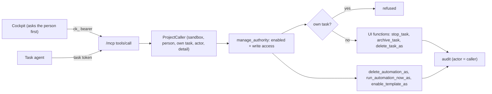

# SPEC-066: the Cockpit and agents stop, archive and delete tasks and run, delete and enable automations through MCP

Status: in progress
Date: 2026-10-13
Scope authorization: task #58 (part of task #47, "fix all open actionable GitHub issues without
creating new issues and close them"): fix GitHub issues #275 and #293 following their acceptance
criteria. Extends [SPEC-037](SPEC-037-i-got-something-like-this-tasks-and-cock.md) (MGT-001..007,
[ADR-0029](../../docs/decisions/0029-cockpit-manages-through-mcp.md)) and
[SPEC-042](SPEC-042-create-2-default-automations-that-can-be.md) (AUT-007..008).

## Goal

From the Cockpit or a task's agent, a person can have Yulius stop, archive or delete a task,
delete an automation, run one now, and enable a ready-made automation by its catalog id, with
the same rules, permissions and audits as the web UI, without opening the UI.

## Context

- SPEC-037 gave the Cockpit (`ck_…` bearer, its owner) and task agents (task token, the task's
  creator) the management tools `tasks_list`, `task_get`, `task_create`, `automation_create`,
  `automations_list`, `automation_update`, `workflows_list`, `sessions_search` and `session_read`
  (`crates/yulius-app/src/mcp.rs`, `COCKPIT_TOOLS`). A tool acts through a
  `coordination::ProjectCaller` (sandbox, person, own task, actor `task:<n>` / `cockpit:<login>`,
  audit detail); `App::manage_authority` rechecks at every changing call that the person is
  enabled and can work in the project.
- The UI's actions: `App::stop_task` (`POST /api/tasks/{tid}/stop`, write), `App::archive_task`
  (`POST /api/tasks/{tid}/archive`, write: resting tasks, or a Done one which is closed first),
  `App::delete_task` (`DELETE /api/tasks/{tid}`, write: not live; a Done one is closed first;
  audited `task.deleted` with the person's login), `App::delete_automation` (write, audited
  `automation.deleted`), `App::run_automation_now` (write, audited `automation.run_now`) and
  `App::enable_automation_template` (SPEC-042 AUT-008: create the ready-made automation enabled,
  or enable the project's automation of the same name keeping its content; serialized; unknown id
  404). Stopping and archiving are not audited in the UI.
- The Cockpit pre-allows only read-only tools (`yulius_harness::launch::COCKPIT_READ_ONLY_TOOLS`);
  Claude Code asks the person before any other tool. Task agents run with the approval bypass.
- Gaps: #275 (no tool stops, archives or deletes a task, deletes an automation or runs one now)
  and #293 (`automations_list` and `automation_create` know nothing about the catalog).

## Requirements

| ID | Requirement | Evidence |
| --- | --- | --- |
| MGT-008 | `task_stop`, `task_archive` (optional `archived`, default true; false restores) and `task_delete` take a task of the caller's project by `task_id` or `number` and run the UI's function for the person the caller acts for (`manage_authority`, then the UI's own write-access check): the same refusals (a live task is not archived or deleted, "stop the task first"; a Done one is closed first) and outcome. A task of another project is "not found". | `crates/yulius/tests/manage_tools.rs` |
| MGT-009 | A task's agent cannot stop, archive or delete its own task through these tools; the refusal says so and changes nothing. | `manage_tools.rs` |
| MGT-010 | Each successful call is audited with the caller as actor (`task:<n>` / `cockpit:<login>`) and the caller's detail: `task.stopped`, `task.archived` / `task.unarchived`, `task.deleted` (the UI's deletion audit, now with the caller instead of the person's login), `automation.deleted`, `automation.run_now`. | `manage_tools.rs`, `cockpit.rs` |
| MGT-011 | `automation_delete` and `automation_run_now` take an `automation_id` of the caller's project and do what the UI does (delete with its history, tasks stay; one run now, also when disabled, the previous-active rule applies), for the person the caller acts for. | `manage_tools.rs` |
| MGT-012 | The Cockpit is served the new tools (`COCKPIT_TOOLS`); none of them is pre-allowed, so Claude Code asks the person before each one. The briefing announces them to task agents. | `mcp.rs` unit tests, `cockpit.rs`, `manage_tools.rs` |
| AUT-012 | `automations_list` also returns `ready_made`: the catalog's automations (id, name, description, schedule, workflow) with `automation_id`, the project's automation of the same name or `null`. `automation_template_enable` (`template`: a catalog id) has the semantics of `POST …/automation-templates/{id}/enable`: creates it enabled (`created: true`, `created_via: agent`, created by the person the caller acts for, audited with the caller and the template), or enables the project's automation of that name keeping its content (`created: false`). Enabling twice never makes a duplicate; an unknown id is an error naming the known ids. | `crates/yulius/tests/automations.rs` |

## Design

- `manage.rs` gets the task tools: resolve the task in the caller's project
  (`agent_task_ref`), refuse the caller's own task, build an `AuthContext` for the person from
  `manage_authority`, call the UI's function, audit with the caller.
- `tasks.rs`: `delete_task` keeps its signature and calls `delete_task_as(ctx, id, actor,
  detail)`, which holds the body; only the audit's actor and detail come from the argument.
- `automations.rs`: `delete_automation`, `run_automation_now` and `enable_automation_template`
  become thin wrappers over `…_as` functions that take the person, the actor and the audit
  detail (and, for the template, `created_via`). The tools call those with the caller's.
- `mcp.rs`: descriptors and dispatch for `task_stop`, `task_archive`, `task_delete`,
  `automation_delete`, `automation_run_now`, `automation_template_enable`; `COCKPIT_TOOLS` grows
  by them; the Cockpit's instructions mention them. `COCKPIT_READ_ONLY_TOOLS` is unchanged.

## Acceptance criteria

- AC-MGT-5: alice's task agent stops alice's other running task; the task stops, the audit has
  `task.stopped` by `task:<n>`. It then archives it (`task.archived`) and deletes it
  (`task.deleted` by `task:<n>`).
- AC-MGT-6: the agent's `task_stop`, `task_archive` and `task_delete` on its own task are refused
  and the task keeps running.
- AC-MGT-7: once alice lost write access, the agent's `task_stop`, `task_delete`,
  `automation_delete` and `automation_run_now` are refused for her access and change nothing; a
  task or automation of another project is "not found".
- AC-MGT-8: a Cockpit's `tools/list` has the new tools; it deletes a task and an automation and
  runs one now, audited `cockpit:alice`; none of the new tools is in the read-only allowlist.
- AC-AUT-9: through `/mcp`, `automations_list` lists `docs-up-to-date` and `open-issues` under
  `ready_made` with `automation_id: null`; `automation_template_enable` creates one enabled with
  `created_via: agent`; after pausing it, enabling again re-enables the same automation (no
  duplicate) and the list shows its id; `"template": "nope"` is an error naming the known ids.

## Plan

- [x] Read the product context and related work, then write and validate the spec
- [ ] Agents and the Cockpit stop, archive and delete tasks through MCP, audited, never their own
- [ ] Agents and the Cockpit delete automations and run them now through MCP
- [ ] Agents list ready-made automations and enable one by catalog id
- [ ] The Cockpit is served the new tools without pre-allowing them; the briefing announces them
- [ ] Docs, ADR and architecture describe the full management tool set
- [ ] Independent review in a fresh session, findings fixed test-first
- [ ] Gates green, delivered into dev, issues closed

## Test plan

- Integration (`crates/yulius/tests/manage_tools.rs`, fake agents): stop/archive/delete another
  task with audits by `task:<n>`; own task refused for all three; a live task's delete and
  archive refused as in the UI; another project's task not found; lost write access refuses each
  tool; `automation_delete` and `automation_run_now` succeed with audits and are refused without
  access; the Cockpit's read-only allowlist excludes every new tool.
- Integration (`crates/yulius/tests/automations.rs`): `ready_made` in `automations_list`,
  `automation_template_enable` create, re-enable after pausing (one automation), unknown id.
- Integration (`crates/yulius/tests/cockpit.rs`): `tools/list` of a Cockpit includes the new
  tools; a Cockpit deletes a task and an automation and runs one now, audited `cockpit:alice`.
- Unit (`mcp.rs`): every `COCKPIT_TOOLS` name is served; the briefing's tools are served.
- Not covered by the gate: a live model asking the person in the Cockpit's TUI before a tool that
  is not pre-allowed (Claude Code's own behaviour, needs a paid credential).

## Decisions

- **The UI's functions, not copies.** The tools call `stop_task`, `archive_task` and
  `delete_task_as` with an `AuthContext` of the person the caller acts for, so the rules
  (resting, Done tasks closed first, successors blocked on deletion) cannot drift. Only the
  audit actor is a parameter.
- **A task never stops, archives or deletes itself through a tool.** Stopping or deleting
  itself kills the session in the middle of its own call, and archiving a Done task closes it
  the same way; Yulius closes and archives a finished task itself. Refusing all three is simpler
  than explaining which of them is safe.
- **Stop and archive are audited for tools only.** The UI does not audit them today; a tool's
  call is made on someone's authority by an agent, which is what the audit is for. Adding UI
  audits is out of scope.
- **Ready-made automations in `automations_list` plus one enabling tool**, not a `template`
  argument of `automation_create`: `automation_create` requires name, cron and prompt in its
  schema, and an argument that makes them optional blurs it. Agents already call
  `automations_list` before creating one, so the catalog is where they look; the prompts are left
  out of the list to keep it short (the catalog's description says what each does).
- **Workflow create and edit stay out** (#275 lists them in its current behaviour, not in its
  acceptance criteria): they are a separate surface (instance and project workflows, defaults
  read-only) and would make this change too large; said in the issue's closing comment.
- Recorded as ADR-0049.
