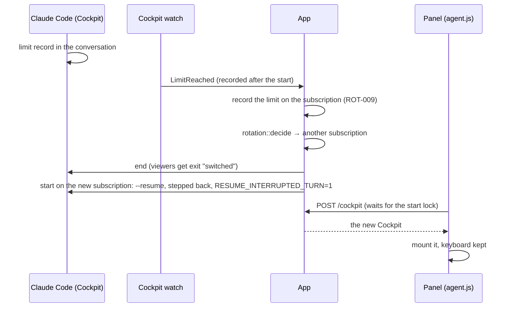

# SPEC-074: the Superagent moves to a subscription with capacity when a usage limit cuts its turn

Status: done
Date: 2026-10-13
Scope authorization: user request (task #69): "I just hit usage limit in the agent. It shouldn't
have happened. Also, rename the agent to "Superagent" to make more straightforward what it is for",
with a screenshot of the Agent panel showing "You've hit your weekly limit · resets 4am
(Europe/Berlin)" and "Usage limit reached · continuing automatically at 4am", while ten tasks kept
working beside it. Extends [SPEC-021](SPEC-021-in-this-bar-we-need-to-add-cockpit-at-th.md) (the
Cockpit), [SPEC-035](SPEC-035-move-cockpit-to-the-right-and-change-coc.md) (shown as the Agent)
and [SPEC-034](SPEC-034-in-previous-tasks-we-have-hit-a-session.md) (a limit steps the
conversation back).

## Goal

A usage limit never leaves the person's own session stuck while the pool has a subscription with
capacity: the session goes on, on that subscription, as if the limit had never happened, exactly
as a task does. The session is called the **Superagent** in the UI, which says more plainly what
it is for.

## Context

**Symptom.** The Agent panel (the SPEC-021 Cockpit) answered a prompt with Claude Code's "You've
hit your weekly limit" and waited for the reset at 4am, while ten tasks on the same pool kept
working.

**Root cause.** `App::cockpit_open` (`crates/yulius-app/src/cockpit.rs`) picks a pool subscription
once, when the Cockpit starts (`pool_account`, `Trigger::Start`), and passes its token in the
process environment. Nothing watches the Cockpit afterwards. Tasks are watched: their transcript
observer reports `Observation::LimitReached`, `on_observation` records the limit on the
subscription and `rotate` resumes the session on another one with the transcript stepped back
(SPEC-034). A Cockpit lives as long as someone views it (a day without viewers ends it), so it can
stay for days on a subscription that tasks fill and then leave. Once that subscription's window is
full, every prompt in the Cockpit fails until the reset. Yulius does not even record what the CLI
said, so the next Cockpit start could pick the same subscription again.

**What exists to reuse.** `HarnessPort::newest_claude_session` finds the Cockpit's conversation
(it already chooses what to resume). `HarnessPort::watch` observes a transcript.
`step_back::step_back_file` and `CLAUDE_CODE_RESUME_INTERRUPTED_TURN` continue a cut turn
natively (SPEC-034 LIM-001/002). `rotation::decide` picks a subscription with capacity, and the
shell start lock serialises the Cockpit's starts (CKP-001). The web panel already follows a
Cockpit to a new id when its session is lost (`agent.js` `recover`).

**Naming.** ADR-0036 shows the Cockpit as "Agent". Every task also runs "an agent", and the
person asked for "Superagent" to say what the panel is for: the agent above the tasks, which
manages the project (SPEC-037).

## Requirements

| ID | Requirement | Evidence |
| --- | --- | --- |
| SUP-001 | A running Cockpit remembers the subscription it started on, also after a server restart (its shell record keeps the account id; older records without one stay valid). | `crates/yulius/tests/cockpit.rs` |
| SUP-002 | While a Cockpit runs, Yulius watches its newest conversation in its folder: the one it resumed and any it starts later (`/clear`, `/resume`). A usage limit Claude Code records there at or after the Cockpit was created is acted on, once: never again after `/clear` and back or a server restart, and not when its reset has passed. A limit recorded earlier (an old conversation) is ignored. A limit record without a readable time counts only once the conversation's history has been read. The watch ends with the process. | `cockpit.rs` |
| SUP-003 | Such a limit is recorded on the Cockpit's subscription as for a task (ROT-009: `limit_reached`, its reset, the limited window full), so no task or Cockpit start picks it until it recovers. | `cockpit.rs` |
| SUP-004 | When another subscription has capacity (the Cockpit's model family, `rotation::decide`), the Cockpit restarts on it under its start lock. When that start fails, the next start continues the cut turn. It resumes the same conversation stepped back over the limit with `CLAUDE_CODE_RESUME_INTERRUPTED_TURN=1` and no prompt (SPEC-034 LIM-001/002), so Claude Code redoes the cut turn by itself. The old process ends first. Its viewers get the exit status `switched`, and its quick end never marks the conversation unresumable (CKP-003). | `cockpit.rs` |
| SUP-005 | Without a subscription that has capacity, the Cockpit keeps running on its subscription, and its viewers get a notice: no other subscription has capacity, and Claude Code goes on when the limit resets. | `cockpit.rs` |
| SUP-006 | The web panel follows a session that ended as `switched` to the running one, with no "stopped" banner or Start again, and the keyboard stays where it was. When no Superagent can start, it says why with Try again. | `e2e/tests/agent-panel.e2e.ts` |
| SUP-007 | The UI calls the panel **Superagent**: the rail tool, the top-bar button (Show/Hide Superagent), the notice, its start, error, stopped and read-access messages. `/s/<slug>/superagent` opens it like `/agent` and `/cockpit` do. The API, the shell kind `cockpit` and stored records keep their names (ADR-0036). | `agent-panel.e2e.ts` |

## Design

- `Observed::LimitReached` / `Observation::LimitReached` gain `at`, the record's `timestamp`, so a
  watcher can tell a new limit from history.
- `ShellRuntime` gains `account` (persisted as `account` in `shell.json`) and `switching`.
  `finish_shell` sends `switched` instead of `closed` and skips `note_cockpit_exit` for it.
- `cockpit.rs`: `start_cockpit` is shared by `cockpit_open` and the switch. `watch_cockpit`
  polls every second and follows the newest conversation in its folder. It opens each
  conversation from its start. It acts on a limit recorded at or after the Cockpit's creation and
  after the last limit it acted on (`limit_handled_at`, kept in `shell.json`), whose reset has not
  passed. `cockpit_limit_reached` records the limit and switches or tells the viewers. A move
  whose start fails leaves a pending continuation: the next `cockpit_open` continues the cut turn.
- The step back and the interrupted-turn flag reach the Cockpit through
  `CockpitLaunch.continue_interrupted` → `CockpitRequest.continue_interrupted`.
- The limit recording of `on_observation` moves into `App::record_limit`, shared by tasks and the
  Cockpit.

## Plan

- [x] Read the product context and related work, then write and validate the spec
- [x] A Cockpit watches its conversation and records a usage limit on its own subscription
- [x] A Cockpit cut by a usage limit continues its turn on a subscription with capacity
- [x] The panel follows its session to the new subscription without a stopped banner
- [x] The Agent panel is named Superagent across the UI, tests and docs
- [x] Independent review in a fresh session, findings fixed test-first
- [x] Review round 2 approves the fixed head, with a reproduced flake fixed
- [x] Every gate green, docs and the changes log updated

## Acceptance criteria

- A Cockpit on subscription A whose conversation records a usage limit restarts on subscription B
  with `--resume <conversation>` and the interrupted-turn flag; the transcript it resumes has no
  limit record; A is recorded as limited.
- A limit already in the conversation before the Cockpit started changes nothing.
- With no other subscription that has capacity, the Cockpit stays, on A, and says why.
- After a server restart, an adopted Cockpit still knows its subscription and is watched.
- The panel shows the new session after a switch, without "stopped" or Start again.
- No "Agent" names the panel in the UI: it is "Superagent".

## Test plan

- Integration (`crates/yulius/tests/cockpit.rs`, real ptyhost, fake `claude` printing its argv and
  the flag): the switch (two subscriptions, a limit appended after the start); a limit from
  before the start is ignored; no capacity gives a notice and no restart; the account survives
  adoption, and an adopted Cockpit switches too.
- Unit (`yulius-harness`): `observe_line` sets `at` from the record's `timestamp`; `plan_cockpit`
  with `continue_interrupted` sets the flag only with a resume.
- E2E (`e2e/tests/agent-panel.e2e.ts`, mock `switchCockpits()`): after a switch the panel shows
  the resumed session with no "stopped" banner; every name check reads "Superagent".

## Decisions

- **React to the limit instead of switching ahead of it** (as tasks also do at a limit). A
  Cockpit restart is visible, and a person may be typing. The limit costs one failed request, which
  the step back removes. Switching ahead at the rotation threshold (ROT) would restart a session
  the person is using for a limit that may never come.
- **Restart rather than swap the token**: Claude Code reads `CLAUDE_CODE_OAUTH_TOKEN` once at
  start; there is no live credential swap. This is the same path tasks take (SPEC-034).
- **Watch the transcript, not the terminal**: the screen text changes with the CLI's wording and
  width; the transcript's structured `usage_limit_reached` record is what tasks rely on.
- **Filter by the record's time instead of tailing**: a brand-new conversation's first prompt can
  hit the limit before the watcher first sees the file; reading from the start and ignoring older
  records catches it without replaying old limits.
- **Keep `cockpit` in the API and records** (ADR-0036): "Superagent" is a UI name.
- **Known limit**: a limit recorded while the server is down and seen only after an adoption
  counts, because its time is after the Cockpit's creation; the Cockpit then switches at once.
- **Known limit** (review round 1, m4): the watch follows the newest conversation in the
  repository folder of the user's home. A `claude` the person starts by hand in a terminal at the
  repository root writes there too, so its usage limit would also move the Superagent. Nothing in a
  transcript tells the two apart; this is rare (tasks run in their own worktrees).
- **Known limit** (review round 1, m2): ending a shell does not prove its host is gone when
  terminating it fails. This holds for every shell, so it is a follow-up for the shell runtime, as
  ADR-0050 did for task runs, not a change here (#346).

## Evidence

- Root cause from the code: `cockpit_open` chose a subscription with `pool_account` only at the
  start, and nothing observed the Cockpit afterwards (no server log of the incident was
  reachable from the task sandbox).
- Regression tests first, each seen failing before its fix:
  - `cockpit.rs` move, no-capacity and adoption tests failed at the missing `account` in
    `shell.json` (stub watch).
  - Review M1 tests (`a_handled_limit_is_not_acted_on_again_after_clear_and_resume`,
    `..._after_a_restart`) recorded the old reset (1_791_400_000_000).
  - `a_failed_move_still_continues_the_cut_turn_at_the_next_start` printed `interrupted:none`.
  - `limits_read_together_count_once_as_the_newest` recorded the earliest reset.
  - The e2e move and failed-move tests showed no resumed session and no error with Try again.
- Mutation checks:
  - Dropping the start-time filter fails `a_limit_from_before_the_start_does_not_move_the_cockpit`.
  - Dropping the `switching` skip of `note_cockpit_exit` fails
    `a_quick_second_move_keeps_resuming_the_conversation`, whose fake exits 3 on a signal.
- Flake reproduced and fixed: 4 of 40 parallel runs of the Cockpit tests failed. The first
  server's watch outlived `stop_workspace_services`, and a redraw appended control sequences to a
  printed value. After the fix: 0 of 40.
- `cargo test -p yulius --test main cockpit::`: 21 passed. `cargo test -p yulius-harness`: green.
  `supervision::`, `shells::` and `subscription_pool::` tests: 40 passed, 1 ignored.
- `scripts/dev ci` at `85a74ef` (before review round 2): 1331 tests run, 1331 passed, 16
  skipped. At `baae79b` (after the merge of `dev`, the round-3 fixes and clippy's `next_back`):
  1345 tests run, 1345 passed, 16 skipped, gate exit 0.
- E2E: `agent-panel.e2e.ts` and `rail.e2e.ts` green (27 tests). The full suite under a load
  average of 55–87 had timeouts in unrelated files, and every failed file passed on a rerun with
  fewer workers (82 tests, then `notes.e2e.ts` alone, 19 tests).
- Independent reviews in fresh sessions:
  - Round 1: request changes, with M1, m1–m5 and nits. Fixed test-first; m2 is #346 and m4 is a
    known limit.
  - Round 2: approve at `3ed1c2f`, with one minor (limits read together) fixed test-first.
  - Round 3: approve at `796824d` (the minor, and the merge of `dev` with the ADR renumbered to
    0052, then 0055 as `dev` took 0052 to 0054). Its minor (a test comment claiming more than it checks) is fixed in the final commit.
    Its nit (a mark assuming time-ordered records) is left: Claude Code appends in time order.
- Not tested here:
  - a real Claude Code session hitting a real usage limit (the fake `claude` and synthetic
    transcripts stand in);
  - `CLAUDE_CODE_RESUME_INTERRUPTED_TURN` in the Cockpit with the real CLI (measured for tasks in
    SPEC-034);
  - the contained (bubblewrap) Cockpit path of the move.
