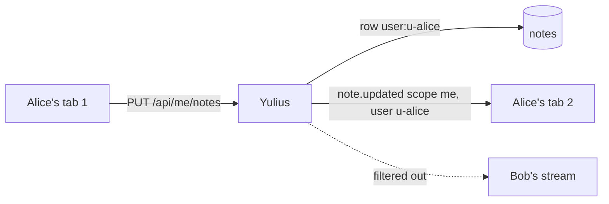

# SPEC-103: a personal "Me" notepad after Team

Status: implemented
Date: 2026-10-14
Owner: Yulius task #88
Scope authorization: user request: "add "me" after team that is for user and not visible for
others but is sandbox-agnostic" (screenshot: the Notes panel with the tabs "This sandbox" and
"Team").

## Goal

The rail's Notes panel gets a third tab, **Me**, after **Team**. It holds one notepad per person:
only that person reads or edits it, and it is the same in every sandbox. It saves by itself and
handles conflicts exactly like the other two notepads.

## Context

- Notes are SPEC-041 (ADR 0032): a `notes` table keyed `team` or `sandbox:<sid>` with a revision
  per row, compare-and-set saves (409 on a stale revision), `GET/PUT /api/notes` and
  `GET/PUT /api/sandboxes/{sid}/notes`, and `note.updated` on `WS /api/events`.
- The web view (`assets/notes.js`) is a list of notepad controllers, each with its own path,
  sessionStorage key for unsaved text and event matcher; the tab strip is built from that list.
  The mock backend (`assets/mock.js`) mirrors the routes for the end-to-end tests.
- `WS /api/events` filters an `Envelope` only by sandbox visibility and `admin_only`. Nothing
  today targets one person, so a personal event needs a new filter.
- People are `UserRecord`s with a stable `UserId`; users are disabled, never deleted. The
  superadmin may have no GitHub login, so the id (not the login) names the owner.

## Requirements

| ID | Requirement | Evidence |
| --- | --- | --- |
| NOT-010 | The Notes panel shows three tabs in order: "This sandbox", "Team", "Me". "Me" holds a text box labelled "My notes", always editable, and the remembered tab includes it. | e2e `notes.e2e.ts` |
| NOT-011 | Personal notes: one notepad per person, stored under `user:<user id>`. `GET/PUT /api/me/notes` read and save the caller's own notepad with the SPEC-041 contract (`scope: "me"`, revision, 409, 256 KiB, 2 MiB body limit). There is no route to anyone else's notepad, administrators included; signed out answers 401. | Rust `notes::personal_notes_are_each_persons_own` |
| NOT-012 | Sandbox-agnostic: the same personal notepad shows in every sandbox and does not depend on any sandbox access. | Rust `notes::personal_notes_are_each_persons_own` (a person with no sandbox); e2e |
| NOT-013 | A stored personal edit publishes `note.updated {scope: "me", sandbox_id: null, ...}` only to the owner's event streams (other people's streams never get it, the superadmin's included), so the owner's other tabs and devices reload an idle notepad. | Rust `notes::an_edit_is_announced_to_viewers`, `notes::a_personal_edit_reaches_only_its_owner` |
| NOT-014 | A conflict with the person's own save from another tab or device (always so for "Me", possible on any notepad) says "You changed these notes in another tab or on another device" and offers "Keep mine" and "Use that version" instead of naming them as a teammate. | e2e `notes.e2e.ts` (a conflict with the person's own other tab) |

## Acceptance criteria

- AC-ME-1: Notes shows "This sandbox", "Team", "Me"; text typed in "Me" is saved and comes back
  after a reload.
- AC-ME-2: "Me" shows the same text in another sandbox.
- AC-ME-3: another person reading `/api/me/notes` gets their own (empty) notepad, never the
  first person's text; saving theirs does not change the first person's.
- AC-ME-4: an edit of "Me" from another tab of the same person appears in an idle notepad; a
  teammate's stream never receives the event.

## Plan

- [x] Read the product context and related work, then write and validate the spec
- [x] Personal notes are stored per user behind GET/PUT /api/me/notes
- [x] A saved personal note is announced only to its owner's sessions
- [x] The Notes panel shows a Me tab after Team with the person's own notepad
- [x] Independent review in a fresh session, findings fixed test-first
- [x] Every gate green, docs and the changes log updated

## Design

**Storage.** No migration: the `notes` table already takes any scope key. A personal notepad is the
row `user:<user id>`.

**Application.** `notes.rs` gains `Scope::Me(UserId)` (wire `me`). `App::note` and
`App::save_note` take a `NoteTarget` (`Team`, `Sandbox(&str)`, `Me`) instead of `Option<&str>`;
`Me` resolves to the caller's own id, so no input can name another person's notepad. A personal
save is published with `EventBus::publish_to_user`.

**Events.** `Envelope` gains `user: Option<UserId>`. `publish` keeps `None`; `publish_to_user`
sets it. `WS /api/events` skips an envelope whose `user` is set and differs from the caller.

**API.** `GET/PUT /api/me/notes` in `routes/notes.rs`, with the same 2 MiB body limit.

**Web.** `notes.js` adds a third notepad: key `me`, label "Me", text label "My notes", path
`/api/me/notes`, unsaved key `…<user id>.me`, matcher `event.scope === 'me'`, placeholder "Only you
see these notes, the same in every sandbox…". `mock.js` stores it under `me:<user id>` and announces
it with scope `me`.

## Test plan

- Rust `crates/yulius/tests/notes.rs`: each person's own notepad (empty at revision 0 for a new
  person, save, read back, another person sees only theirs, 409 on a stale revision, 401 signed
  out); the envelope of a personal save names its owner; a WebSocket test shows the owner's
  stream receives it and another person's does not.
- e2e `notes.e2e.ts`: the tab order, a personal note saved and reloaded, the same in another
  sandbox, an edit from another tab appears; the existing axe and phone tests cover three tabs.
- Not covered: a real second device (the mock simulates the other tab).

## Decisions

- Server-stored in the existing `notes` table (ADR 0084), not browser storage: "sandbox-agnostic"
  for a person means the same text on every device, and browser storage is per browser. Reusing
  the table keeps one notes contract and one conflict flow.
- Keyed by the user id, not the GitHub login: the superadmin may have no login, and a login can be
  renamed on GitHub.
- A dedicated `/api/me/notes` route instead of `/api/users/{id}/notes`: there is nothing to
  authorise because the owner is always the caller, so another person's notepad cannot even be
  addressed.
- Per-user event targeting on the existing bus instead of no event: without it the person's other
  tabs would only learn of an edit through a 409 conflict. Not visible to others means the API and
  the event stream; the instance's operator, who holds the database, can still read the table
  (as for every other note).
- Review round 1 (fresh session, approve, no blocker or major): minors fixed test-first. The
  WebSocket test now also proves the superadmin's stream never gets someone's personal note (it
  failed with an admin bypass put in the filter on purpose). A conflict with one's own other tab
  no longer names the person as a teammate (NOT-014). Long lines rewrapped.
- Confirmation review (approve `8804eea6`): the docs' lines this task added are now within 100
  columns, and "Me" always reads a conflict as the person's own (a save stored under a GitHub
  login since renamed is still theirs). Accepted: on the shared notepads, a GitHub user whose
  login is `superadmin` reads as the unlinked superadmin's own save, the same rule SPEC-041's
  lost-answer check already uses; it only changes the banner's words, never what is saved.

## Evidence

- Rust: `cargo nextest run -p yulius -E 'binary_id(yulius::main) & test(/^notes::/)'` 7 of 7
  pass, three runs in a row for the WebSocket tests. Each new test failed first:
  `personal_notes_are_each_persons_own` with 404 before the route existed;
  `an_edit_is_announced_to_viewers` and `a_personal_edit_reaches_only_its_owner` before a
  personal save was announced; the latter again with the event published but the stream not
  filtering it (Bob received it), and with an admin bypass in the filter (the superadmin received it).
- e2e: `npx e2e run tests/notes.e2e.ts` 23 of 23 pass; the 4 new tests failed first (no Me tab;
  then the conflict banner named the person as a teammate, also under a login since renamed).
- Full e2e suite (`npx e2e run`) at `5826006a`: 42 files passed, 1 skipped (`agent.e2e.ts`, needs
  a model); 294 tests passed, 1 skipped.
- `scripts/dev ci` exit 0 at `5826006a` (after merging `origin/dev`): nextest 1534 passed,
  16 skipped; repository contracts (unique decision numbers, links, UI tokens), lint, deps and
  docs passed. `python3 scripts/check_repository.py --ui`: UI contracts passed.
- After the confirmation review's fixes and a second merge of `origin/dev`, at `434d2923`:
  `scripts/dev ci` exit 0 (nextest 1535 passed, 16 skipped) and the full e2e suite 42 files
  passed, 1 skipped; 308 tests passed, 1 skipped.
- Independent review in a fresh session: approve, no blocker or major; its minors fixed in
  `0f9ee27b` and `5826006a` (see Decisions).
- Not tested here: two real devices of one person against a real server (the mock simulates the
  other tab), and a real browser looking at the Me tab beside a teammate's session.
