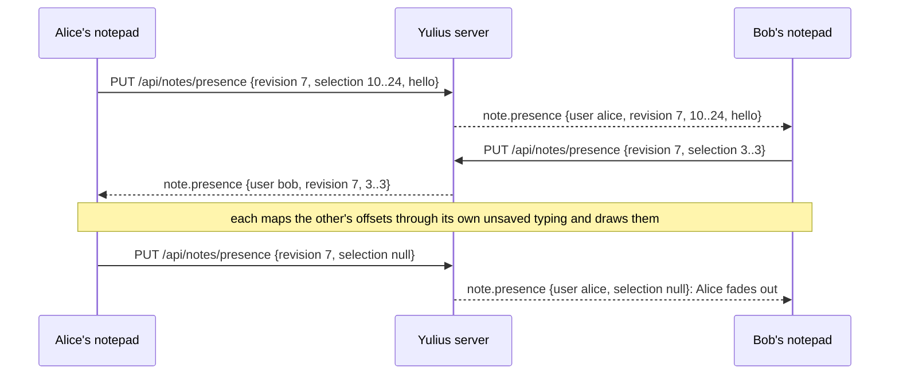

# SPEC-112: notes tabs in any order, smooth selection, and teammates' cursors

Status: implemented
Date: 2026-10-14
Owner: Yulius task #97
Scope authorization: user request: "i want to be able to move those 3 bars "this sandbox", "team"
and "me" and Team should be the first by default. Moreover, selecting text in the panel should be
animated very smoothly, corners rounded. I want to see selection of other people in different
colors and their cursor and their names as well. Like in google docs but smooth and wholsome"
(screenshot: the Notes panel with the tabs "This sandbox", "Team", "Me" and a long team note).

## Goal

The Notes panel feels like a shared document:

1. Its three tabs can be put in any order (drag, keyboard or menu). A person who never moved them
   sees **Team** first, and Team is the tab that opens first.
2. A text selection in a notepad is drawn by Yulius, with rounded corners, and glides from one
   shape to the next instead of jumping.
3. Teammates who have the same notepad open show up in it: each in their own colour, with their
   caret, their selection and their name, moving smoothly as they move.

## Context

- Notes are SPEC-041 (ADR-0032) and SPEC-103 (ADR-0084): `assets/notes.js` builds the tab strip
  from a fixed list of three notepad controllers (`sandbox`, `team`, `me`), remembers the last tab
  under `yulius.notesTab` (default `sandbox`), and each notepad is a plain `<textarea>` saved whole
  with a revision (`PUT`, 409 on a stale one); `note.updated` on `WS /api/events` reloads an idle
  notepad.
- `WS /api/events` (SPEC-002 §7.8) is a bounded broadcast bus (1024 events per subscriber; a
  lagging one gets `resync`). An envelope is scoped by sandbox visibility, `admin_only` and, since
  SPEC-103, one user. Nothing in the server tracks who has a page open.
- A `<textarea>` paints its own selection: browsers draw square, instant highlight boxes, and a
  page cannot animate or round them. Drawing a selection means hiding the native one
  (`::selection`) and painting rectangles measured from a mirror of the text box.
- The sandbox tab strip (`layout.js`) already reorders tabs by dragging and offers "Move left" /
  "Move right" in a context menu (WCAG 2.5.7); the workflow editor reorders with Alt+↑/↓.

## Requirements

| ID | Requirement | Evidence |
| --- | --- | --- |
| NOT-015 | Tab order: the Notes tabs can be reordered by dragging one along the strip (the others make room as it passes, the tab settles into its place), by Alt+← / Alt+→ on a focused tab, and by "Move left" / "Move right" in the tab's context menu. The order is remembered per browser (`yulius.notesOrder`) and comes back after a reload and in every sandbox. Without a stored order it is Team, This sandbox, Me; a stored order that is not a permutation of the three is ignored. | e2e `notes.e2e.ts` (drag, keyboard, menu, reload, default) |
| NOT-016 | First tab: a person with no remembered tab opens Team (the first tab of the default order). A remembered tab (NOT-001) still wins. | e2e `notes.e2e.ts` |
| NOT-017 | Smooth selection: in an editable or read-only notepad, the person's selection is drawn behind the text as one rounded shape per line (radius 4 px, the accent colour, softer when the box is not focused) and animates (about 120 ms, eased) as it grows, shrinks or moves; scrolling and resizing keep it on the text. The native selection is not painted. Under `prefers-reduced-motion: reduce` it changes without animation. A caret alone draws nothing (the native caret stays). | e2e `notes.e2e.ts` (shapes follow a selection, rounded, transition on `transform`, follow a scroll); reduced motion is the global `prefers-reduced-motion` rule of `styles.css` (WCAG 2.3.3), which collapses every transition |
| NOT-018 | Presence API: `PUT /api/notes/presence` and `PUT /api/sandboxes/{sid}/notes/presence` take `{revision, selection: {anchor, head} \| null, hello?: bool, client?: string}` (unknown fields refused; `client`, the browser tab, at most 32 letters and digits): the caller's selection in UTF-16 offsets of the text at `revision`, or `null` when they left. Each is relayed as `note.presence {scope, sandbox_id, user_id, client, name, revision, selection, hello}` to the people who may read that notepad (team: everyone signed in; sandbox: its viewers) and stored nowhere; it answers 204. A sandbox note's presence needs read access (else 404); offsets above 1 Mi are refused (422). There is no presence for "Me". | Rust `notes::presence_is_relayed_to_readers` |
| NOT-019 | Presence is bounded: at most 20 presence updates per second per person and notepad (more answer 429 and are not relayed), and the server keeps at most 4096 such counters. | Rust `notes::presence_is_rate_limited` |
| NOT-020 | Teammates in a notepad: while a person has the Team or a sandbox notepad shown, the browser sends their selection (at most one update per 100 ms, the last one always sent), again every 15 s, `hello` when the notepad is shown and again after lost events (`resync`; others answer with theirs at once, at most once a second), `null` when it is hidden, another tab is chosen or the page goes away (then with a request that outlives the page), and a refused or lost update again after 1 s, doubling up to 15 s. Each tab has its own random `client` id: one person's tabs are shown and leave separately, in that person's colour. Others' updates are shown as a caret in a colour of their own (picked from 8 by their user id) with a name tag (GitHub login, else display name) and their selection in that colour, translucent and rounded, both gliding like NOT-017. Positions are mapped through the unsaved typing on both sides; an update for another revision hides that person until the revisions meet again; a person not heard of for 45 s, or who sent `null`, fades out. The person's own updates (any tab) are not drawn. Only lines within a screen of the view are drawn. | e2e `notes.e2e.ts` (a teammate's caret, name and selection appear, move, map over local typing, hide on another revision, leave; own echo ignored; hello sent, answered and repeated after a resync; a refused update sent again; heartbeat; leaving with keepalive; two tabs of one person) |
| NOT-021 | Accessible: the drawn shapes are decorative (`aria-hidden`); under forced colours the native selection comes back and the layer is hidden; a tab's keyboard move is announced through its new position and `aria-keyshortcuts`, colours keep the name tag at AA contrast in both themes, and the panel keeps no WCAG A/AA violations. | e2e `notes.e2e.ts` (axe with a teammate shown) |

## Acceptance criteria

- AC-112-1: a person who never used Notes opens it on Team, with the tabs Team, This sandbox, Me.
- AC-112-2: dragging "Me" before "Team" (or Alt+← on it twice) gives Me, Team, This sandbox,
  which is still so after a reload and in another sandbox.
- AC-112-3: selecting text in a notepad shows rounded highlight shapes that move with the
  selection; the browser's own highlight is not painted.
- AC-112-4: when a teammate selects text in the Team notepad, the person sees that range in the
  teammate's colour with a caret and their name, and sees it move and disappear when they leave.

## Plan

- [x] Read the product context and related work, then write and validate the spec
- [x] Notes tabs reorder by drag, keyboard and menu, Team first by default
- [x] A notepad draws its own rounded, gliding selection
- [x] The server relays notepad presence to its readers, rate-limited
- [x] Teammates' carets, names and selections show in the notepad
- [x] Independent review in a fresh session, findings fixed test-first
- [x] Confirmation review of the fixed head approves it
- [x] Every gate green, docs and the changes log updated

## Design

**Tab order (web).** `notes.js` keeps the three controllers in a `pads` array whose order comes
from `readJson('yulius.notesOrder')` when it is a permutation of `team`, `sandbox`, `me`, else
`['team', 'sandbox', 'me']`. The remembered tab defaults to the first of that order. `move(pad,
step)` reorders, stores and re-renders (focus stays on the moved tab). Dragging uses pointer
events (no HTML5 drag image): past a 4 px threshold the pressed tab follows the pointer with a
transform, the tab it crosses slides aside (FLIP with a transition), and on release the order is
committed; a press without a drag is a click. The context menu is `openMenu` with "Move left" /
"Move right", like the sandbox tabs.

**Drawn selection (web, new `assets/textlayer.js`).** `createTextLayer(textarea)` adds an
`aria-hidden` layer behind the text box (the text box is transparent above it) and a hidden mirror
`div` that copies the text box's font, padding, width (`clientWidth`, without the scrollbar),
`white-space: pre-wrap` and wrapping. `rects(start, end)` sets the mirror's text, measures a DOM
`Range` over it (`getClientRects`), merges the boxes of one line and returns them relative to the
content; a caret is measured with a collapsed range (a marker `span` when that yields nothing).
Each shape is a `div` positioned with `transform` and sized with `width`/`height`, so CSS
transitions animate it; shapes are reused by line index so a moving selection morphs. The layer's
content is offset by the text box's scroll. `selectionchange`, `input`, `scroll`, focus and a
`ResizeObserver` schedule one redraw per animation frame. `.notes-text.drawn-selection::selection`
is transparent. The same layer draws peers (`setPeers`), each a selection group in its colour and
a caret with a name tag above it (below it on the first line).

**Positions across unsaved typing.** `textlayer.js` also exports `textEdit(a, b)`, the common
prefix and suffix of two texts, and `mapPosition(pos, edit)`, which maps an offset in `a` to `b`
(before the edit: same; after: shifted; inside: the edit's start). A sender maps its selection from its text box to the saved
text at `base` and sends that revision; a receiver whose `base` equals it maps the offsets from
the saved text into its own text box. Another revision hides that person until both sides reload.

**Presence (server).** `App::note_presence(ctx, target, input)` checks `View` for a sandbox note
(Team and sandbox only; `Me` is not routable), validates the offsets (≤ 1 Mi) and the tab's
`client` (at most 32 letters and digits, relayed as sent), counts the update
in `note_presence: Mutex<HashMap<String, Vec<i64>>>` keyed by `user|scope` (20 per 1000 ms, at
most 4096 keys, expired keys pruned first, else 429), and publishes `UiEvent::NotePresence` with
the sandbox scope (sandbox) or none (team). Nothing is stored, so a server restart forgets nobody
it needs: browsers say hello again on reconnect (`resync`).

**Presence (web).** Each shared notepad has a presence sender (trailing throttle of 100 ms,
heartbeat 15 s while shown, `hello` when shown and after `resync`, `null` when hidden or left
(with `keepalive` when the page goes); a refused or lost update is sent again after 1 s, doubling
up to 15 s, unless a newer one went out; one update on its way at a time, so they arrive in order;
hellos answered at most once a second, a later one then) and a peer map `user_id:client → {name,
revision, selection, seen}` swept every second (45 s expiry). `store.js` emits
`note-presence`; `mock.js` relays the routes and lets tests act as a teammate (`notePresence`).

## Test plan

- Rust `crates/yulius/tests/notes.rs`: presence is relayed with the right envelope (team: no
  sandbox; sandbox: the sandbox), names the sender, carries `null` and `hello`; a sandbox without
  read access answers 404; unknown fields 422; large offsets 422; signed out 401; the 21st update
  within a second answers 429 and is not relayed, and one after the window passes is.
- e2e `notes.e2e.ts`: the default order and first tab; drag, Alt+arrows and the menu reorder and
  persist; a selection draws rounded shapes that follow a new selection and a scroll; a teammate's presence (mock) shows a caret with their name and a
  selection, moves, maps over the person's own unsaved typing, hides on another revision, goes
  away on `null` and after 45 s (clock), the person's own echo draws nothing, a `hello` is
  answered; the browser sends its own selection (mock records it); axe with a teammate shown.
- The order parser and `mapPosition` are covered through the e2e flows above (a stored order of
  the wrong shape; a teammate's offsets over the person's unsaved typing).
- Not covered: two real browsers against a real server (the WebSocket relay is covered in Rust,
  the drawing in the mock); pixel-exact alignment in every browser (Chromium only).

## Decisions

- One pull request for the three asks, above the 400-line guideline: they are one "shared
  document" experience in one file family, and the presence drawing needs the drawn-selection
  layer, so a split would ship a layer with no second user. Recorded here instead of splitting.
- Presence is relayed, not stored (ADR-0091): a stateless relay on the existing event bus needs no
  table, no cleanup and no per-connection tracking; `hello` plus a heartbeat and an expiry give
  late joiners the picture within one round trip. A server-held presence map was the alternative
  (an exact list on load, but state to bound, expire and secure per sandbox).
- Positions are whole-text offsets at a revision mapped through each side's unsaved typing, not
  operational transforms or CRDTs: notes are saved whole within 600 ms, so the window where texts
  differ is short; hiding a person across revisions is honest where a guess could be wrong.
- Drawing the selection replaces the native highlight only (not the caret): the native caret is
  what IMEs, screen magnifiers and the platform expect, and a drawn caret would lag typing.
- Order and first tab stay per browser (`localStorage`), like the remembered tab (NOT-001):
  it is a layout preference, not data worth a server round trip.
- Review round 1 (fresh session, request changes on the e2e gate, no blocker or major in the code):
  - The intermittent "a save whose answer was lost" (2 of 10 runs under load) was a race older
    than this task, made likelier by more requests: a save refused while another refusal was
    still being looked into made its own look, which no longer knew the lost save the first look
    had rebased on, and showed a false conflict. A save now stays in flight while its refusal is
    looked into (regression e2e "a save made while a refused one is looked into", failing before).
  - Minors fixed test-first: hello again after `resync`; a refused or lost update sent again with
    a backoff; a per-tab `client` id so one person's tabs leave separately; hellos answered at
    most once a second; the counter bound unit-tested (`count_in_window`); forced colours bring
    the native selection back; only lines near the view are drawn; Escape during a drag selects
    nothing on release; the name tag flips by its place in view; diffs never split a surrogate
    pair. Kept: the remaining heuristics of `textEdit` with repeated characters (a mapped offset
    may sit a character off until the next save) only affect drawing.
- Confirmation review (approve `856c156a`, no blocker or major): minors fixed — a second hello
  within a second is answered a moment later instead of not at all (e2e failing before); a
  selection's rows are found by row number, not a search; stale docs made true (spec, ADR-0091,
  architecture); the mock refuses a `client` that is not a string; Escape then `pointercancel`
  no longer swallows the next tab click; the surrogate-pair mapping has a test. Kept: a newer
  revision announced during a conflict look waits for the next event or save (older than this
  task, the text is dirty then); a scroll re-measures the whole selection and draws the lines
  near the view (`getClientRects` stays linear in the selection: smooth for notes of usual size,
  not measured at the 256 KiB limit); forced colours hide teammates' marks with the layer (NOT-021).
- Re-confirmation (approve `6acf4266`): its nit that the new hello test could see one answer for
  two hellos led to a real bug: repeated, the test failed 1 in about 20 runs because two presence
  updates were on their way at once and arrived out of order (the caret at the end after the
  selection), leaving teammates a stale caret until the next move. Now one update is on its way
  at a time and the newest follows when it is answered (a page going away does not wait); the
  test waits for the first answer before the second hello. 40 of 40 runs passed after the fix.
  Rows are counted from the first row's middle (a piece a pixel off stays in its row).

## Evidence

Run on the branch merged with `origin/dev` (2026-10-14):

- `scripts/dev ci` (fmt, clippy `-D warnings`, nextest, doctests, cargo-deny, cargo-shear,
  rustdoc, repository check): exit 0, 1638 tests passed, 16 skipped; advisories, bans,
  licenses and sources ok.
- `cargo nextest run -p yulius -E 'binary_id(yulius::main) & test(/^notes::/)'`: 9 passed,
  including `presence_is_relayed_to_readers` and `presence_is_rate_limited` (the latter failed
  with the limiter disabled); `yulius-app` unit `presence_counters_are_bounded_and_idle_ones_make_room`
  and `yulius-contracts` `presence_refuses_unknown_fields_and_says_hello_only_when_asked` pass.
- `cd e2e && npx e2e run --workers 2`: 46 files passed, 378 tests passed, 1 skipped (needs a model).
- `npx e2e run tests/notes.e2e.ts --repeat-each 3`: 102 of 102; the former flakes repeated
  (`--grep "answer was lost is not a conflict|looked into" --repeat-each 30`: 60 of 60 at load
  average 26; `--grep "two hellos" --repeat-each 40`: 40 of 40).
- Seen in the Yulius browser (mock, dark theme): Team first, a rounded own selection, two
  teammates with name tags, carets and translucent selections, a blank line inside a selection
  drawn as a sliver.
- Not covered: two real browsers against a real server (the relay is covered in Rust, the drawing
  in the mock), other browsers than Chromium, forced colours only as CSS rules (the harness
  cannot emulate them), and drawing speed at the 256 KiB limit.

