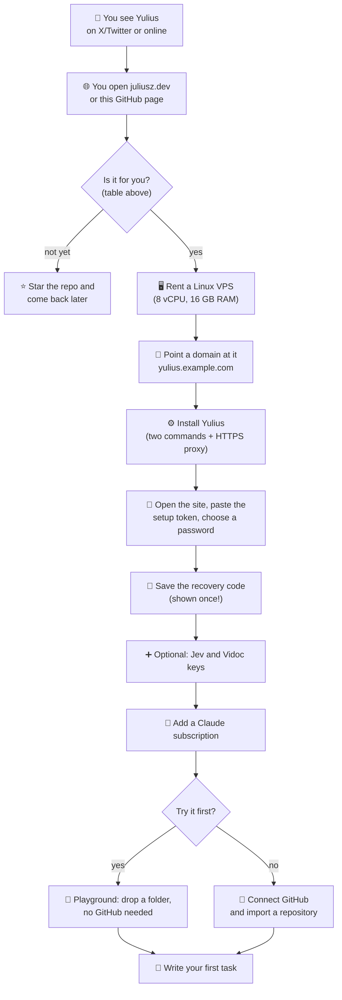

# Yulius

**Your own server where Claude Code agents build software for your team, one task at a time,
with tests, reviews and CI they cannot skip.**

You give Yulius a task ("add a CSV export to the reports page"). It starts a Claude Code session
for it in a contained sandbox, the agent writes a plan, code and tests, gets an independent
review, opens a pull request and merges it into `dev` once Yulius's own CI is green. You watch,
steer and unblock from the browser. Yulius is self-hosted (one Rust binary on one Linux server),
written in Rust and inspired by [Cezar](https://github.com/open-mercato/cezar).

> **Just found Yulius on X/Twitter or [juliusz.dev](https://juliusz.dev)?** Read
> [the 5-minute path](#from-curious-to-first-task) below. It tells you what you need, what each
> word on the setup screens means and what to click, in order.
>
> **Here to work on Yulius's own code?** Jump to [Developing Yulius](#developing-yulius).

## Contents

- [Is Yulius for you?](#is-yulius-for-you)
- [From curious to first task](#from-curious-to-first-task)
- [What you need before you start](#what-you-need-before-you-start)
- [Recommended servers (VPS)](#recommended-servers-vps)
- [Step by step](#step-by-step)
- [Words you will meet](#words-you-will-meet)
- [For AI agents helping a person set up Yulius](#for-ai-agents-helping-a-person-set-up-yulius)
- [Developing Yulius](#developing-yulius)

## Is Yulius for you?

| ✅ A good fit | ❌ Not a good fit |
| --- | --- |
| A small team (about 2-5 people) with one or more Claude subscriptions | Someone who wants a hosted SaaS with nothing to install |
| Code on GitHub (or a folder you can upload to try it first) | Teams that cannot send code to Claude (Anthropic) |
| You want agents to deliver on their own, with people watching | You want to approve every line an agent types |
| You can rent a Linux server and point a domain at it | Windows or macOS servers (macOS is for developing Yulius only) |

What it does for you, in short: native Claude Code sessions per task, each in its own sandbox with
its own Docker, shells, browser and editor; a pool of Claude subscriptions it switches between by
itself; tests, review and CI enforced on every task; and a Superagent you can ask for quick jobs.
The full list is in the [product summary](docs/product.md).

## From curious to first task



Expect about an hour the first time, most of it waiting for packages to install.

## What you need before you start

| | What | Why | Where to get it |
| :---: | --- | --- | --- |
| ☐ | A Linux server (VPS) | Yulius runs there, day and night, with your agents | [Recommended servers](#recommended-servers-vps) |
| ☐ | A domain or subdomain (`yulius.example.com`) | You open Yulius in the browser over HTTPS | Your domain registrar or DNS provider |
| ☐ | A Claude subscription (Pro or Max) | The agents are Claude Code; they run on your subscription | [claude.ai](https://claude.ai) |
| ☐ | A GitHub account or organization | Yulius works on your repositories through its own GitHub App | [github.com](https://github.com) (optional for a first try: use a playground) |
| ☐ | 10 minutes in a terminal (SSH) | Installing Yulius is a few commands on the server | Your VPS provider gives you the SSH login |
| ☐ | *Optional:* a Jev API key | Smarter task intake | [typesafe.ai](https://typesafe.ai) |
| ☐ | *Optional:* a Vidoc API key | Security scans of every change | [model.vidocsecurity.com](https://model.vidocsecurity.com/#key) |

## Recommended servers (VPS)

Yulius needs a **real virtual machine (KVM)**, not a "container VPS" (OpenVZ or LXC): it creates
its own sandboxes with Linux namespaces, cgroups and a Docker engine per project, which container
plans do not allow.

**Configuration that works everywhere:**

| Setting | Choose |
| --- | --- |
| Operating system | **Ubuntu 24.04 LTS** (Debian 13 also works; it needs systemd 254 or newer), x86_64 or arm64 |
| CPU | 4 vCPU minimum; **8 vCPU** for a team running several tasks at once |
| Memory | 8 GB minimum; **16 GB** recommended (every task runs Claude Code, builds and tests) |
| Disk | 80 GB minimum; **160 GB+ SSD/NVMe** (sandboxes, build caches and Docker images add up) |
| Network | A public IPv4 address, ports 22, 80 and 443 open |
| Virtualization | KVM (a full VM); dedicated vCPUs are better than shared for long builds |

These sizes are our guidance from running Yulius on itself, not a measured minimum; more tasks at
once need more CPU and memory. Yulius cleans up old files by itself and warns on every page when
the disk runs low.

**Providers that offer that configuration:**

| Provider | Website | A plan that fits (8 vCPU / 16 GB or close) | Notes |
| --- | --- | --- | --- |
| Hetzner Cloud | [hetzner.com/cloud](https://www.hetzner.com/cloud) | CPX41 (shared) or CCX33 (dedicated) | Best price for the power; data centers in the EU, US and Singapore |
| DigitalOcean | [digitalocean.com](https://www.digitalocean.com) | CPU-Optimized or General Purpose Droplet, 8 vCPU / 16 GB | Simple dashboard, good docs for beginners |
| OVHcloud | [ovhcloud.com](https://www.ovhcloud.com/en/vps/) | VPS with 8 vCPU / 16-24 GB | Generous disk and traffic |
| Vultr | [vultr.com](https://www.vultr.com) | Optimized Cloud Compute, 8 vCPU / 16 GB | Many regions worldwide |
| Akamai (Linode) | [linode.com](https://www.linode.com) | Dedicated CPU 16 GB | Predictable dedicated CPUs |
| AWS Lightsail | [aws.amazon.com/lightsail](https://aws.amazon.com/lightsail/) | 16 GB instance | If your team already lives in AWS |

Plan names and prices change; pick the closest plan to the configuration table above.

## Step by step

Each step says who does it: 👤 a person (needs a browser, a card or a password) or 💻 commands on
the server (a person or their AI agent over SSH).

### ☐ 1. 👤 Rent the server and point your domain at it

1. Create the VPS: Ubuntu 24.04, the size from the table above, your SSH key.
2. At your DNS provider, add an `A` record: `yulius.example.com` → the server's IP address.
3. Check you can log in: `ssh root@yulius.example.com`.

### ☐ 2. 💻 Install Yulius

On the server, as root. **a. Build the binary:**

```sh
apt-get update && apt-get install -y git build-essential curl
curl --proto '=https' --tlsv1.2 -sSf https://sh.rustup.rs | sh -s -- -y && . "$HOME/.cargo/env"
git clone https://github.com/Quartio-Studio/yulius.git && cd yulius
cargo build --release -p yulius
install -m 0755 target/release/yulius /usr/local/bin/yulius
```

**b. Install what sandboxes copy from the host**, *before* the host setup: every sandbox starts
from a copy of the server's system, so tools installed later are missing there until that copy
is rebuilt ([prerequisites](docs/operations.md#1-prerequisites)):

- ☐ **Claude Code**, system-wide (under `/usr/local` or `/opt`, not `~/.local`) so the agents
  can see it.
- ☐ **GitHub CLI** (`gh`) 2.82.1 or newer, from GitHub's own package repository (Ubuntu's is too
  old).
- ☐ *Optional:* Google Chrome, `xvfb`, `ffmpeg` and fonts for the in-sandbox browser.

**c. Set up the host** (Docker, sandbox isolation, the service user, the systemd service and the
sandbox base):

```sh
yulius host setup --public-url https://yulius.example.com
```

It prints `ok`, `changed`, `manual` or `FAIL` for each item and is safe to run again. Installed
something from list b afterwards? Rebuild the base:
`sudo -u yulius yulius sandbox-base build --data-dir /var/lib/yulius`.

**d. Put HTTPS in front**: a reverse proxy such as Caddy, which also gets the TLS certificate
for you ([reverse proxy](docs/operations.md#4-reverse-proxy-tls-websockets)).

Check everything with `sudo -u yulius yulius doctor --data-dir /var/lib/yulius --contained`. The
[operations guide](docs/operations.md#2-build-and-install) has every detail, and the optional
update helper that installs new Yulius versions from `main`.

### ☐ 3. 👤 Open Yulius and create the superadmin

1. On the server, read the **setup token**: `cat /var/lib/yulius/setup.token`
   ([what is it?](#setup-token)).
2. Open `https://yulius.example.com`, paste the token, choose the superadmin password (twice, at
   least 8 characters, 12+ recommended) and tick both boxes ("the password can only be
   recovered with the recovery code", "I have stored the password…"): the button stays grey until
   you do.
3. Yulius shows your **recovery code** once ([what is it?](#recovery-code)). Store it apart from
   the password, tick "I have stored the recovery code safely" and continue.

### ☐ 4. 👤 Add the optional keys (or skip them)

The last two setup screens ask for a [Jev](#jev) key and a [Vidoc](#vidoc) key. Both are
optional: **Skip for now** is fine, and you can add, replace or remove them later in
**Settings → Instance**.

### ☐ 5. 👤 Add a Claude subscription

User menu → **Administration → Subscriptions → Add subscription**. Claude's own sign-in opens in a
terminal in your browser. Add more subscriptions later for more capacity: Yulius uses them as one
pool and moves tasks between them by itself. **Do this before anything else**: without a
subscription no agent can start.

### ☐ 6. 👤 Bring in a project

| Option | When | How |
| --- | --- | --- |
| 🧪 **Playground** | You want to try Yulius first, without GitHub | Home → drop a project folder or pick a template. Nothing is pushed anywhere. |
| 🐙 **GitHub repository** | You are ready to work on real code | User menu → **Administration → GitHub connection**: enter your organization or user name, pick **Organization** or **Personal account**, click **Create GitHub App on GitHub**, confirm on GitHub, then install the App on the repositories Yulius may use. Then import the repository. |
| 💻 **From your laptop** | The code and your Claude sessions are on your machine | Ask your local Claude Code "onboard this into Yulius" ([remote control](docs/remote-control.md)) or run `yulius onboard`. |

A GitHub project goes through **onboarding** first (click **Start onboarding** on the sandbox
page): an agent adds tests, lint, a dead-code check and a CI job to the repository, in its own
pull request. To let teammates in: **Administration → Users → Admit user** with their GitHub
login.

### ☐ 7. 👤 Write your first task 🎉

Open the project, type what you want in plain words and start it. Follow its plan, terminal and
pull request in the task view; answer when it asks you something. When CI is green it merges
into `dev` by itself. Promoting `dev` to `main` (production) is always a person's decision.

## Words you will meet

| Term | In one line |
| --- | --- |
| [VM / VPS](#vm-or-vps) | The rented Linux server Yulius lives on |
| [Setup token](#setup-token) | One-time password that proves you own the server, used once |
| [Recovery code](#recovery-code) | Six digits that reset a forgotten superadmin password |
| [Jev](#jev) | Optional AI that judges new tasks (split it? does this change the scope?) |
| [Vidoc](#vidoc) | Optional AI security scanner for every change |
| Sandbox | One project in Yulius, with its own isolated files, Docker, shells and browser |
| Task | One piece of work an agent delivers, from plan to merged pull request |
| Superagent | Your personal Claude Code beside every page, for quick jobs and questions |
| Playground | A project that lives only on your Yulius server, no GitHub |

### VM or VPS

A **VM** (virtual machine) is a computer you rent in a data center; a **VPS** (virtual private
server) is the same thing as providers sell it. Yulius needs one because it is self-hosted: it runs
24/7, keeps your agents working while your laptop is closed, holds your code and keys on a
machine you control, and gives each project an isolated sandbox. It must be a full KVM virtual
machine running Linux, see [Recommended servers](#recommended-servers-vps).

### Setup token

A random one-time password Yulius writes to `/var/lib/yulius/setup.token` (readable only by the
service) the first time it starts. **Why:** until a superadmin exists, anyone who finds your URL
would see the setup page; the token proves the person creating the superadmin can log in to the
server. **How:** `cat /var/lib/yulius/setup.token` over SSH, paste it on the first screen. After
setup it is no longer accepted.

### Recovery code

Six digits shown **once**, right after you choose the superadmin password. It is **the only way to
reset a forgotten superadmin password** (Yulius sends no reset emails).

- ✅ **When you get it:** at setup, after every recovery, or when you generate a new one in
  **Administration → Users → Superadmin recovery code** (needs the current password).
- ✅ **Store it:** apart from the password, for example in a password manager and on a sealed
  paper copy.
- ✅ **Use it:** sign-in page → *Superadmin password* → **Forgot password?** → enter the code and
  a new password. You then get a new code; save it too.
- ⚠️ **Three wrong codes lock recovery.** A superadmin who still knows the password can unlock it by
  generating a new code.

### Jev

[Jev](https://typesafe.ai) is a small, fast decision model by TypeSafe AI. In Yulius it gives
task intake its judgement: it suggests **splitting** a new task that mixes separate pieces of
work, **holds** a message you type into a running task when it changes the task's scope until
someone decides, proposes running broad work as a supertask, and picks a new task's mode and
workflow when you leave them on Auto. **Optional:** without a key these checks are off and
Yulius uses its defaults.

- **The Jev API key** is your password for Jev's service. Get one from
  [typesafe.ai](https://typesafe.ai), paste it on the setup screen "Task intake with Jev" or in
  **Settings → Instance**, and click **Save and test**.
- It is stored encrypted on your server and never shown again. Each check sends the task's prompt and
  related task details (title, step titles, typed text, workflow names) to TypeSafe.

### Vidoc

[Vidoc](https://vidocsecurity.com) reviews code for security vulnerabilities with its `vidoc-1`
model. With a key, agents scan their changes before delivery and each project's CI scans every
pull request; serious findings block the merge, the rest become GitHub issues. **Optional:**
without a key the scan is off.

- **The Vidoc API key:** get it at [model.vidocsecurity.com](https://model.vidocsecurity.com/#key),
  paste it on the setup screen "Security scans with Vidoc" or in **Settings → Instance**.
- The scanned code is sent to Vidoc. Agents never see the key itself.

## For AI agents helping a person set up Yulius

If a person asked you to help them install or try Yulius, follow [Step by step](#step-by-step) in
order and:

- **Do yourself** (💻): every command in step 2, `yulius doctor`, the reverse proxy config,
  reading `/var/lib/yulius/setup.token` for them.
- **Hand to the person** (👤): renting the server and DNS, the password and recovery code, API
  keys, the Claude sign-in and GitHub App confirmation. Never ask them to paste a password, the
  recovery code or an API key into your chat; they type those into Yulius's own pages.
- **When something fails:** `yulius host setup` and `yulius doctor` name the failing item and its
  fix; the [operations guide](docs/operations.md) is the full reference.
- **After setup:** to drive Yulius from the person's own Claude Code, see
  [remote control](docs/remote-control.md).

## Developing Yulius

This section is for working on Yulius's own code. The product is specified in
[SPEC-001](.ai/specs/SPEC-001-yulius-product.md) (product),
[SPEC-002](.ai/specs/SPEC-002-yulius-architecture.md) (architecture and runtime contracts) and
[SPEC-003](.ai/specs/SPEC-003-traceability.md) (source traceability); each spec's evidence section
records what is verified.

Prerequisites: Python 3.11+, [rustup](https://rustup.rs), Git and a platform C linker.

```sh
python3 scripts/bootstrap.py
scripts/dev doctor
scripts/dev ci
```

Pinned tools install into ignored `.tools/`; the default Rust toolchain is unchanged.
See [development instructions](docs/engineering/development.md) for commands and CI.

- [AGENTS.md](AGENTS.md): coding-agent entry point.
- [Product](docs/product.md), [architecture](docs/architecture.md), [operations](docs/operations.md)
  and [decisions](docs/decisions/README.md).
- [Git delivery](docs/engineering/git.md): feature → dev → main, self-merges and cleanup.
- [Engineering workflow](docs/engineering/workflow.md): specify, implement, verify and review.
- [Rust rules](docs/engineering/rust.md) and [dependency boundaries](docs/engineering/architecture.md).
- [Repository skills](.apm/skills) (APM sources; [standard](docs/engineering/primitives.md)): specification, Rust implementation, runners, verification and review.
- [Future specification guidance](docs/engineering/specifications.md).

Checks need no production credentials, database or model subscription.
[MIT license](LICENSE).
