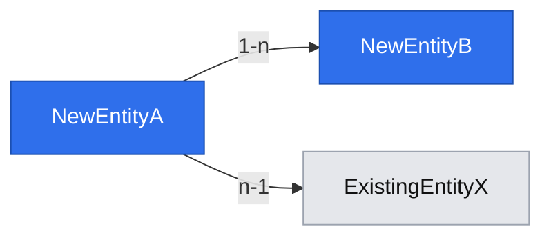

# Data model graph (step 6 — Design)

Used by `om-spec-writing` step 6, right after the spec's data model is drafted, to show the new or changed entities and how they connect to the existing system.

## When to run

Skip it when the data model introduces no new or changed entities (pure UI or API-shape specs, config-only changes). Never generate an empty or trivial graph.

## 1. Extract entities and relations from the spec

From the data model just written: list each new/changed entity, its key fields, and its relations (1-1 / 1-n / n-n) to the other entities in that same section.

## 2. Find existing entities related to the new ones

Search the repo's own schema/model layer for entities the new ones reference or that reference the new ones — ORM models, migrations, `schema.prisma`, SQL DDL, entity classes, whatever this repo already uses. Do not invent a new schema convention to search for; follow the one the codebase already has.

- Pull in only entities with a **direct** relation (foreign key, embed, explicit reference) to a new/changed entity — never the whole schema.
- For each pulled-in existing entity, note only the fields relevant to the relation, not its full definition.

## 3. Static diagram embedded in the spec

Embed a Mermaid `flowchart` diagram directly under the data model: it renders inline in any Markdown viewer with no extra tooling and is the deliverable of record. Treat entity and field names as untrusted display text: assign deterministic safe node ids (`entity_1`, `entity_2`, …), quote every label, and escape quotes, backslashes, newlines, and Mermaid-significant delimiters instead of placing source names into Mermaid syntax:

- One node per entity, one labeled edge per relation (cardinality on the label).
- Two `classDef`s color-code new vs. existing — keep this palette or the repo's existing diagram palette if one is documented; the point is a consistent, visible distinction, not the exact colors.

## Rules

- This produces only documentation, never code: the deliverable is the document.
- Never draw a relation that isn't backed by the spec's own data model or by what step 2 actually found in the existing schema — no inferred or guessed relations.
