# Architecture

One Rust binary, `yulius`, serves the web UI and API, supervises detached `ptyhost` processes
that own Claude Code sessions inside per-sandbox containment, and talks to GitHub and
Anthropic. The detailed contracts are in
[SPEC-002](../.ai/specs/SPEC-002-yulius-architecture.md); crate layering rules are in
[engineering/architecture.md](engineering/architecture.md).

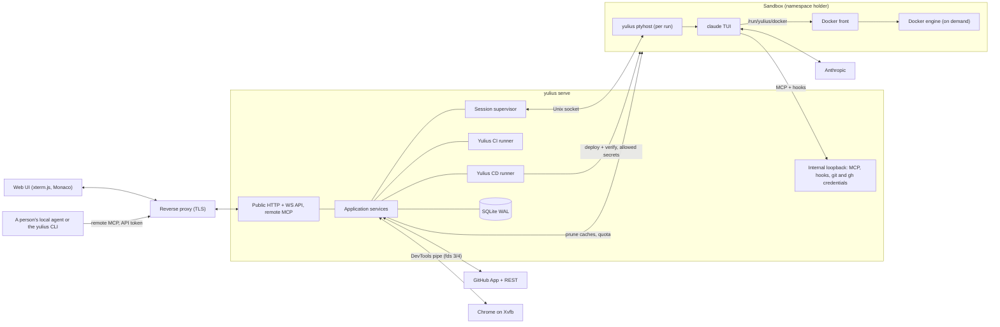

## Layers and crates

Dependencies point inward: interface, composition and adapters depend on application, which
depends on domain and contracts. `scripts/check_repository.py` enforces this.

| Layer | Crates |
| --- | --- |
| domain | `yulius-domain` |
| contracts | `yulius-contracts` |
| application | `yulius-app` |
| adapter | `yulius-store`, `yulius-ptyhost`, `yulius-sandbox`, `yulius-harness`, `yulius-github`, `yulius-git`, `yulius-browser`, `yulius-egress`, `yulius-import` |
| interface | `yulius-server` (axum routes, embedded web UI in `web/`) |
| composition | `yulius` (configuration, wiring, subcommands) |
| tooling | `tools/` (fake agent, xtask) and `scripts/` (the gates, among them the macOS compile check with `zig_macos.py`, and `vidoc_scan.py`, the security scan that `yulius` embeds as `yulius security-scan`, switched on or off in `.config/vidoc.toml`) |

## CPU

A sandbox's processes share its cgroup limits, but not equally. CI jobs run in its `ci/` leaf
with four times the CPU weight of the agents' `agents/` leaf. Under full load CI gets up to 80 % of
the sandbox and the agents at least 20 %, and idle CPU goes to whoever wants it. Agent Bash commands also run
5 nice levels below the agents themselves ([SPEC-053](../.ai/specs/SPEC-053-ci-e2e-timeouts-under-agent-load-give-ci.md),
[decision 0039](decisions/0039-ci-jobs-get-the-cpu-first.md)).

Tasks (processes and threads) are one budget too, sized from the host (a quarter of its task
table, at least 8192, at most three quarters of the service's own limit). CI jobs and the engine with its containers each stop at 3/8 of it, so the
agent sessions keep at least a quarter. A session that still ends while the sandbox was at its
task or memory limit says so in the task
([SPEC-268](../.ai/specs/SPEC-268-parallel-tasks-in-one-sandbox-crash-clau.md),
[decision 0198](decisions/0198-sandbox-task-limits-are-sized-from-the-host-and-leave-sessions-a-reserve.md)).
All sandboxes together stop at three quarters of the service's limit (`sandboxes/pids.max`), so
the server keeps a quarter however many are busy; a hit there counts as the sandbox's
([SPEC-272](../.ai/specs/SPEC-272-all-sandboxes-together-keep-the-server-a.md),
[decision 0201](decisions/0201-all-sandboxes-share-a-task-limit-below-the-services.md)).

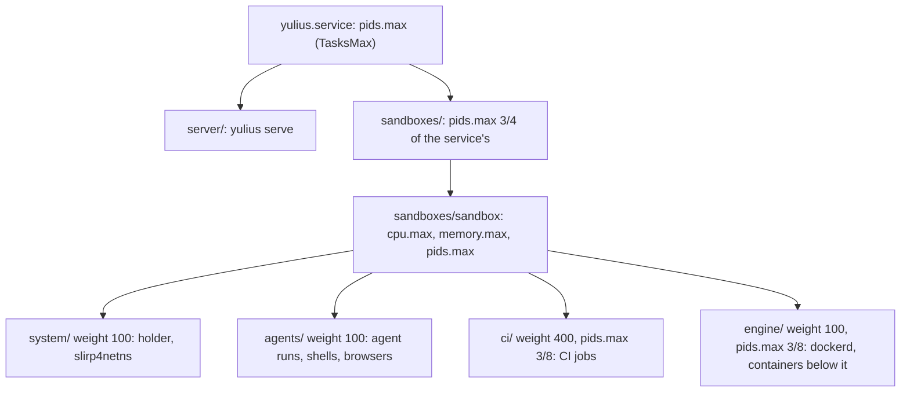

The e2e suite (`e2e/`, test-only) shares that CPU with the agents when an agent runs it, and the
`ci/` leaf in CI. Its static server (`e2e/serve.py`) keeps connections alive and queues 1024 of
them, so a page's burst of module requests waits for a busy server instead of having its SYNs
dropped; the runner's workers stay bounded by the CPU budget
([SPEC-148](../.ai/specs/SPEC-148-fix-354-349-356-394-the-e2e-suite-holds.md),
[decision 0122](decisions/0122-the-e2e-server-keeps-up-with-a-page-under-load.md)).

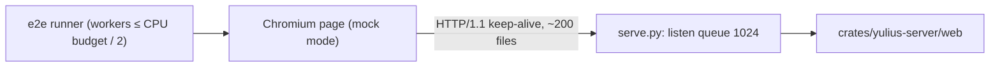

## Containers

Each isolated sandbox has its own Docker engine
([SPEC-187](../.ai/specs/SPEC-187-docker-works-inside-sandboxes-for-tasks.md),
[decision 0151](decisions/0151-a-sandbox-runs-its-own-docker-engine-under-an-engine-seccomp-profile.md),
superseding [0140](decisions/0140-isolated-sandboxes-have-no-container-engine-agents-are-told.md)).

- **The socket** ([decision 0158](decisions/0158-docker-reaches-every-run-through-a-front-and-a-directory-moved-into-live-runs.md)).
  A Docker front (`yulius sandbox-host docker`), a process the server starts beside every live
  holder, adopted ones included, serves `<state>/docker/docker.sock`. Agents, the Superagent,
  Shells and CI jobs bind that directory at `/run/yulius/docker`, with `DOCKER_HOST` and a
  `/run/docker.sock` link, so a recreated socket reaches them. Runs started without it get the
  directory moved into their mount namespace at the next upkeep (`yulius sandbox-host
  bind-docker`: `open_tree` in the holder's namespace, `move_mount` in the run's). Without an
  engine (a missing prerequisite) the front answers a Docker-API error naming the reason.
- **Start on demand.** The first connection starts the engine: `yulius sandbox-exec --engine`
  joins `sandboxes/<sandbox>/engine` and execs `bwrap`, then `yulius sandbox-host engine`
  supervises `dockerd`. The front splices each connection to the engine's own socket (for a
  holder of SPEC-187, to that holder's own engine).
- **The engine's process.** `dockerd` is root of the sandbox's user namespace, in the sandbox's
  network, with a run's file view plus its storage (`sysroots/<sandbox>/docker`), a fresh sysfs
  and a cgroup namespace of its own. Its seccomp profile (the run profile plus the mount APIs,
  `setns` and `pivot_root`) bounds every container.
- **Removal.** Removing a sandbox
  ([SPEC-206](../.ai/specs/SPEC-206-i-deleted-sandbox-from-yulius-but-it-s-s.md)) stops its tasks,
  cancels its CI runs, ends its Superagents, Shells and browser (a start under way ends itself
  once it reads the removal), and retires its holder. A `retired` marker in the holder's state
  directory makes `prepare` refuse the sandbox and the upkeep tick stop the holder, with its
  engine, containers and egress, a minute after the retirement once no run holds a lease; a
  restart stops it instead of adopting it. A run's own processes end with the run (its own PID
  namespace). A CD deploy already running finishes.
- **Idle stop.** The engine stops after the idle time with no client and no container. Its
  `engine/` leaf is then empty, so systemd prunes it when `yulius.service` stops
  (`KillMode=process` keeps the holder and front running). The front makes it again before each
  start, and the upkeep tick does the same for a kept engine or relay front (SPEC-201, #614).
- **Disk.** Its storage counts toward the quota. Under pressure, a running engine's unused images
  and build cache are pruned through its own control socket; a stopped engine is never started
  for that.
- **When the prerequisites are missing** (the cgroup delegation), the briefing's `## Containers`
  section says there is no engine and `docker info` says why. A sandbox whose own system (its
  upper layer, else its base) has no `dockerd` is told to install it there
  (`sudo apt-get install -y docker.io docker-buildx docker-compose-v2`, buildx and compose
  included, SPEC-201) or that the host's Docker reaches new bases (ADR-0160).
- **Proof on a host.** `yulius doctor --docker-smoke` walks a throwaway sandbox through an
  upgrade (a run older than the engine, adoption with Docker on, a recreated socket).

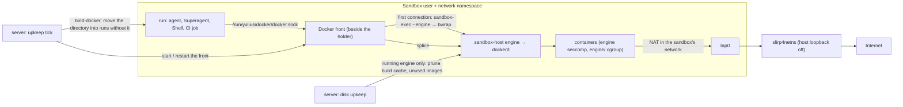

**The host's part** ([SPEC-203](../.ai/specs/SPEC-203-docker-in-sandboxes-works-out-of-the-box.md),
[decision 0162](decisions/0162-one-host-setup-command-brings-and-keeps-docker-in-sandboxes.md)).
`yulius host setup` (root, `crates/yulius/src/host_setup.rs`) brings a host to what sandboxes
need for Docker: Docker Engine for the bases to copy, the host's own daemon stopped, the
modules, the service user and its ids, the unit's delegation, a root-owned binary, a current
base. Each item reads the host through a `Host` trait, so the same items run against a fake host
in tests. `yulius host check` is the same list with only the safe fixes. After each healthy
install, the update helper runs the **new** binary's `host check --json` and keeps the report.
One verdict, `yulius_sandbox::docker_status::verdict`, gives "sandbox Docker" to the doctor, the
setup and the server. The server's isolation adapter adds the base's rebuild and the sandboxes
on their own Docker. Settings → Instance reads it all from `GET /api/admin/sandbox-docker`, and
`POST …/smoke` runs `yulius doctor --docker-smoke --json` as the server's child.

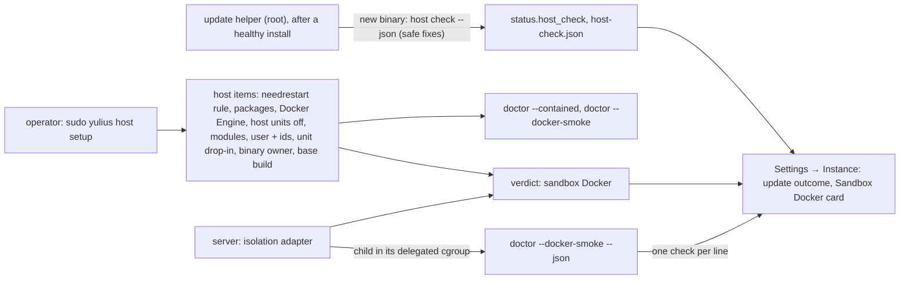

## Sandbox browser DevTools

Each sandbox's Chromium runs outside containment and speaks the DevTools protocol only over the
pipe pair Yulius gives it at spawn (`--remote-debugging-pipe`, fds 3 and 4, NUL-terminated JSON;
[ADR-0191](decisions/0191-the-sandbox-browser-speaks-devtools-over-a-pipe.md)). It opens no
DevTools socket, and a contained run (isolated or the fallback bubblewrap, each with its own PID
namespace) cannot see its process, so no such agent or other sandbox can drive it. A process
running as Yulius's user on the host, including an agent run without containment (host mode), or
root could open the browser's `/proc/<pid>/fd`. Agents reach the browser through Yulius's browser
tools, viewers through the viewer WebSocket.

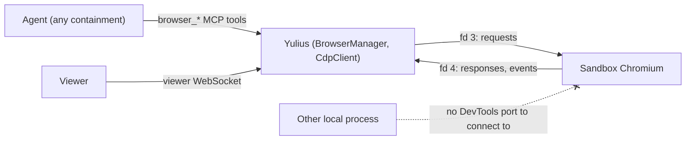

## Disk

A sandbox has a soft disk quota. The application prunes build caches of tasks that do not
work every 5 minutes (ended tasks, then idle ones from 90 % of the quota), removes the worktrees
of closed and cancelled tasks, and a switch checks the quota and the other start preconditions
before it ends the running session ([SPEC-008](../.ai/specs/SPEC-008-sandbox-disk.md),
[decision 0017](decisions/0017-sandbox-disk-upkeep.md)). A running task's caches go only when a
fresh probe finds no background shell and no background subagent. An unanswered probe keeps them.

Over the quota, a CI run waits in the queue instead of erroring
([SPEC-059](../.ai/specs/SPEC-059-fix-240-256-258-245-ci-waits-for-disk-in.md),
[decision 0045](decisions/0045-ci-waits-for-disk-under-the-shared-quota.md)). The dispatcher
starts a check off its loop, at most once a minute per sandbox: upkeep under pressure, then a fresh
measurement. The run's reason and its `pending` commit status name the largest consumers, and the
run starts at the first dispatch under the quota. A job refused after its run started puts the
run back in the queue.

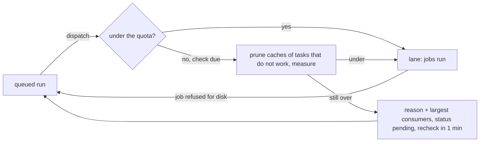

## Connecting a subscription

An administrator connects a Claude subscription with Claude's own sign-in, `claude setup-token`.
It runs in a server-owned PTY, and the web UI shows it in a dialog over the login terminal
(SPEC-001 ROT-002, SPEC-002 ADR-05). The CLI stores no credential file. It prints the long-lived
token once, so the server reads the token from the raw PTY stream and masks it for viewers. On
the CLI's exit it seals the token into the account. A CLI that runs on more than 5 s after a
complete token appeared is stopped and the token sealed (SPEC-243,
[decision 0184](decisions/0184-a-captured-token-ends-the-sign-in-and-a-closed-dialog-cancels-it.md)).
The dialog follows the terminal's ending. On `ok` it closes by itself and a toast names the
subscription. On `error`, `cancelled` or a lost terminal it shows why, with Try again (a new
sign-in in the same dialog). Closing it while the sign-in runs cancels that sign-in. The cancel
waits for the end and keeps a token already printed, so a sign-in that succeeded is never lost.

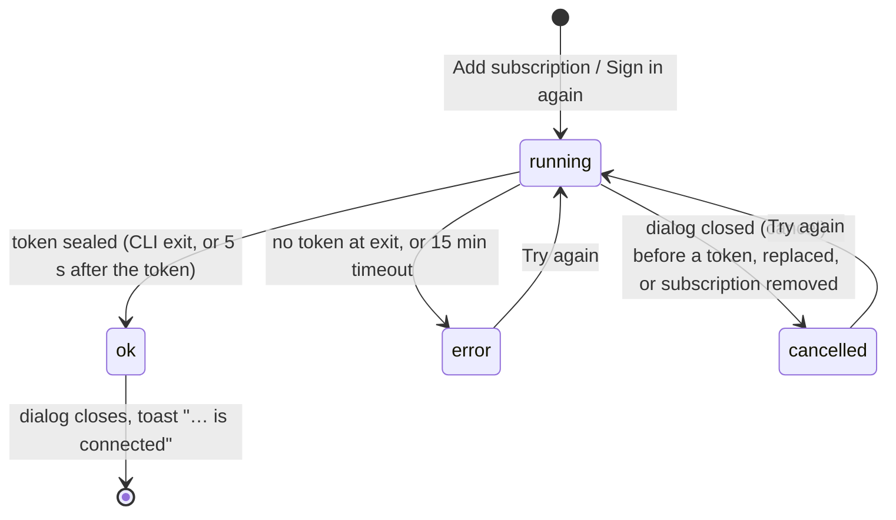

## Usage limits

When a subscription's usage limit cuts a turn, the task goes on as if the limit never happened
([SPEC-034](../.ai/specs/SPEC-034-in-previous-tasks-we-have-hit-a-session.md),
[decision 0027](decisions/0027-step-back-past-a-usage-limit.md)): on another subscription at
once, or on its own after the reset. The supervisor has the harness adapter step the transcript
back over the limit on a blocking thread, and indexes the session again only if the file changed.
The transcript is the agent's: the step back reaches it from the folder above the home through
handles that follow no link, reads it only when it is a regular file, and replaces it within its
folder's handle ([SPEC-266](../.ai/specs/SPEC-266-transcript-step-back-and-home-creation-g.md),
[decision 0174](decisions/0174-host-access-to-agent-owned-folders-goes-through-handles.md)).
Claude Code then resumes the same session with `CLAUDE_CODE_RESUME_INTERRUPTED_TURN=1`, so it
redoes the lost turn by itself. Nothing is typed. If Claude Code continues the turn by itself at
the reset, its first agent work or turn end after the pause ends the pause, and Yulius leaves
that run alone; after a restart, a limit that such a turn followed is not acted on again. A person's
switch of a task left at its limit by a refused automatic switch also resumes past the limit
([SPEC-072](../.ai/specs/SPEC-072-fix-276-277-278-usage-limit-resume-respe.md),
[decision 0058](decisions/0058-the-clis-own-continuation-ends-a-limit-pause.md)).

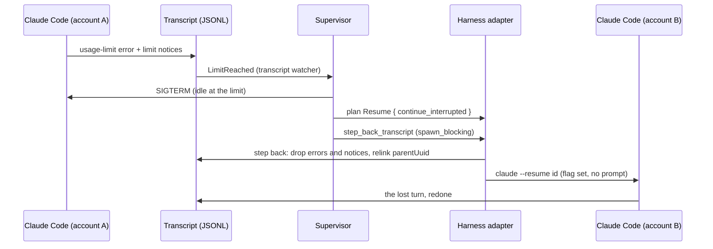

## Subscription names and emails

A subscription (an `accounts` row) has the name a person gives it and the email of the Claude
account behind its credential ([SPEC-244](../.ai/specs/SPEC-244-rename-claude-sessions-and-show-account.md),
[decision 0185](decisions/0185-a-subscription-email-comes-from-claudes-profile-at-sign-in.md)).
Administrators rename it in place on the Subscriptions page (`PATCH /api/admin/accounts/{id}`).
The email is read, never typed. After a sign-in stores a credential, the app asks Claude's profile
with that credential through the usage adapter. The background usage round asks the same for
every signed-in account whose email was never answered. A definite answer is stored with
`email_checked_at`; a temporary failure backs that account off. A new credential clears both.
Only administrators get the email in views (UI-022); task summaries never carry it.

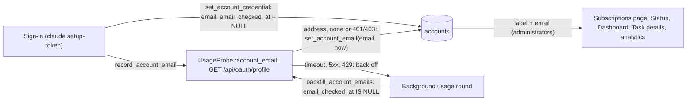

## Full context

A session whose context is full gets "Prompt is too long" for every prompt, and no Stop hook ends
the turn ([SPEC-060](../.ai/specs/SPEC-060-fix-213-a-session-whose-context-is-full.md),
[decision 0046](decisions/0046-compact-then-restart-a-full-session.md), #213). The harness
observes the refusal (`ContextFull`), the compaction boundary (`Compacted`) and a failed compaction
(`CompactFailed`). The supervisor ends the turn so the task waits instead of working, and keeps
one recovery episode per task in its runtime. The episode outlives a run and ends at the agent's
next successful reply. Each stage is said in the task's terminal and audited as
`task.context_full`. A replay after a restart that ends in a refusal starts the same recovery.

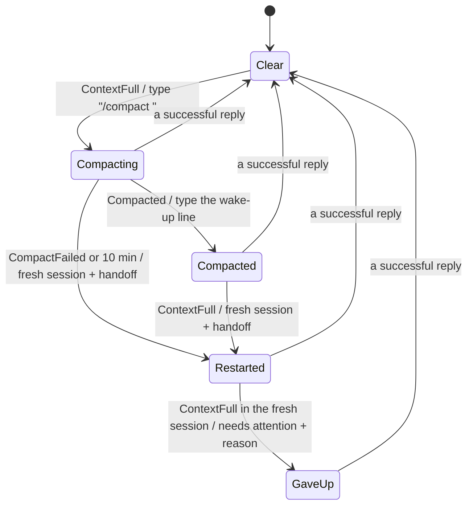

## Playgrounds

A playground lets a team try Yulius on its own code before it connects GitHub
([SPEC-099](../.ai/specs/SPEC-099-on-onboarding-we-want-a-mode-to-play-aro.md),
[decision 0081](decisions/0081-a-playground-keeps-its-git-on-the-server.md)). Its `origin` is a
bare repository on the server outside the sandbox (`<data>/playgrounds/<id>.git`), so the
clone, worktrees and merges use the same `origin/<branch>` refs as a GitHub sandbox while nothing
leaves the server, and the sandbox's processes never reach a repository whose hooks the server's
Git would run; the server fetches and pushes it by that path, never by the clone's configured URL.
The record marks it with an empty repository owner. The browser packs a chosen folder into a gzip tar (`files/` the
working tree, `git/` the history part of `.git`); the server takes only `HEAD`, `packed-refs`,
`shallow`, `objects/` and `refs/` of it, copies the branches and tags into the new `origin` with the
hardened Git, and commits the working files on top. `delivery_merge` squashes a task branch onto
the integration branch there (`git merge-tree` and `commit-tree`, pushed without forcing) on green
Yulius CI ([SPEC-163](../.ai/specs/SPEC-163-fix-411-yulius-ci-runs-the-gate-on-a-pla.md),
[decision 0134](decisions/0134-a-playground-s-ci-tests-the-head-merged-into-its-integration-branch.md)):
the CI sync tests the integration head without GitHub, and `delivery_merge` first builds the task
head merged into the integration branch in Yulius's clone (the merge train's builder, a merge
commit) and tests it as `task/<n>`; while that run goes the merge is armed, and it lands once the
run passed. Nothing is published to GitHub. Hygiene, the automatic pull request and reconciliation
skip playgrounds.

A local checkout without GitHub comes in from the command line too
([SPEC-171](../.ai/specs/SPEC-171-fix-409-420-yulius-onboard-uploads-a-che.md)): `yulius onboard
--playground` sends a bundle of every branch and tag, the uncommitted work and the chosen sessions
through the import pipeline, with `playground: true` on the plan and the manifest. Into a new
playground the job's files go under an id reserved when the job is created; the playground is made
when the upload completes, as from a folder (the bundle's refs copied into `origin` with the
hardened Git, the uncommitted work one commit on the checked-out branch). Into the person's
existing playground of that name the upload lands as an import does, under `import/<login>/`.
A removed playground's code goes on request
([decision 0139](decisions/0139-a-removed-playground-s-code-is-purged-once-nothing-of-it-runs.md)):
the request is kept in `playground_purges`, and its `origin` and sandbox directory are deleted
only once no agent run, shell, browser, CI run or other process of its sandbox is left (tried at
once and with every disk upkeep round); the quota counts only the `origin`s left on disk.

**Repository hygiene** (SPEC-001 DLV-007, [SPEC-269](../.ai/specs/SPEC-269-i-don-t-understand-the-idea-of-manual-cl.md),
[decision 0199](decisions/0199-yulius-removes-safe-stale-branches-and-worktrees-itself.md)).
`yulius-app::ci::hygiene` classifies branches and worktrees with `yulius-domain::ci` and, every 6
hours, removes each live sandbox's safe ones as `yulius` through the same cleanup a person's Clean
up or an agent's `repo_cleanup` runs; unmerged work without a pull request stays for a person.
The kept report (in memory) carries the last cleanup and the next round for the CI tab's card.

**Leftovers** ([SPEC-215](../.ai/specs/SPEC-215-leftovers-are-found-and-cleaned-accurate.md),
[decision 0170](decisions/0170-leftovers-are-deleted-by-kind-rules-checked-again-at-deletion.md)).
Every path under the data directory has an owner record and a rule for when it is garbage (the
inventory in SPEC-215). `yulius-domain::leftovers` holds the kinds and their policy (safe
automatically, needs a person, report only). `yulius-app::leftovers` scans by kind: removed
sandboxes from `SandboxStore::removed_sandboxes`, live sandboxes' ended caches (from the disk
upkeep's own scan), worktrees no task owns, unused CI checkouts, Git records of vanished
worktrees, and instance directories no record owns. It deletes one item at a time after its
**guard** checks the rule again: the sandbox is still removed and was removed 10 minutes ago,
`still_running` finds no run, shell, browser or CI run, no CD run is live, the isolation's
`holder_live` is false, and a CI claim is held while checkouts go. Trees whose files belong to a
sandbox's mapped ids go through the isolation's `remove_owned_tree`: the system trees by
`base::remove_tree` as root of a mapped namespace, and every path below `sandboxes/` (its CI jobs
and agents write there as sub-uids) by `sandbox-host remove-tree --below <data dir>`, the same
link-safe walk as root of the mapped namespace
([decision 0176](decisions/0176-leftovers-below-a-sandbox-go-through-its-mapped-root.md)); a
failure names the entry that stayed. No link is followed: an item reached through one is never listed, and the
removal opens each directory from the data directory down with `O_NOFOLLOW` and removes through
the opened directory, so a link a sandbox swaps in after the check fails the removal. A tree that stays is made writable directory by directory through `O_PATH` handles, its owner's unreadable directories included ([decision 0179](decisions/0179-a-tree-is-made-writable-through-o-path-handles.md)), and removed again. The automatic round runs at every start and hourly. People reach the
same engine through `/api/admin/leftovers*` (Settings → Instance) and `yulius leftovers` (the
loopback `/internal/leftovers*` with the key in `<data>/leftovers-cli.key`).

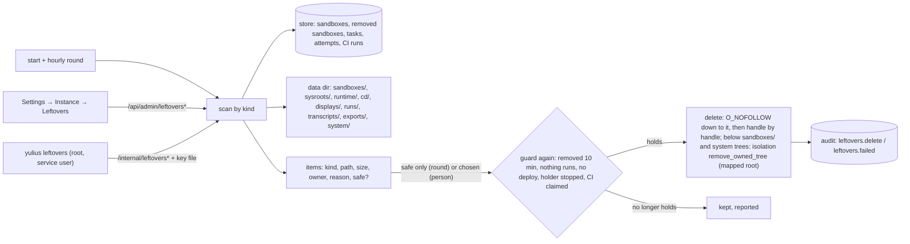

A playground moves to GitHub
([SPEC-176](../.ai/specs/SPEC-176-fix-410-move-a-playground-to-a-github-re.md),
[decision 0142](decisions/0142-a-playground-moves-into-an-empty-github-repository.md)) into an empty
repository of the instance owner that its mover could import (`admin` or `maintain` there; the
superadmin: one the App can access). Detached from its request, while no task of it is live or
queued and no CI run of it is active, and holding the
sandbox's merge pass, Yulius pushes every branch and tag of `origin` to it in one atomic push with
the installation token (the default branch alone first, so GitHub takes it as its default), removes the clone's own transport settings, points its `origin` at it and refreshes its
`origin/*` refs from the bare `origin` by path (no token through the clone), then writes the GitHub owner,
name and repository id into the record in one compare-and-set (the commit point; a failure before
it points the clone back). It then deletes the bare `origin`. From then on every playground test
(`is_playground`) answers no, so access, credentials, delivery and CI take their GitHub paths.

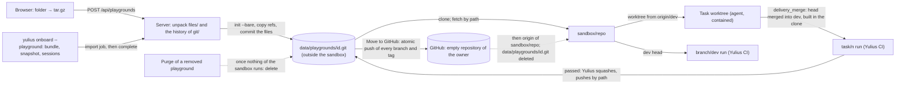

## Parallel tasks at merge

Tasks working at once must not collide where their parallel work meets
([SPEC-083](../.ai/specs/SPEC-083-merge-conflicts-with-many-agents.md),
[decision 0066](decisions/0066-parallel-tasks-stop-colliding-at-merge.md)). Numbered files
(decision records, specs, migrations) get their number from Yulius (`record_number`): past the
integration branch, every live task's checkout and every reservation in `record_numbers`. The logs
every task appends to (the changes log, the decision index) merge by union in every repository,
from Yulius's block in the clone's `info/attributes`; Yulius merges the integration branch
locally before GitHub merges (SPEC-050 DLV-203), so GitHub never sees those conflicts. A review
carries over Git's own merges of the integration branch, checked with `git merge-tree`.

## Agent feedback

Yulius has no messages for now ([SPEC-028](../.ai/specs/SPEC-028-delete-message-mechanism-for-now-until-w.md),
[decision 0023](decisions/0023-no-messages-until-delivery-is-reliable.md)): nothing is stored for
an agent, injected by a hook or typed into its session. An agent pulls what it needs: it waits
with `yulius wait` in a background shell, which Claude Code wakes it from, and reads
`ci_status` and `delivery_status`. The armed merge's outcome is kept in memory for the wait,
with the armed merge and its decisions in progress under one lock: a merge armed again while an
earlier one is decided supersedes it ([decision 0048](decisions/0048-armed-merge-state-under-one-lock.md)).
Before Yulius merges or arms a merge, its merge gate checks the pull request's title, head and
base against the branch policy of `yulius.toml` `[branch_policy]` at the integration branch;
a violation is refused with the rule in words, also for promotion pull requests
([SPEC-069](../.ai/specs/SPEC-069-fix-223-yulius-s-merge-gate-enforces-the.md),
[decision 0051](decisions/0051-the-merge-gate-enforces-the-branch-policy.md)).
`delivery_merge` first delivers the head the way the end of a clean turn does
(`try_auto_open_pr`): it pushes the branch and opens the pull request, or pushes new commits to
it. A head it cannot deliver yet (open step, no plan for a task that needs a spec, invalid spec,
uncommitted work) is refused with the reason, and a push GitHub refuses answers with the remedy
(merge the pushed head, never force): only a note that same call wrote replaces its error. A head
is pushed when GitHub's branch is at it, whatever `git push` said: every push of a task's head
(end of turn, `delivery_merge`, Deliver…, armed-merge upkeep, merge trains) goes through one helper
that asks the remote (`git ls-remote`) when Git reports a failure, and the wait drops a failed-push
note once the branch is at its head ([SPEC-139](../.ai/specs/SPEC-139-fix-366-448-yulius-wait-and-delivery-mer.md),
[decision 0113](decisions/0113-github-s-branch-says-whether-a-head-is-pushed.md)). A goal task whose evaluator keeps every turn going therefore still gets its pull request
([SPEC-116](../.ai/specs/SPEC-116-linter-dead-code-should-be-installed-on.md) DMG-001).

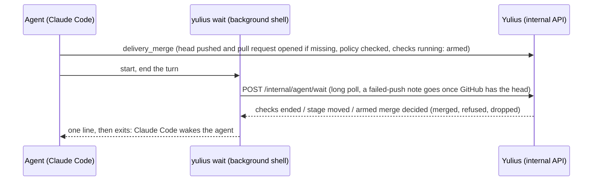

## A task's own files

Claude Code's removal check asks a person even with approvals bypassed (a root-level path, a path
in a variable, a `sh -c` script). A task removes the files it created itself with
`yulius remove <path>…`, run in its own run, which alone sees the run's private tmpfs
([SPEC-192](../.ai/specs/SPEC-192-claude-sessions-asks-me-to-delete-someth.md),
[decision 0155](decisions/0155-a-task-removes-its-own-files-with-yulius-remove.md)). It judges
ownership by location: an untracked or ignored path of the task's worktree
(`YULIUS_TASK_WORKTREE`), or a path on the run's own tmpfs (`/`, `/tmp`, `/run`, `/dev/shm`) of a
contained run; mount points, directories holding one and the root's links are refused, and a
link is removed as a link. Task runs get `TMPDIR=/tmp`, so `$TMPDIR/x` is not `/x`.

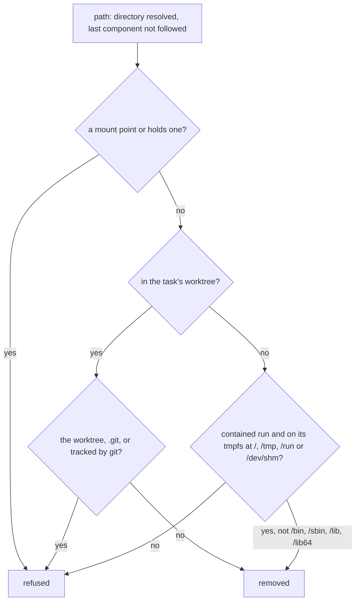

## Host access to agent-owned folders

The server runs outside containment as the service user, and a sandbox's whole directory is
mounted read-write into its runs and shells, so an agent can swap any folder below it for a link
at any moment. Wherever the server reads or writes there (editor reads and saves, uploads and
attachments, imported transcripts, skill copies), it opens the folder once and does everything
else through that handle
([SPEC-220](../.ai/specs/SPEC-220-fix-657-host-writes-into-agent-owned-fol.md),
[decision 0174](decisions/0174-host-access-to-agent-owned-folders-goes-through-handles.md)). The
helpers are `files::open_inside` (a resolved path opened with `O_NOFOLLOW`, the handle's real path
checked to be inside the root), `files::open_dirs_below` (each folder from the sandbox directory
with `O_DIRECTORY | O_NOFOLLOW`, made with `mkdirat` when missing) and `files::replace_in` (a
random `O_EXCL | O_NOFOLLOW` temporary file renamed within the handle). The editor's listing,
folder creation and deletion, and the removal of task, shell and draft attachments, walk the
resolved folder from the sandbox directory with `open_dirs_below` (no real-path check, so no
`/proc`) and list, `mkdirat`, or remove through `files::remove_tree` (bounded, handle by handle,
a link unlinked, never followed)
([SPEC-265](../.ai/specs/SPEC-265-editor-delete-folder-create-and-listing.md)); the harness's skill copies
do the same and remove trees with `unlinkat`, and the launch preparation of the Claude config dir
(`claude_config::ensure_claude_config`) opens `<home>/.claude` from the folder above the home and
reads paths the agent wrote in a worktree's git files lexically, never on the host filesystem
([SPEC-253](../.ai/specs/SPEC-253-claude-config-dir-links-and-commondir-ca.md),
[decision 0193](decisions/0193-the-claude-config-dir-is-walked-from-above-home-and-the-main-repository-is-read-from-the-git-layout.md)).
The disk upkeep counts a worktree, a CI job checkout or a cache only when every folder from the
sandbox directory down to it is a real directory (`leftovers::no_link_between`), checks a cache
again right before removing it through `leftovers::remove_below`'s `O_NOFOLLOW` handles, and an
ended worktree again before Git removes it
([SPEC-263](../.ai/specs/SPEC-263-disk-upkeep-refuses-links-at-worktrees-a.md)).
Races are tested at pause points
(`yulius_app::race`, only with the `test-support` feature).

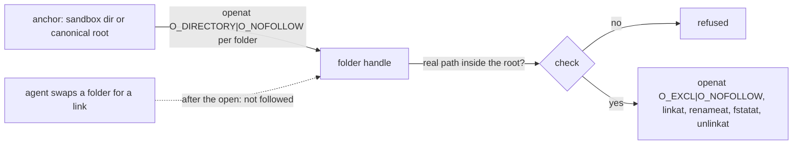

## Task start

A task's agent is a native Claude Code session, and its first message is in before a person can
type into it ([SPEC-117](../.ai/specs/SPEC-117-creating-tasks-work-in-a-very-very-weird.md),
[decision 0095](decisions/0095-a-goal-task-starts-with-its-goal-as-the-launch-prompt.md)). Files
attached on the new-task composer are uploaded to the sandbox's drafts folder and show in the
composer's tray, and each sits in the prompt's text as a placeholder where it was pasted, dropped
or placed from the tray ([SPEC-150](../.ai/specs/SPEC-150-fix-the-ux-i-d-expect-uploading-images-a.md),
[decision 0124](decisions/0124-uploaded-files-sit-in-a-tray-the-text-holds-placeholders.md)); a
file without one follows the text. The prompt is stored with it there as the
mention `@'<path>'` (an older prompt has its files after the text, a line `@path` each), and
`Request::parse` keeps that order everywhere the prompt goes
([SPEC-124](../.ai/specs/SPEC-124-images-keep-their-position-in-the-text-f.md),
[decision 0101](decisions/0101-attached-files-keep-their-place-in-the-prompt.md)). A goal task (the
default) is launched with `/goal <condition>` as Claude Code's prompt argument: one message, nothing
typed; Claude Code's record of the goal confirms it, and a goal not taken flags the task. Until it
is confirmed the run directory holds `launch-goal-pending`, so a restarted server watches it again
([SPEC-146](../.ai/specs/SPEC-146-fix-346-453-a-shell-ends-only-when-its-h.md)). The
condition is the person's whole request, its lines kept and each attached file at its place as
`[file N: <path>]` (the agent opens it with its Read tool, since a `/goal` carries no image block),
then a blank line and the definition of done. Past Claude Code's 4000 UTF-16 code units it is cut
and points at the request file in the sandbox home, which keeps the whole request with the same
markers. Yulius's other rules reach the agent and the goal's judge natively, in the SessionStart
briefing ([SPEC-212](../.ai/specs/SPEC-212-we-need-to-approach-it-differently-we-ca.md),
[decision 0168](decisions/0168-the-goal-is-the-whole-request-and-the-briefing-carries-the-rules.md)). A
prompt task's first message is its request. Without an image it is the CLI prompt argument, each
file mentioned where it sits (`@"<path>"`). With an image the session starts with no prompt and
Yulius types the message into the TUI, in order: the text, each image's path pasted on its own
where it sits (Claude Code shows `[Image #N]` at the cursor and sends an image block), the other
files mentioned in the text, then Enter (an `@` mention of an image would only be a Read tool
call). Until that
Enter a person's keys are not written into the session; the first one is answered with a notice.
A resumed goal session (Continue, a switch) gets its `/goal` typed after its continuation turn, as
one line of at most 700 code units (Claude Code takes a longer write as a paste, which is no
command): the request when it fits, else the request file named; a
person who typed into it before keeps their draft: no goal is typed and the task needs attention
(only keystrokes count as typing; focus and mouse reports and terminal answers do not). Each
launch trusts the worktree and its main repository in the Claude config. Claude Code 2.1.292 looks
a worktree's trust up there when `.claude/settings.json` pre-approves tools. The same preparation,
for task runs and the Superagent alike, adds `"outputStyle": "Concise"` to the config dir's user
`settings.json` when it names no style, so sessions answer in Claude Code's Concise style while
`/output-style` and a repository's committed style still win
([SPEC-210](../.ai/specs/SPEC-210-https-code-claude-com-docs-en-output-sty.md),
[decision 0166](decisions/0166-sessions-default-to-the-concise-output-style.md)). If a trust prompt
still shows before SessionStart, Yulius types nothing into it and says so, and the keys a person
answers it with are no draft. A goal launched as the prompt runs once the prompt is answered, a
typed one follows once it is gone, and a prompt left unanswered for 5 minutes flags the task
([SPEC-106](../.ai/specs/SPEC-106-onboarding-another-repo-got-fucked-up-by.md),
[decision 0086](decisions/0086-a-lost-onboarding-task-returns-the-sandbox-to-pending.md)). A typed
first message is pending (`opening-pending` in the run directory) until its `UserPromptSubmit`: a
restart flags a task whose first message never reached that hook (a submitted one a hold keeps
goes on), and a first message held for capacity resumes on another account, or a manual switch,
as a fresh session that types it again with its images
([SPEC-068](../.ai/specs/SPEC-068-fix-252-266-only-real-typing-counts-as-t.md),
[decision 0052](decisions/0052-only-keystrokes-count-as-typing.md);
[SPEC-011](../.ai/specs/SPEC-011-automatic-dev-delivery.md),
[SPEC-025](../.ai/specs/SPEC-025-uploaded-attachements-should-be-clickabl.md),
[SPEC-030](../.ai/specs/SPEC-030-i-asked-previous-task-to-attach-images-a.md),
[decisions 0022](decisions/0022-native-task-attachments.md) and
[0026](decisions/0026-attached-images-are-pasted.md)). The request is read when the task first
starts, after its compare-and-set to `starting`. Until then, a message a person queues into the
waiting task is appended to the stored request by one conditional update, so the start either
reads it or refuses it ([SPEC-052](../.ai/specs/SPEC-052-even-if-a-task-is-queued-i-d-like-to-be.md),
[decision 0035](decisions/0035-queued-messages-join-the-request.md)).

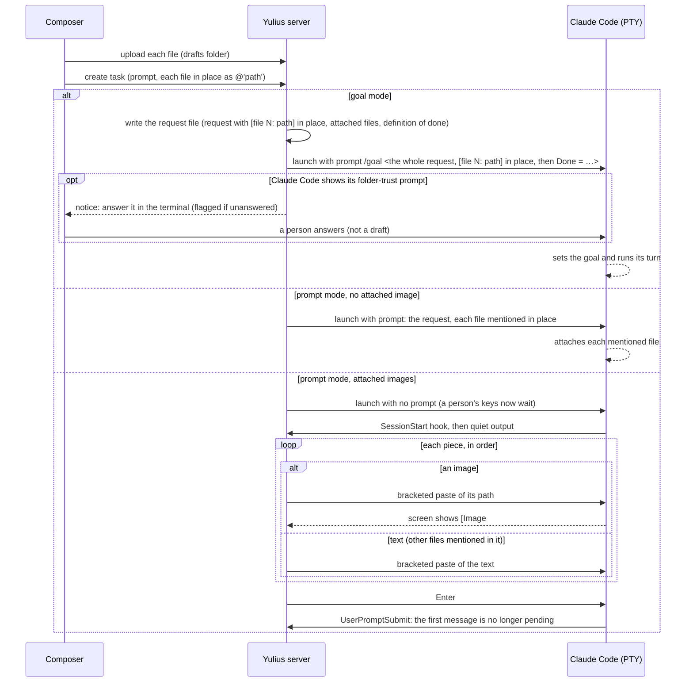

### Onboarding repair

A sandbox waits in `pending` or `preparing` until its onboarding task has made it ready
([decision 0076](decisions/0076-onboarding-is-mandatory-in-the-ui.md),
[decision 0077](decisions/0077-onboarding-task-is-created-when-needed.md)). That task stays in
the task list while the sandbox waits: archiving it is refused. If it is deleted, the sandbox
returns to `pending` and Start onboarding creates a new one. `refresh_onboarding` makes these
repairs, and the server makes them once for every sandbox at start, which heals sandboxes stuck
before the fix ([SPEC-106](../.ai/specs/SPEC-106-onboarding-another-repo-got-fucked-up-by.md),
[decision 0086](decisions/0086-a-lost-onboarding-task-returns-the-sandbox-to-pending.md)).
Every state change below is a compare-and-set from the state it was decided on, so a Start
onboarding or a refresh running while an admin skips never writes over the skip (attaching a new
onboarding task writes `pending` under the lock a skip takes, so it needs no condition). Until it runs,
the onboarding task reads "Waits for Start onboarding" (or "Not started" after a skip), not Closed
([SPEC-153](../.ai/specs/SPEC-153-fix-406-431-399-onboarding-writes-never.md),
[decision 0126](decisions/0126-a-task-that-never-ran-is-a-view-not-a-status.md)).
A repository with no commits has no branch for that task's worktree: a start whose clone has no
branch of origin fetches it again and, when origin still has none, pushes `README.md` to the default branch GitHub reports
(`main` when none), as the App, and records that branch. A sandbox recorded with a branch GitHub
lacks (an empty clone's `master`) is corrected to GitHub's when someone pushed it since
([SPEC-241](../.ai/specs/SPEC-241-onboarding-works-on-an-empty-github-repo.md),
[decision 0187](decisions/0187-an-empty-repository-gets-its-first-commit-when-onboarding-starts.md)).
Onboarding runs an agent, so it waits for a Claude account first: without a usable one (signed in,
`ok` or `limited`) Start onboarding and a browser import's start are refused before anything is
created or pushed and the sandbox stays `pending`; the same gate (`account_gate`, 409
`claude_account_required`) refuses every other start a person asks for, while a start by a chain, a
rule, an automation or a time waits `waiting_capacity` saying no account is connected
([SPEC-246](../.ai/specs/SPEC-246-onboarding-requires-a-connected-claude-a.md),
[decision 0190](decisions/0190-a-person-starts-no-agent-without-a-connected-claude-account.md)).

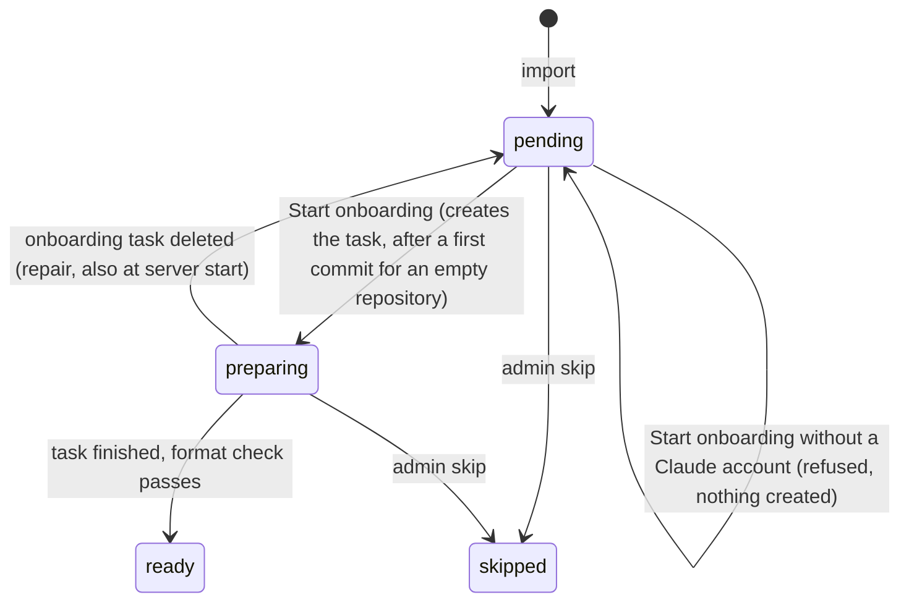

The onboarding task leaves the project ready for the discipline. In its own pull request it lays
the gate: a test command, lint and format, and a dead-code and unused-dependency check, wired into
`[commands]` and `[[ci.jobs]]` with a CI job for every project of a monorepo. Existing findings
go into a committed baseline instead of application-code changes. It delivers through the review
and `delivery_merge` like every task
([SPEC-116](../.ai/specs/SPEC-116-linter-dead-code-should-be-installed-on.md),
[decision 0094](decisions/0094-onboarding-installs-the-gate-in-its-own-pull-request.md)). The
briefing quotes the newest end of the changes log: a log whose ISO dates run oldest first is
quoted from its end, and its new entries go there.

### Supertasks

Every run starts through `App::start_run`: a new task, the queue, a released chain or rule,
Start now, Continue, and the capacity loop. Before the session limit, it applies the supertask
hold (`yulius-app/src/supertask.rs`,
[SPEC-071](../.ai/specs/SPEC-071-somewhere-here-the-user-should-be-able-t.md),
[decision 0054](decisions/0054-a-supertask-holds-its-project-at-the-start-door.md)). A task
without a live run waits `queued` while its project has a pending supertask (only an earlier one
counts, for a supertask). A supertask also waits while the project has a working task. Live runs
are never touched. The queue offers free slots to supertasks first, then FIFO, one start after
the other. A held task's summary lists what it waits for (`held_by`).

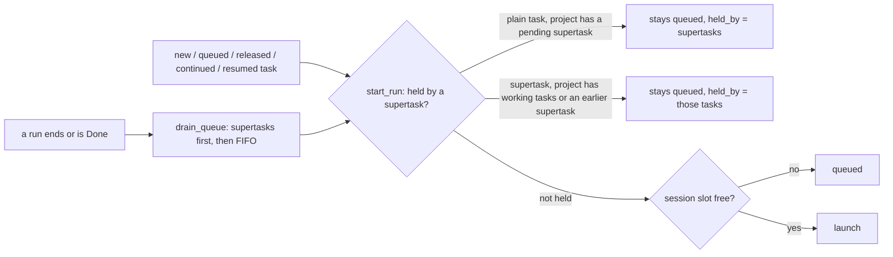

### Prepared tasks

A task can wait as `prepared` before its first run (`yulius-app/src/prepared.rs`,
[SPEC-105](../.ai/specs/SPEC-105-add-scheduling-when-i-decide-in-this-mod.md),
[decision 0085](decisions/0085-a-prepared-task-waits-for-a-person-or-its-time.md)). Without a time
it waits for a person's Start now; with one (a row in `task_schedules`) the background tick
releases it once the time has come and the sandbox's onboarding no longer blocks tasks. Released,
it goes `prepared → queued` by compare-and-set and starts through `start_run` like a new task.

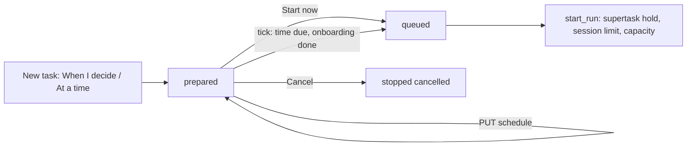

### Changing how a waiting task starts

A `chained` or `prepared` task takes another start choice before its first run
(`yulius-app/src/start_change.rs`, `PUT /api/tasks/{tid}/start`,
[SPEC-126](../.ai/specs/SPEC-126-we-d-like-to-be-able-to-change-task-runn.md),
[decision 0102](decisions/0102-a-waiting-task-changes-how-it-starts.md)). The choice is checked
as at creation, a wait on itself is refused, and the store replaces the status, chain row and
start time in one transaction guarded by the status read. A chain evaluation releases a task only
while its chain still names what was evaluated, and a rule judges the tasks that existed when it
was written (the chain row's time).

```mermaid
flowchart LR
    W[chained or prepared] -->|PUT start: after a task or a rule| C[chained]
    W -->|PUT start: When I decide / At a time| P[prepared]
    W -->|PUT start: Start now / Supertask| Q[queued]
    C -->|evaluation of the same chain| Q
    X[queued, running, ended] -->|PUT start| N[409: keeps its start]
```

## Remote control

A person drives the instance from their own computer ([guide](remote-control.md), SPEC-247,
[ADR-0188](decisions/0188-remote-control-uses-scoped-personal-api-tokens.md),
[ADR-0189](decisions/0189-remote-file-changes-are-commits-on-a-change-branch-with-a-pull-request.md)).
On Settings they make a personal API token (`operate` or `read`, stored hashed). Their local
Claude Code adds `https://<instance>/mcp` with it; the `yulius` CLI (`yulius remote login`, then
`yulius project|task|ci …`) calls the same endpoint. `App::remote_mcp_handle`
(`crates/yulius-app/src/remote.rs`) checks the token's scope, counts 120 requests a minute, and
checks each project tool's action against the person's access to the project named in
`project`. It then runs the Superagent's own tool (as `remote:<login>`) or the function the web
UI's route calls, audits changes as `remote.tool` and redacts results as every MCP result. File
changes never touch a sandbox: `project_change` commits in a fresh clone of GitHub, in a private
directory outside every sandbox, and opens a
pull request that Yulius CI tests, and `change_merge` merges it once green
(`crates/yulius-app/src/remote_files.rs`).

"Onboard this folder" needs nothing more from the person (SPEC-256,
[ADR-0194](decisions/0194-an-operate-token-confirms-for-its-person-s-laptop-onboarding.md)): the
local agent signs the CLI in with the same `operate` token, which `yulius onboard` and
`yulius secrets import` also use when there is no `yulius login` token. `yulius onboard --yes`
uploads the checkout and sessions; `yulius secrets import --yes --env-files --from-file NAME=PATH`
creates the keys it found (the CLI reads the files; values never reach the agent) already allowed
into `.env` files (`AgentSecretInput.env_files`); and `yulius project onboard --notes` starts
onboarding with the agent's hand-over, which `App::approve_onboarding` adds, redacted, to the
resting onboarding task's request (`append_resting_prompt`) before the task starts.

```mermaid
flowchart LR
  LA["Local agent (laptop)"] -->|"yulius onboard --yes"| UP["Import API: checkout + sessions"]
  LA -->|"yulius secrets import --yes --env-files --from-file"| VA["Agent secrets (env_files allowed)"]
  LA -->|"onboarding_start {notes}"| OT["Onboarding task request + hand-over"]
  OT -->|"secrets_list, secret_copy_to_env"| VA
```

```mermaid
sequenceDiagram
  participant L as Local agent / yulius CLI
  participant M as POST /mcp (public)
  participant A as App (remote.rs)
  participant G as GitHub
  participant C as Yulius CI
  L->>M: tools/call project_change {project, files}
  M->>A: remote_caller(token): scope, 120/min
  A->>A: require(person, project, Work)
  A->>G: fresh clone, commit as the person, push yulius/change-…, open PR
  C->>G: tests the pull request (its own [[ci.jobs]])
  L->>M: tools/call change_merge {number}
  A->>C: run at the exact head passed?
  A->>G: merge, delete the branch
```

## Superagent (the Cockpit)

Every user has one plain Claude Code session per sandbox, shown as the **Superagent**
([SPEC-074](../.ai/specs/SPEC-074-i-just-hit-usage-limit-in-the-agent-it-s.md), formerly the Agent)
([SPEC-021](../.ai/specs/SPEC-021-in-this-bar-we-need-to-add-cockpit-at-th.md),
[decision 0020](decisions/0020-cockpit-as-a-plain-shell-session.md)); the code and the API still
call it the Cockpit. It is a sandbox shell of kind `cockpit` that runs `claude` instead of the
login shell: no lifecycle hooks, status line or briefing (its only hook is the redaction hook,
below), a pool subscription's token, and the newest
conversation resumed whenever it starts again. On a contained server it runs in Claude Code's
bypass-permissions mode, as task runs do (`--dangerously-skip-permissions`, `IS_SANDBOX=1`,
[SPEC-208](../.ai/specs/SPEC-208-tasks-and-the-superagent-should-run-in-d.md),
[decision 0165](decisions/0165-the-superagent-bypasses-approvals-on-contained-servers.md)). Its start, like a terminal's, runs detached from
the request, so a client that goes away mid-start never leaves a second or half-started session
([SPEC-077](../.ai/specs/SPEC-077-fix-250-cockpit-and-shell-starts-survive.md),
[decision 0053](decisions/0053-shell-starts-run-detached-from-the-request.md)). The web UI shows it in the right tool panel beside
the page, under a notice that it is for quick work only, opened from the first button of the tools
rail ([SPEC-035](../.ai/specs/SPEC-035-move-cockpit-to-the-right-and-change-coc.md),
[decision 0036](decisions/0036-agent-in-the-right-panel.md),
[decision 0106](decisions/0106-the-superagent-is-opened-from-the-tools-rail-only.md)).

A Cockpit remembers its pool subscription (in `shell.json`) and watches its newest conversation
while it runs ([SPEC-074](../.ai/specs/SPEC-074-i-just-hit-usage-limit-in-the-agent-it-s.md),
[decision 0055](decisions/0055-cockpit-moves-past-a-usage-limit.md)). A usage limit recorded after
it started is recorded on that subscription as a task's is. The Cockpit then starts again, under
its start lock, on a subscription with capacity. It resumes the conversation stepped back over the
limit with Claude Code's interrupted-turn flag, as a task does after a limit (SPEC-034). The old
process ends with the exit status `switched`, and the panel follows it to the new one. Without
capacity, it stays and its viewers get a notice. A shell, the Cockpit included, is recorded as
ended only once it exited or its host was terminated: when its host cannot be ended it stays live
and its viewers are told, and the move starts no second Cockpit on the same conversation
([SPEC-146](../.ai/specs/SPEC-146-fix-346-453-a-shell-ends-only-when-its-h.md),
[decision 0120](decisions/0120-a-shell-ends-only-when-its-host-is-proven-gone.md)).

It manages the project through the Yulius MCP server
([SPEC-037](../.ai/specs/SPEC-037-i-got-something-like-this-tasks-and-cock.md),
[decision 0029](decisions/0029-cockpit-manages-through-mcp.md)). Its bearer (`ck_…`) is derived
from the shell's persisted host token, and it is served the management tools (tasks,
automations, workflows, sessions), `task_message` and the vault tools (below). Those tools act for a person (`ProjectCaller`): the Cockpit's
owner, or a task's owner when a task's agent calls them. `task_create` takes the same path as
New task; `task_stop`, `task_archive`, `task_delete`, `automation_delete`, `automation_run_now`
and `automation_template_enable` call the UI's own functions with that person and the caller as
the audit actor, never on the caller's own task
([SPEC-066](../.ai/specs/SPEC-066-fix-275-293-cockpit-and-agents-manage-ta.md),
[decision 0049](decisions/0049-management-tools-cover-the-task-and-automation-lifecycle.md)).
`task_message`, the Superagent's and the remote MCP's (never a task agent's), passes on what its person says to a task
(`App::tool_task_message`, `task_message.rs`): a task that never started gets it in its request
through `App::queue_task_message` (SPEC-052); a running one gets it through `App::send_input` as
one bracketed paste labelled with the person, then a separate Enter, refused before Claude Code's
session started (SessionStart, whose `session-started` marker in the run folder `reconcile`
reads for a reattached run, or half the goal-ready timeout after the spawn, `spawned_ms`),
while a person typed
in the last minute (`typed_recently`), while Claude Code's folder-trust dialog shows
(`trust_prompt_shown`), while Yulius types the first message or while another
message is typed (`TaskRuntime::typing_message`); audited `task.messaged`
([SPEC-230](../.ai/specs/SPEC-230-superagent-should-be-able-to-prompt-task.md),
[decision 0178](decisions/0178-the-superagent-messages-tasks-by-queueing-or-typing.md)).

A repository's `.mcp.json` would make Claude Code ask about each of its servers when the
Superagent starts. Before every task run and Superagent start, `App::import_project_mcp` adds
the file's servers that the sandbox lacks to its MCP servers, so task runs get them like any
other server. The Superagent starts with `--settings` naming every one of them in
`disabledMcpjsonServers`, so it never asks
([SPEC-095](../.ai/specs/SPEC-095-while-onboarding-other-project-i-got-som.md),
[decision 0078](decisions/0078-repository-mcp-json-feeds-the-mcp-section.md)). Agents write the
file, so imported servers have the origin `mcp_json`: the MCP Test, which runs on the host, never
starts their command nor connects to their private address until a person changes what they run
([decision 0173](decisions/0173-the-mcp-test-refuses-servers-imported-from-mcp-json.md)). An MCP server's
secret values reach a run in `YULIUS_MCP_<SERVER>_<VAR>` variables, never under the server's own
variable name, which may hold an agent secret's placeholder.

The Superagent gets the same servers as a task run of its sandbox (`App::mcp_attachments`), inline
in its `--mcp-config` next to `yulius`, their values in its secret environment, and the task runs'
redaction of agent secrets: `CLAUDE_CODE_SHELL_PREFIX=<yulius> --scrub-exec` for its Bash commands,
hooks and stdio servers, and the `PostToolUse` hook, its only hook; its screen is redacted on the
server as a task's terminal is. The wrapper and hook load their fingerprints with the workspace
token the person's environment holds, answered while the person may work in the sandbox (by an
access decision within the staleness bound, never waiting on GitHub) ([SPEC-147](../.ai/specs/SPEC-147-fix-395-the-superagent-gets-the-sandbox.md),
[decision 0121](decisions/0121-the-superagent-gets-the-sandbox-mcp-servers-and-the-redaction.md)).

Every terminal people watch (a task's, the Superagent's, a Cockpit shell's) replaces a value with
its label fitted to the value's display width (`fitted_label`): `[secret:NAME]` followed by `*` padding, or cut short. A full-screen
program's cursor-addressed redraws then land in the cells it meant. Text channels keep the full
label ([SPEC-239](../.ai/specs/SPEC-239-termial-gets-bugged-often-fix.md),
[decision 0181](decisions/0181-a-terminal-masks-a-secret-as-wide-as-its-value.md)).

The Superagent uses the agent vault as a task's agent does
([SPEC-186](../.ai/specs/SPEC-186-the-superagent-uses-the-agent-vault-like.md),
[decision 0150](decisions/0150-the-superagent-uses-agent-secrets-as-a-task-does.md)). It starts
behind the egress proxy with its own `ck_` bearer (`App::vault_superagent_setup`: proxy variables,
the CA bundle in its run directory, a placeholder per agent secret), and the proxy's policy takes
a live Superagent's bearer as `EgressCaller::Superagent`, which never uses a production secret.
`secret_copy_to_env` and `secret_request_hosts` take a `SecretUser` (a task's agent or the
Superagent): the Superagent's copies go to the sandbox repository's ignored `.env`, and its asks
are recorded as `<login>'s Superagent`. The copy walks to its `.env` from the canonical sandbox
folder, a folder the agent cannot replace (`secret_source_root`): `repo` for the Superagent, the
worktree's folders for a task, then the folders named, one at a time without following links, and
the folder reached must be inside that work folder; Git checks run in the anchored work folder. A
Superagent that swapped `repo` for a link is refused and nothing is written
([SPEC-254](../.ai/specs/SPEC-254-superagent-secret-copy-to-env-follows-a.md), #635). It has no project browser, so no `browser_fill_secret`.
`secrets_list` gives it a task's records with its own guidance, and `secret_verify`, the
Superagent's only (a matching candidate's hash must not reach a task transcript other members
read), compares the SHA-256 of a value the person holds with the stored value and its variants (a
final line break; literal `\n` as line breaks, since an agent secret never spans lines)
([SPEC-178](../.ai/specs/SPEC-178-superagent-should-have-access-to-agent-s.md),
[decision 0144](decisions/0144-the-superagent-reads-the-agent-vault-and-verifies-values-by-hash.md)).
A key block stored that way is written to a `.env` as its file (`dotenv::key_block`), and its
lines are redaction needles. The Secrets page's value field is one line, so it writes a pasted
key block's line breaks as literal `\n`; `check_agent_value` refuses a key flattened onto one line
(`dotenv::flattened_key`), and the agent secrets list marks one stored before that `flattened`
for the people who manage it
([SPEC-193](../.ai/specs/SPEC-193-creating-multiline-keys-fails-make-sure.md),
[decision 0156](decisions/0156-a-pasted-multi-line-secret-is-stored-with-escaped-line-breaks.md)).

Agents create agent secrets from a file with `secret_create_from_file` (`vault/create.rs`, for
a task's agent or the Superagent as a `SecretUser`). The tool takes a path relative to the work
folder or `~/` for the caller's home (the sandbox home for a task, its person's home for the
Superagent, shared by their projects). Yulius walks to it from a folder the agent cannot replace (the
canonical sandbox folder, or `users/<id>` for the Superagent's home) as `secret_copy_to_env` walks to
its target (`open_folder`: one folder at a time without following links, real path checked), reads a regular
file of at most 16 KiB, converts it with `dotenv::agent_value_from_file` (the CLI import's
conversion too) and stores it through `App::insert_agent_secret`, the Secrets page's path. The
secret has no hosts and no `.env` allowance, its creator is the person the caller acts for (write
access required) and its audit actor is the agent. The file is removed through the same folder
handle only when asked
([SPEC-211](../.ai/specs/SPEC-211-yulius-should-be-able-to-create-secrets.md),
[decision 0167](decisions/0167-agents-create-agent-secrets-from-a-file-yulius-reads.md)).

`yulius secrets import` (`crates/yulius/src/cli.rs`, `yulius-import`'s `secrets_import` and
`dotenv`) adds secrets from a computer through the same create calls as the Secrets page, with
the `yulius login` token, else the `yulius remote login` one: it reads a dotenv file, stdin,
hidden prompts or whole files (`--from-file NAME=PATH`), lists the caller's existing team titles
or a sandbox's agent names, classifies each secret, asks for `yes` at `/dev/tty` (unless `--yes`
runs with an `operate` token, [decision 0194](decisions/0194-an-operate-token-confirms-for-its-person-s-laptop-onboarding.md))
and posts the new ones once each (no retry). Agent values that are ordinary text
(`yulius_domain::vault::ordinary_text`: configuration words, hosts, e-mail addresses, URLs without
credentials) are skipped, and values found in the tracked files of the project's checkout
(`repo_values::find_in_checkout`, in memory) are asked about or, with `--yes`, skipped
([SPEC-274](../.ai/specs/SPEC-274-agent-secrets-refuse-plain-words-that-ma.md),
[decision 0204](decisions/0204-secrets-import-refuses-ordinary-text-and-an-operate-token-deletes.md));
`yulius secrets delete NAME` calls the remote tool `secret_delete`. Values stay in `Secret` (redacted `Debug`,
wiped on drop) and never reach its output
([SPEC-205](../.ai/specs/SPEC-205-to-cli-add-and-option-to-import-secrets.md),
[decision 0163](decisions/0163-the-cli-imports-secrets-after-a-typed-yes-and-shows-no-value.md)).

```mermaid
sequenceDiagram
    participant P as Person
    participant C as yulius secrets import
    participant App as Yulius (vault API)
    P->>C: --to agent .env (or stdin, or hidden prompts)
    C->>App: GET /api/sandboxes, GET agent-secrets (names only)
    C->>C: ordinary text skipped; values in the project's tracked files asked about
    C-->>P: names: new / exists (skipped) / skipped with reason
    P->>C: yes at /dev/tty (or --yes with an operate token)
    C->>App: POST agent-secrets per new name (hosts [], once, audited by name)
    C-->>P: imported / failed per name, summary
```

Claude Code reads the Yulius tools once per connection, so each Cockpit's `shell.json` keeps the
launch digest it started with (`App::cockpit_launch_digest`: its MCP instructions, tool
descriptors, whether the egress proxy is wired and `COCKPIT_LAUNCH_REVISION`; `serve` wires
the proxy before it adopts shells). One adopted after a restart with another digest, or
none, is due a refresh: its watch tracks whether a turn or background work is open, and once its
conversation is idle it is ended (`switched`) and started again resuming that conversation, as a
usage-limit move does but without redoing a turn.

```mermaid
flowchart LR
  UI["Right panel: Superagent"] -->|"POST /api/sandboxes/sid/cockpit"| APP["App::cockpit_open"]
  APP -->|"pool_account"| POOL[("Subscriptions")]
  W["Cockpit watch: newest conversation"] -->|"usage limit after the start: record_limit, start again (switched) once the old host is gone"| APP
  W -->|"adopted with another launch digest: start again resuming, once idle (switched)"| APP
  SH -->|"HTTPS_PROXY yulius:ck_… (bound hosts get their secrets)"| EG["Egress proxy: EgressCaller::Superagent"]
  APP -->|"plan_cockpit"| HP["Harness: claude [--resume id] --mcp-config yulius + sandbox servers --settings: PostToolUse redaction [.mcp.json servers rejected]"]
  MS -->|"mcp_attachments: values in the secret environment"| HP
  SH -->|"scrub-exec, PostToolUse: Bearer ws_… (YULIUS_TASK_TOKEN)"| FP["/internal/scrub/fingerprints"]
  APP -->|"import_project_mcp (also before task runs): origin mcp_json, never host-tested"| MS[("Sandbox MCP servers")]
  REPO[".mcp.json in the repository"] --> APP
  APP --> SH["Shell runtime (user space, repository)"]
  UI -->|"WS /api/shells/id/terminal"| SH
  SH -->|"Bearer ck_… (YULIUS_COCKPIT_TOKEN)"| MCP["/mcp: management and vault tools"]
  MCP -->|"task_message: not started → request (queued); running → paste + Enter (send_input)"| TASK["A task of the project"]
  MCP -->|"secret_copy_to_env (SecretUser::Superagent)"| ENV[".env in the sandbox repository"]
  MCP -->|"secret_create_from_file: reads a work-folder or ~/ file, no links"| VA[("Agent vault: new secret, no hosts")]
  AG["Task agent"] -->|"Bearer task token"| MCP
  MCP -->|"task_create"| NT["App::create_task_as (as New task)"]
  MCP -->|"task_stop / task_archive / task_delete"| TU["The UI's stop, archive, delete (never the caller's own task)"]
  MCP -->|"automation_*, automation_template_enable"| AU["Automations and ready-made ones"]
```

## Agent secret hosts

An agent secret is used only on the hosts it is bound to (SPEC-002 ADR-20). Since SPEC-121
(ADR-0098) a person adds one with a name, a value and a description, and it starts bound to
nothing. The agent works out the service's host and proposes it with `secret_request_hosts`.

Since SPEC-216 (ADR-0171) a new secret has `auto_allow` ("Let agents set it up") unless the person
turns it off when adding it or in Edit. Then the proposed hosts are bound at once (audited
`vault.agent.auto_allow` with the asking task) and production CD runs get the value
(`allowed_for`), with no person in between. Secrets added before keep it off. Without it the
request waits on the secret (`requested_hosts`) until a person who manages it allows it, so an
agent misled by injected content cannot send that secret to another server; and production gets
it only through the production-only allowance (`cd_prod`), which excludes `auto_allow`, `.env`
copies and bound hosts: each compare-and-set of the store refuses the pair itself, so two people
answering at once cannot end with both (SPEC-134 M-B, SPEC-262).

Every team secret belongs to one sandbox (`sandbox_id`, the default) or is team-wide
(`NULL`). A sandbox's team secret is read by the people who can view that sandbox
(`/api/sandboxes/{sid}/team-secrets`, 404 elsewhere, its activity hidden) and changed by those
who write to it; team-wide ones are everyone's (`/api/team-secrets`). Schema version 35 listed
the team secrets (none had a sandbox) in `vault_scope_pending`; at the next start, before
serving, `App::assign_vault_scopes` (`vault/scopes.rs`) re-seals each into a copy per sandbox and
replaces it in one transaction (`vault_assign`), audited `vault.team.assign` by `yulius`. Agent
secrets have their own scopes (below).

## Agent secret scopes

Since SPEC-245 ([decision 0186](decisions/0186-agent-secrets-are-project-global-or-personal.md))
an agent secret is a project's (`sandbox_id`), global (no sandbox, no owner) or personal
(`owner_id`, removed with the user's row). `vault_enabled (secret_id, sandbox_id)` switches a global or
personal secret on for a project; a new one is on for the project it was added from. Names are
unique within a scope. `VaultStore::vault_agent_in(sandbox)` lists the candidates (the project's,
and the global and personal ones, of every owner, switched on there); `vault/reach.rs` resolves
them for a `Holder`: one per name, project > personal > global, then the instance Vidoc key, and
never another person's. A task's holder is its owner unless an automation started it
(`Holder::of_task`); the Superagent's is its person; CI jobs, CD runs and MCP references hold
nobody, and a task an automation's task creates is an automation task too.
The Superagent's egress caller carries its person; an agent run's carries none: the proxy reads
its task's current holder on every request, so a hand-over or a deleted task applies also to
connections opened before it, a hand-over (also one during a launch) rewrites the run's
fingerprint file in place for the new owner (SPEC-248), and `task_message` from anyone but the
owner refuses a task holding personal secrets. A personal secret is never copied
into `.env` files, resolved in MCP references, typed by `browser_fill_secret` or given to
production. Yulius' own redaction of a project covers every candidate; the fingerprint file a run
gets covers only its holder's (`App::matcher_for`). Global secrets are managed and switched by
instance administrators, personal ones only by their owner (404 to everyone else), through
`PUT /api/sandboxes/{sid}/agent-secrets/{id}/enabled`; the store counts the 200 secrets a project
may get in the transaction that adds or switches one on. Schema version 39 switched every team-wide
agent secret on for every live sandbox.

```mermaid
flowchart LR
  C["vault_agent_in(project): project + switched-on global + switched-on personal (all owners)"] --> H{"run's holder"}
  H -->|"task (not automation) or Superagent: its person"| P["per name: project > own personal > global"]
  H -->|"CI job, CD run, automation's task, MCP refs"| N["per name: project > global"]
  P --> X["egress proxy, placeholders, tools"]
  N --> X
  C --> R["Yulius' redaction of the project (every candidate)"]
```

Storing a host or `.env` request, a host bound at once, a secret an agent created, or a global or
personal secret switched on or off for a project publishes `secrets.updated` to a project
secret's sandbox (to everyone for a global or personal secret), so an open Secrets page reads its
list again without a reload ([SPEC-209](../.ai/specs/SPEC-209-allow-didnt-show-instantly-but-i-needed.md)).

```mermaid
flowchart LR
  A["Agent: secret_request_hosts(NAME, host)"] --> Q{"auto_allow?"}
  Q -->|"yes (default for new secrets)"| B["bound now (vault.agent.auto_allow)"]
  Q -->|"no"| W["requested_hosts: waits for a person"]
  W -->|"Allow on the Secrets page"| B
  B --> X["Egress proxy adds it toward the bound hosts"]
  P{"production CD run names it"} -->|"auto_allow or cd_prod"| R["gets the value"]
  P -->|"neither"| N["nothing ran: a person allows it"]
```

```mermaid
sequenceDiagram
    participant P as Person
    participant UI as Secrets page
    participant App as Yulius (vault)
    participant A as Agent
    participant X as Egress proxy
    P->>UI: Add VIDOC_API_KEY (name, value, description)
    UI->>App: POST agent-secrets (hosts [], injection none)
    A->>App: secrets_list, then secret_request_hosts(model.vidocsecurity.com)
    App-->>A: requested, waiting for a person (task needs attention)
    App-->>UI: secrets.updated (open page reads the list again, shows Allow)
    A->>X: request to model.vidocsecurity.com with the placeholder
    X-->>A: forwarded without the secret (not bound yet)
    P->>UI: Allow
    UI->>App: POST agent-secrets/{id}/request {allow: true}
    A->>X: request to model.vidocsecurity.com with the placeholder
    X-->>A: placeholder replaced by the value, response redacted
```

## Agent secrets in CI jobs

A CI job runs a pull request's code, so it gets an agent secret only the way an agent does, and
only when the integration branch grants it
([SPEC-142](../.ai/specs/SPEC-142-fix-466-yulius-ci-jobs-opt-in-to-named-a.md), ADR-0116). When a
job starts, `App::ci_job_secrets` (`crates/yulius-app/src/ci/exec.rs`) looks up the `secrets` of
the integration branch's `[[ci.jobs]]` entry of the same name in the integration head GitHub
reports, taken into the CD mirror only Yulius writes (`App::ci_verified_gate`): CI jobs can write the
sandbox clone, so its copy only says whether to look. A pull request's own `yulius.toml` is never
asked, and the grant binds the entry's command too: a pull request tested with its own jobs that
reuses a granted name for another command runs it without any secret, and its output says why
([SPEC-264](../.ai/specs/SPEC-264-ci-grants-agent-secrets-only-to-the-trus.md), ADR-0196). A
granted job gets the placeholders, the CA bundle and a proxy credential of its own, held in memory
until its process ended. The proxy's `EgressClient` is then a CI caller, `ci:<run>`, that may use
only the granted secrets toward their bound hosts; each use is audited under that actor.

```mermaid
flowchart LR
  GH["GitHub: integration head"] -->|"exact commit, objects checked"| MIR["CD mirror (Yulius only)"]
  MIR -->|"yulius.toml, e.g. security: secrets = VIDOC_API_KEY; grant by job name and command"| EXEC["CI job start (ci_job_secrets)"]
  CLONE["sandbox clone (CI jobs can write it)"] -.->|"only whether to look"| EXEC
  PR["pull request's own yulius.toml"] -.->|"never read for grants"| EXEC
  EXEC -->|"placeholder, CA, proxy credential"| JOB["CI job (pull request code)"]
  JOB -->|"request with yulius-secret-VIDOC_API_KEY"| X["Egress proxy: client ci:run"]
  X -->|"value only toward bound hosts"| V["model.vidocsecurity.com"]
  X -->|"vault.agent.use, actor ci:run"| AUD["secrets audit"]
```

## Vidoc: the instance key and the security scan

Vidoc is an optional instance service, like Jev
([SPEC-195](../.ai/specs/SPEC-195-vidoc-is-built-into-yulius-an-optional-i.md), ADR-0157).

- **The key.** A superadmin saves the key on the Instance page or in a setup step
  (`crates/yulius-app/src/vidoc_key.rs`, `/api/admin/vidoc*`). It is sealed in the `instance` row,
  or read from `YULIUS_VIDOC_API_KEY_FILE` while nothing is saved.
- **Where it applies.** The vault adds it as the virtual agent secret `VIDOC_API_KEY`
  (`App::applied_agent_secrets`, `vault/mod.rs`), bound to `model.vidocsecurity.com` only, for every
  run that gets no agent secret of that name (the project's, a global one switched on for it, or
  for agent runs the person's own: [Agent secret scopes](#agent-secret-scopes)). That covers agent runs and the Superagent, and CI
  jobs whose integration-branch grant names it. The egress proxy injects, audits (`instance:vidoc`)
  and redacts it as it does any agent secret. MCP references, `.env` copies and browser filling
  never resolve it.
- **The scan.** It runs where the code is. `scripts/vidoc_scan.py`, embedded in the binary as
  `yulius security-scan`, reads `HEAD`'s tree and sends line-numbered chunks to `/v1/messages`.
  It reads the JSON findings back. It fails on open critical or high ones, and on open medium ones
  in the lines the branch changed (`git diff -U0`, 3 lines of slack; SPEC-217, ADR-0172). It prints
  low ones in the change for the agent to decide, and fingerprints the rest as outside the change.
- **Repeats and gaps.** Each request lists the `[[ignore]]` entries of its files as accepted risks.
  Outside the changed lines an entry also matches a finding in its `function`, near its `line`, or
  one Vidoc answers as `accepted`; open findings name their nearest ignore. An answer cut at
  `max_tokens` halves its chunk (3 levels); a chunk still unreviewed (5xx, timeouts, unreadable,
  the deadline) leaves the scan incomplete, exit 3, and in CI `$YULIUS_CI_INCOMPLETE_CODE` with a
  `::yulius-incomplete` line (SPEC-273, ADR-0202).
- **The default pipeline.** `App::ci_gate` and `ci_verified_gate` add the built-in `security` job
  (`yulius-domain` `ci::with_security_job`: `yulius security-scan --ci`, granted `VIDOC_API_KEY`)
  when the sandbox's applied agent secrets have that key and its CI does not scan already.
- **Issues.** When a run with a `security` job ends (`ci_follow_run_findings`), `ci/findings.rs`
  reads that job's `::yulius-finding` lines. On a pull request head whose other jobs passed or were
  skipped (SPEC-273), it files each new fingerprint (table `security_findings`, migration 0036) and
  reopens the issue of one reported again. On a pull request or on the integration branch, it
  closes the issues whose fingerprint no line of the file on `origin/<integration>` has any more
  (`GitHubPort::create_issue`, `set_issue_state`).
- **Infra bootstrap.** The briefing and the onboarding prompt carry the scan only when the instance
  has a key (`briefing.rs` `security_scan`, `onboarding.rs` `security_setup`).

```mermaid
flowchart LR
  SA["Superadmin: Instance page or setup"] -->|"PUT /api/admin/vidoc"| APP["Yulius: instance row, sealed"]
  FILE["YULIUS_VIDOC_API_KEY_FILE"] -.->|"while nothing is saved"| APP
  APP -->|"virtual agent secret VIDOC_API_KEY, unless the project has its own"| PX["Egress proxy"]
  AG["Agent: yulius security-scan, scripts/dev security"] -->|"x-api-key: yulius-secret-VIDOC_API_KEY"| PX
  CI["CI job security (built in when the key applies), granted VIDOC_API_KEY: --ci"] -->|"the same placeholder"| PX
  PX -->|"the key toward model.vidocsecurity.com only"| V["Vidoc /v1/messages, vidoc-1"]
  V -->|"JSON findings: exit 0, 1, 2 when not run, 3 when incomplete"| AG
  CI -->|"::yulius-finding lines: outside the change, at the run's end"| ISS["ci/findings.rs: file (other jobs passed), reopen, close"]
  ISS -->|"issues, once per fingerprint"| GH["GitHub issues"]
  APP -->|"key set: briefing and onboarding add the scan rule"| BOOT["infra bootstrap"]
```

## CD (deployment)

CD runs a project's deploy and verify scripts like CI runs its checks
([SPEC-134](../.ai/specs/SPEC-134-implement-cd-it-should-write-cd-bash-scr.md), ADR-0109,
ADR-0110, ADR-0111). In the UI both are one CI/CD page with a CI (tests) and a CD (deployment)
tab (`pages/cicd.js`, ADR-0125); "the CD page" below is its CD tab, `/s/<slug>/ci?section=cd`.
A CI run or a deploy is a view of its tab at its own address (`?run=<id>`, `runview.js`), with a
sticky live summary, and the Now summary above both tabs (`pages/cinow.js`) lists what runs and
links to it ([decision 0180](decisions/0180-ci-and-cd-runs-are-views-of-the-ci-cd-page.md)).
`yulius.toml` defines `[cd.dev]` and `[cd.prod]` and any other `[cd.<name>]` with its `stage`
(`dev` or `prod`, [SPEC-257](../.ai/specs/SPEC-257-current-ci-cd-is-too-strict-dev-prod-is.md),
[decision 0195](decisions/0195-cd-environments-are-named-and-take-their-rules-from-a-stage.md)):
the stage carries every rule below, so "dev" and "production" mean the stages. A name's stage is
resolved at the verified integration head first, else at the production head
(`yulius_domain::cd::resolve_stage`). Yulius reads them only at the heads of the
protected branches (`crates/yulius-app/src/ci/cd.rs`), so a task branch or a worktree never
changes what a deploy runs. `yulius_domain::cd::authorize` decides who may deploy: dev a
person with write access or an agent (`cd_deploy`), production only an administrator who typed the
project's slug. The commit is the one GitHub reports, taken into a mirror only Yulius writes
(`yulius_git::Git::cd_mirror_fetch`, every object checked); its tree is written into the run's
own directory (`export_tree`) and runs through the process host like a CI job (`ci_watch`): dev in
the sandbox's containment, production in the sandbox's network only on the host's read-only system (the launch spec's `host_system` join mode), each with the
secrets allowed for that environment; nothing agents can write is bound in. Output is redacted
before it is stored in `cd_runs`. A run has no lane and no retry: a deploy is not assumed repeatable, so one left by a
restart is recorded as an error. `needs_you` (table column `tasks.needs_you`) puts a task in Needs
you until a person writes to it. `POST …/cd/{env}/deploy` answers only once the run is recorded,
after the checks and production's promotion (seconds to a minute), so the CD page opens the Deploy
dialog as soon as the person confirms, saying what is being checked and promoted with the time so
far, and turns it into the run's view when the answer comes, or shows the refusal in it
([SPEC-189](../.ai/specs/SPEC-189-when-i-clicked-deploy-nothing-happened-f.md)).

```mermaid
sequenceDiagram
    participant A as Agent or person
    participant App as Yulius (CD)
    participant G as Git clone
    participant V as Vault
    participant S as Sandbox (process host)
    A->>App: deploy dev (cd_deploy / CD page)
    App->>App: authorize (production: administrator + typed slug)
    App->>G: fetch: GitHub's dev head into the private mirror (objects checked), read [cd.dev]
    App->>V: values of the named secrets (allowed for this environment)
    V-->>App: values, or "nothing ran: a person allows …"
    App->>App: record the run (cd_runs) and audit cd.deploy
    App->>S: the commit's tree in the run's own directory, run deploy then verify
    S-->>App: output (redacted), exit status
    App->>App: passed / failed / error, audit cd.finished
```

```mermaid
flowchart LR
  M["merge into dev"] -->|"deploys nothing"| DEV
  DEV["dev stage: [cd.dev], [cd.staging] … at the dev head"] -.->|"cd_deploy, CD page, nightly automation"| RUN1["CD run"]
  P["a person on the CD page, slug typed"] --> PROMO["promote dev into main"] --> PROD["prod stage: [cd.prod], [cd.platform] … at the main head"] --> RUN2["CD run"]
  AG["agent"] -.->|"refused"| P
```

A delivery profile's environment run (DLV-003; an agent's `delivery_deploy`) is a CD run of its
stage ([SPEC-219](../.ai/specs/SPEC-219-fix-656-delivery-environment-runs-must-r.md), ADR-0175):
`App::environment_head` (`crates/yulius-app/src/ci/environment.rs`) fetches the stage branch's head
from origin, the token only in that command's environment, into its own mirror
`<data>/cd/<sandbox>/environments.git` (`mirror_fetch_head`, one commit, objects checked), and
`App::environment_command` writes its tree into `<data>/runs/env-<run>` with a fresh `HOME` and runs
the command there through `ci_watch` in `cd_containment` (integration as dev, production as
production). Nothing of it reads the sandbox clone, whose configuration agents write.

```mermaid
flowchart LR
  AG["agent: delivery_deploy / person: Run"] --> RUN["environment run (audited)"]
  GH["origin (GitHub)"] -->|"head of the stage branch, token in the command's env"| EMIR["environments.git (Yulius only)"]
  CLONE["sandbox clone (agents write .git)"] -.->|"never read"| RUN
  EMIR -->|"export_tree"| DIR["runs/env-run: src, fresh HOME"]
  RUN --> DIR
  DIR -->|"process host, CD containment"| CMD["/bin/sh -c command"]
```

Outside Yulius, GitHub keeps the production branch a person's
([ADR-0114](decisions/0114-agents-hold-a-token-github-refuses-on-production.md)). The agent's Git
and `gh` get `App::agent_git_credential`: an installation token restricted to the repository and
to the agent permissions (`AGENT_TOKEN_PERMISSIONS`, no Administration or Workflows), never a
person's. The production ruleset (`rulesets_for`: restrict updates and deletions, block force
pushes, repository admins the only bypass) makes GitHub refuse that token on the branch.
`App::production_branch_warning` asks GitHub, with an agent token, which rules apply to the
production branch and whether that token may bypass them (`GitHubPort::branch_guard`), and
onboarding reports a branch the agents could write. The preparation agent then calls
`production_protect` ([ADR-0129](decisions/0129-onboarding-agents-protect-production-as-the-onboarding-person.md)):
`App::tool_production_protect` adds `people_only_ruleset` (the same rules, no pull-request rule)
with the task owner's own token after `repo_access` says they are a repository admin, and only
when the branch is not already guarded; the agent's token never gains Administration.

```mermaid
flowchart LR
  AG["agent's git / gh"] -->|"credential helper"| TOK["narrowed App token"]
  TOK -->|"push, merge, fast-forward main"| GH{"GitHub ruleset on main"}
  GH -->|"not a bypass actor"| NO["refused"]
  PERSON["repository admin (promotion)"] -->|"own token, bypass"| GH
  GH --> OK["main moves"]
  ONB["onboarding"] -->|"branch_guard with an agent token"| GH
  ONB -->|"production_protect: owner's admin token adds the ruleset"| GH
```

That token reaches only the sandbox's own repository. To read another repository of the same
GitHub owner (an earlier version to port from, a shared library), an agent calls `reference_repo`
([ADR-0197](decisions/0197-tasks-read-other-repositories-of-their-owner-through-a-bundle.md),
[SPEC-267](../.ai/specs/SPEC-267-i-got-this-such-things-should-usually-ha.md)):
`App::tool_reference_repo` checks with the task owner's user token that they can read it
(`repo_access`), and `GitPort::bundle_branch` fetches its default branch with that token into a
fresh bare repository under `<data>/tmp` and writes a bundle of it. `App::attach_server_file`
streams the bundle into the task's attachments through the upload path's handles (ADR-0174), the
fetch folder is removed, and the agent clones the bundle itself into
`<sandbox>/reference/<owner>/<name>`, outside every worktree. Git never runs on the host in a folder
an agent writes, and the agent never holds the person's token. Another owner, the sandbox's own
repository, a playground, a disabled or unsigned owner and no read access are refused with
`needs_you`; onboarding fetches the repositories a project refers to first.

```mermaid
flowchart LR
  AG["agent"] -->|"reference_repo owner/name"| APP["Yulius"]
  APP -->|"repo_access, owner's token"| GH["GitHub"]
  APP -->|"bundle_branch, owner's token"| TMP["data/tmp/reference-*: bare fetch + bundle"]
  TMP -->|"attach_server_file (handles)"| ATT["sandbox attachments/tasks/task"]
  AG -->|"git clone bundle"| REF["sandbox reference/owner/name"]
  ATT --> REF
```

## Keys in .env

A project keeps its keys in a `.env` that Git ignores, beside a tracked `.env.example` that names
them without values ([SPEC-129](../.ai/specs/SPEC-129-default-place-for-keys-should-be-env-tha.md),
ADR-0105). Code that runs outside the egress proxy (a deployed app, a deploy script of Yulius CD)
reads them there. The agent never holds a value, so Yulius writes it: `secret_copy_to_env` checks
with Git that the file is ignored and untracked, then writes the file whole (mode 0600). A value in
a file leaves the secret's bound hosts, so a person allows each secret once (`env_files`).

```mermaid
sequenceDiagram
    participant A as Agent
    participant App as Yulius (vault)
    participant G as Git
    participant W as Task worktree
    participant P as Person
    A->>App: secret_copy_to_env(STRIPE_KEY)
    App-->>A: nothing written, waiting for a person (task needs attention)
    P->>App: Secrets page: Allow (POST agent-secrets/{id}/env)
    A->>App: secret_copy_to_env(STRIPE_KEY)
    App->>G: check-ignore .env, ls-files .env
    G-->>App: ignored, untracked
    App->>W: .env gets STRIPE_KEY=value, .env.example gets STRIPE_KEY=
    App-->>A: copied (no value in the result)
```

## Agent states

A project's operator state (a deploy tool's inventory database, rollout folders, configs) moves
from a laptop as an *agent state*
([SPEC-271](../.ai/specs/SPEC-271-laptop-onboarding-move-a-project-s-opera.md),
[decision 0200](decisions/0200-operator-state-is-a-sealed-agent-state-with-one-writer.md)).
`yulius secrets import --state NAME=DIR` (`yulius-import`'s `states`) packs the folder into a
gzip tar with each entry's permission bits, refusing links and special files, and sends it with
`PUT /api/sandboxes/{sid}/agent-states/{name}` under ADR-0194's rules (typed `yes`, or `--yes`
with the operate token). The server (`vault/states.rs`) checks it (files and folders only,
relative paths, ≤ 64 MiB packed, ≤ 512 MiB and 20 000 entries unpacked), seals it as one envelope
bound to the row and version (`agent_states`, schema 42) and audits `vault.state.*` without
content; at most two states move at once (`UploadState::states`). A task's
`secret_state_restore` opens the target's parent from the canonical sandbox folder's `home`
without links (creating missing folders), unpacks into a fresh sibling folder and renames it into
place; `secret_state_save` packs the folder back through handles as the next version with a
compare-and-set on the version. Once restored, `restored_path` is the only writer: an import over
it is refused unless `replace=true`, which makes that copy stale until a restore replaces it.

```mermaid
sequenceDiagram
    participant L as Laptop agent (yulius CLI)
    participant App as Yulius (vault/states.rs)
    participant DB as agent_states (sealed archive)
    participant T as Task agent
    participant H as Sandbox home
    L->>App: PUT agent-states/OPS (packed folder, operate token)
    App->>DB: check, seal (row id + version), version 1, audit vault.state.import
    T->>App: secret_state_restore(OPS, ~/.ops)
    App->>H: unpack into .yulius-state-x through handles, rename to ~/.ops
    App->>DB: restored_path ~/.ops (the writer)
    L->>App: PUT agent-states/OPS again
    App-->>L: 409: restored at ~/.ops (only with replace=true)
    T->>App: secret_state_save(OPS) after a rollout
    App->>DB: version 2 (compare-and-set), audit vault.state.save
    L->>App: GET agent-states/OPS/archive (state-get)
```

## Terminal input

A keystroke goes from xterm to the PTY and its echo comes back without waiting for the database or
GitHub ([SPEC-118](../.ai/specs/SPEC-118-when-i-write-something-in-a-claude-termi.md),
[decision 0096](decisions/0096-terminal-input-rides-a-write-grant.md)). Each viewer holds a write
grant, confirmed when it opens the terminal. The store's access epoch grows with every write that
can change who may type. While the epoch is unchanged, input is written at once. When it moves,
the next input is checked first. A grant older than 30 s is re-confirmed in the background. The
viewer's socket loop never awaits a permission check: the 60 s re-check runs in a spawned task, and
the loop picks up its verdict.

```mermaid
sequenceDiagram
  participant X as xterm (browser)
  participant L as Viewer loop (routes/terminal.rs, routes/shells.rs)
  participant G as WriteGrant + access epoch
  participant P as ptyhost (PTY)
  participant H as Hub
  X->>L: input frame
  L->>G: decide(epoch, now)
  alt grant holds
    G-->>L: allow (and re-confirm beside it after 30 s)
  else epoch moved or no grant
    G->>G: can_work / shell check (database, GitHub)
    G-->>L: allow or forbidden
  end
  L->>P: bytes
  P-->>H: echo (output chunk)
  H-->>L: broadcast
  L-->>X: binary output frame
  Note over L: every 60 s a spawned re-check, its verdict selected beside input and output
```

Output can carry a program's copy: Claude Code copies the selection it draws with an OSC 52 write.
The browser terminal (`terminal-core.js`) writes it to the clipboard only for a viewer who can write
and just pressed a key or the mouse there, and never answers a clipboard query
([decision 0130](decisions/0130-a-program-s-copy-reaches-the-clipboard-of-the-viewer-who-used-it.md)).

## Task ownership

A task acts on GitHub with one person's token, so it is that person's: its owner, the creator
until a hand-over ([SPEC-070](../.ai/specs/SPEC-070-tasks-should-be-owned-by-a-specific-pers.md),
[decision 0060](decisions/0060-a-task-is-owned-by-one-person.md)). `tasks.owner_id` decides the
token (`App::owner_github_token`), the worktree's commit identity and the authority of the task's
agent; `created_by` stays who asked. `App::load_task` refuses every task change to anyone but the
owner. Anyone else who may work in the project asks for control; the owner hands it over or
declines, and an absent owner's task passes at once.

```mermaid
flowchart LR
  B["Bob: Request control"] -->|"POST /control-request"| REQ[("tasks.control_requested_by")]
  REQ -->|"owner absent"| PASS["pass_control"]
  A["Alice (owner): Hand over"] -->|"POST /control-request/accept"| PASS
  A -->|"DELETE: decline"| REQ
  PASS --> OWN[("tasks.owner_id = Bob")]
  OWN --> TOK["Yulius's pushes, PRs, merges as Bob"]
  OWN --> ID["worktree commit identity: Bob"]
  OWN --> GATE["load_task: only Bob writes"]
```

Everyone but the owner watches the task as its live transcript, not its terminal: the terminal is
drawn for the size its writer's browser sets and is unreadable at another
([SPEC-179](../.ai/specs/SPEC-179-ui-problem-when-someone-else-has-a-contr.md),
[decision 0145](decisions/0145-someone-else-s-task-is-watched-as-its-live-transcript.md)).
`watchview.js` prints the session with the Sessions view's renderer in the terminal's colours and
reads on from where it stopped; `App::task_transcript` reads the latest lineage entry's file
(`transcripts::read_tail`, then `read_page` from `end`) and answers an unchanged size from a `stat`.
While the reader has not scrolled up, a `ResizeObserver` keeps the view at the bottom through every
change of height ([decision 0149](decisions/0149-the-watched-transcript-follows-the-bottom-as-a-state.md)).
While the agent works, a `✻ Working… (1m 23s)` line moves as Claude Code's spinner, in CSS, and
counts from the task's `working_since` ([decision 0153](decisions/0153-the-working-line-moves-as-claude-code-s-spinner.md)).

```mermaid
sequenceDiagram
  participant W as Watcher's browser (watchview.js)
  participant API as GET /api/tasks/{tid}/transcript
  participant F as Session transcript (JSONL)
  W->>API: tail (no from)
  API->>F: read_tail: last 200 entries, redacted
  API-->>W: entries, end, bytes, session_id
  loop every 1.5 s while live and shown
    W->>API: from=end, seen=bytes, session
    API->>F: stat
    alt same session, same size
      API-->>W: no entries
    else grown
      API->>F: read_page from end
      API-->>W: new entries, end, bytes
    end
  end
```

## Ready-made automations

Ready-made automations are a read-only catalog like the default workflows
([SPEC-042](../.ai/specs/SPEC-042-create-2-default-automations-that-can-be.md),
[decision 0034](decisions/0034-ready-made-automations-catalog.md)): `catalog/automations/*.md`,
embedded at build time. Enable copies one into an ordinary automation; a project's automation of
the same name counts as the template's. The Automations page lists every shipped automation first,
as Defaults (the project's automation of its name, or the shipped one switched off until its switch
enables it), then the project's others as Custom ([SPEC-197](../.ai/specs/SPEC-197-those-2-automations-should-be-defaults-l.md),
[decision 0159](decisions/0159-shipped-automations-are-the-automations-page-defaults.md)).

```mermaid
flowchart LR
  CAT["catalog/automations/*.md"] -->|"build.rs embeds"| TPL["automations::templates"]
  UI["Automations page: Defaults"] -->|"GET automation-templates"| TPL
  UI -->|"POST …/enable"| EN["App::enable_automation_template"]
  EN -->|"same name exists"| UPD["re-enable it"]
  EN -->|"else"| INS["insert automation (enabled)"]
  INS --> SCH["Scheduler: one task per slot"]
  UPD --> SCH
```

## How an automation's tasks start

An automation stores one start choice for every task it creates, the choices of New task's start
chip ([SPEC-078](../.ai/specs/SPEC-078-we-d-like-to-be-able-to-set-the-automati.md),
[decision 0062](decisions/0062-an-automation-starts-its-tasks-like-new-task.md)). A run creates
its task through the same `create_task_ruled` as New task. A task to run after that has ended
turns into the rule `#N done`, so a recurring automation keeps working once its predecessor is
finished. The editor shows the choice as New task's start chip in its action bar, and Run now
sends the choice the chip shows for that run only
([SPEC-093](../.ai/specs/SPEC-093-automation-editor-the-start-choice-sits.md),
[decision 0074](decisions/0074-run-now-uses-the-start-choice-the-editor-shows.md)); without it a
run uses the stored choice. "When I decide" creates the task through `create_task_held` as a
prepared task without a time, which waits for Start now and keeps the next runs skipped while it
waits ([SPEC-155](../.ai/specs/SPEC-155-fix-416-automations-can-create-prepared.md),
[decision 0128](decisions/0128-an-automation-can-prepare-its-tasks.md)).

```mermaid
flowchart LR
  RUN["Scheduler or Run now: one slot"] --> START{"automation.start, or Run now's body"}
  START -->|"Now"| Q["queued"]
  START -->|"Supertask"| ST["queued supertask (SPEC-071)"]
  START -->|"After #N, not ended"| CH["chained after #N"]
  START -->|"After #N, ended"| RD["chained on rule #N done"]
  START -->|"Rule"| RL["chained on the rule"]
  START -->|"When I decide"| PR["prepared until Start now (SPEC-105)"]
```

## Web UI state

The web UI is plain ES modules. Server state comes from the API and the UI event stream
(`store.js`); what only one person's browser needs stays in `localStorage`: preferences (theme,
column widths, model and effort), the notification history, the new-task composer's drafts
([decision 0021](decisions/0021-composer-drafts-in-the-browser.md)), and each sandbox's pull
requests as the last Git overview read said them (`yulius.pulls.<user>.<sandbox>`), shown at once
after a reload, for a sandbox a view watches, until the page's own read replaces them (dropped if
that read fails, while a later failed read keeps the chips an earlier read on the page showed;
SPEC-104). The overview is read every minute while the tab is in view, and at once
when the server announces a change of the sandbox's pull requests (`pulls.updated`: a delivery
stage moved, a Yulius CI run was queued, started or ended), at least 3 s after the start of the
last read, or when a hidden tab that missed one is shown again. Reads of a sandbox never overlap,
also across views that stop and start watching it; an announcement during a read brings one more
read after it. A pull request Yulius recorded as merged reads merged even while GitHub still lists
it open ([decision 0087](decisions/0087-pull-request-changes-are-announced.md)). These reads are
planned on a clock the transport may give: the real one, or in mock mode with `pullclock=manual` a
clock only a test's `advanceClock` moves ([decision 0118](decisions/0118-the-mock-drives-the-pull-request-read-clock.md)).
Sign-out removes the notification history, the drafts and the pull requests; an expired session
removes the pull requests too.

Screens keep their state when the person moves away and back
([decision 0092](decisions/0092-screens-remember-where-they-were-left.md), SPEC-113). The router
(`router.js`) remembers, in `sessionStorage` for this browser tab, the last address shown inside
each sandbox and on each sandbox page, including the filters pages keep in their query with
`replaceQuietly`; links marked `data-restore` (sandbox tabs, Home's cards, the sidebar's pages, the
Tasks and Git back links) go back there, and a link to where the person already is opens the plain
path. The tool panel (`panels.js`) keeps each sandbox's open tool, and the Superagent, Browser,
Editor and Shell views of the 3 sandboxes used last stay alive, hidden; the editor of a sandbox in
the background keeps its files' text without Monaco models. Sign-out and an expired session forget
the places. The editor loads Monaco once and makes its editor only when all of `editor.main` has
run: Monaco's main chunk sets `window.monaco` before the chunk that registers some of its services,
and an editor made earlier lacks them (decision 0122). Monaco ends a worker it no longer needs (the
editor worker once the last file closes), also while the worker still loads its script; each worker
of `MonacoEnvironment.getWorker` cancels its errors once it is ended, so that cut load is no
uncaught error, while a worker in use still reports its errors (SPEC-235).

Every drop-down menu is built by `openMenu` (`dom.js`). It stays inside the window, scrolling its
items, and a menu of 8 or more items opens with a filter box
([decision 0030](decisions/0030-menus-filter-when-long.md)). A group of items under a header (the
start menu's tasks) shows five rows and scrolls the rest in a box of its own, fading at the edge it
continues past with a "↓ N more" line under it ([decision 0083](decisions/0083-long-menu-groups-scroll-five-rows.md)).

The Tasks page's Graph view (`?view=graph`, SPEC-164, [decision 0135](decisions/0135-the-task-graph-is-drawn-in-the-browser-from-the-task-summaries.md))
is drawn from the task summaries the store already holds, with no endpoint of its own:
`taskgraph.js` reads each open task's `after` (a chain, or a start rule's `#N`s), `held_by`,
`supertask`, `status` and `state_since` into the queue in start order, a layered graph (a column
per longest path, rows by barycenter, cycles never followed) drawn as HTML cards over SVG arrows,
the prepared tasks and the rest, and redraws on the store's `tasks` events.

```mermaid
flowchart LR
  S["store.js tasksOf(sandbox)"] -->|"after, held_by, supertask, status, state_since"| M["taskgraph.js taskStructure"]
  EV["task.updated / task.created"] --> S
  M --> Q["Starts next (supertasks first, then longest queued)"]
  M --> L["layered layout: columns, rows"] --> V["cards (links) over SVG arrows"]
  M --> R["Prepared, On their own"]
```

```mermaid
flowchart LR
  PI["promptinput.js (files inside the text)"] -->|"value with @'path' in place"| C
  C["Composer (taskview.js)"] -->|"edit, attach"| D["drafts.js (per user and sandbox)"]
  C -->|"upload"| U["POST /api/sandboxes/:id/attachments"]
  D -->|"debounced, on leave or hide"| LS[("localStorage yulius.draft.*")]
  LS -->|"after a reload"| D
  C -->|"task started: clear"| D
  SO["Sign-out"] -->|"forget"| LS
  G["GET /api/sandboxes/:id/git"] -->|"every read"| P["store.js loadPulls / pullsOf()"]
  EV["pulls.updated (stage moved, CI run changed)"] -->|"read again"| G
  CL["read clock (real; mock: pullclock=manual)"] -->|"gap, 15 s, every minute"| P
  P -->|"write"| LP[("localStorage yulius.pulls.*")]
  LP -->|"after a reload, until the read answers"| P
  SO -->|"forget"| LP
  EX["Session expired"] -->|"forget"| LP
  R["router.js emit / replaceQuietly"] -->|"each address in a sandbox"| PL[("sessionStorage yulius.places")]
  PL -->|"data-restore links: tabs, Home cards, sidebar pages"| R
  SO -->|"forget"| PL
  EX -->|"forget"| PL
```

## Task status

A running task's activity is derived from Claude Code's own records, not guessed from the last
event ([ADR-0044](decisions/0044-task-status-follows-claude-codes-own-records.md)). Background work
is counted from three sources:
- background shells, from the process probe;
- background agents, from the turn record;
- Monitor streams and agents launched in the turn that ends, from the transcript.

The probe counts only the agent's own shells. In the sandbox, an orphaned subshell that the PID
namespace's init adopted is not one, even though it still carries Claude Code's wrapper command
line (a server started as `(server &)`)
([SPEC-130](../.ai/specs/SPEC-130-458-got-achieved-but-wasn-t-marked-as-do.md)). An idle agent
that waits in `yulius wait` goes on by itself. Its task reads Working ("Waiting for checks or
merge"), even with a complete plan and a tested pull request; only an achieved goal makes it Done.

While a goal is open, a clean Stop reads idle only after the goal verdict (or the turn record, or
20 s). A proactive switch waits for any of this background work
([ADR-0063](decisions/0063-background-work-and-goal-verdict-from-the-transcript.md)):

```mermaid
flowchart LR
    prompt["prompt / wake-up\n(hook, user line)"] --> working
    stop["clean Stop hook"] --> idle["waiting / done"]
    turn["turn_duration:\npending background agents"] --> bg["+ background work\n(shown Working)"]
    launch["transcript: monitor started,\nagent launched (until it ends)"] --> bg
    idle --> bg
    stop -.->|"goal open: until the verdict,\nthe turn record or 20 s"| working
    verdict["goal verdict: not met"] --> working
    work["assistant work after the stop"] --> working
    notice["notice that asks a person"] --> attention["needs_attention"]
    attention -.->|"agent works on"| working
```

A task is Done through an achieved goal or a tested pull request with a complete plan, so a task
without a goal that opens no pull request would wait at "Your turn" for good. For that reason the
tasks Yulius creates itself are goal tasks: an automation run's task and the onboarding
preparation. Only the continuation of an imported session is a prompt task, because the person
whose conversation it continues decides when it is finished
([SPEC-240](../.ai/specs/SPEC-240-fix-they-seem-to-be-wrong-because-tasks.md),
[decision 0182](decisions/0182-an-automation-runs-its-task-as-a-goal.md)).

A reboot (or any lost run) ends a task by what it was doing
([ADR-0177](decisions/0177-a-run-lost-after-its-goal-closes-the-task.md)). Every settled turn saves
the run's screen to its `final-screen`, so the terminal of a run lost later is not blank:

```mermaid
flowchart LR
    settled["activity becomes waiting / done,\nor an idle run reattached"] -->|"writes (hub with output)"| screen["runs/&lt;attempt&gt;/final-screen"]
    lost["run lost: reconcile found it dead or missing,\na lost connection, a stop that timed out"] --> which{"task running\nwith activity done?"}
    which -->|"yes: nothing was lost"| closed["closed"]
    which -->|"no"| stopped["stopped(server_lost / lost)\nContinue offered"]
    screen -.->|"no live run: the terminal shows it"| view["task terminal"]
```

## Run metrics

A run's tokens, turns and active time are computed from its own transcript lines and its
sub-agents' transcripts, by one accumulator (`yulius-harness` `observe`), live while it runs and
again after a restart ([ADR-0070](decisions/0070-run-metrics-come-from-the-transcript.md)). Runs
recorded before that rule are counted again once: migration 23 queues every run recorded so far,
and after start, once reconciliation has ended the lost runs, a background job counts each ended
run's window of its transcript and records the outcome with the figures it replaced
([ADR-0072](decisions/0072-recount-old-runs-from-their-transcripts-once.md)); no recount starts
after a failed reconciliation (`App::recover`). A run that ends before a watcher of this process
read its transcript to its end (its agent exited while Yulius was down: reconciliation finds the
exit, or a reattach gets it at once) is counted the same way when it is ended; its row changes only
when the count finds figures
([ADR-0117](decisions/0117-a-run-that-ends-while-yulius-is-down-is-counted-from-its-transcript.md)):

```mermaid
flowchart LR
    mig["migration 23:
queue every run so far"] --> queue[("metrics_recounts")]
    start["start: reconcile"] -->|"succeeded"| job["recount_old_metrics
(background)"]
    ended["run ended before its watcher
read its transcript to the end
(exited while Yulius was down)"] --> rcount["harness.recount
of its window"]
    rcount -->|"figures found"| rput[("metrics replaced")]
    rcount -->|"nothing / failed"| rkeep[("metrics kept")]
    queue --> job
    job -->|"ended run, transcript exists"| count["harness.recount
(spawn_blocking): its window
from its start to its end
or the next run's start"]
    count --> put[("metrics: replaced;
before/after recorded")]
    job -->|"no transcript / no lines /
live / gone"| keep[("metrics kept;
outcome recorded")]
```

## CI job output

A CI job's output is read from its log while it runs: the stored output is its last 512 KiB
(escape sequences removed), and the same reads feed the stage scanner and the failure scanner
(`FailureScanner` in `yulius-domain::ci::failures`). The failure scanner keeps every failing test's
block it sees anywhere in the output, nextest's (`FAIL [ 0.5s] …` with its `stdout ───` and
`stderr ───`) and libtest's, at most 8 KiB each and 32 KiB per job, in `ci_jobs.failures` when the
job ends. `ci_status` with a `run_id` shows them before the end of a failed job's output, so a test
that failed early in a long job stays diagnosable
([SPEC-145](../.ai/specs/SPEC-145-fix-460-485-ci-keeps-a-failed-test-s-out.md),
[decision 0119](decisions/0119-ci-keeps-failing-tests-output-from-the-whole-job.md)).

## CI job states

A job's exit decides its state in `App::ci_job` (`crates/yulius-app/src/ci/exec.rs`):
0 is passed, the skip code `yulius_domain::ci::SKIP_EXIT_CODE` (78, given to every job as
`YULIUS_CI_SKIP_CODE`) is skipped, the incomplete code `INCOMPLETE_EXIT_CODE` (75,
`YULIUS_CI_INCOMPLETE_CODE`) is error with the reason `incomplete: <its ::yulius-incomplete
line>` (ADR-0202), any other exit or a signal is failed; a timeout, the output limit, a lost host
or a refused start is error. A failed job cancels the run's other jobs (fail-fast), except that the
`security` job neither cancels nor is cancelled by them (SPEC-273). `yulius_domain::ci::aggregate` makes the run's
state, where skipped counts like passed, so a run is never skipped and the merge gate stays one
rule; the commit status counts the skipped jobs
([SPEC-162](../.ai/specs/SPEC-162-all-security-checks-kept-getting-yulius.md),
[decision 0133](decisions/0133-a-ci-job-that-checked-nothing-ends-skipped.md)). It is published
when the run is queued and when it starts. It is published again each time a job passes or ends
skipped while other jobs still run (one at a time, so its count never goes back), and last when
the run ends, after every job's task. A published status resets the run's retry attempts
([SPEC-198](../.ai/specs/SPEC-198-it-isn-t-true-because-i-saw-that-some-ci.md)).

```mermaid
flowchart LR
  EXIT["job's process ends"] -->|"exit 0"| P["passed"]
  EXIT -->|"exit $YULIUS_CI_SKIP_CODE (78)"| S["skipped: checked nothing"]
  EXIT -->|"exit $YULIUS_CI_INCOMPLETE_CODE (75)"| E
  EXIT -->|"other exit or a signal"| F["failed"]
  EXIT -->|"timeout, output limit, lost host"| E["error"]
  P --> RUN["run: passed when every job passed or was skipped"]
  S --> RUN
  F --> RF["run: failed (blocks the merge)"]
```

## Stages

Every stage of a task, a CI run and a CD run is one row of `spans`
([SPEC-137](../.ai/specs/SPEC-137-rich-measurements-of-every-stage-tasks-c.md),
[decision 0112](decisions/0112-stages-are-spans-written-with-the-state-they-measure.md)). Spans that
follow a state are written by SQLite triggers in the same transaction as the state change, with the
time the application wrote; the rest by Yulius as it happens (`yulius-app/src/stages.rs`): a CI
run's preparation, job-slot waits and checkouts, a CD run's checks, promotion and confirmation, a
task's armed-merge waits and updates onto the integration branch, and the stages job or deploy
output names, read from the log Yulius already follows (`OutputScanner` in `yulius-domain`). A CI
job's or CD run's CPU time, peak memory and bytes written come from its process host, which measures
the job's reaped process tree (`getrusage` of its children) into `exit.json`; they are stored with
the job's end and the end trigger adds them to its span
([SPEC-154](../.ai/specs/SPEC-154-fix-488-ci-jobs-and-cd-runs-record-their.md),
[decision 0127](decisions/0127-a-job-s-resource-use-comes-from-its-process-host.md)). Nothing
outside Yulius writes a span; the API only reads them, and the Dashboard's Pipeline tab (SPEC-161),
the run views (decision 0180), the task overview and the Dashboard's Overview draw them. Spans older than 180
days go with the hourly CI upkeep. A waterfall (`stages.js`) draws one subject's spans on a time
axis with a legend, folds a span's children (one with a failure opens), and in a CI run puts each
job's slot wait on the job's own row under "Jobs", paired by the job id in the span keys
([SPEC-165](../.ai/specs/SPEC-165-for-very-complex-tests-it-s-not-readable.md),
[decision 0136](decisions/0136-a-ci-job-s-slot-wait-is-drawn-on-its-own-row.md)).

```mermaid
flowchart LR
  subgraph States["state tables"]
    T["tasks, step_events, attempts, metrics, capacity_pauses, delivery"]
    C["ci_runs, ci_jobs, cd_runs"]
  end
  T -->|"triggers, same transaction"| S[("spans")]
  C -->|"triggers, same transaction"| S
  HOST["ptyhost: reaps the job, exit.json usage"] -->|"cpu_ms, memory_peak_mb, disk_written_mb with the job's end"| C
  LOG["job / deploy log (read every 0.5 s)"] -->|"::yulius-stage, test summaries"| SC["OutputScanner + OutputStages"]
  SC -->|"Yulius's clock"| S
  APP["CI prepare, slot wait, checkout; CD checks, promotion, confirmation; armed merge, updates"] --> S
  S --> API["GET …/stages/timeline, summary, spans"]
  API --> UI["Dashboard (Overview, Pipeline tab), run views, task overview"]
  UI -->|"stages running now"| NOW["run view's live summary"]
```

## Notes

The tools rail's Notes hold a notepad per sandbox and one for the team, shared and saved while
people type ([SPEC-041](../.ai/specs/SPEC-041-here-we-want-auto-saved-notes-sandbox-wi.md),
[decision 0032](decisions/0032-shared-notes-with-revisions.md)), and one per person, "Me"
(`/api/me/notes`, row `user:<user id>`;
[SPEC-103](../.ai/specs/SPEC-103-add-me-after-team-that-is-for-user-and-n.md),
[decision 0084](decisions/0084-personal-notes-in-the-notes-table.md)). A save carries the whole
text and the revision it started from; the store writes it only when that revision is still
current, and every stored edit is announced on the event stream: a personal note's event is
addressed to its owner (`Envelope.user`), and `WS /api/events` drops it for everyone else.

The tabs go in any order, Team first by default (`yulius.notesOrder` in the browser). Each notepad
draws its selections itself (`textlayer.js`: rounded shapes under the transparent text box,
measured on a hidden mirror) and shows the teammates who have it open
([SPEC-112](../.ai/specs/SPEC-112-i-want-to-be-able-to-move-those-3-bars-t.md),
[decision 0091](decisions/0091-notepad-presence-is-relayed-not-stored.md)): a browser sends its
selection in the saved text's offsets, `App::note_presence` relays it as `note.presence` to the
notepad's readers (20 a second per person and notepad at most) and stores nothing. Each update
carries `seq`, growing per browser tab, and a receiver drops one older than the newest it heard
from that tab, so a leave sent as the page goes (with `keepalive`, not waiting for the update on
its way) is never undone by a late update ([decision 0138](decisions/0138-presence-updates-carry-a-per-tab-sequence-number.md)).

```mermaid
sequenceDiagram
    participant A as Alice's notepad
    participant S as Server (App::note_presence)
    participant B as Bob's notepad
    A->>S: PUT notes/presence {revision, selection, hello, client, seq} (≤ 1 per 100 ms, every 15 s)
    S-->>B: note.presence (team: everyone, sandbox: its viewers)
    B->>S: PUT notes/presence (answers a hello)
    S-->>A: note.presence
    Note over A,B: offsets mapped through each side's unsaved typing, another revision hides
    A->>S: PUT notes/presence {selection: null, seq} (hidden, another tab, page gone)
    Note over B: an update with a lower seq from that tab, arriving later, is dropped
```

The Editor shows the same presence for files
([SPEC-127](../.ai/specs/SPEC-127-the-editor-gets-the-notepad-s-smooth-sel.md),
[decision 0103](decisions/0103-editor-presence-mirrors-monaco-and-reaches-writers-only.md)): the
browser loop is shared (`presence.js`), `App::file_presence` checks the path like the files API
and shares the notepads' limiter, and the event goes through a third envelope audience,
`Envelope.writers_only`, which `WS /api/events` delivers only to people with write access to the
sandbox (cached and re-checked like sandbox visibility). The drawing copies what Monaco renders:
its selection boxes and teammates' decorations become the notepads' gliding shapes in a layer
inside Monaco's scrolled content (`editorlayer.js`).

```mermaid
flowchart LR
    A[Alice's Editor<br/>presence.js] -->|PUT files/presence<br/>root, path, sha256, selection| S[App::file_presence<br/>file_target + limiter]
    S -->|publish_to_writers| BUS[(event bus<br/>writers_only)]
    BUS -->|WS /api/events<br/>can_work_in| B[Bob's Editor<br/>writer]
    BUS -.->|dropped| R[Reader of the sandbox]
    B --> M[Monaco decoration<br/>+ caret position]
    M --> L[editorlayer.js<br/>rounded gliding shapes]
```

The file in front follows the disk ([SPEC-181](../.ai/specs/SPEC-181-here-ui-got-bugged-a-little-bit-we-want.md),
[decision 0146](decisions/0146-the-editor-follows-the-file-in-front-by-polling-with-its-sha.md)).
Agents and shells write the sandbox directly, so there is no event to wait for: while the Editor is
shown, the page visible and the sandbox in front, the browser looks at that one file every 2 s
(and at once when the Editor or the page comes back) with the `sha256` it has, and
`App::file_read` answers 204 when the bytes still hash to it. A newer version replaces unedited
text as one undoable edit of the part that changed; edited text is kept and the status bar says
"Changed on disk", and the save's 409 choice decides.

```mermaid
sequenceDiagram
    participant E as Editor (file in front)
    participant S as Server (App::file_read)
    participant D as Sandbox disk
    loop every 2 s while shown
        E->>S: GET files/content?path&known=sha
        S->>D: read + sha256
        alt same sha256
            S-->>E: 204
        else changed (agent, shell, teammate's save)
            S-->>E: {content, sha256}
            E-->>E: unedited: one edit of the changed part, edited: "Changed on disk"
        end
    end
```

```mermaid
sequenceDiagram
    participant A as Notepad (notes.js)
    participant S as Server (App::save_note)
    participant D as SQLite notes
    participant B as Teammate's notepad
    A->>S: PUT notes {body, revision: n} (600 ms after typing, blur, hide)
    S->>D: UPDATE … WHERE revision = n
    alt still at n
        D-->>S: revision n + 1
        S-->>A: Note
        S-->>B: note.updated (sandbox viewers / everyone for team / the owner for Me)
        B->>S: GET notes (nothing unsaved)
    else someone saved meanwhile
        S-->>A: 409 conflict
        A->>S: GET notes
        A-->>A: same text: adopt, else Keep mine / Use theirs
    end
```

## Updates

An update from `main` (SPEC-002 ADR-18) builds while tasks work, then freezes every task at once
(SPEC-160, ADR-0131): the server asks the process host to move each run's agent tree into its own
cgroup `…/sandboxes/<sandbox>/agents/run-<attempt>` and freeze it (`yulius_sandbox::freeze`), so the
agent stops mid-turn with nothing to notice while its ptyhost keeps serving. The root helper
restarts the service; the new server releases and thaws the tasks one by one. A run that cannot be
frozen (no delegated cgroup) pauses at its turn boundary through the hook hold instead.

```mermaid
sequenceDiagram
  participant S as Server (updates.rs)
  participant H as Process host (freeze)
  participant K as Kernel cgroup v2
  participant R as Root helper
  S->>R: build request (tasks keep working)
  R-->>S: built
  S->>H: freeze(run) for every live task
  H->>K: mkdir run-<attempt>, cgroup.freeze=1, move agent tree
  K-->>H: cgroup.events frozen 1
  S->>R: install request (two passes all frozen)
  R->>S: stop, back up, install, start, health check
  S->>H: thaw(run) one by one after releasing each task
  H->>K: cgroup.freeze=0
```

A task's summary says when its live run is paused (`pause`, ADR-0154): by an update, or by a
person. A person's pause (`pause.rs`) freezes the run with the same host call under the update's
freeze lock, or holds its turn boundary when it cannot be frozen, and is stored with its attempt;
the update's thaws and sweeps keep those runs frozen and a starting server freezes them again.

```mermaid
stateDiagram-v2
  [*] --> Working: running
  Working --> PausedByPerson: POST /pause (freeze, or hold at turn end)
  Working --> PausedByUpdate: update drains (freeze)
  PausedByUpdate --> Working: update releases (thaw)
  PausedByPerson --> PausedByPerson: update drains, installs, releases (kept frozen)
  PausedByPerson --> Working: POST /resume (thaw)
  PausedByPerson --> Ending: stop, close, switch (thaw first)
```

The UI's event stream (`WS /api/events`) beats every 20 s; the page replaces a stream silent for
50 s, so a connection that died without a close is noticed and the lists resync (SPEC-191).

## Agent primitives

Repository skills are APM primitives ([ADR-0016](decisions/0016-apm-for-agent-primitives.md),
[standard](engineering/primitives.md)): the sources in `.apm/skills` are deployed by `apm install`
to the harness directories Yulius already discovers, and the repository check rejects drift.

```mermaid
flowchart LR
    src[".apm/skills (source)"] -->|apm install| a[".agents/skills"]
    src -->|apm install| c[".claude/skills"]
    lock["apm.yml + apm.lock.yaml"] --> src
    a --> yulius["Yulius skill discovery (REPOSITORY_SKILL_DIRS)"]
    c --> yulius
    src -.->|check_repository.py: deployments equal sources| gate["scripts/dev check"]
```

## Runtime

- Each task run is owned by a detached `ptyhost`; the server reattaches after restart.
- Agents reach Yulius only through the internal loopback listener with per-run tokens. A hook runs
  in its own task: the hook client fails open after 5 s and closes its connection, which drops the
  HTTP handler, and the hook is still applied to its end
  ([ADR-0115](decisions/0115-a-received-hook-is-applied-to-its-end.md)).
- A stop or close asks the attached run to shut down; one that comes while the run is launching
  (spawned, not attached yet) is asked by the launch once it attaches, so it never waits for the
  escalation ([SPEC-140](../.ai/specs/SPEC-140-fix-404-464-353-443-task-done-supervisio.md)).
- A stop always takes effect: its status change, and a run end's, is a compare-and-set that, lost
  to a concurrent change (a switch completing, a stop landing), is made again from the status read
  anew, in bounded rounds. A run that ends on a stop's intent rests its task even before the stop's
  change lands, and a switch overtaken by a stop, a close or its old run's loss starts no new run
  ([SPEC-250](../.ai/specs/SPEC-250-stop-during-a-switch-leaves-the-task-run.md)).
- Persistence is SQLite in WAL mode; the data directory layout is in SPEC-002 section 4.
- State machines (task, attempt, switch, automation, import, onboarding, delivery, update, CI)
  are in SPEC-002 section 6; runtime contracts in section 7 and
  [engineering/runtime-contracts.md](engineering/runtime-contracts.md).
- Security and trust model: SPEC-002 section 8. Limits: section 9.

Decisions: [decisions](decisions/README.md).
