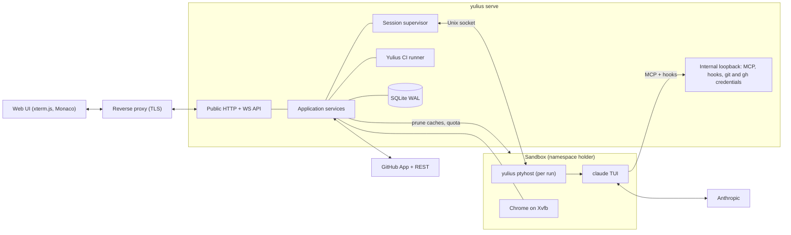
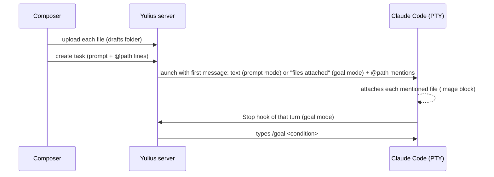
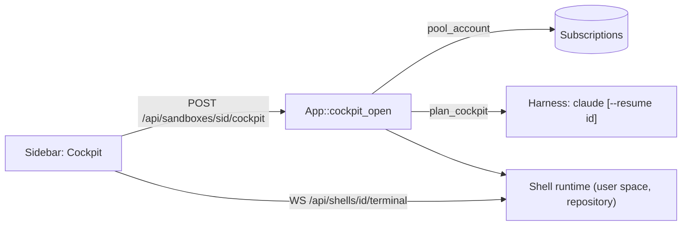
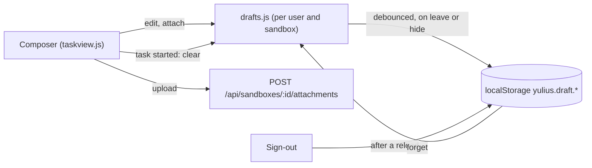
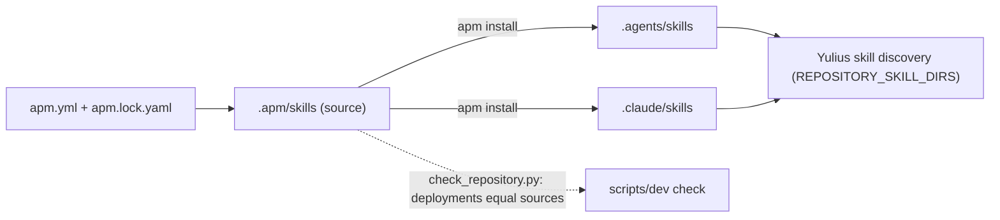

# Architecture

One Rust binary, `yulius`, serves the web UI and API, supervises detached `ptyhost` processes
that own Claude Code sessions inside per-sandbox containment, and talks to GitHub and
Anthropic. The detailed contracts are in
[SPEC-002](../.ai/specs/SPEC-002-yulius-architecture.md); crate layering rules are in
[engineering/architecture.md](engineering/architecture.md).

## Layers and crates

Dependencies point inward: interface, composition and adapters depend on application, which
depends on domain and contracts. `scripts/check_repository.py` enforces this.

| Layer | Crates |
| --- | --- |
| domain | `yulius-domain` |
| contracts | `yulius-contracts` |
| application | `yulius-app` |
| adapter | `yulius-store`, `yulius-ptyhost`, `yulius-sandbox`, `yulius-harness`, `yulius-github`, `yulius-git`, `yulius-browser`, `yulius-egress`, `yulius-import` |
| interface | `yulius-server` (axum routes, embedded web UI in `web/`) |
| composition | `yulius` (configuration, wiring, subcommands) |
| tooling | `tools/` (fake agent, xtask) |

## Disk

A sandbox has a soft disk quota. The application prunes build caches of tasks that do not
work every 5 minutes (ended tasks, then idle ones from 90 % of the quota), removes the worktrees
of closed and cancelled tasks, and a switch checks the quota and the other start preconditions
before it ends the running session ([SPEC-008](../.ai/specs/SPEC-008-sandbox-disk.md),
[decision 0017](decisions/0017-sandbox-disk-upkeep.md)).

## Task start

A task's agent is a native Claude Code session. Files attached on the new-task composer are
uploaded to the sandbox's drafts folder and mentioned (`@path`) in the session's first message,
the CLI prompt argument, which Claude Code attaches natively (an image as an image). A goal task
then gets its `/goal` typed into the terminal; the request file in the sandbox home keeps the
whole request ([SPEC-011](../.ai/specs/SPEC-011-automatic-dev-delivery.md),
[SPEC-025](../.ai/specs/SPEC-025-uploaded-attachements-should-be-clickabl.md),
[decision 0022](decisions/0022-native-task-attachments.md)).

## Cockpit

Every user has one plain Claude Code session per sandbox, the Cockpit
([SPEC-021](../.ai/specs/SPEC-021-in-this-bar-we-need-to-add-cockpit-at-th.md),
[decision 0020](decisions/0020-cockpit-as-a-plain-shell-session.md)). It is a sandbox shell of
kind `cockpit` that runs `claude` instead of the login shell: no hooks, MCP or briefing, a pool
subscription's token, and the newest conversation resumed whenever it starts again.

## Web UI state

The web UI is plain ES modules. Server state comes from the API and the UI event stream
(`store.js`); what only one person's browser needs stays in `localStorage`: preferences (theme,
column widths, model and effort), the notification history, and the new-task composer's drafts
([decision 0021](decisions/0021-composer-drafts-in-the-browser.md)). Sign-out removes the
notification history and the drafts.

## Agent primitives

Repository skills are APM primitives ([ADR-0016](decisions/0016-apm-for-agent-primitives.md),
[standard](engineering/primitives.md)): the sources in `.apm/skills` are deployed by `apm install`
to the harness directories Yulius already discovers, and the repository check rejects drift.

## Runtime

- Each task run is owned by a detached `ptyhost`; the server reattaches after restart.
- Agents reach Yulius only through the internal loopback listener with per-run tokens.
- Persistence is SQLite in WAL mode; the data directory layout is in SPEC-002 section 4.
- State machines (task, attempt, switch, automation, import, onboarding, delivery, update, CI)
  are in SPEC-002 section 6; runtime contracts in section 7 and
  [engineering/runtime-contracts.md](engineering/runtime-contracts.md).
- Security and trust model: SPEC-002 section 8. Limits: section 9.

Decisions: [decisions](decisions/README.md).
