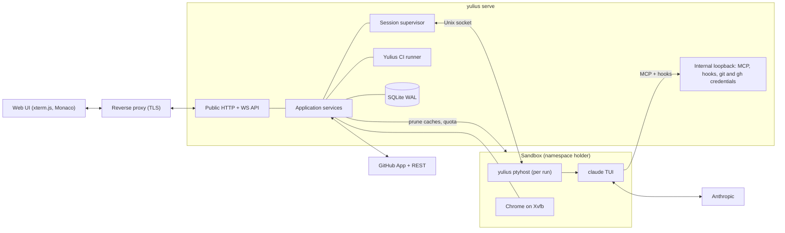

# Architecture

One Rust binary, `yulius`, serves the web UI and API, supervises detached `ptyhost` processes
that own Claude Code sessions inside per-sandbox containment, and talks to GitHub and
Anthropic. The detailed contracts are in
[SPEC-002](../.ai/specs/SPEC-002-yulius-architecture.md); crate layering rules are in
[engineering/architecture.md](engineering/architecture.md).

## Layers and crates

Dependencies point inward: interface, composition and adapters depend on application, which
depends on domain and contracts. `scripts/check_repository.py` enforces this.

| Layer | Crates |
| --- | --- |
| domain | `yulius-domain` |
| contracts | `yulius-contracts` |
| application | `yulius-app` |
| adapter | `yulius-store`, `yulius-ptyhost`, `yulius-sandbox`, `yulius-harness`, `yulius-github`, `yulius-git`, `yulius-browser`, `yulius-egress`, `yulius-import` |
| interface | `yulius-server` (axum routes, embedded web UI in `web/`) |
| composition | `yulius` (configuration, wiring, subcommands) |
| tooling | `tools/` (fake agent, xtask) |

## Disk

A sandbox has a soft disk quota. The application prunes build caches of tasks that do not
work every 5 minutes (ended tasks, then idle ones from 90 % of the quota), removes the worktrees
of closed and cancelled tasks, and a switch checks the quota and the other start preconditions
before it ends the running session ([SPEC-005](../.ai/specs/SPEC-005-sandbox-disk.md),
[decision 0016](decisions/0016-sandbox-disk-upkeep.md)).

## Runtime

- Each task run is owned by a detached `ptyhost`; the server reattaches after restart.
- Agents reach Yulius only through the internal loopback listener with per-run tokens.
- Persistence is SQLite in WAL mode; the data directory layout is in SPEC-002 section 4.
- State machines (task, attempt, switch, automation, import, onboarding, delivery, update, CI)
  are in SPEC-002 section 6; runtime contracts in section 7 and
  [engineering/runtime-contracts.md](engineering/runtime-contracts.md).
- Security and trust model: SPEC-002 section 8. Limits: section 9.

Decisions: [decisions](decisions/README.md).
