# Architecture

One Rust binary, `yulius`, serves the web UI and API, supervises detached `ptyhost` processes
that own Claude Code sessions inside per-sandbox containment, and talks to GitHub and
Anthropic. The detailed contracts are in
[SPEC-002](../.ai/specs/SPEC-002-yulius-architecture.md); crate layering rules are in
[engineering/architecture.md](engineering/architecture.md).

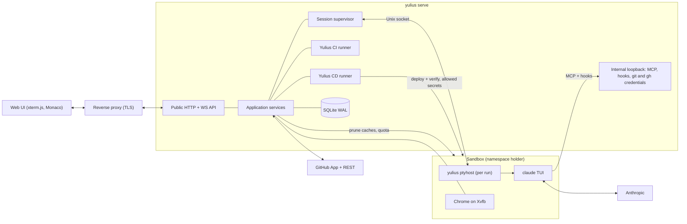

## Layers and crates

Dependencies point inward: interface, composition and adapters depend on application, which
depends on domain and contracts. `scripts/check_repository.py` enforces this.

| Layer | Crates |
| --- | --- |
| domain | `yulius-domain` |
| contracts | `yulius-contracts` |
| application | `yulius-app` |
| adapter | `yulius-store`, `yulius-ptyhost`, `yulius-sandbox`, `yulius-harness`, `yulius-github`, `yulius-git`, `yulius-browser`, `yulius-egress`, `yulius-import` |
| interface | `yulius-server` (axum routes, embedded web UI in `web/`) |
| composition | `yulius` (configuration, wiring, subcommands) |
| tooling | `tools/` (fake agent, xtask, the pinned Vidoc CLI for `scripts/dev security`, switched on or off in `.config/vidoc.toml`) |

## CPU

A sandbox's processes share its cgroup limits, but not equally. CI jobs run in its `ci/` leaf
with four times the CPU weight of the agents' `agents/` leaf. Under full load CI gets up to 80 % of
the sandbox and the agents at least 20 %, and idle CPU goes to whoever wants it. Agent Bash commands also run
5 nice levels below the agents themselves ([SPEC-053](../.ai/specs/SPEC-053-ci-e2e-timeouts-under-agent-load-give-ci.md),
[decision 0039](decisions/0039-ci-jobs-get-the-cpu-first.md)).

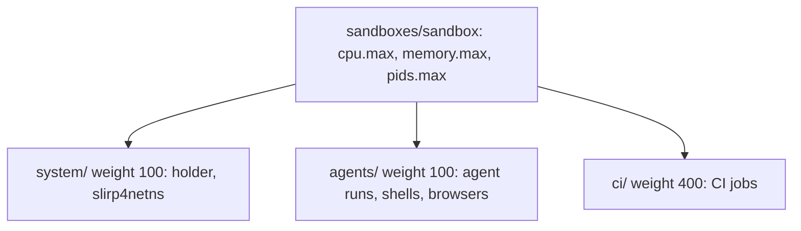

The e2e suite (`e2e/`, test-only) shares that CPU with the agents when an agent runs it, and the
`ci/` leaf in CI. Its static server (`e2e/serve.py`) keeps connections alive and queues 1024 of
them, so a page's burst of module requests waits for a busy server instead of having its SYNs
dropped; the runner's workers stay bounded by the CPU budget
([SPEC-148](../.ai/specs/SPEC-148-fix-354-349-356-394-the-e2e-suite-holds.md),
[decision 0122](decisions/0122-the-e2e-server-keeps-up-with-a-page-under-load.md)).

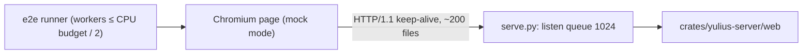

## Disk

A sandbox has a soft disk quota. The application prunes build caches of tasks that do not
work every 5 minutes (ended tasks, then idle ones from 90 % of the quota), removes the worktrees
of closed and cancelled tasks, and a switch checks the quota and the other start preconditions
before it ends the running session ([SPEC-008](../.ai/specs/SPEC-008-sandbox-disk.md),
[decision 0017](decisions/0017-sandbox-disk-upkeep.md)). A running task's caches go only when a
fresh probe finds no background shell and no background subagent. An unanswered probe keeps them.

Over the quota, a CI run waits in the queue instead of erroring
([SPEC-059](../.ai/specs/SPEC-059-fix-240-256-258-245-ci-waits-for-disk-in.md),
[decision 0045](decisions/0045-ci-waits-for-disk-under-the-shared-quota.md)). The dispatcher
starts a check off its loop, at most once a minute per sandbox: upkeep under pressure, then a fresh
measurement. The run's reason and its `pending` commit status name the largest consumers, and the
run starts at the first dispatch under the quota. A job refused after its run started puts the
run back in the queue.

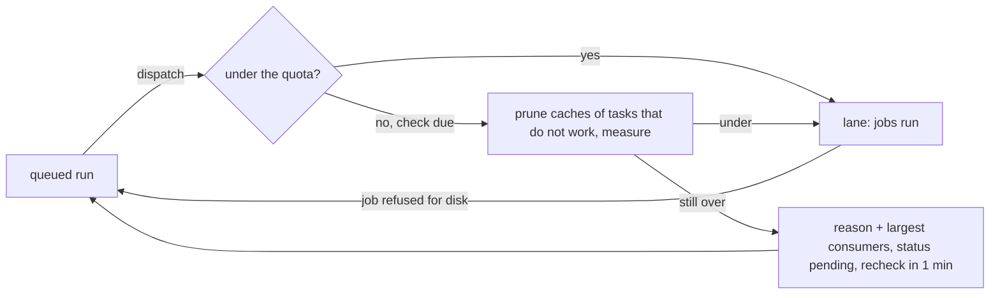

## Usage limits

When a subscription's usage limit cuts a turn, the task goes on as if the limit never happened
([SPEC-034](../.ai/specs/SPEC-034-in-previous-tasks-we-have-hit-a-session.md),
[decision 0027](decisions/0027-step-back-past-a-usage-limit.md)): on another subscription at
once, or on its own after the reset. The supervisor has the harness adapter step the transcript
back over the limit on a blocking thread, and indexes the session again only if the file changed.
Claude Code then resumes the same session with `CLAUDE_CODE_RESUME_INTERRUPTED_TURN=1`, so it
redoes the lost turn by itself. Nothing is typed. If Claude Code continues the turn by itself at
the reset, its first agent work or turn end after the pause ends the pause, and Yulius leaves
that run alone; after a restart, a limit that such a turn followed is not acted on again. A person's
switch of a task left at its limit by a refused automatic switch also resumes past the limit
([SPEC-072](../.ai/specs/SPEC-072-fix-276-277-278-usage-limit-resume-respe.md),
[decision 0058](decisions/0058-the-clis-own-continuation-ends-a-limit-pause.md)).

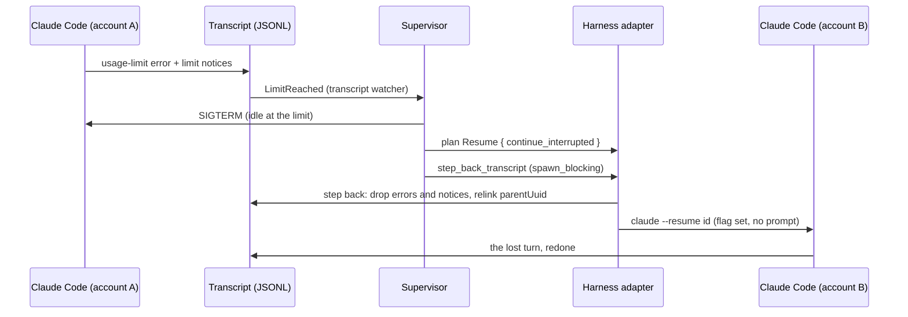

## Full context

A session whose context is full gets "Prompt is too long" for every prompt, and no Stop hook ends
the turn ([SPEC-060](../.ai/specs/SPEC-060-fix-213-a-session-whose-context-is-full.md),
[decision 0046](decisions/0046-compact-then-restart-a-full-session.md), #213). The harness
observes the refusal (`ContextFull`), the compaction boundary (`Compacted`) and a failed compaction
(`CompactFailed`). The supervisor ends the turn so the task waits instead of working, and keeps
one recovery episode per task in its runtime. The episode outlives a run and ends at the agent's
next successful reply. Each stage is said in the task's terminal and audited as
`task.context_full`. A replay after a restart that ends in a refusal starts the same recovery.

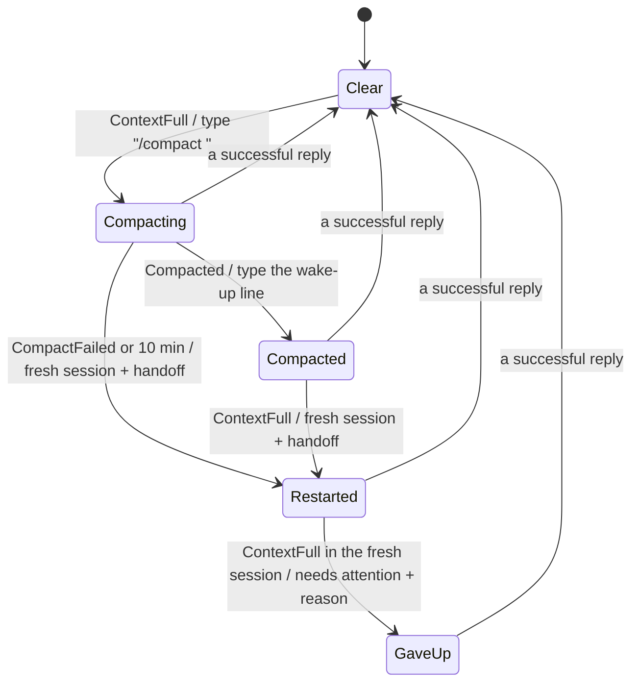

## Playgrounds

A playground lets a team try Yulius on its own code before it connects GitHub
([SPEC-099](../.ai/specs/SPEC-099-on-onboarding-we-want-a-mode-to-play-aro.md),
[decision 0081](decisions/0081-a-playground-keeps-its-git-on-the-server.md)). Its `origin` is a
bare repository on the server outside the sandbox (`<data>/playgrounds/<id>.git`), so the
clone, worktrees and merges use the same `origin/<branch>` refs as a GitHub sandbox while nothing
leaves the server, and the sandbox's processes never reach a repository whose hooks the server's
Git would run; the server fetches and pushes it by that path, never by the clone's configured URL.
The record marks it with an empty repository owner. The browser packs a chosen folder into a gzip tar (`files/` the
working tree, `git/` the history part of `.git`); the server takes only `HEAD`, `packed-refs`,
`shallow`, `objects/` and `refs/` of it, copies the branches and tags into the new `origin` with the
hardened Git, and commits the working files on top. `delivery_merge` squashes a task branch onto
the integration branch there (`git merge-tree` and `commit-tree`, pushed without forcing). CI
sync, hygiene, the automatic pull request and reconciliation skip playgrounds.

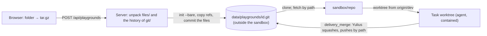

## Parallel tasks at merge

Tasks working at once must not collide where their parallel work meets
([SPEC-083](../.ai/specs/SPEC-083-merge-conflicts-with-many-agents.md),
[decision 0066](decisions/0066-parallel-tasks-stop-colliding-at-merge.md)). Numbered files
(decision records, specs, migrations) get their number from Yulius (`record_number`): past the
integration branch, every live task's checkout and every reservation in `record_numbers`. The logs
every task appends to (the changes log, the decision index) merge by union in every repository,
from Yulius's block in the clone's `info/attributes`; Yulius merges the integration branch
locally before GitHub merges (SPEC-050 DLV-203), so GitHub never sees those conflicts. A review
carries over Git's own merges of the integration branch, checked with `git merge-tree`.

## Agent feedback

Yulius has no messages for now ([SPEC-028](../.ai/specs/SPEC-028-delete-message-mechanism-for-now-until-w.md),
[decision 0023](decisions/0023-no-messages-until-delivery-is-reliable.md)): nothing is stored for
an agent, injected by a hook or typed into its session. An agent pulls what it needs: it waits
with `yulius wait` in a background shell, which Claude Code wakes it from, and reads
`ci_status` and `delivery_status`. The armed merge's outcome is kept in memory for the wait,
with the armed merge and its decisions in progress under one lock: a merge armed again while an
earlier one is decided supersedes it ([decision 0048](decisions/0048-armed-merge-state-under-one-lock.md)).
Before Yulius merges or arms a merge, its merge gate checks the pull request's title, head and
base against the branch policy of `yulius.toml` `[branch_policy]` at the integration branch;
a violation is refused with the rule in words, also for promotion pull requests
([SPEC-069](../.ai/specs/SPEC-069-fix-223-yulius-s-merge-gate-enforces-the.md),
[decision 0051](decisions/0051-the-merge-gate-enforces-the-branch-policy.md)).
`delivery_merge` first delivers the head the way the end of a clean turn does
(`try_auto_open_pr`): it pushes the branch and opens the pull request, or pushes new commits to
it. A head it cannot deliver yet (open step, no plan for a task that needs a spec, invalid spec,
uncommitted work) is refused with the reason, and a push GitHub refuses answers with the remedy
(merge the pushed head, never force): only a note that same call wrote replaces its error. A head
is pushed when GitHub's branch is at it, whatever `git push` said: every push of a task's head
(end of turn, `delivery_merge`, Deliver…, armed-merge upkeep, merge trains) goes through one helper
that asks the remote (`git ls-remote`) when Git reports a failure, and the wait drops a failed-push
note once the branch is at its head ([SPEC-139](../.ai/specs/SPEC-139-fix-366-448-yulius-wait-and-delivery-mer.md),
[decision 0113](decisions/0113-github-s-branch-says-whether-a-head-is-pushed.md)). A goal task whose evaluator keeps every turn going therefore still gets its pull request
([SPEC-116](../.ai/specs/SPEC-116-linter-dead-code-should-be-installed-on.md) DMG-001).

```mermaid
sequenceDiagram
    participant A as Agent (Claude Code)
    participant W as yulius wait (background shell)
    participant Y as Yulius (internal API)
    A->>Y: delivery_merge (head pushed and pull request opened if missing; policy checked; checks running: armed)
    A->>W: start, end the turn
    W->>Y: POST /internal/agent/wait (long poll; a failed-push note goes once GitHub has the head)
    Y-->>W: checks ended / stage moved / armed merge decided (merged, refused, dropped)
    W-->>A: one line, then exits: Claude Code wakes the agent
```

## Task start

A task's agent is a native Claude Code session, and its first message is in before a person can
type into it ([SPEC-117](../.ai/specs/SPEC-117-creating-tasks-work-in-a-very-very-weird.md),
[decision 0095](decisions/0095-a-goal-task-starts-with-its-goal-as-the-launch-prompt.md)). Files
attached on the new-task composer are uploaded to the sandbox's drafts folder and show in the
composer's tray, and each sits in the prompt's text as a placeholder where it was pasted, dropped
or placed from the tray ([SPEC-150](../.ai/specs/SPEC-150-fix-the-ux-i-d-expect-uploading-images-a.md),
[decision 0124](decisions/0124-uploaded-files-sit-in-a-tray-the-text-holds-placeholders.md)); a
file without one follows the text. The prompt is stored with it there as the
mention `@'<path>'` (an older prompt has its files after the text, a line `@path` each), and
`Request::parse` keeps that order everywhere the prompt goes
([SPEC-124](../.ai/specs/SPEC-124-images-keep-their-position-in-the-text-f.md),
[decision 0101](decisions/0101-attached-files-keep-their-place-in-the-prompt.md)). A goal task (the
default) is launched with `/goal <condition>` as Claude Code's prompt argument: one message, nothing
typed; Claude Code's record of the goal confirms it, and a goal not taken flags the task. Until it
is confirmed the run directory holds `launch-goal-pending`, so a restarted server watches it again
([SPEC-146](../.ai/specs/SPEC-146-fix-346-453-a-shell-ends-only-when-its-h.md)). The
condition names the request file in the sandbox home, which keeps the whole request, and the
attached files, which the agent opens with its Read tool (a `/goal` carries no image
block); the request file writes each file inside the text where it sits (`[file N: <path>]`). A
prompt task's first message is its request. Without an image it is the CLI prompt argument, each
file mentioned where it sits (`@"<path>"`). With an image the session starts with no prompt and
Yulius types the message into the TUI, in order: the text, each image's path pasted on its own
where it sits (Claude Code shows `[Image #N]` at the cursor and sends an image block), the other
files mentioned in the text, then Enter (an `@` mention of an image would only be a Read tool
call). Until that
Enter a person's keys are not written into the session; the first one is answered with a notice.
A resumed goal session (Continue, a switch) gets its `/goal` typed after its continuation turn; a
person who typed into it before keeps their draft: no goal is typed and the task needs attention
(only keystrokes count as typing; focus and mouse reports and terminal answers do not). Each
launch trusts the worktree and its main repository in the Claude config. Claude Code 2.1.292 looks
a worktree's trust up there when `.claude/settings.json` pre-approves tools. If a trust prompt
still shows before SessionStart, Yulius types nothing into it and says so, and the keys a person
answers it with are no draft. A goal launched as the prompt runs once the prompt is answered, a
typed one follows once it is gone, and a prompt left unanswered for 5 minutes flags the task
([SPEC-106](../.ai/specs/SPEC-106-onboarding-another-repo-got-fucked-up-by.md),
[decision 0086](decisions/0086-a-lost-onboarding-task-returns-the-sandbox-to-pending.md)). A typed
first message is pending (`opening-pending` in the run directory) until its `UserPromptSubmit`: a
restart flags a task whose first message never reached that hook (a submitted one a hold keeps
goes on), and a first message held for capacity resumes on another account, or a manual switch,
as a fresh session that types it again with its images
([SPEC-068](../.ai/specs/SPEC-068-fix-252-266-only-real-typing-counts-as-t.md),
[decision 0052](decisions/0052-only-keystrokes-count-as-typing.md);
[SPEC-011](../.ai/specs/SPEC-011-automatic-dev-delivery.md),
[SPEC-025](../.ai/specs/SPEC-025-uploaded-attachements-should-be-clickabl.md),
[SPEC-030](../.ai/specs/SPEC-030-i-asked-previous-task-to-attach-images-a.md),
[decisions 0022](decisions/0022-native-task-attachments.md) and
[0026](decisions/0026-attached-images-are-pasted.md)). The request is read when the task first
starts, after its compare-and-set to `starting`. Until then, a message a person queues into the
waiting task is appended to the stored request by one conditional update, so the start either
reads it or refuses it ([SPEC-052](../.ai/specs/SPEC-052-even-if-a-task-is-queued-i-d-like-to-be.md),
[decision 0035](decisions/0035-queued-messages-join-the-request.md)).

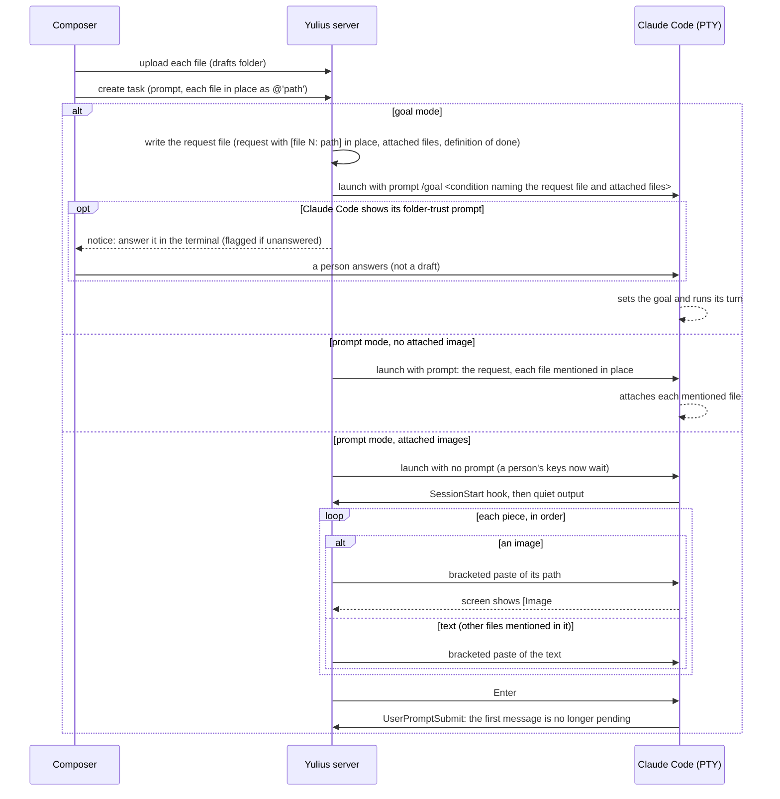

### Onboarding repair

A sandbox waits in `pending` or `preparing` until its onboarding task has made it ready
([decision 0076](decisions/0076-onboarding-is-mandatory-in-the-ui.md),
[decision 0077](decisions/0077-onboarding-task-is-created-when-needed.md)). That task stays in
the task list while the sandbox waits: archiving it is refused. If it is deleted, the sandbox
returns to `pending` and Start onboarding creates a new one. `refresh_onboarding` makes these
repairs, and the server makes them once for every sandbox at start, which heals sandboxes stuck
before the fix ([SPEC-106](../.ai/specs/SPEC-106-onboarding-another-repo-got-fucked-up-by.md),
[decision 0086](decisions/0086-a-lost-onboarding-task-returns-the-sandbox-to-pending.md)).
Every state change below is a compare-and-set from the state it was decided on, so a Start
onboarding or a refresh running while an admin skips never writes over the skip (attaching a new
onboarding task writes `pending` under the lock a skip takes, so it needs no condition). Until it runs,
the onboarding task reads "Waits for Start onboarding" (or "Not started" after a skip), not Closed
([SPEC-153](../.ai/specs/SPEC-153-fix-406-431-399-onboarding-writes-never.md),
[decision 0126](decisions/0126-a-task-that-never-ran-is-a-view-not-a-status.md)).

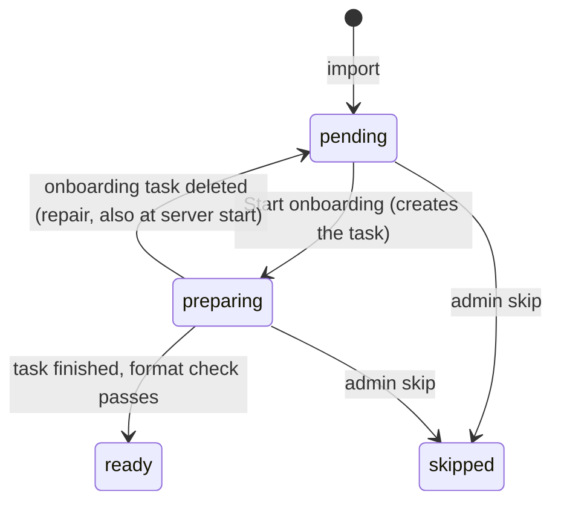

The onboarding task leaves the project ready for the discipline. In its own pull request it lays
the gate: a test command, lint and format, and a dead-code and unused-dependency check, wired into
`[commands]` and `[[ci.jobs]]` with a CI job for every project of a monorepo. Existing findings
go into a committed baseline instead of application-code changes. It delivers through the review
and `delivery_merge` like every task
([SPEC-116](../.ai/specs/SPEC-116-linter-dead-code-should-be-installed-on.md),
[decision 0094](decisions/0094-onboarding-installs-the-gate-in-its-own-pull-request.md)). The
briefing quotes the newest end of the changes log: a log whose ISO dates run oldest first is
quoted from its end, and its new entries go there.

### Supertasks

Every run starts through `App::start_run`: a new task, the queue, a released chain or rule,
Start now, Continue, and the capacity loop. Before the session limit, it applies the supertask
hold (`yulius-app/src/supertask.rs`,
[SPEC-071](../.ai/specs/SPEC-071-somewhere-here-the-user-should-be-able-t.md),
[decision 0054](decisions/0054-a-supertask-holds-its-project-at-the-start-door.md)). A task
without a live run waits `queued` while its project has a pending supertask (only an earlier one
counts, for a supertask). A supertask also waits while the project has a working task. Live runs
are never touched. The queue offers free slots to supertasks first, then FIFO, one start after
the other. A held task's summary lists what it waits for (`held_by`).

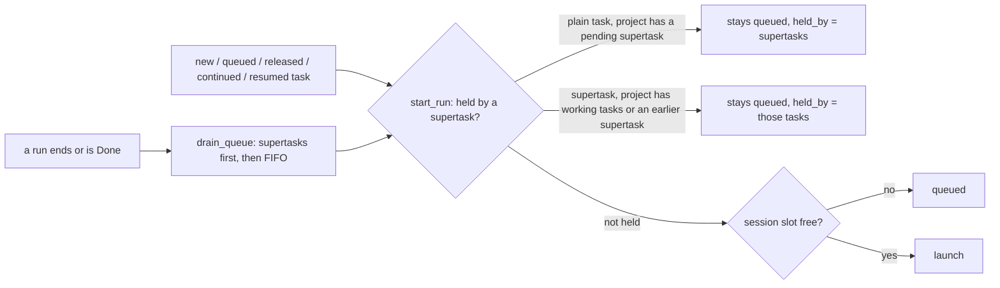

### Prepared tasks

A task can wait as `prepared` before its first run (`yulius-app/src/prepared.rs`,
[SPEC-105](../.ai/specs/SPEC-105-add-scheduling-when-i-decide-in-this-mod.md),
[decision 0085](decisions/0085-a-prepared-task-waits-for-a-person-or-its-time.md)). Without a time
it waits for a person's Start now; with one (a row in `task_schedules`) the background tick
releases it once the time has come and the sandbox's onboarding no longer blocks tasks. Released,
it goes `prepared → queued` by compare-and-set and starts through `start_run` like a new task.

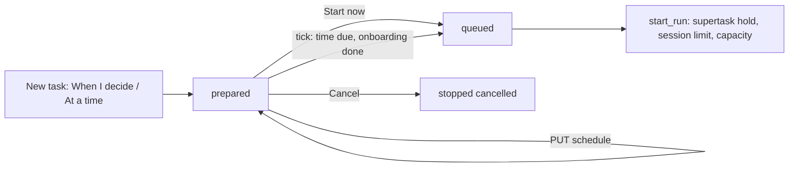

### Changing how a waiting task starts

A `chained` or `prepared` task takes another start choice before its first run
(`yulius-app/src/start_change.rs`, `PUT /api/tasks/{tid}/start`,
[SPEC-126](../.ai/specs/SPEC-126-we-d-like-to-be-able-to-change-task-runn.md),
[decision 0102](decisions/0102-a-waiting-task-changes-how-it-starts.md)). The choice is checked
as at creation, a wait on itself is refused, and the store replaces the status, chain row and
start time in one transaction guarded by the status read. A chain evaluation releases a task only
while its chain still names what was evaluated, and a rule judges the tasks that existed when it
was written (the chain row's time).

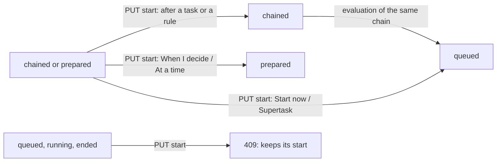

## Superagent (the Cockpit)

Every user has one plain Claude Code session per sandbox, shown as the **Superagent**
([SPEC-074](../.ai/specs/SPEC-074-i-just-hit-usage-limit-in-the-agent-it-s.md), formerly the Agent)
([SPEC-021](../.ai/specs/SPEC-021-in-this-bar-we-need-to-add-cockpit-at-th.md),
[decision 0020](decisions/0020-cockpit-as-a-plain-shell-session.md)); the code and the API still
call it the Cockpit. It is a sandbox shell of kind `cockpit` that runs `claude` instead of the
login shell: no hooks, settings or briefing, a pool subscription's token, and the newest
conversation resumed whenever it starts again. Its start, like a terminal's, runs detached from
the request, so a client that goes away mid-start never leaves a second or half-started session
([SPEC-077](../.ai/specs/SPEC-077-fix-250-cockpit-and-shell-starts-survive.md),
[decision 0053](decisions/0053-shell-starts-run-detached-from-the-request.md)). The web UI shows it in the right tool panel beside
the page, under a notice that it is for quick work only, opened from the first button of the tools
rail ([SPEC-035](../.ai/specs/SPEC-035-move-cockpit-to-the-right-and-change-coc.md),
[decision 0036](decisions/0036-agent-in-the-right-panel.md),
[decision 0106](decisions/0106-the-superagent-is-opened-from-the-tools-rail-only.md)).

A Cockpit remembers its pool subscription (in `shell.json`) and watches its newest conversation
while it runs ([SPEC-074](../.ai/specs/SPEC-074-i-just-hit-usage-limit-in-the-agent-it-s.md),
[decision 0055](decisions/0055-cockpit-moves-past-a-usage-limit.md)). A usage limit recorded after
it started is recorded on that subscription as a task's is. The Cockpit then starts again, under
its start lock, on a subscription with capacity. It resumes the conversation stepped back over the
limit with Claude Code's interrupted-turn flag, as a task does after a limit (SPEC-034). The old
process ends with the exit status `switched`, and the panel follows it to the new one. Without
capacity, it stays and its viewers get a notice. A shell, the Cockpit included, is recorded as
ended only once it exited or its host was terminated: when its host cannot be ended it stays live
and its viewers are told, and the move starts no second Cockpit on the same conversation
([SPEC-146](../.ai/specs/SPEC-146-fix-346-453-a-shell-ends-only-when-its-h.md),
[decision 0120](decisions/0120-a-shell-ends-only-when-its-host-is-proven-gone.md)).

It manages the project through the Yulius MCP server
([SPEC-037](../.ai/specs/SPEC-037-i-got-something-like-this-tasks-and-cock.md),
[decision 0029](decisions/0029-cockpit-manages-through-mcp.md)). Its bearer (`ck_…`) is derived
from the shell's persisted host token, and it is served only the management tools: tasks,
automations, workflows and sessions. Those tools act for a person (`ProjectCaller`): the Cockpit's
owner, or a task's owner when a task's agent calls them. `task_create` takes the same path as
New task; `task_stop`, `task_archive`, `task_delete`, `automation_delete`, `automation_run_now`
and `automation_template_enable` call the UI's own functions with that person and the caller as
the audit actor, never on the caller's own task
([SPEC-066](../.ai/specs/SPEC-066-fix-275-293-cockpit-and-agents-manage-ta.md),
[decision 0049](decisions/0049-management-tools-cover-the-task-and-automation-lifecycle.md)).

A repository's `.mcp.json` would make Claude Code ask about each of its servers when the
Superagent starts. Before every task run and Superagent start, `App::import_project_mcp` adds
the file's servers that the sandbox lacks to its MCP servers, so task runs get them like any
other server. The Superagent starts with `--settings` naming every one of them in
`disabledMcpjsonServers`, so it never asks
([SPEC-095](../.ai/specs/SPEC-095-while-onboarding-other-project-i-got-som.md),
[decision 0078](decisions/0078-repository-mcp-json-feeds-the-mcp-section.md)). An MCP server's
secret values reach a run in `YULIUS_MCP_<SERVER>_<VAR>` variables, never under the server's own
variable name, which may hold an agent secret's placeholder.

The Superagent gets the same servers as a task run of its sandbox (`App::mcp_attachments`), inline
in its `--mcp-config` next to `yulius`, their values in its secret environment, and the task runs'
redaction of agent secrets: `CLAUDE_CODE_SHELL_PREFIX=<yulius> --scrub-exec` for its Bash commands,
hooks and stdio servers, and the `PostToolUse` hook, its only hook; its screen is redacted on the
server as a task's terminal is. The wrapper and hook load their fingerprints with the workspace
token the person's environment holds, answered while the person may work in the sandbox (by an
access decision within the staleness bound, never waiting on GitHub). It is not behind the egress
proxy, so servers imported from `.mcp.json` with placeholders do not authenticate there ([SPEC-147](../.ai/specs/SPEC-147-fix-395-the-superagent-gets-the-sandbox.md),
[decision 0121](decisions/0121-the-superagent-gets-the-sandbox-mcp-servers-and-the-redaction.md)).

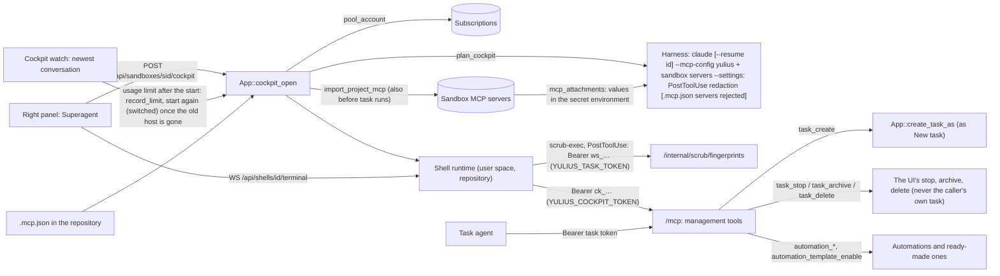

## Agent secret hosts

An agent secret is used only on the hosts it is bound to (SPEC-002 ADR-20). Since SPEC-121
(ADR-0098) a person adds one with a name, a value and a description, and it starts bound to
nothing. The agent works out the service's host and proposes it; the request waits on the secret
(`requested_hosts`) until a person who manages it allows it. An agent never binds a host itself,
so an agent misled by injected content cannot send a secret to another server.

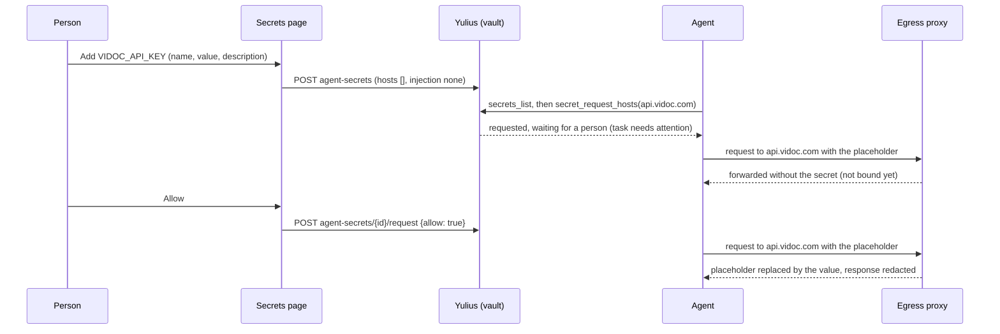

## Agent secrets in CI jobs

A CI job runs a pull request's code, so it gets an agent secret only the way an agent does, and
only when the integration branch grants it
([SPEC-142](../.ai/specs/SPEC-142-fix-466-yulius-ci-jobs-opt-in-to-named-a.md), ADR-0116). When a
job starts, `App::ci_job_secrets` (`crates/yulius-app/src/ci/exec.rs`) looks up the `secrets` of
the integration branch's `[[ci.jobs]]` entry of the same name in the integration head GitHub
reports, taken into the CD mirror only Yulius writes (`App::ci_verified_gate`): CI jobs can write the
sandbox clone, so its copy only says whether to look. A pull request's own `yulius.toml` is never
asked. A granted job gets the placeholders, the CA bundle and a proxy
credential of its own, held in memory until its process ended. The proxy's `EgressClient` is then a
CI caller, `ci:<run>`, that may use only the granted secrets toward their bound hosts; each use is
audited under that actor.

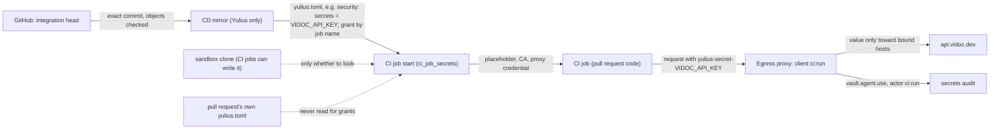

## CD (deployment)

CD runs a project's deploy and verify scripts like CI runs its checks
([SPEC-134](../.ai/specs/SPEC-134-implement-cd-it-should-write-cd-bash-scr.md), ADR-0109,
ADR-0110, ADR-0111). In the UI both are one CI/CD page with a CI (tests) and a CD (deployment)
tab (`pages/cicd.js`, ADR-0125); "the CD page" below is its CD tab, `/s/<slug>/ci?section=cd`.
`yulius.toml` defines `[cd.dev]` and `[cd.prod]`; Yulius reads them only at the heads of the
protected branches (`crates/yulius-app/src/ci/cd.rs`), so a task branch or a worktree never
changes what a deploy runs. `yulius_domain::cd::authorize` decides who may deploy: dev a
person with write access or an agent (`cd_deploy`), production only an administrator who typed the
project's slug. The commit is the one GitHub reports, taken into a mirror only Yulius writes
(`yulius_git::Git::cd_mirror_fetch`, every object checked); its tree is written into the run's
own directory (`export_tree`) and runs through the process host like a CI job (`ci_watch`): dev in
the sandbox's containment, production in the sandbox's network only on the host's read-only system (the launch spec's `host_system` join mode), each with the
secrets allowed for that environment; nothing agents can write is bound in. Output is redacted
before it is stored in `cd_runs`. A run has no lane and no retry: a deploy is not assumed repeatable, so one left by a
restart is recorded as an error. `needs_you` (table column `tasks.needs_you`) puts a task in Needs
you until a person writes to it.

```mermaid
sequenceDiagram
    participant A as Agent or person
    participant App as Yulius (CD)
    participant G as Git clone
    participant V as Vault
    participant S as Sandbox (process host)
    A->>App: deploy dev (cd_deploy / CD page)
    App->>App: authorize (production: administrator + typed slug)
    App->>G: fetch; GitHub's dev head into the private mirror (objects checked), read [cd.dev]
    App->>V: values of the named secrets (allowed for this environment)
    V-->>App: values, or "nothing ran: a person allows …"
    App->>App: record the run (cd_runs) and audit cd.deploy
    App->>S: the commit's tree in the run's own directory, run deploy then verify
    S-->>App: output (redacted), exit status
    App->>App: passed / failed / error, audit cd.finished
```

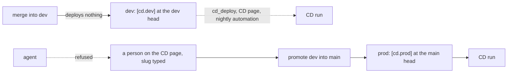

Outside Yulius, GitHub keeps the production branch a person's
([ADR-0114](decisions/0114-agents-hold-a-token-github-refuses-on-production.md)). The agent's Git
and `gh` get `App::agent_git_credential`: an installation token restricted to the repository and
to the agent permissions (`AGENT_TOKEN_PERMISSIONS`, no Administration or Workflows), never a
person's. The production ruleset (`rulesets_for`: restrict updates and deletions, block force
pushes, repository admins the only bypass) makes GitHub refuse that token on the branch.
`App::production_branch_warning` asks GitHub, with an agent token, which rules apply to the
production branch and whether that token may bypass them (`GitHubPort::branch_guard`), and
onboarding reports a branch the agents could write. The preparation agent then calls
`production_protect` ([ADR-0129](decisions/0129-onboarding-agents-protect-production-as-the-onboarding-person.md)):
`App::tool_production_protect` adds `people_only_ruleset` (the same rules, no pull-request rule)
with the task owner's own token after `repo_access` says they are a repository admin, and only
when the branch is not already guarded; the agent's token never gains Administration.

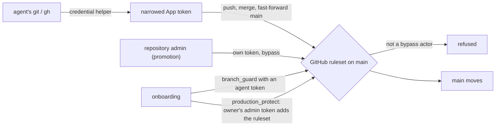

## Keys in .env

A project keeps its keys in a `.env` that Git ignores, beside a tracked `.env.example` that names
them without values ([SPEC-129](../.ai/specs/SPEC-129-default-place-for-keys-should-be-env-tha.md),
ADR-0105). Code that runs outside the egress proxy (a deployed app, a deploy script of Yulius CD)
reads them there. The agent never holds a value, so Yulius writes it: `secret_copy_to_env` checks
with Git that the file is ignored and untracked, then writes the file whole (mode 0600). A value in
a file leaves the secret's bound hosts, so a person allows each secret once (`env_files`).

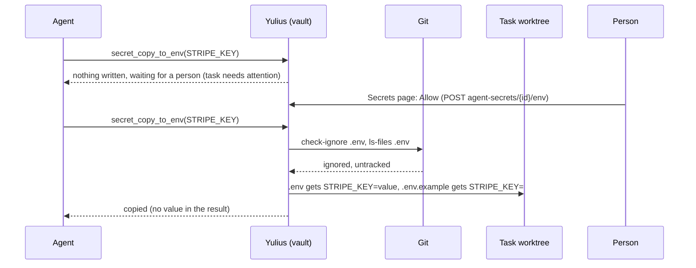

## Terminal input

A keystroke goes from xterm to the PTY and its echo comes back without waiting for the database or
GitHub ([SPEC-118](../.ai/specs/SPEC-118-when-i-write-something-in-a-claude-termi.md),
[decision 0096](decisions/0096-terminal-input-rides-a-write-grant.md)). Each viewer holds a write
grant, confirmed when it opens the terminal. The store's access epoch grows with every write that
can change who may type. While the epoch is unchanged, input is written at once. When it moves,
the next input is checked first. A grant older than 30 s is re-confirmed in the background. The
viewer's socket loop never awaits a permission check: the 60 s re-check runs in a spawned task, and
the loop picks up its verdict.

```mermaid
sequenceDiagram
  participant X as xterm (browser)
  participant L as Viewer loop (routes/terminal.rs, routes/shells.rs)
  participant G as WriteGrant + access epoch
  participant P as ptyhost (PTY)
  participant H as Hub
  X->>L: input frame
  L->>G: decide(epoch, now)
  alt grant holds
    G-->>L: allow (and re-confirm beside it after 30 s)
  else epoch moved or no grant
    G->>G: can_work / shell check (database, GitHub)
    G-->>L: allow or forbidden
  end
  L->>P: bytes
  P-->>H: echo (output chunk)
  H-->>L: broadcast
  L-->>X: binary output frame
  Note over L: every 60 s a spawned re-check, its verdict selected beside input and output
```

Output can carry a program's copy: Claude Code copies the selection it draws with an OSC 52 write.
The browser terminal (`terminal-core.js`) writes it to the clipboard only for a viewer who can write
and just pressed a key or the mouse there, and never answers a clipboard query
([decision 0130](decisions/0130-a-program-s-copy-reaches-the-clipboard-of-the-viewer-who-used-it.md)).

## Task ownership

A task acts on GitHub with one person's token, so it is that person's: its owner, the creator
until a hand-over ([SPEC-070](../.ai/specs/SPEC-070-tasks-should-be-owned-by-a-specific-pers.md),
[decision 0060](decisions/0060-a-task-is-owned-by-one-person.md)). `tasks.owner_id` decides the
token (`App::owner_github_token`), the worktree's commit identity and the authority of the task's
agent; `created_by` stays who asked. `App::load_task` refuses every task change to anyone but the
owner, and the terminal opens read-only for others. Anyone else who may work in the project asks
for control; the owner hands it over or declines, and an absent owner's task passes at once.

```mermaid
flowchart LR
  B["Bob: Request control"] -->|"POST /control-request"| REQ[("tasks.control_requested_by")]
  REQ -->|"owner absent"| PASS["pass_control"]
  A["Alice (owner): Hand over"] -->|"POST /control-request/accept"| PASS
  A -->|"DELETE: decline"| REQ
  PASS --> OWN[("tasks.owner_id = Bob")]
  OWN --> TOK["Yulius's pushes, PRs, merges as Bob"]
  OWN --> ID["worktree commit identity: Bob"]
  OWN --> GATE["load_task: only Bob writes"]
```

## Ready-made automations

Ready-made automations are a read-only catalog like the default workflows
([SPEC-042](../.ai/specs/SPEC-042-create-2-default-automations-that-can-be.md),
[decision 0034](decisions/0034-ready-made-automations-catalog.md)): `catalog/automations/*.md`,
embedded at build time. Enable copies one into an ordinary automation; a project's automation of
the same name counts as the template's.

```mermaid
flowchart LR
  CAT["catalog/automations/*.md"] -->|"build.rs embeds"| TPL["automations::templates"]
  UI["Automations page: Ready-made"] -->|"GET automation-templates"| TPL
  UI -->|"POST …/enable"| EN["App::enable_automation_template"]
  EN -->|"same name exists"| UPD["re-enable it"]
  EN -->|"else"| INS["insert automation (enabled)"]
  INS --> SCH["Scheduler: one task per slot"]
  UPD --> SCH
```

## How an automation's tasks start

An automation stores one start choice for every task it creates, the choices of New task's start
chip ([SPEC-078](../.ai/specs/SPEC-078-we-d-like-to-be-able-to-set-the-automati.md),
[decision 0062](decisions/0062-an-automation-starts-its-tasks-like-new-task.md)). A run creates
its task through the same `create_task_ruled` as New task. A task to run after that has ended
turns into the rule `#N done`, so a recurring automation keeps working once its predecessor is
finished. The editor shows the choice as New task's start chip in its action bar, and Run now
sends the choice the chip shows for that run only
([SPEC-093](../.ai/specs/SPEC-093-automation-editor-the-start-choice-sits.md),
[decision 0074](decisions/0074-run-now-uses-the-start-choice-the-editor-shows.md)); without it a
run uses the stored choice. "When I decide" creates the task through `create_task_held` as a
prepared task without a time, which waits for Start now and keeps the next runs skipped while it
waits ([SPEC-155](../.ai/specs/SPEC-155-fix-416-automations-can-create-prepared.md),
[decision 0128](decisions/0128-an-automation-can-prepare-its-tasks.md)).

```mermaid
flowchart LR
  RUN["Scheduler or Run now: one slot"] --> START{"automation.start, or Run now's body"}
  START -->|"Now"| Q["queued"]
  START -->|"Supertask"| ST["queued supertask (SPEC-071)"]
  START -->|"After #N, not ended"| CH["chained after #N"]
  START -->|"After #N, ended"| RD["chained on rule #N done"]
  START -->|"Rule"| RL["chained on the rule"]
  START -->|"When I decide"| PR["prepared until Start now (SPEC-105)"]
```

## Web UI state

The web UI is plain ES modules. Server state comes from the API and the UI event stream
(`store.js`); what only one person's browser needs stays in `localStorage`: preferences (theme,
column widths, model and effort), the notification history, the new-task composer's drafts
([decision 0021](decisions/0021-composer-drafts-in-the-browser.md)), and each sandbox's pull
requests as the last Git overview read said them (`yulius.pulls.<user>.<sandbox>`), shown at once
after a reload, for a sandbox a view watches, until the page's own read replaces them (dropped if
that read fails, while a later failed read keeps the chips an earlier read on the page showed;
SPEC-104). The overview is read every minute while the tab is in view, and at once
when the server announces a change of the sandbox's pull requests (`pulls.updated`: a delivery
stage moved, a Yulius CI run was queued, started or ended), at least 3 s after the start of the
last read, or when a hidden tab that missed one is shown again. Reads of a sandbox never overlap,
also across views that stop and start watching it; an announcement during a read brings one more
read after it. A pull request Yulius recorded as merged reads merged even while GitHub still lists
it open ([decision 0087](decisions/0087-pull-request-changes-are-announced.md)). These reads are
planned on a clock the transport may give: the real one, or in mock mode with `pullclock=manual` a
clock only a test's `advanceClock` moves ([decision 0118](decisions/0118-the-mock-drives-the-pull-request-read-clock.md)).
Sign-out removes the notification history, the drafts and the pull requests; an expired session
removes the pull requests too.

Screens keep their state when the person moves away and back
([decision 0092](decisions/0092-screens-remember-where-they-were-left.md), SPEC-113). The router
(`router.js`) remembers, in `sessionStorage` for this browser tab, the last address shown inside
each sandbox and on each sandbox page, including the filters pages keep in their query with
`replaceQuietly`; links marked `data-restore` (sandbox tabs, Home's cards, the sidebar's pages, the
Tasks and Git back links) go back there, and a link to where the person already is opens the plain
path. The tool panel (`panels.js`) keeps each sandbox's open tool, and the Superagent, Browser,
Editor and Shell views of the 3 sandboxes used last stay alive, hidden; the editor of a sandbox in
the background keeps its files' text without Monaco models. Sign-out and an expired session forget
the places. The editor loads Monaco once and makes its editor only when all of `editor.main` has
run: Monaco's main chunk sets `window.monaco` before the chunk that registers some of its services,
and an editor made earlier lacks them (decision 0122).

Every drop-down menu is built by `openMenu` (`dom.js`). It stays inside the window, scrolling its
items, and a menu of 8 or more items opens with a filter box
([decision 0030](decisions/0030-menus-filter-when-long.md)). A group of items under a header (the
start menu's tasks) shows five rows and scrolls the rest in a box of its own, fading at the edge it
continues past with a "↓ N more" line under it ([decision 0083](decisions/0083-long-menu-groups-scroll-five-rows.md)).

```mermaid
flowchart LR
  PI["promptinput.js (files inside the text)"] -->|"value with @'path' in place"| C
  C["Composer (taskview.js)"] -->|"edit, attach"| D["drafts.js (per user and sandbox)"]
  C -->|"upload"| U["POST /api/sandboxes/:id/attachments"]
  D -->|"debounced, on leave or hide"| LS[("localStorage yulius.draft.*")]
  LS -->|"after a reload"| D
  C -->|"task started: clear"| D
  SO["Sign-out"] -->|"forget"| LS
  G["GET /api/sandboxes/:id/git"] -->|"every read"| P["store.js loadPulls / pullsOf()"]
  EV["pulls.updated (stage moved, CI run changed)"] -->|"read again"| G
  CL["read clock (real; mock: pullclock=manual)"] -->|"gap, 15 s, every minute"| P
  P -->|"write"| LP[("localStorage yulius.pulls.*")]
  LP -->|"after a reload, until the read answers"| P
  SO -->|"forget"| LP
  EX["Session expired"] -->|"forget"| LP
  R["router.js emit / replaceQuietly"] -->|"each address in a sandbox"| PL[("sessionStorage yulius.places")]
  PL -->|"data-restore links: tabs, Home cards, sidebar pages"| R
  SO -->|"forget"| PL
  EX -->|"forget"| PL
```

## Task status

A running task's activity is derived from Claude Code's own records, not guessed from the last
event ([ADR-0044](decisions/0044-task-status-follows-claude-codes-own-records.md)). Background work
is counted from three sources:
- background shells, from the process probe;
- background agents, from the turn record;
- Monitor streams and agents launched in the turn that ends, from the transcript.

The probe counts only the agent's own shells. In the sandbox, an orphaned subshell that the PID
namespace's init adopted is not one, even though it still carries Claude Code's wrapper command
line (a server started as `(server &)`)
([SPEC-130](../.ai/specs/SPEC-130-458-got-achieved-but-wasn-t-marked-as-do.md)). An idle agent
that waits in `yulius wait` goes on by itself. Its task reads Working ("Waiting for checks or
merge"), even with a complete plan and a tested pull request; only an achieved goal makes it Done.

While a goal is open, a clean Stop reads idle only after the goal verdict (or the turn record, or
20 s). A proactive switch waits for any of this background work
([ADR-0063](decisions/0063-background-work-and-goal-verdict-from-the-transcript.md)):

```mermaid
flowchart LR
    prompt["prompt / wake-up\n(hook, user line)"] --> working
    stop["clean Stop hook"] --> idle["waiting / done"]
    turn["turn_duration:\npending background agents"] --> bg["+ background work\n(shown Working)"]
    launch["transcript: monitor started,\nagent launched (until it ends)"] --> bg
    idle --> bg
    stop -.->|"goal open: until the verdict,\nthe turn record or 20 s"| working
    verdict["goal verdict: not met"] --> working
    work["assistant work after the stop"] --> working
    notice["notice that asks a person"] --> attention["needs_attention"]
    attention -.->|"agent works on"| working
```

## Run metrics

A run's tokens, turns and active time are computed from its own transcript lines and its
sub-agents' transcripts, by one accumulator (`yulius-harness` `observe`), live while it runs and
again after a restart ([ADR-0070](decisions/0070-run-metrics-come-from-the-transcript.md)). Runs
recorded before that rule are counted again once: migration 23 queues every run recorded so far,
and after start, once reconciliation has ended the lost runs, a background job counts each ended
run's window of its transcript and records the outcome with the figures it replaced
([ADR-0072](decisions/0072-recount-old-runs-from-their-transcripts-once.md)); no recount starts
after a failed reconciliation (`App::recover`). A run that ends before a watcher of this process
read its transcript to its end (its agent exited while Yulius was down: reconciliation finds the
exit, or a reattach gets it at once) is counted the same way when it is ended; its row changes only
when the count finds figures
([ADR-0117](decisions/0117-a-run-that-ends-while-yulius-is-down-is-counted-from-its-transcript.md)):

```mermaid
flowchart LR
    mig["migration 23:
queue every run so far"] --> queue[("metrics_recounts")]
    start["start: reconcile"] -->|"succeeded"| job["recount_old_metrics
(background)"]
    ended["run ended before its watcher
read its transcript to the end
(exited while Yulius was down)"] --> rcount["harness.recount
of its window"]
    rcount -->|"figures found"| rput[("metrics replaced")]
    rcount -->|"nothing / failed"| rkeep[("metrics kept")]
    queue --> job
    job -->|"ended run, transcript exists"| count["harness.recount
(spawn_blocking): its window
from its start to its end
or the next run's start"]
    count --> put[("metrics: replaced;
before/after recorded")]
    job -->|"no transcript / no lines /
live / gone"| keep[("metrics kept;
outcome recorded")]
```

## CI job output

A CI job's output is read from its log while it runs: the stored output is its last 512 KiB
(escape sequences removed), and the same reads feed the stage scanner and the failure scanner
(`FailureScanner` in `yulius-domain::ci::failures`). The failure scanner keeps every failing test's
block it sees anywhere in the output, nextest's (`FAIL [ 0.5s] …` with its `stdout ───` and
`stderr ───`) and libtest's, at most 8 KiB each and 32 KiB per job, in `ci_jobs.failures` when the
job ends. `ci_status` with a `run_id` shows them before the end of a failed job's output, so a test
that failed early in a long job stays diagnosable
([SPEC-145](../.ai/specs/SPEC-145-fix-460-485-ci-keeps-a-failed-test-s-out.md),
[decision 0119](decisions/0119-ci-keeps-failing-tests-output-from-the-whole-job.md)).

## Stages

Every stage of a task, a CI run and a CD run is one row of `spans`
([SPEC-137](../.ai/specs/SPEC-137-rich-measurements-of-every-stage-tasks-c.md),
[decision 0112](decisions/0112-stages-are-spans-written-with-the-state-they-measure.md)). Spans that
follow a state are written by SQLite triggers in the same transaction as the state change, with the
time the application wrote; the rest by Yulius as it happens (`yulius-app/src/stages.rs`): a CI
run's preparation, job-slot waits and checkouts, a CD run's checks, promotion and confirmation, a
task's armed-merge waits and updates onto the integration branch, and the stages job or deploy
output names, read from the log Yulius already follows (`OutputScanner` in `yulius-domain`). A CI
job's or CD run's CPU time, peak memory and bytes written come from its process host, which measures
the job's reaped process tree (`getrusage` of its children) into `exit.json`; they are stored with
the job's end and the end trigger adds them to its span
([SPEC-154](../.ai/specs/SPEC-154-fix-488-ci-jobs-and-cd-runs-record-their.md),
[decision 0127](decisions/0127-a-job-s-resource-use-comes-from-its-process-host.md)). Nothing
outside Yulius writes a span; the API only reads them, and the Dashboard's Pipeline tab (SPEC-161),
the run dialogs, the task overview and the Dashboard's Overview draw them. Spans older than 180
days go with the hourly CI upkeep.

```mermaid
flowchart LR
  subgraph States["state tables"]
    T["tasks, step_events, attempts, metrics, capacity_pauses, delivery"]
    C["ci_runs, ci_jobs, cd_runs"]
  end
  T -->|"triggers, same transaction"| S[("spans")]
  C -->|"triggers, same transaction"| S
  HOST["ptyhost: reaps the job, exit.json usage"] -->|"cpu_ms, memory_peak_mb, disk_written_mb with the job's end"| C
  LOG["job / deploy log (read every 0.5 s)"] -->|"::yulius-stage, test summaries"| SC["OutputScanner + OutputStages"]
  SC -->|"Yulius's clock"| S
  APP["CI prepare, slot wait, checkout; CD checks, promotion, confirmation; armed merge, updates"] --> S
  S --> API["GET …/stages/timeline, summary, spans"]
  API --> UI["Dashboard (Overview, Pipeline tab), run dialogs, task overview"]
```

## Notes

The tools rail's Notes hold a notepad per sandbox and one for the team, shared and saved while
people type ([SPEC-041](../.ai/specs/SPEC-041-here-we-want-auto-saved-notes-sandbox-wi.md),
[decision 0032](decisions/0032-shared-notes-with-revisions.md)), and one per person, "Me"
(`/api/me/notes`, row `user:<user id>`;
[SPEC-103](../.ai/specs/SPEC-103-add-me-after-team-that-is-for-user-and-n.md),
[decision 0084](decisions/0084-personal-notes-in-the-notes-table.md)). A save carries the whole
text and the revision it started from; the store writes it only when that revision is still
current, and every stored edit is announced on the event stream: a personal note's event is
addressed to its owner (`Envelope.user`), and `WS /api/events` drops it for everyone else.

The tabs go in any order, Team first by default (`yulius.notesOrder` in the browser). Each notepad
draws its selections itself (`textlayer.js`: rounded shapes under the transparent text box,
measured on a hidden mirror) and shows the teammates who have it open
([SPEC-112](../.ai/specs/SPEC-112-i-want-to-be-able-to-move-those-3-bars-t.md),
[decision 0091](decisions/0091-notepad-presence-is-relayed-not-stored.md)): a browser sends its
selection in the saved text's offsets, `App::note_presence` relays it as `note.presence` to the
notepad's readers (20 a second per person and notepad at most) and stores nothing.

```mermaid
sequenceDiagram
    participant A as Alice's notepad
    participant S as Server (App::note_presence)
    participant B as Bob's notepad
    A->>S: PUT notes/presence {revision, selection, hello, client} (≤ 1 per 100 ms, every 15 s)
    S-->>B: note.presence (team: everyone; sandbox: its viewers)
    B->>S: PUT notes/presence (answers a hello)
    S-->>A: note.presence
    Note over A,B: offsets mapped through each side's unsaved typing; another revision hides
    A->>S: PUT notes/presence {selection: null} (hidden, another tab, page gone)
```

The Editor shows the same presence for files
([SPEC-127](../.ai/specs/SPEC-127-the-editor-gets-the-notepad-s-smooth-sel.md),
[decision 0103](decisions/0103-editor-presence-mirrors-monaco-and-reaches-writers-only.md)): the
browser loop is shared (`presence.js`), `App::file_presence` checks the path like the files API
and shares the notepads' limiter, and the event goes through a third envelope audience,
`Envelope.writers_only`, which `WS /api/events` delivers only to people with write access to the
sandbox (cached and re-checked like sandbox visibility). The drawing copies what Monaco renders:
its selection boxes and teammates' decorations become the notepads' gliding shapes in a layer
inside Monaco's scrolled content (`editorlayer.js`).

```mermaid
flowchart LR
    A[Alice's Editor<br/>presence.js] -->|PUT files/presence<br/>root, path, sha256, selection| S[App::file_presence<br/>file_target + limiter]
    S -->|publish_to_writers| BUS[(event bus<br/>writers_only)]
    BUS -->|WS /api/events<br/>can_work_in| B[Bob's Editor<br/>writer]
    BUS -.->|dropped| R[Reader of the sandbox]
    B --> M[Monaco decoration<br/>+ caret position]
    M --> L[editorlayer.js<br/>rounded gliding shapes]
```

```mermaid
sequenceDiagram
    participant A as Notepad (notes.js)
    participant S as Server (App::save_note)
    participant D as SQLite notes
    participant B as Teammate's notepad
    A->>S: PUT notes {body, revision: n} (600 ms after typing, blur, hide)
    S->>D: UPDATE … WHERE revision = n
    alt still at n
        D-->>S: revision n + 1
        S-->>A: Note
        S-->>B: note.updated (sandbox viewers / everyone for team / the owner for Me)
        B->>S: GET notes (nothing unsaved)
    else someone saved meanwhile
        S-->>A: 409 conflict
        A->>S: GET notes
        A-->>A: same text: adopt; else Keep mine / Use theirs
    end
```

## Agent primitives

Repository skills are APM primitives ([ADR-0016](decisions/0016-apm-for-agent-primitives.md),
[standard](engineering/primitives.md)): the sources in `.apm/skills` are deployed by `apm install`
to the harness directories Yulius already discovers, and the repository check rejects drift.

```mermaid
flowchart LR
    src[".apm/skills (source)"] -->|apm install| a[".agents/skills"]
    src -->|apm install| c[".claude/skills"]
    lock["apm.yml + apm.lock.yaml"] --> src
    a --> yulius["Yulius skill discovery (REPOSITORY_SKILL_DIRS)"]
    c --> yulius
    src -.->|check_repository.py: deployments equal sources| gate["scripts/dev check"]
```

## Runtime

- Each task run is owned by a detached `ptyhost`; the server reattaches after restart.
- Agents reach Yulius only through the internal loopback listener with per-run tokens. A hook runs
  in its own task: the hook client fails open after 5 s and closes its connection, which drops the
  HTTP handler, and the hook is still applied to its end
  ([ADR-0115](decisions/0115-a-received-hook-is-applied-to-its-end.md)).
- A stop or close asks the attached run to shut down; one that comes while the run is launching
  (spawned, not attached yet) is asked by the launch once it attaches, so it never waits for the
  escalation ([SPEC-140](../.ai/specs/SPEC-140-fix-404-464-353-443-task-done-supervisio.md)).
- Persistence is SQLite in WAL mode; the data directory layout is in SPEC-002 section 4.
- State machines (task, attempt, switch, automation, import, onboarding, delivery, update, CI)
  are in SPEC-002 section 6; runtime contracts in section 7 and
  [engineering/runtime-contracts.md](engineering/runtime-contracts.md).
- Security and trust model: SPEC-002 section 8. Limits: section 9.

Decisions: [decisions](decisions/README.md).
