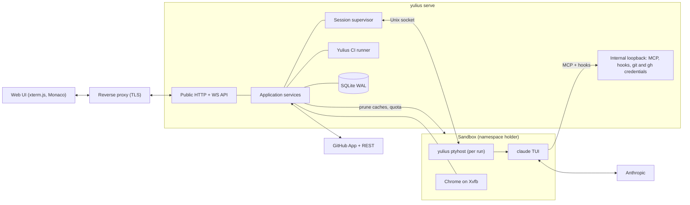
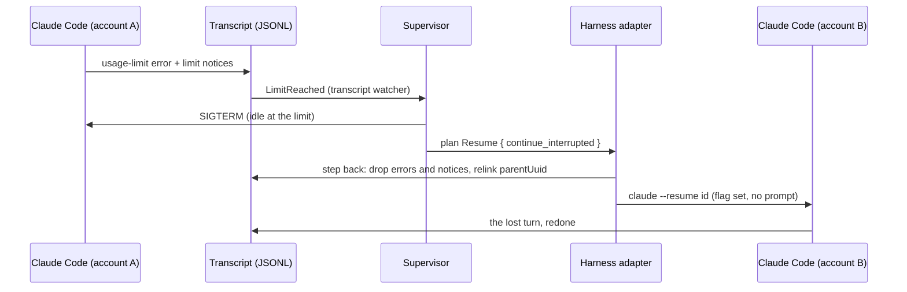
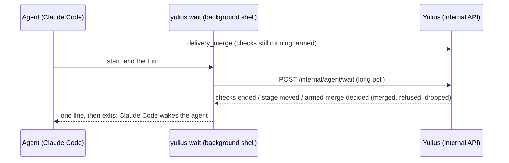
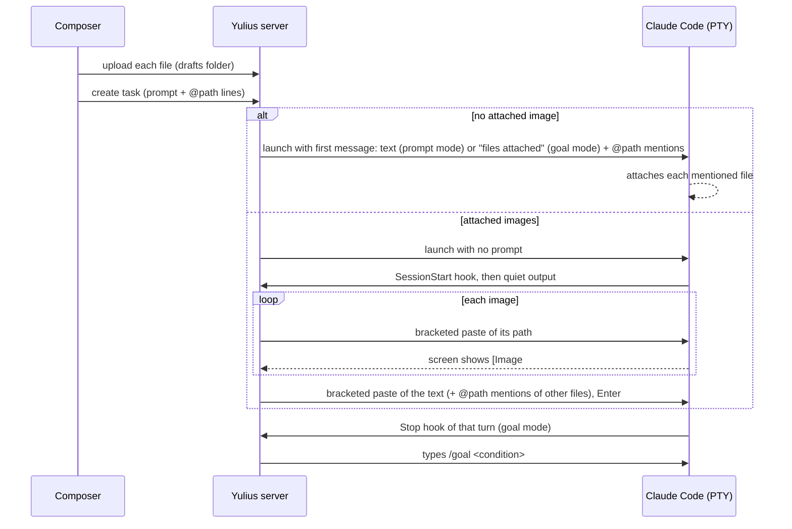
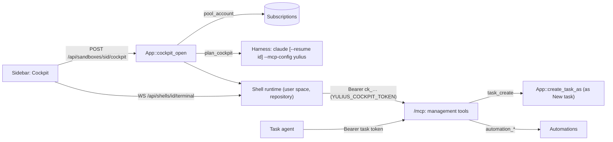
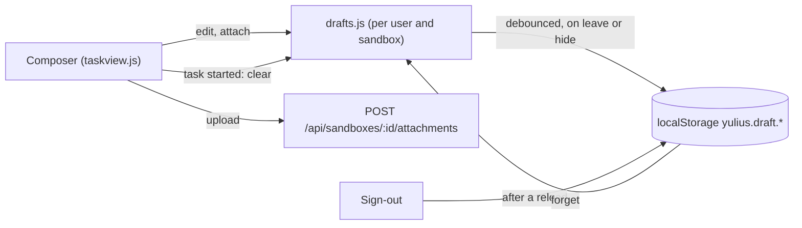
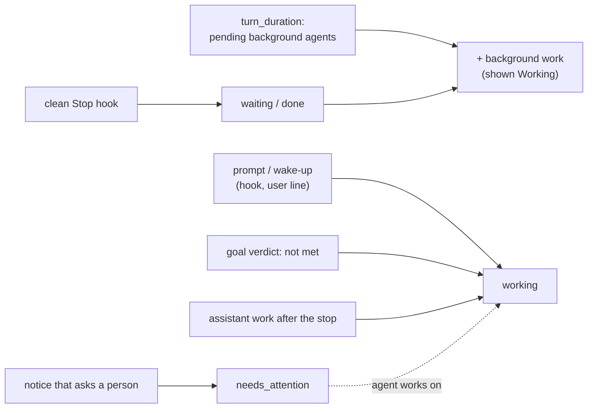
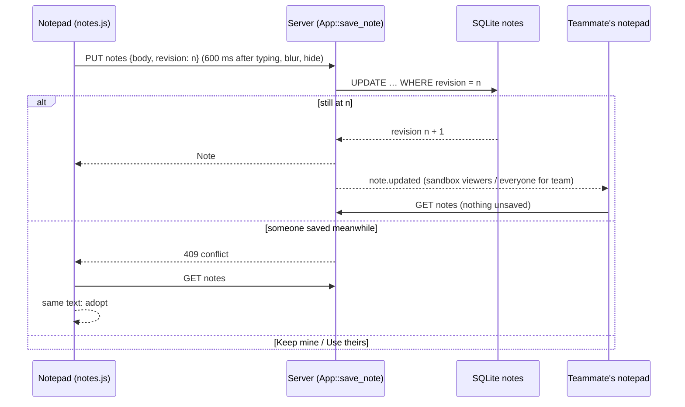
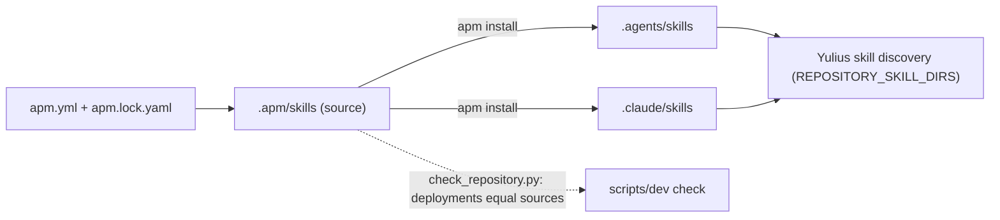

# Architecture

One Rust binary, `yulius`, serves the web UI and API, supervises detached `ptyhost` processes
that own Claude Code sessions inside per-sandbox containment, and talks to GitHub and
Anthropic. The detailed contracts are in
[SPEC-002](../.ai/specs/SPEC-002-yulius-architecture.md); crate layering rules are in
[engineering/architecture.md](engineering/architecture.md).

## Layers and crates

Dependencies point inward: interface, composition and adapters depend on application, which
depends on domain and contracts. `scripts/check_repository.py` enforces this.

| Layer | Crates |
| --- | --- |
| domain | `yulius-domain` |
| contracts | `yulius-contracts` |
| application | `yulius-app` |
| adapter | `yulius-store`, `yulius-ptyhost`, `yulius-sandbox`, `yulius-harness`, `yulius-github`, `yulius-git`, `yulius-browser`, `yulius-egress`, `yulius-import` |
| interface | `yulius-server` (axum routes, embedded web UI in `web/`) |
| composition | `yulius` (configuration, wiring, subcommands) |
| tooling | `tools/` (fake agent, xtask) |

## Disk

A sandbox has a soft disk quota. The application prunes build caches of tasks that do not
work every 5 minutes (ended tasks, then idle ones from 90 % of the quota), removes the worktrees
of closed and cancelled tasks, and a switch checks the quota and the other start preconditions
before it ends the running session ([SPEC-008](../.ai/specs/SPEC-008-sandbox-disk.md),
[decision 0017](decisions/0017-sandbox-disk-upkeep.md)).

## Usage limits

When a subscription's usage limit cuts a turn, the task goes on as if the limit never happened
([SPEC-034](../.ai/specs/SPEC-034-in-previous-tasks-we-have-hit-a-session.md),
[decision 0027](decisions/0027-step-back-past-a-usage-limit.md)): on another subscription at
once, or on its own after the reset. The harness adapter steps the transcript back over the
limit, and Claude Code resumes the same session with `CLAUDE_CODE_RESUME_INTERRUPTED_TURN=1`, so
it redoes the lost turn by itself. Nothing is typed.

## Agent feedback

Yulius has no messages for now ([SPEC-028](../.ai/specs/SPEC-028-delete-message-mechanism-for-now-until-w.md),
[decision 0023](decisions/0023-no-messages-until-delivery-is-reliable.md)): nothing is stored for
an agent, injected by a hook or typed into its session. An agent pulls what it needs: it waits
with `yulius wait` in a background shell, which Claude Code wakes it from, and reads
`ci_status` and `delivery_status`. The armed merge's outcome is kept in memory for the wait.

## Task start

A task's agent is a native Claude Code session. Files attached on the new-task composer are
uploaded to the sandbox's drafts folder and reach the session's first message natively. Without
an image, that message is the CLI prompt argument and each file is mentioned there (`@path`).
With an image, the session starts with no prompt and Yulius types the message into the TUI. Each
image's path is pasted on its own, and Claude Code shows it as `[Image #N]` and sends an image
block. The text is pasted next, with the other files mentioned, then Enter (an `@` mention of an
image would only be a Read tool call). A goal task then gets its `/goal` typed into the terminal;
the request file in the sandbox home keeps the whole request
([SPEC-011](../.ai/specs/SPEC-011-automatic-dev-delivery.md),
[SPEC-025](../.ai/specs/SPEC-025-uploaded-attachements-should-be-clickabl.md),
[SPEC-030](../.ai/specs/SPEC-030-i-asked-previous-task-to-attach-images-a.md),
[decisions 0022](decisions/0022-native-task-attachments.md) and
[0026](decisions/0026-attached-images-are-pasted.md)).

## Cockpit

Every user has one plain Claude Code session per sandbox, the Cockpit
([SPEC-021](../.ai/specs/SPEC-021-in-this-bar-we-need-to-add-cockpit-at-th.md),
[decision 0020](decisions/0020-cockpit-as-a-plain-shell-session.md)). It is a sandbox shell of
kind `cockpit` that runs `claude` instead of the login shell: no hooks, settings or briefing, a
pool subscription's token, and the newest conversation resumed whenever it starts again.

It manages the project through the Yulius MCP server
([SPEC-037](../.ai/specs/SPEC-037-i-got-something-like-this-tasks-and-cock.md),
[decision 0029](decisions/0029-cockpit-manages-through-mcp.md)). Its bearer (`ck_…`) is derived
from the shell's persisted host token, and it is served only the management tools: tasks,
automations, workflows and sessions. Those tools act for a person (`ProjectCaller`): the Cockpit's
owner, or a task's creator when a task's agent calls them. `task_create` takes the same path as
New task.

## Web UI state

The web UI is plain ES modules. Server state comes from the API and the UI event stream
(`store.js`); what only one person's browser needs stays in `localStorage`: preferences (theme,
column widths, model and effort), the notification history, and the new-task composer's drafts
([decision 0021](decisions/0021-composer-drafts-in-the-browser.md)). Sign-out removes the
notification history and the drafts.

Every drop-down menu is built by `openMenu` (`dom.js`). It stays inside the window, scrolling its
items, and a menu of 8 or more items opens with a filter box
([decision 0030](decisions/0030-menus-filter-when-long.md)).

## Task status

A running task's activity is derived from Claude Code's own records, not guessed from the last
event ([ADR-0033](decisions/0033-task-status-follows-claude-codes-own-records.md)):

## Notes

The tools rail's Notes hold a notepad per sandbox and one for the team, shared and saved while
people type ([SPEC-041](../.ai/specs/SPEC-041-here-we-want-auto-saved-notes-sandbox-wi.md),
[decision 0032](decisions/0032-shared-notes-with-revisions.md)). A save carries the whole text and
the revision it started from; the store writes it only when that revision is still current, and
every stored edit is announced on the event stream.

## Agent primitives

Repository skills are APM primitives ([ADR-0016](decisions/0016-apm-for-agent-primitives.md),
[standard](engineering/primitives.md)): the sources in `.apm/skills` are deployed by `apm install`
to the harness directories Yulius already discovers, and the repository check rejects drift.

## Runtime

- Each task run is owned by a detached `ptyhost`; the server reattaches after restart.
- Agents reach Yulius only through the internal loopback listener with per-run tokens.
- Persistence is SQLite in WAL mode; the data directory layout is in SPEC-002 section 4.
- State machines (task, attempt, switch, automation, import, onboarding, delivery, update, CI)
  are in SPEC-002 section 6; runtime contracts in section 7 and
  [engineering/runtime-contracts.md](engineering/runtime-contracts.md).
- Security and trust model: SPEC-002 section 8. Limits: section 9.

Decisions: [decisions](decisions/README.md).
