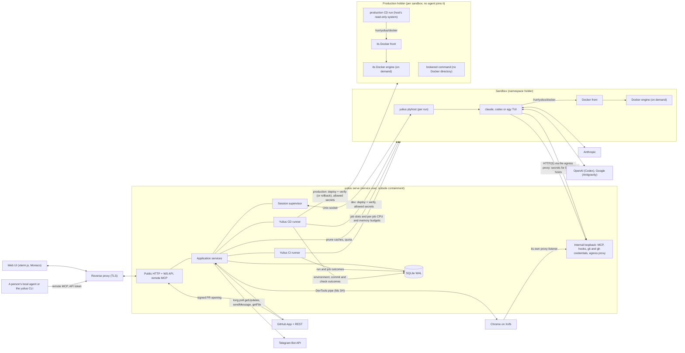
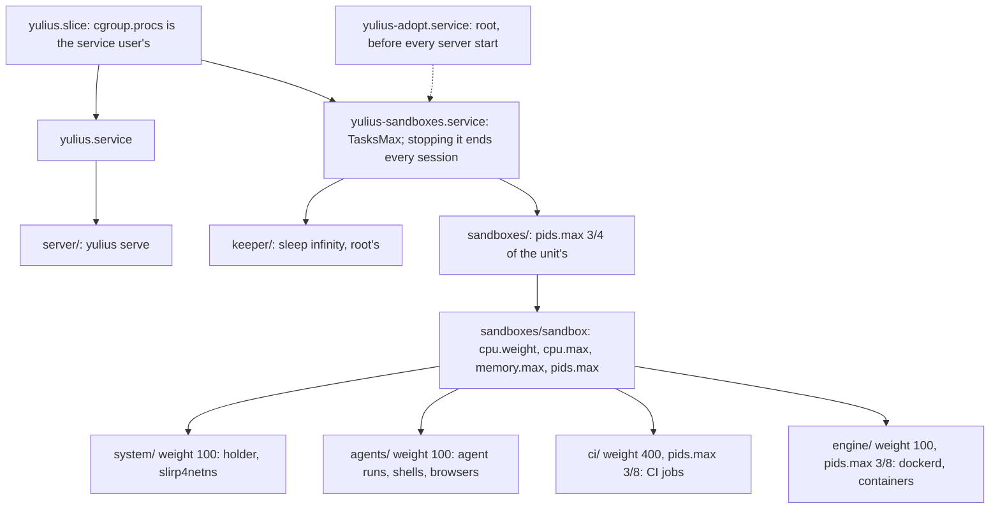
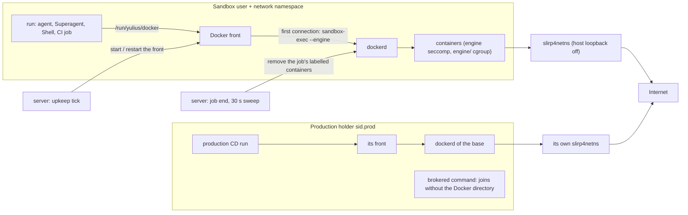
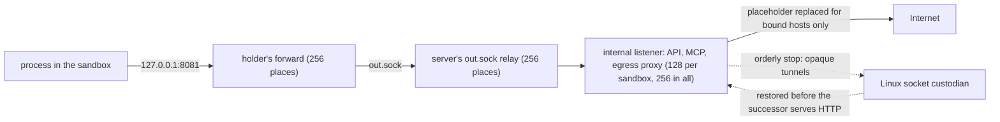
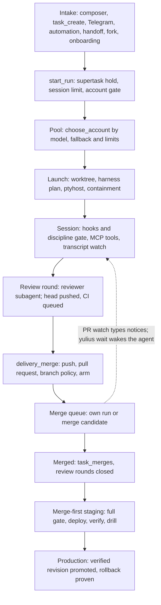
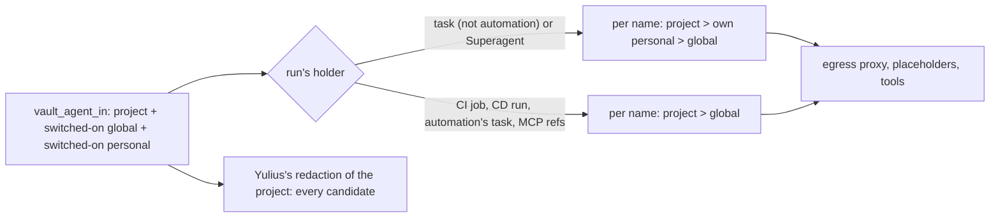

# Architecture

This document describes Yulius's components, its process and isolation model, how a task's work
flows from intake to merge and deploy, what is stored, and the invariants a structural change must
keep. Read it before such a change. Feature behaviour (what a person sees, UI details, messages) is
in [product.md](product.md). The feature-by-feature narrative this document replaced, with every
detail and decision citation, is kept in
[archive/architecture-until-2026-11-26.md](archive/architecture-until-2026-11-26.md); each area
below links its section there. Crate layering rules are in
[engineering/architecture.md](engineering/architecture.md), runtime contracts in
[engineering/runtime-contracts.md](engineering/runtime-contracts.md) and the decision records in
[decisions](decisions/README.md).

## Overview

One Rust binary, `yulius`, serves the web UI and API, supervises detached `ptyhost` processes that
own agent sessions inside per-sandbox containment, runs Yulius CI and Yulius CD, and talks to
GitHub, Anthropic, OpenAI, Google and Telegram. A sandbox is one project: a clone of its GitHub
repository (or of a playground's bare repository on the server), a worktree per task, a home, and a
namespace holder its runs join. Three agent harnesses run there: Claude Code (`claude`), Codex
(`codex`) and Antigravity (`agy`). Their adapters live in `yulius-harness`: each plans a run, reads
the harness's transcript or rollout and checks its sign-ins. Yulius provides the pinned Codex and
Antigravity CLIs and keeps Claude Code current in its data directory ([decision
0355](decisions/0355-codex-returns-as-a-second-harness-with-a-pinned-cli.md)).

The main parts of the server:

- **Application services** (`yulius-app`): tasks, the subscription pool, delivery and the merge
  queue, CI, CD, the vault, notices, the Superagents. It reaches everything else through ports.
- **Session supervisor**: places a run on a subscription, plans it through the harness adapter,
  starts it through a process host, watches its transcript and answers its hooks.
- **Yulius CI and CD runners**: run jobs and deploy scripts through the same process host, inside
  the sandbox's containment or its production holder.
- **Adapters**: `yulius-store` (SQLite), `yulius-ptyhost`, `yulius-sandbox` (containment, holders,
  cgroups), `yulius-harness`, `yulius-github`, `yulius-git`, `yulius-browser`, `yulius-egress`,
  `yulius-import`.

People reach Yulius through the web UI and the public API (browser sessions), the remote MCP and the
`yulius` CLI (personal API tokens), and a linked Telegram chat. Agents reach it only through the
internal loopback listener, with a token per run.

## Layers and crates

Dependencies point inward: interface, composition and adapters depend on application, which depends
on domain and contracts. `scripts/check_repository.py` enforces this.

| Layer | Crates |
| --- | --- |
| domain | `yulius-domain` |
| contracts | `yulius-contracts` |
| application | `yulius-app` |
| adapter | `yulius-store`, `yulius-ptyhost`, `yulius-sandbox`, `yulius-harness`, `yulius-github`, `yulius-git`, `yulius-browser`, `yulius-egress`, `yulius-import` |
| interface | `yulius-server` (axum routes, embedded web UI in `web/`; its e2e mock backend `assets/mock.js` is left out, ADR-0206) |
| composition | `yulius` (configuration, wiring, subcommands) |
| tooling | `tools/` (fake agent, xtask) and `scripts/` (the gates, among them the macOS compile check with `zig_macos.py`, and `vidoc_scan.py`, the security scan that `yulius` embeds as `yulius security-scan`, switched on or off in `.config/vidoc.toml`) |

## Process and isolation model

### The server and its units

`yulius serve` runs as the service user, outside containment, in `yulius.service`. The sandboxes'
cgroups do not live in that unit: systemd 258 and later refuse to start a unit while a group below
it holds processes, so they live in the sessions unit `yulius-sandboxes.service`, in one slice with
the server, and the server can restart while sessions run. A root unit, `yulius-adopt.service`, runs
before every server start and moves what an earlier layout left in the server's unit. `yulius host
setup` writes all three; without them the server uses its own unit, and Restart and Update are
refused where the restart would fail ([decision
0298](decisions/0298-sessions-live-in-their-own-unit.md)). Updates and instance moves are run as
root by helpers that the server asks through request files in its data directory.

### Process hosts

Each task run is owned by a detached `yulius ptyhost`. The supervisor talks to it over a Unix socket
and reattaches after a server restart, so a restart or update is invisible to the session. The host
owns the PTY, starts the containment (`bwrap` from the host's own `PATH`, never the run's), reaps
the run's process tree and writes its resource use (`getrusage` of its children) to `exit.json`. CI
jobs, CD runs, environment runs, brokered commands and script watches run through the same host
(`ci_watch`), which enforces their time and disk bounds. The supervisor ends a disconnected run with
the identities its host recorded, and on Linux checks that the whole process exited before it
records a forced loss. A run directory keeps the markers a restarted server needs to continue (a
launch goal not yet confirmed, a typed first message pending, a person's possible draft, the last
answered Stop, the final screen).

### Sandbox containment and the namespace holder

There are three modes: a sandbox with a holder (the default), the fallback bubblewrap
(`YULIUS_ISOLATION=legacy` or missing prerequisites), and host mode. The holder is a process with
its own user, network and mount namespaces and its own `slirp4netns` (host loopback off). Agent
runs, Superagents, Shells, CI jobs, dev CD runs and script watches join it. A contained run (joined
or fallback) has its own PID namespace, a private tmpfs at `/`, `/tmp`, `/run` and `/dev/shm`
(`/tmp` is 1 GiB) and the sandbox directory mounted read-write; a run that joined a holder also gets
the run seccomp filter, the fallback has none. The process host makes a run-owned directory inside
the sandbox's disk quota for disposable builds and reclaims it when the run ends. A run's own processes end with the run. A
process in the sandbox reaches Yulius at `127.0.0.1:8081`, the holder's forward to the server's
`out.sock` relay. An agent run without containment (host mode) runs as the service user on the host.
Removing a sandbox retires its holder: a `retired` marker makes `prepare` refuse it, and the upkeep
stops the holder with its engine, containers and egress once no run holds a lease.

CPU, tasks and memory are shared through the cgroups above. CI jobs weigh four times the agents in
their sandbox, and a sandbox running jobs weighs 100 plus 100 per CPU its jobs hold (at least 500,
at most 10,000) among the sandboxes. CI jobs are admitted from one instance-wide CI budget by what
CI really uses within a bounded worst case. Six limits (live sessions, CI jobs, CI runs per sandbox,
sandbox memory, disk quota, CD run disk) are sized from the host unless Settings or the unit pin
them.

### Containers

Each sandbox has its own Docker engine ([decision
0151](decisions/0151-a-sandbox-runs-its-own-docker-engine-under-an-engine-seccomp-profile.md)). A
Docker front beside every live holder serves `<state>/docker/docker.sock`; runs bind that directory
at `/run/yulius/docker`. The first connection starts `dockerd` as root of the sandbox's user
namespace, in its network, under an engine seccomp profile, in the `engine/` cgroup. The front
admits through 256 places, labels the containers and networks a CI job creates
(`yulius.ci.job=<id>`, read from the caller's cgroup) and copies every other caller's bytes. A job's
end and a 30 s sweep remove its labelled containers and networks. The engine stops when idle; disk
pressure prunes only a running engine.

Production-stage CD runs never use the sandbox's engine; brokered commands join the same production
holder without its Docker directory. Each sandbox has a
second holder, `<sid>.prod`, with its own namespaces, `slirp4netns`, cgroup, system layer over the
current base and engine storage; its runs join it on the host's read-only system, and nothing of the
sandbox directory is bound in ([decision
0208](decisions/0208-production-cd-runs-use-a-production-holder-with-its-own-docker-engine.md)).

### The egress proxy and the relays

The egress proxy is part of the server's internal listener. Agent runs, Superagents, granted CI jobs
and script watches with secrets get proxy variables, a CA bundle and a placeholder per agent secret;
the proxy replaces a placeholder with its value only toward the secret's bound hosts (and only for
requests its method and path rules allow), audits each use and redacts the responses. It intercepts
HTTP/1.1; gRPC (HTTP/2) to a bound host is not proxied. It asks on every request whether the
client's run still lives (an agent run's attempt, a CI job's credential, a Superagent's shell), so
an ended run gets 403. Places are bounded: the holder's forward and `out.sock` hold 256 connections,
the proxy 128 per sandbox and 256 in all; at a limit the longest-idle connection (idle 5 minutes or
more) gives way, then the busiest run's oldest, and a plain `http://` request waits at most 5
minutes for its response head. A refusal that remains is a connection trouble shown once. On an
orderly Linux shutdown, established opaque CONNECT tunnels are handed to the next server through
`sandbox-host hold-tunnels`, started from the departing server's own image, with a two-minute
deadline; intercepted connections close at restart.

### The sandbox browser

Each sandbox's Chromium runs outside containment (on Xvfb) and speaks DevTools only over the pipe
Yulius gives it at spawn (fds 3 and 4); it opens no DevTools socket, and no contained run can see
its process ([decision 0191](decisions/0191-the-sandbox-browser-speaks-devtools-over-a-pipe.md)).
Agents and the Superagents drive it through Yulius's `browser_*` tools, viewers through the viewer
WebSocket. Chrome is on the host's network, so it goes out only through a proxy listener of its own,
which the egress proxy serves as that sandbox's browser: it connects where the sandbox could (plus
its dev-server ports), and never intercepts, injects or redacts; without it no browser starts. A
viewer's X input reaches Chrome only while the host's managed policy is in force. A secret is typed
only into a page of one of its hosts, and a screenshot is refused while a page shows one.

### Other isolated processes

- **Sign-ins** (`claude setup-token`, `codex login --device-auth`, the Antigravity TUI) run on the
  host in a server-owned PTY with a fixed argv, new empty home folders and input from instance
  administrators only; Claude Code's raw output is one allocation, zeroed once the token is
  extracted, while Codex and Antigravity leave a file in the new home and print no token.
- **The Global Superagent** runs `claude` with no built-in tools, no MCP server but Yulius, no
  hooks, no settings file, a refusing `no-shell` script as its shell and editor, no agent secret and
  no egress proxy, in a bubblewrap namespace whose only writable root is its own folder.
- **Brokered commands** run in the production holder with a fresh home and a temporary key file
  (0600), without Docker ([decision
  0459](decisions/0459-brokered-commands-run-in-the-production-holder-with-a-temporary-key-file.md)).
- **Script watches** run in bubblewrap joined to the holder in CI's cgroup, under `ulimit` bounds.

### Host access to sandbox folders and the host's Git

A sandbox's directory is writable by its runs, so an agent can swap any folder for a link at any
moment. Wherever the server reads or writes there (editor, uploads, transcripts, skill copies, CI
logs and checkouts, worktree removal, `.env` copies, agent states), it opens folders one at a time
from an anchor it made, with `O_NOFOLLOW`, and works through the handles: new names with `O_EXCL`
and a rename within the handle, removals handle by handle ([decision
0174](decisions/0174-host-access-to-agent-owned-folders-goes-through-handles.md)). Where Git would
follow links (an import's snapshot, a server-made commit), the work moves to a server-private folder
(`<data>/import-worktrees`, `<data>/changes`). Every command of the Git adapter runs through `yulius
git-confined` (Landlock): it may execute Git's own programs only and touch only the folders the
command works in ([decision 0322](decisions/0322-the-hosts-own-git-runs-confined.md)). Transfers
with GitHub, which carry the server's token, are made by a courier repository in
`<data>/git-couriers` on the clone's objects, never in the clone ([decision
0323](decisions/0323-a-transfer-with-the-servers-token-is-made-in-a-repository-of-the-servers-own.md)).

### Harness memory and instructions

Every contained session sees its harness's persistent memory and user-level instruction files
read-only (Claude Code's project memory, `CLAUDE.md` and `rules`; Codex's `AGENTS.md` and
`memories`; Antigravity's `GEMINI.md` and rules). The process host starts bwrap through `yulius
sandbox-exec --guard`, which opens each path from its anchor refusing every link and passes
read-only binds by descriptor ([decision
0479](decisions/0479-harness-memory-is-read-only-in-every-session-yulius-starts.md)).

### Invariants

- **Bounds.** Every queue, table and buffer has a limit: Docker front places (256), relay and proxy
  places, the sandboxes' share of tasks (3/4 of the service's, CI and the engine 3/8 each of a
  sandbox's), the CI budget, the disk quota and CD run disk bound, a command's output (stopped past
  16 MiB, stored cut to 96 KiB), runs at once (4 brokered commands per project, 4 script watches on
  the instance), a reference copy (1 GiB), an agent state (64 MiB packed), MCP texts served to
  Claude Code (4096 characters), remote MCP calls (120 a minute).
- **Cancellation.** A stop always takes effect: status changes are compare-and-sets retried from a
  fresh read in bounded rounds, and a stop that arrives while a run launches is applied when it
  attaches. Starts of shells, CD runs and environment runs run detached from the request, so a
  client that goes away leaves no half-started process. A cancelled update build kills cargo's
  process group within about a second.
- **Reaping.** A shell is recorded as ended only once it exited or its host was terminated. An idle
  task's stray processes (adopted by the sandbox's init) are killed after 2 hours, each only while
  its pid keeps the recorded start time. Leftovers under the data directory are deleted one item at
  a time after a guard checks the rule again (sandbox removed 10 minutes, nothing runs, holder
  stopped). A starting server records runs, command runs and watch runs it did not see end as lost.
- **Secrets.** An agent never holds a secret's value: it gets a placeholder, and the proxy sends the
  value only toward bound hosts. A production secret reaches no run. Values are redacted from
  terminals, transcripts, MCP results, and CD and command output; when redaction cannot load, output
  is withheld. Credentials and keys are sealed in the database; a pasted token is never echoed,
  logged or audited, and the CLI's secret values never reach its output. The server's GitHub token
  never enters a sandbox's folder, the agent never holds a person's token, and the agent's own token
  cannot write the production branch. Yulius writes a key into a worktree only as a Git-ignored,
  untracked `.env` (0600); `.env.example` names keys without values.

## Data flow of a task

### Intake and creation

A task is created by New task in the web UI (files uploaded to the sandbox's drafts folder, each
kept in place in the prompt), by `task_create` from a task's agent, a Superagent or the remote MCP,
by a Telegram message, by an automation run, by a handoff from another sandbox, by a fork, or by
onboarding and imports. The tools, Telegram, handoffs and automations create through New task's own
path (`create_task_as`, `create_task_ruled`). A task's owner is its creator until control moves; the
owner's GitHub token, commit identity and authority are the task's. Its harness is fixed at
creation. A task can wait `prepared` (for a person or a time) or `chained` (after a task or a rule)
before it is queued; each of these moves is a compare-and-set.

### Start and launch

Every run starts through `App::start_run`: a new task, the queue, a released chain or rule, Start
now, Continue and the capacity loop. It applies the supertask hold, then the session limit; a start
that must wait is stored with the task (`tasks.queued_start`). A person's start needs a usable
subscription. The pool places the run (`choose_account`): a subscription of the task's provider that
can run its model, else the model's fallback (Opus 5.5 for a Fable model), else the task waits for
the earliest reset. The run records the model it was launched with, and limits bind that model.

The launch prepares the worktree, the harness home or config dir (trust, settings, plugin language
servers off, guarded memory), the sandbox's skills and MCP servers, and starts the harness through
the process host. A goal task is launched with `/goal <condition>` as the prompt argument; a prompt
task's first message is its prompt, or is typed when it carries images. Yulius's rules reach the
agent in the SessionStart briefing. A usage limit moves the session to another subscription by
resume, past the cut turn, or pauses it until the reset; nothing is typed.

### Hooks, MCP and the discipline gate

The harness's hooks run `yulius hook <harness> <event>` in the sandbox, which posts to the internal
API. The hook client fails open after 5 s, and a received hook is still applied to its end. A task's
MCP server is the stdio bridge `yulius mcp`, which lives as long as the session and resends a call
Yulius never read for up to 10 minutes, so a server restart does not cut the session's tools
([decision
0244](decisions/0244-task-runs-reach-yulius-through-a-stdio-bridge-and-are-woken-after-an-outage.md)).
The discipline gate answers from the task's workflow, the worktree's Git state and the spec file:
the Stop hook blocks a task that needs a spec while it is missing or invalid (at most three times),
and `PreToolUse` denies an edit of a non-documentation file until the spec has a Plan item. Bash
calls are checked in the sandbox and never sent.

### Steps, activity and Done

The agent keeps a plan of steps; declared work is the plan's open steps and the spec's status, which
Yulius stores with the task. Activity is derived from the harness's own records: hooks, the
transcript's turn records, and the process probe for background shells. A task is Done through an
achieved goal or a tested pull request with no declared work left, and never while Yulius has pull
request news for it. An idle task with nothing going on is parked after a grace period: its session
ends, it holds no session slot, and its worktree, claims and delivery stay until it is resumed.

### Review

The independent review runs as a reviewer subagent Yulius defines at every launch. The Agent tool's
`PreToolUse` reaches `App::review_gate`, which numbers the round among the rounds of the task's open
pull request, picks the reviewer's model and records it in `review_rounds`. The same start pushes
the head and queues its Yulius CI run, so CI tests it while the reviewer reads. `SubagentStop` (or
the harness's completion record when a hook was lost) ends the round with its verdict.

### Delivery and the merge queue

`delivery_merge` delivers the head as a clean turn's end does (push, open or update the pull
request), checks the title, head and base against the branch policy in `yulius.toml`, and arms the
merge for the reviewed head. Every sandbox's armed merges go through one queue ([decision
0285](decisions/0285-armed-pull-requests-merge-through-a-queue-that-never-restarts-a-run.md)). A
pass runs per sandbox at a time: a pull request whose own run passed and that is up to date merges
now; one that is behind joins the next merge candidate (the integration branch with up to 8 such
pull requests merged in, tested by one run), and a failed candidate is bisected. A pull request's
own run always finishes; the queue never restarts it. Every merge goes through the GitHub adapter's
`merge_pull`. The merge is recorded in one transaction with the task, pull request, accepted head,
integration branch and landed commit (`task_merges`), and the pull request's review rounds close
there. Work committed after a merge starts a new pull request of the same task.

A red after-merge gate stops the queue ([decision
0482](decisions/0482-a-red-after-merge-gate-stops-the-merge-queue.md), `merge_stop.rs`). This is
`[merge_queue] stop_on_red_gate`, on by default beside a merge-first staging target. The queue
stops while the gate history at the integration head has an open failure that is not a
quarantined test. The state is read at most every 15 s per project. While it is stopped:

- the armed-merge pass and `delivery_merge` keep every other merge armed, with a note naming the
  failures;
- a merge candidate forms only from repairs, and one under test is dissolved (`gate_red`);
- the repair assignment prefers the task whose merge brought the failure in.

A repair is marked with `delivery_merge`'s `repairs_gate`, or its task's merge brought an open
failure in. The next pass after a green verdict merges as before.

The GitHub adapter
keeps GitHub's availability apart from task state: during an outage, task displays use the recorded
delivery and pull observations, and display reads are shared per credential and revalidated with
ETags.

The agent does not poll: it waits with `yulius wait` in a background shell (a long poll), and the
pull request watch types what happens to an open pull request into the session every 20 s, as one
bracketed paste, never over a person's possible draft or a question on screen. Each event has a key,
typed once (`<data>/pr-notices.json`).

### CI

The gate in force comes from `yulius.toml` at the integration head (or the newest valid ancestor);
every commit on its way is judged by it, with its own changed jobs beside, never instead. A pull
request from a fork is never tested. A job's `paths` decide skips at queue time. A job waits for its
exclusive turn, Docker network room, the CI budget and a slot; its time limit starts with its
process. Its exit decides its state (0 passed, 78 skipped, 75 incomplete is an error, others
failed); an infrastructure failure runs again once. A failed job cancels the others except
`security`. The commit status is published when the run is queued, starts, progresses and ends.

### CD, staging and production

CD reads `[cd.<name>]` only at the heads of the protected branches, from a mirror only Yulius writes
(every object checked), and runs the commit's tree in the run's own directory. A dev-stage run runs
in the sandbox's containment, a production-stage run in the production holder; each gets the secrets
allowed for that environment and the project's variables. Dev deploys are open to people with write
access and agents; production only to an administrator who typed the project's slug. A project's
shared staging target is the dev-stage environment with `merge_first = true`; it changes only
through its queue of tested merged revisions: the full gate judges a revision, the newest ready one
deploys, a failed deploy is restored ([decision
0410](decisions/0410-the-full-suite-runs-on-the-merged-revision-beside-a-merge-first-staging-target.md)).
A passed dev deploy starts a rollback drill, and a production deploy needs a passed drill for its
tree. A production deploy promotes the verified staging revision into the production branch; GitHub
refuses the agents' token on that branch. A deploy has no retry, except the staging queue's retries
of a lost or errored run.

Yulius's own `[cd.dev]` deploys to a staging VM. Its production is a promotion of `dev` to `main`,
which each instance installs through its update helper; an update freezes every task's cgroup,
restarts the service and thaws them one by one.

### Across a restart

The server writes `<data>/alive-at` every 30 s. At start it reconciles runs (reattaches live process
hosts, ends lost ones), restores armed merges and tries them once, restores the Superagents'
requests and checks, and types "Yulius is back; continue" once into each idle task whose turn closed
during the outage with a Stop it did not answer. A session whose Yulius MCP is known to be gone gets
`/mcp reconnect yulius` typed. Runs that ended while the server was down are counted from their
transcripts.

## Storage and durability

Persistence is SQLite in WAL mode, changed through numbered migrations. State changes that can race
are compare-and-sets from the state they were decided on. Spans that follow a state are written by
SQLite triggers in the same transaction as the state change. What the database holds:

- tasks, attempts (runs) and their metrics, steps, review rounds, deliveries and `task_merges`;
- subscriptions (`accounts`, sealed credentials, usage), `account_billing`;
- CI runs, jobs, kept failures, quarantines, CI minutes and load; CD runs and kept releases
  (`cd_releases` outlives the runs' 14 days); staging requests; spans (180 days);
- the vault (sealed agent and team secrets, rules, requests, agent states), project variables,
  commands and command runs, watches and their outbox, notices, Telegram links and sent messages,
  digests, the instance row (sealed bot, Jev and Vidoc keys, limits, switches), the audit log.

Durable files beside it: `pr-notices.json`, `superagent-requests.json`, `superagent-checks.json`,
the armed merges' file, `alive-at`, `leftovers-cli.key`, each shell's `shell.json` and `scrub.json`,
and each run directory's markers and `final-screen`. The data directory also holds the sandboxes
(`sandboxes/`, `sysroots/`, `runtime/`), CD run files (`cd/<sid>/runs`), playground origins, Git
couriers, the provided CLIs and the extracted skills.

Kept in memory only, and lost by a restart: armed-merge outcomes for waits, the context-recovery
episode, blind-limit counts, a rebalance's no-room notice, the PR watch's last answers, the hygiene
report, CI's exclusive turns, production waits for a drill, agent-state holds and the GitHub
callback answer. Nothing about an instance move in progress is stored in the database, since the
database travels with the copy.

## Agent secret hosts

An agent secret is used only on the hosts it is bound to; it starts bound to nothing, and the agent
proposes a host with `secret_request_hosts`. A secret with `auto_allow` ("Let agents set it up", the
default for new secrets) binds the proposed hosts at once (audited with the asking task) and goes to
production CD runs. Without it the request waits on the secret until a person who manages it allows
it, so an agent misled by injected content cannot send the value elsewhere. A production secret is
given only through the production-only allowance (`cd_prod`), which excludes `auto_allow`, `.env`
copies and bound hosts; the store's compare-and-sets refuse the pair, and no row of a production
secret has hosts, so no run gets it ([decision
0324](decisions/0324-a-production-secret-reaches-no-run-and-has-no-hosts.md)).

- **Method and path rules** (`vault_secrets.rules`, 0 to 32 rules of methods and a `*` path pattern)
  are matched in the egress policy against the path as sent and as it goes out, with no decoding; a
  request they do not allow gets 403 and nothing is sent. Hosts asked for a secret with rules always
  wait for a person.
- **Copies of production secrets**: an agent asks with `secret_request_copy`; a person who manages
  the secret allows it after a fresh two-factor unlock, and the store removes the request and
  inserts the copy (an ordinary project secret, `auto_allow` off) in one transaction.
- **Widening** a secret allowed use by use (a new host, `.env` copies, production, switching
  `auto_allow` on) needs the same fresh unlock; an API token is refused.
- Team secrets belong to one sandbox or are team-wide; a sandbox's are visible only to its viewers.

Details: [Agent secret hosts](archive/architecture-until-2026-11-26.md#agent-secret-hosts), [Method
and path rules](archive/architecture-until-2026-11-26.md#method-and-path-rules), [Copies of
production secrets](archive/architecture-until-2026-11-26.md#copies-of-production-secrets).

## Agent secret scopes

An agent secret is a project's (`sandbox_id`), global (no sandbox, no owner) or personal
(`owner_id`, removed with its user); `vault_enabled` switches a global or personal secret on for a
project ([decision 0186](decisions/0186-agent-secrets-are-project-global-or-personal.md)).
`vault/reach.rs` resolves one per name for a run's holder: project, then personal (only the holder's
own), then global, then the instance Vidoc key. A task's holder is its owner unless an automation
started it; the Superagent's is its person; CI jobs, CD runs and MCP references hold nobody. The
proxy reads an agent run's current holder on every request, so a hand-over applies to connections
opened before it. A personal secret is never copied to `.env`, resolved in MCP references, typed
into a page or given to production. Yulius's own redaction covers every candidate of a project; a
run's fingerprint file covers only its holder's values that can be in its sandbox. A project may get
at most 200 secrets, counted in the transaction that adds or switches one on.

Details: [Agent secret scopes](archive/architecture-until-2026-11-26.md#agent-secret-scopes).

## Vidoc: the instance key and the security scan

Vidoc is an optional instance service. A superadmin saves its key (sealed in the `instance` row, or
read from `YULIUS_VIDOC_API_KEY_FILE` while nothing is saved). The vault adds it as the virtual
agent secret `VIDOC_API_KEY`, bound to `model.vidocsecurity.com` only, for every run that gets no
agent secret of that name; the egress proxy injects, audits (`instance:vidoc`) and redacts it. MCP
references, `.env` copies and browser filling never resolve it.

- **The scan** runs where the code is: `scripts/vidoc_scan.py`, embedded as `yulius security-scan`,
  sends `HEAD`'s tree in chunks and fails on open critical or high findings, and on medium ones in
  the changed lines. Exit 2 means not run, exit 3 incomplete (in CI the incomplete code, which makes
  the job an error).
- **The pipeline**: CI adds the built-in `security` job when the sandbox's applied secrets have the
  key and its CI does not scan already. It is granted `VIDOC_API_KEY` and neither cancels nor is
  cancelled by other jobs. Its findings file, reopen and close GitHub issues by fingerprint.
- **Switches**: a project's switch (`vidoc: false` in its profile, which the sandbox's admins flip on
  its CI/CD page) and the superadmin's instance switch turn scans off: runs get `YULIUS_VIDOC=off`, the key is not applied, no built-in job is
  added, and the proxy refuses `model.vidocsecurity.com` (403, nothing sent; 503 when it cannot read
  the switch).

Details:
[Vidoc](archive/architecture-until-2026-11-26.md#vidoc-the-instance-key-and-the-security-scan),
[Agent secrets in CI jobs](archive/architecture-until-2026-11-26.md#agent-secrets-in-ci-jobs).

## Other areas

Each entry names the component that owns the area and the invariants that matter. The archive
section holds the details.

### Harnesses and subscriptions

- **Codex.** The supervisor runs a Codex task in `CODEX_HOME=<sandbox>/codex/<account>`, writing
  `auth.json`, `config.toml` and `hooks.json` through handles that follow no link; a refreshed
  `auth.json` returns to the vault. Codex moves only between Codex accounts.
  [details](archive/architecture-until-2026-11-26.md#codex)
- **Codex and Antigravity CLIs.** One installer (`wiring/pinned_cli.rs`) downloads each pinned
  release once, checks its sha512 and unpacks it into the data directory; runs bind it read-only.
  [details](archive/architecture-until-2026-11-26.md#codex-and-antigravity-clis)
- **Claude Code updates.** The server's updater installs a newer platform binary under
  `<data>/claude-code` after sha512, ELF, version and default-model checks, never running it, and
  switches `current` atomically. A running session moves to it by resume at a turn's end, unless a
  goal, a possible draft, Claude Code's queue or another restart keeps it.
  [details](archive/architecture-until-2026-11-26.md#claude-code-updates)
- **Connecting a subscription.** Sign-ins run on the host (see above); tokens and credential files
  are read without following links and sealed. A pasted token is checked once against Claude's
  profile and never echoed, logged or audited.
  [details](archive/architecture-until-2026-11-26.md#connecting-a-subscription)
- **Usage limits.** The harness adapter steps the transcript back over a limit (through handles),
  and the session resumes past it on another subscription or after the reset. Workflow agents'
  limits are read from their own transcripts.
  [details](archive/architecture-until-2026-11-26.md#usage-limits),
  [workflows](archive/architecture-until-2026-11-26.md#a-limit-met-while-a-dynamic-workflow-runs)
- **What a limit binds.** A limit binds the subscription or one model family (`LimitScope`). Every
  usage write goes through one helper under one lock (`App::change_account_usage`), never held
  across a provider request; a reset is believed at most a week and a day ahead.
  [details](archive/architecture-until-2026-11-26.md#what-a-limit-binds)
- **The fallback model.** The pool decides the model at each placement; a run records its launched
  model (`attempts.model`). Refusals of a model with no known end are bounded per task, in memory.
  [details](archive/architecture-until-2026-11-26.md#the-fallback-model)
- **Asking Claude about a stored limit.** Refresh sends one one-token request per stored limit,
  applied under the usage lock only while the sign-in and limit are unchanged, within 25 s.
  [details](archive/architecture-until-2026-11-26.md#asking-claude-about-a-stored-limit)
- **Moving a task off its subscription.** `App::move_task` handles a person's switch, a removal (the
  row is deleted first) and a refusal; the rebalance pass moves idle tasks every 2 minutes off a
  subscription past its harness's threshold, never a pinned task.
  [details](archive/architecture-until-2026-11-26.md#moving-a-task-off-its-subscription)
- **Subscription names, emails and charge dates.** The email comes from Claude's profile unless an
  administrator types it, settled in one SQL statement; only administrators see it. Charge dates are
  their own table, which credential writes never touch.
  [names](archive/architecture-until-2026-11-26.md#subscription-names-and-emails), [charge
  dates](archive/architecture-until-2026-11-26.md#subscription-charge-dates)
- **Harness comparison.** The Dashboard counts tasks by assigned harness and tokens by the run's
  executing harness. [details](archive/architecture-until-2026-11-26.md#harness-comparison)

### Sessions

- **Task start.** Launch markers in the run directory let a restarted server watch a goal or first
  message again. A message queued before the start is appended to the request by one conditional
  update before the compare-and-set to `starting`.
  [details](archive/architecture-until-2026-11-26.md#task-start)
- **Goal retries after an API error.** Claude Code owns the retry and Yulius types nothing; a
  request Yulius opens for such a pause ends when the agent works again.
  [details](archive/architecture-until-2026-11-26.md#goal-retries-after-an-api-error)
- **Full context.** The supervisor keeps one recovery episode per task (compact, then a fresh
  session with a handoff, then ask a person).
  [details](archive/architecture-until-2026-11-26.md#full-context)
- **Onboarding repair.** A sandbox waits `pending` or `preparing` until its onboarding task made it
  ready; each change is a compare-and-set, repaired at every start.
  [details](archive/architecture-until-2026-11-26.md#onboarding-repair)
- **Parked sessions.** The background tick parks an idle task after `YULIUS_PARK_AFTER_MINUTES`
  (default 30) once `ParkFacts` hold; a resume checks under the launch lock that the same attempt is
  still parked. The end-of-day digest runs from the same tick.
  [details](archive/architecture-until-2026-11-26.md#parked-sessions)
- **Supertasks, prepared tasks, start changes, forks.** Holds apply in `start_run`; status, chain
  and start time change in one transaction guarded by the status read; a fork only reads its source
  and resumes a stored copy of its session.
  [supertasks](archive/architecture-until-2026-11-26.md#supertasks),
  [prepared](archive/architecture-until-2026-11-26.md#prepared-tasks), [start
  changes](archive/architecture-until-2026-11-26.md#changing-how-a-waiting-task-starts),
  [forks](archive/architecture-until-2026-11-26.md#forked-tasks)
- **A task's own files.** `yulius remove` runs in the task's own run and removes only untracked or
  ignored paths of its worktree or its run's tmpfs, never a mount point.
  [details](archive/architecture-until-2026-11-26.md#a-tasks-own-files)
- **Task status.** Activity follows the harness's own records; a `needs_attention` flag keeps its
  reason in `tasks.attention`; the server's `AttentionFacts::group` and the web UI apply one rule.
  The hub writes a run's output only while it shows that run.
  [details](archive/architecture-until-2026-11-26.md#task-status)
- **Run metrics.** One accumulator in `yulius-harness` counts tokens, turns and time from the
  transcripts, live and again after a restart.
  [details](archive/architecture-until-2026-11-26.md#run-metrics)
- **Terminal input.** Input rides a write grant checked against the store's access epoch; the socket
  loop never awaits a permission check.
  [details](archive/architecture-until-2026-11-26.md#terminal-input)
- **Task ownership.** `yulius_domain::task_access` decides view, tidy, control and answer in one
  place; nothing else compares a task's owner.
  [details](archive/architecture-until-2026-11-26.md#task-ownership)
- **Parallel tasks at merge.** Numbered files take their number from `record_number`; append-only
  logs merge by union from Yulius's block in the clone's `info/attributes`.
  [details](archive/architecture-until-2026-11-26.md#parallel-tasks-at-merge)
- **Handoffs between sandboxes.** An instance switch and a sandbox opt-out gate `sandbox_handoff`;
  rows in `task_handoffs` carry chain and depth.
  [details](archive/architecture-until-2026-11-26.md#handoffs-between-sandboxes)
- **Discipline gate, review, feedback.** Covered above.
  [gate](archive/architecture-until-2026-11-26.md#the-discipline-gate),
  [review](archive/architecture-until-2026-11-26.md#the-reviews-rounds-and-models),
  [feedback](archive/architecture-until-2026-11-26.md#agent-feedback), [merge
  queue](archive/architecture-until-2026-11-26.md#the-merge-queue),
  [notices](archive/architecture-until-2026-11-26.md#pull-request-notices),
  [restart](archive/architecture-until-2026-11-26.md#across-a-yulius-restart)

### Superagents and remote control

- **Superagent (the Cockpit).** One `claude` shell of kind `cockpit` per person and sandbox, with a
  `ck_` bearer. Its person tools run the function a page's route calls with the person's rights at
  the call; actions in other sandboxes and production releases wait for the person's answer from a
  browser session. [details](archive/architecture-until-2026-11-26.md#superagent-the-cockpit)
- **The Global Superagent.** Its `gs_` bearer reaches the remote MCP as its person, without
  `WITHHELD_TOOLS` (the vault and variables, `cd_deploy`, project import, onboarding).
  [details](archive/architecture-until-2026-11-26.md#the-global-superagent)
- **MCP server scopes.** One server per name by rank for the run's holder; secret values reach a run
  only as `YULIUS_MCP_<SERVER>_<VAR>`; servers imported from `.mcp.json` are never started by the
  host's Test. [details](archive/architecture-until-2026-11-26.md#mcp-server-scopes)
- **Remote control.** Personal API tokens (`operate` or `read`, stored hashed) reach the same tools;
  file changes are committed in a fresh clone outside every sandbox and merged through a tested pull
  request. [details](archive/architecture-until-2026-11-26.md#remote-control)

### Secrets, values and commands

- **Brokered commands.** Definitions bind a secret by id; runs are rows of `command_runs`, checked
  again at start, redacted, and lost at a restart; an approval is one conditional write before the
  deadline, and no answer is a no.
  [details](archive/architecture-until-2026-11-26.md#brokered-commands)
- **Agent secrets in CI jobs.** A job's grant is read from the integration head in the CD mirror,
  never from the pull request's `yulius.toml`, and binds the job's command.
  [details](archive/architecture-until-2026-11-26.md#agent-secrets-in-ci-jobs)
- **Keys in .env.** `secret_copy_to_env` checks that the file is ignored and untracked, then writes
  it whole (0600). [details](archive/architecture-until-2026-11-26.md#keys-in-env)
- **Agent states.** Sealed archives with one writer; saves are compare-and-sets on the version; CD
  runs restore and save them under one hold.
  [details](archive/architecture-until-2026-11-26.md#agent-states)
- **Project variables.** Plain rows, neither sealed nor redacted; a production run gets only those
  its table names. [details](archive/architecture-until-2026-11-26.md#project-variables)

### Notifications

- **Telegram.** `NotificationChannel` is the port; the notifier applies the event stream's
  `envelope_reaches`, a throttle and redaction; intake runs one worker per chat.
  [details](archive/architecture-until-2026-11-26.md#the-personal-telegram-channel)
- **Notices.** `App::post_notice` replaces by project, recipient and key in one transaction and
  keeps 200 per scope.
  [details](archive/architecture-until-2026-11-26.md#notices-a-key-and-an-expiry)
- **Script watches.** `App::watch_tick` claims one run per watch in the store; posts go through an
  outbox in the run's transaction.
  [details](archive/architecture-until-2026-11-26.md#script-watches)

### CI and resources

- **Which jobs judge a commit.** `yulius.toml` is parsed as TOML 1.1; an invalid file never turns CI
  off. [details](archive/architecture-until-2026-11-26.md#which-jobs-judge-a-commit)
- **CI job output, waits, states.** The last 512 KiB of output and every failing test's block are
  kept; a job's limit counts only its own run; skipped counts as passed in a run's state.
  [output](archive/architecture-until-2026-11-26.md#ci-job-output),
  [waits](archive/architecture-until-2026-11-26.md#ci-job-waits-and-time-limits),
  [states](archive/architecture-until-2026-11-26.md#ci-job-states)
- **Stages.** Every stage of a task, CI run and CD run is a row of `spans`; nothing outside Yulius
  writes one. [details](archive/architecture-until-2026-11-26.md#stages)
- **CPU, resource limits, disk.** Cgroup weights and task budgets as above; limits are pure
  functions in `yulius_domain::limits`; a CI run over the disk quota waits in the queue.
  [CPU](archive/architecture-until-2026-11-26.md#cpu),
  [limits](archive/architecture-until-2026-11-26.md#resource-limits),
  [disk](archive/architecture-until-2026-11-26.md#disk),
  [containers](archive/architecture-until-2026-11-26.md#containers)
- **Sandbox browser, host access, memory.** Covered above.
  [browser](archive/architecture-until-2026-11-26.md#sandbox-browser-devtools), [host
  access](archive/architecture-until-2026-11-26.md#host-access-to-agent-owned-folders),
  [memory](archive/architecture-until-2026-11-26.md#harness-memory-is-read-only)

### CD

- **CD (deployment), staging, rollback.** Covered above.
  [CD](archive/architecture-until-2026-11-26.md#cd-deployment),
  [staging](archive/architecture-until-2026-11-26.md#merge-first-staging), [bootstrap
  default](archive/architecture-until-2026-11-26.md#merge-first-as-the-bootstrap-default), [Yulius's
  staging](archive/architecture-until-2026-11-26.md#yuliuss-own-staging),
  [rollback](archive/architecture-until-2026-11-26.md#rollback)
- **Playgrounds.** A playground's `origin` is a bare repository on the server outside the sandbox,
  fetched and pushed by path; guests get write on that playground only, and its runs no agent secret
  once one joined. Hygiene, leftovers and build-cache sweeps are described in the same section.
  [details](archive/architecture-until-2026-11-26.md#playgrounds)

### Web UI and team tools

- **Web UI state.** Plain ES modules; server state from the API and `WS /api/events`; only one
  browser's needs in `localStorage`.
  [details](archive/architecture-until-2026-11-26.md#web-ui-state)
- **Notes and the Editor.** Saves are compare-and-sets on the revision; presence is relayed, not
  stored; live documents are kept in memory per path.
  [details](archive/architecture-until-2026-11-26.md#notes)
- **Automations.** Each has an immutable creator checked before saves and runs; runs create tasks
  through `create_task_ruled`.
  [catalog](archive/architecture-until-2026-11-26.md#ready-made-automations),
  [starts](archive/architecture-until-2026-11-26.md#how-an-automations-tasks-start)

### Instance operations

- **Updates.** A root helper builds and installs; tasks are frozen by cgroup, deploys are not, and
  the deploy gate holds new ones. [details](archive/architecture-until-2026-11-26.md#updates)
- **Instance export, import and moving.** Root commands outside Yulius freeze both units and stream
  a pax tar through `O_NOFOLLOW` handles; a move is a resumable checklist that never ends with both
  instances running. [export](archive/architecture-until-2026-11-26.md#instance-export-and-import),
  [moving](archive/architecture-until-2026-11-26.md#moving-an-instance)
- **Agent primitives.** Skills are APM primitives from `.apm/skills`; a server start refreshes every
  sandbox's skills. [details](archive/architecture-until-2026-11-26.md#agent-primitives)
- **Runtime.** Covered above (process hosts, harness launch).
  [details](archive/architecture-until-2026-11-26.md#runtime)
